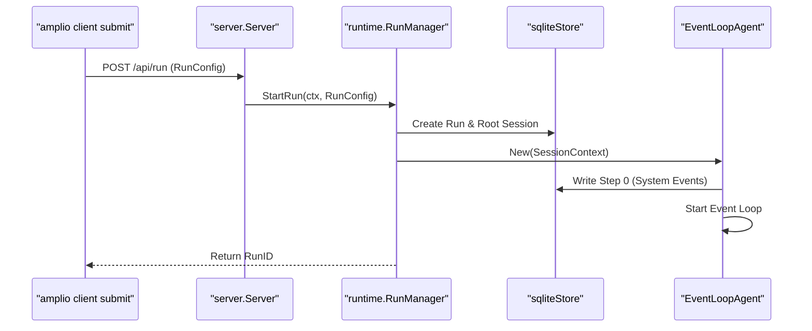

<!-- source: DeepWiki mcp.deepwiki.com · repo google-deepmind/amplio · page 1.1 Getting Started · fetched 2026-10-26 -->

# Getting Started

<details>
<summary>Relevant source files</summary>

The following files were used as context for generating this wiki page:

- [cmd/amplio/main.go](cmd/amplio/main.go)
- [cmd/amplio/serve.go](cmd/amplio/serve.go)
- [docs/guide/cli.md](docs/guide/cli.md)
- [docs/guide/configuration.md](docs/guide/configuration.md)
- [internal/config/config.go](internal/config/config.go)

</details>


Amplio is a DB-first agentic framework designed for long-horizon autonomous research runs. This page covers the initial setup, configuration, and execution of the Amplio environment.

## Installation and Building from Source

Amplio is implemented in Go and follows a standard Go project structure. The entry point for the CLI is located in `cmd/amplio/main.go` [cmd/amplio/main.go:17-44]().

### Prerequisites
- **Go 1.22+**
- **SQLite3** (with development headers for CGO)
- **Linux** (Recommended for full process monitoring features)

### Building the Binary
To build the Amplio CLI, run the following from the repository root:
```bash
go build ./cmd/amplio
```
This produces a single `amplio` binary capable of running as a server, a client, or in headless mode [docs/guide/cli.md:3-9]().

## Data Directory Layout

Everything Amplio manages—databases, logs, artifacts, and configuration—is contained within a single **Data Directory** [docs/guide/configuration.md:8-14](). By default, this is `~/.amplio`, but it can be overridden via the `--data-dir` flag or the `AMPLIO_DATA_DIR` environment variable [internal/config/config.go:118-131]().

### Directory Structure
| Path | Description |
| :--- | :--- |
| `config.toml` | User-defined settings and LLM specifications [docs/guide/configuration.md:93-93](). |
| `amplio.db` | The primary SQLite database containing all runs, sessions, and events [docs/guide/configuration.md:94-94](). |
| `artifacts/<run-id>/` | Working directories for agents, exposed via `$AMPLIO_ARTIFACT_DIR` [internal/config/config.go:153-155](). |
| `blobs/<run-id>/` | Storage for large tool outputs like images, kept outside the DB [internal/config/config.go:160-162](). |
| `bin/` | Contains `amplio` and `amplio-notify` shims prepended to agent `PATH` [internal/config/config.go:112-117](). |
| `server.json` | Metadata about the running server (PID, address, token) used by the client [docs/guide/configuration.md:101-101](). |
| `auth.token` | The generated secret for web UI authentication [docs/guide/configuration.md:34-34](). |

**Sources:** [internal/config/config.go:112-162](), [docs/guide/configuration.md:87-107]()

## Configuration (config.toml)

Amplio uses a layered configuration model where precedence is: **Flag > Environment Variable > config.toml > Default** [cmd/amplio/main.go:46-48]().

### Minimal Configuration
A `config.toml` file should be placed in the root of your data directory. At minimum, it requires system LLM specifications for internal operations like summarization and reporting.

```toml
# System-level LLMs
system_llm_hq   = "vertex-claude:claude-opus-4-8"
system_llm_fast = "vertex-claude:claude-sonnet-4-6"

# Required for skill/lesson search
embed_model     = "vertex:text-embedding-004"

[run]
# The first LLM in this list is the default for new runs
llms = ["vertex-claude:claude-3-5-sonnet-v2", "gemini:gemini-1.5-pro"]

[skills]
dirs = ["~/my-skills"]
```

### Key Configuration Keys
| Key | Env Var | Description |
| :--- | :--- | :--- |
| `system_llm_hq` | `AMPLIO_SYSTEM_LLM_HQ` | High-quality model for final reports and critics [cmd/amplio/main.go:164-165](). |
| `system_llm_fast` | `AMPLIO_SYSTEM_LLM_FAST` | Fast model for step summaries and compaction [cmd/amplio/main.go:166-167](). |
| `embed_model` | `AMPLIO_EMBED_MODEL` | Model used to generate embeddings for Recall [cmd/amplio/main.go:168-169](). |
| `listen` | `AMPLIO_LISTEN` | Bind address for the web server (default `localhost:26759`) [cmd/amplio/serve.go:95-96](). |

**Sources:** [cmd/amplio/main.go:158-172](), [docs/guide/configuration.md:1-62]()

## Starting the Server

The `amplio serve` command starts the long-lived orchestration layer. It manages the SQLite database, recovers interrupted runs, and hosts the web UI [cmd/amplio/serve.go:47-53]().

### Initialization Sequence
1. **Config Resolution**: Loads and layers configuration from flags, env, and file [cmd/amplio/serve.go:55-59]().
2. **Locking**: Takes an exclusive lock on the data directory to prevent multiple processes from corrupting the DB [cmd/amplio/serve.go:102-106]().
3. **System Setup**: Initializes the `db.Store`, `runtime.RunManager`, and the background `observer` [cmd/amplio/serve.go:139-146]().
4. **Recovery**: Schedules `RespawnSession` for any runs that were active when the previous process terminated [cmd/amplio/serve.go:189-194]().

### Command
```bash
amplio serve --listen 0.0.0.0:26759
```
On first run, Amplio generates a `auth.token`. The server will print a URL containing this token; opening this URL authenticates your browser session [docs/guide/cli.md:24-30]().

**Sources:** [cmd/amplio/serve.go:45-194](), [docs/guide/cli.md:13-34]()

## First Run: Submitting a Task

Once the server is running, you can submit your first research task using the `amplio client` command. The client automatically discovers the server's address and token from `server.json` in the data directory [docs/guide/cli.md:37-38]().

### Submitting via CLI
```bash
# Submit a simple task
amplio client submit "Research the impact of SQLite WAL mode on concurrent writes."

# Submit with specific workspace and model
amplio client submit --task="Run the eval suite" --workspace=~/projects/my-repo --llm=vertex-claude:claude-3-5-sonnet
```

### Data Flow: From CLI to Execution

The following diagram illustrates how a submission flows from the CLI through the Server into the Agent Runtime.

**Submission and Runtime Initialization**

**Sources:** [cmd/amplio/main.go:173](), [internal/runtime/manager.go:1-50](), [internal/server/server.go:1-50]()

## Key Environment Variables

Beyond configuration, these variables are critical for the execution environment of agent subprocesses:

| Variable | Purpose |
| :--- | :--- |
| `AMPLIO_RUN_ID` | The unique ID of the current research run [internal/config/config.go:41](). |
| `AMPLIO_SESSION_ID` | The ID of the specific agent session [internal/config/config.go:48](). |
| `AMPLIO_ARTIFACT_DIR` | Path where the agent is permitted to write files [internal/config/config.go:40](). |
| `AMPLIO_NOTIFY` | Path to the notification shim for agent signaling [internal/config/config.go:49](). |

### The Notify Shim
Amplio installs a special shim at `bin/amplio-notify` inside the data directory [cmd/amplio/main.go:75-86](). This binary is a symlink to the main `amplio` binary but behaves differently when invoked as `amplio-notify`. It allows agents to send events back to the server (e.g., signaling task completion or requesting human input) without needing full access to the CLI's management commands [cmd/amplio/main.go:88-105]().

**Sources:** [internal/config/config.go:38-50](), [cmd/amplio/main.go:75-106]()

---

