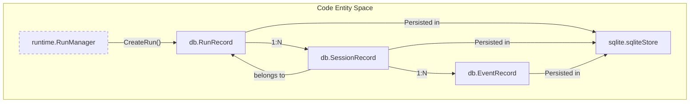
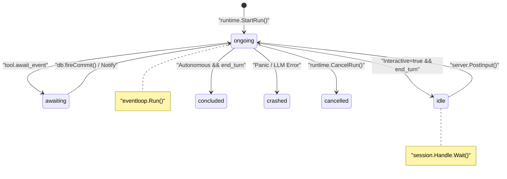

<!-- source: DeepWiki mcp.deepwiki.com · repo google-deepmind/amplio · page 1.2 Runs and Sessions · fetched 2026-10-26 -->

# Runs and Sessions

Relevant source files

The following files were used as context for generating this wiki page:

- [docs/guide/runs.md](docs/guide/runs.md)
- [internal/agent/eventloop/eventloop_test.go](internal/agent/eventloop/eventloop_test.go)
- [internal/db/sqlite/sqlite.go](internal/db/sqlite/sqlite.go)
- [internal/server/artifacts_test.go](internal/server/artifacts_test.go)
- [internal/server/briefings_test.go](internal/server/briefings_test.go)
- [internal/server/grades_test.go](internal/server/grades_test.go)
- [internal/server/server_test.go](internal/server/server_test.go)

In Amplio, a **Run** represents a single unit of work (a task) with its own workspace, configuration, and history. A **Session** is a specific execution context for an agent within that run. A single run always begins with a root session but can expand into a tree of sub-agent sessions as the work progresses [docs/guide/runs.md:1-5]().

## Run and Session Hierarchy

The relationship between Runs and Sessions is hierarchical and persisted in the database. A Run acts as a container for metadata (task, briefings, status) and one or more Sessions [internal/db/db.go:102-127]().

### Data Structures
*   **`RunRecord`**: Stores the global state of the work, including the `RunID`, `Task`, `Workspace` path, and overall `Status` [internal/db/db.go:102-127]().
*   **`SessionRecord`**: Tracks an individual agent's lifecycle. It includes a `ParentID` to facilitate the sub-agent tree, the `AgentType` (e.g., `standard_agent`), and its current execution `Status` [internal/db/db.go:142-167]().

### Hierarchy Diagram: Code Entity Space
The following diagram illustrates how the `RunManager` orchestrates these entities and how they relate to the underlying storage.

Sources: [internal/runtime/runtime.go:61-90](), [internal/db/db.go:102-167](), [internal/db/sqlite/sqlite.go:52-62]()

## Execution Modes

Amplio supports two primary modes of operation which dictate how sessions transition between states.

| Mode | Primary Agent | Behavior |
| :--- | :--- | :--- |
| **Autonomous** | `standard_agent` | The agent works toward a `concluded` state without human intervention. Reaching the end of a turn without tool calls triggers the `Finalizer` [docs/guide/runs.md:26-27](), [internal/agent/eventloop/eventloop.go:350-365](). |
| **Interactive** | `chatbot` | The agent parks in `idle` status after every turn, waiting for a `UserEvent` via the `Input` mechanism [docs/guide/runs.md:23-25](), [internal/agent/eventloop/eventloop.go:370-385](). |

## Session Lifecycle and Statuses

Sessions move through a state machine managed by the `EventLoopAgent`. The status is persisted in the `Session` table and updated via `store.SetSessionStatus` [internal/db/sqlite/sqlite.go:490-510]().

*   **`ongoing`**: The agent goroutine is active and processing the event loop [internal/db/db.go:50]().
*   **`awaiting`**: Blocked waiting for a specific event, such as a sub-agent's completion via the `await_event` tool [internal/db/db.go:51](), [internal/tool/toolset.go:150-165]().
*   **`idle`**: (Interactive only) The agent is parked and the goroutine has exited, waiting for user input to respawn [internal/db/db.go:52](), [internal/agent/eventloop/eventloop.go:400-415]().
*   **`concluded`**: The task is finished successfully [internal/db/db.go:53]().
*   **`crashed`**: The agent encountered a terminal error or the process died [internal/db/db.go:54]().
*   **`cancelled`**: The session was stopped by a user or parent request [internal/db/db.go:55]().

### Lifecycle Transitions: Natural Language to Code
This diagram bridges the conceptual lifecycle to the specific functions and statuses in the `eventloop` package.

Sources: [internal/agent/eventloop/eventloop.go:200-250](), [internal/runtime/runtime.go:210-230](), [internal/db/db.go:50-55]()

## Sub-agents

Agents can expand their capabilities by spawning sub-agents using the `spawn` tool [internal/tool/toolset.go:120-135](). 

1.  **Creation**: The parent calls `spawn`, which invokes `RunManager.AddSubAgent` [internal/runtime/runtime.go:300-315]().
2.  **Isolation**: Each sub-agent gets a unique `SessionID` and a fresh context, but shares the same `RunID` and artifact directory [docs/guide/runs.md:60-63]().
3.  **Communication**: Parents communicate with sub-agents via `send_message` and receive results as `AssistantEvent` logs when the sub-agent concludes [internal/tool/toolset.go:140-155]().

## Artifacts and Blobs

*   **Artifacts**: Files generated by agents (e.g., reports, logs, code) are stored in a run-specific directory defined by `config.ArtifactDir(runID)` [internal/config/config.go:180-195](). Agents access this via the `$AMPLIO_ARTIFACT_DIR` environment variable [docs/guide/runs.md:76-79]().
*   **Blobs**: Large binary data or tool outputs are stored in the `blob.Store`, which manages content-addressed storage within the data directory [internal/blob/blob.go:25-45]().

## Reports and Grades

When an autonomous run's root session reaches `concluded`, the `Finalizer` triggers a separate `keen-critic` agent to evaluate the run [internal/agent/critic/critic.go:40-60]().

### Report Structure
The report is saved as an `Observation` record of kind `run_report` [internal/db/db.go:205-220](). It includes:
*   **Summary**: A prose description of the work performed [docs/guide/runs.md:89]().
*   **Grade**: An LLM-assigned value from 1 (Garbage) to 5 (Excellent) [docs/guide/runs.md:106-108]().
*   **Achievements/Struggles**: Specific steps cited as evidence of success or difficulty [docs/guide/runs.md:91-93]().

### Grade Precedence
Users can manually override the critic's grade via the UI or API (`PATCH /api/runs/{id}`). The `RunRecord.Grade` (human) takes precedence over `RunRecord.ReportGrade` (critic) in the dashboard display [internal/db/sqlite/sqlite.go:156-158](), [internal/server/server.go:211]().

Sources: [internal/agent/critic/critic.go:40-100](), [internal/db/db.go:205-220](), [docs/guide/runs.md:83-112]()

## Management Actions

### Cancellation
Canceling a run via `RunManager.CancelRun` sets the run status to `cancelled` and sends a cancellation signal to all active session contexts [internal/runtime/runtime.go:450-470](). This triggers a recursive cancellation of all sub-agents.

### Archiving
Archiving is a metadata update (`archived = 1`) in the `Run` table [internal/db/sqlite/sqlite.go:159](). It removes the run from the default dashboard view but preserves all data [docs/guide/runs.md:118-120]().

### Deletion
Deletion is permanent. The `RunManager` removes:
1.  All database rows associated with the `RunID` (Sessions, Events, Observations) [internal/db/sqlite/sqlite.go:380-400]().
2.  The artifact directory on disk [internal/server/server.go:211]().
3.  Any associated blobs [docs/guide/runs.md:120-121]().

Sources: [internal/runtime/runtime.go:450-480](), [internal/db/sqlite/sqlite.go:159-160](), [internal/server/server.go:211]()

---

