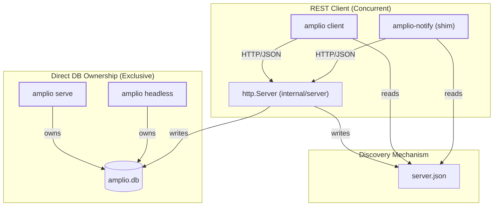
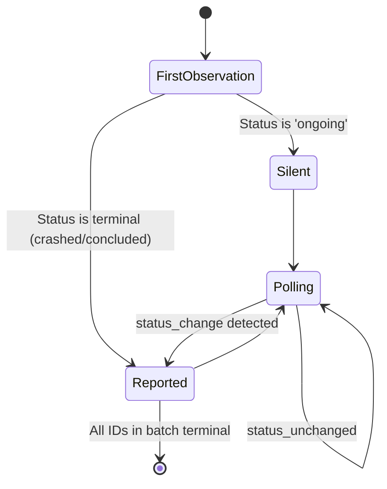

<!-- source: DeepWiki mcp.deepwiki.com · repo google-deepmind/amplio · page 1.3 Command-Line Interface · fetched 2026-10-26 -->

# Command-Line Interface

<details>
<summary>Relevant source files</summary>

The following files were used as context for generating this wiki page:

- [cmd/amplio/client.go](cmd/amplio/client.go)
- [cmd/amplio/client_api_test.go](cmd/amplio/client_api_test.go)
- [cmd/amplio/client_test.go](cmd/amplio/client_test.go)
- [cmd/amplio/monitor.go](cmd/amplio/monitor.go)
- [cmd/amplio/monitor_test.go](cmd/amplio/monitor_test.go)
- [cmd/amplio/notify.go](cmd/amplio/notify.go)
- [cmd/amplio/notify_test.go](cmd/amplio/notify_test.go)
- [docs/guide/cli.md](docs/guide/cli.md)
- [docs/guide/configuration.md](docs/guide/configuration.md)

</details>


Amplio is a single binary with three distinct operational modes: hosting a long-lived server (`serve`), interacting with a running server via a REST client (`client`), or executing tasks in a standalone foreground process (`headless`). [docs/guide/cli.md:3-9]()

The CLI is built using the `cobra` library. Every command respects global configuration flags, most notably `--data-dir`, which determines the specific Amplio instance and its associated SQLite database, artifacts, and server state. [docs/guide/cli.md:10-12]() [docs/guide/configuration.md:8-14]()

## Command Architecture and Data Flow

The CLI interacts with the Amplio ecosystem through two primary paths: direct database ownership (used by `serve` and `headless`) and HTTP/REST communication (used by `client` and `notify`).

### System Interaction Diagram

"CLI Command Paths and Code Entities"

Sources: [cmd/amplio/client.go:38-43](), [cmd/amplio/notify.go:114-121](), [docs/guide/cli.md:19-22]()

## amplio serve

The `serve` command initializes the long-lived orchestration layer. It is the only process that should own a production data directory for extended periods.

*   **Responsibility**: Hosts the REST API, serves the SvelteKit UI, runs the `RunManager` for agent execution, and manages the background `Observer` for summarization and compaction. [docs/guide/cli.md:19-22]()
*   **Authentication**: On first run, it generates a high-entropy token stored in `auth.token`. This token is required for all write operations via the API and for UI access. [docs/guide/cli.md:28-31]()
*   **Discovery**: It writes a `server.json` file containing its PID, local address, and the auth token, allowing `client` commands to function without manual credential passing. [cmd/amplio/client.go:38-40](), [docs/guide/cli.md:37-38]()

Sources: [docs/guide/cli.md:13-34](), [cmd/amplio/client.go:38-43]()

## amplio client

The `client` command is a wrapper around the REST API. It is designed for both human use and for "Run Manager" agents that need to spawn and monitor sub-runs. [cmd/amplio/client.go:54-60]()

### Key Subcommands

| Command | Implementation Function | Purpose |
| :--- | :--- | :--- |
| `submit` | `clientSubmitCmd` | Hands a task to the server and returns the `run_id`. [cmd/amplio/client.go:75-140]() |
| `list` | `clientListCmd` | Displays a table of runs. Supports `--json` for scripting. [cmd/amplio/client.go:66](), [docs/guide/cli.md:76-79]() |
| `status` | `clientStatusCmd` | Provides detailed telemetry for a specific run and its sessions. [cmd/amplio/client.go:65]() |
| `monitor` | `clientMonitorCmd` | Polls run status until completion; exits with specific codes. [cmd/amplio/monitor.go:54-98]() |
| `cancel` | `clientCancelCmd` | Triggers a cancellation cascade for all sessions in a run. [cmd/amplio/client.go:63]() |
| `restart` | `clientRestartCmd` | Revives crashed sessions within a run. [cmd/amplio/client.go:64]() |
| `api` | `clientAPICmd` | Raw HTTP helper for arbitrary API endpoints. [cmd/amplio/client.go:67]() |

### Scripting Pattern: stdout vs stderr
A strict convention is enforced: **stdout** carries the machine-readable datum (e.g., a Run ID or JSON table), while **stderr** carries human-readable logs and confirmation messages. [cmd/amplio/client.go:46-50]()

```bash
# Capture the ID directly without parsing logs
RUN_ID=$(amplio client submit "Fix the build")
```
Sources: [cmd/amplio/client.go:46-50](), [docs/guide/cli.md:45-48]()

## Run Monitoring

The `monitor` command is a specialized tool for unattended automation. It polls the server at a defined `--interval` (default 10m) and streams status changes. [cmd/amplio/monitor.go:95-97]()

### Monitor State Machine

"Monitor Observation Logic"

Sources: [cmd/amplio/monitor.go:133-153](), [cmd/amplio/monitor.go:158-165]()

### Monitor Exit Codes
| Code | Meaning |
| :--- | :--- |
| `0` | All watched runs concluded successfully. |
| `1` | Usage error or unwatchable run (e.g., a chatbot that parks idle). |
| `2` | At least one run in the batch crashed. |
| `3` | At least one run was cancelled. |
| `124` | Timeout reached (max 50 hours). |

Sources: [cmd/amplio/monitor.go:38-41](), [cmd/amplio/monitor.go:179-197]()

## amplio headless

The `headless` mode executes the agent event loop within the CLI process itself. [docs/guide/cli.md:128-132]()

*   **`headless run`**: Requires a task and workspace. It initializes a new `RunManager` and `sqliteStore`, effectively acting as a single-run server. [docs/guide/cli.md:130-131]()
*   **`headless resume`**: Takes a `run_id` and reconstructs the execution state from the database. This is the primary mechanism for CI/CD pipelines to continue interrupted work. [docs/guide/cli.md:132-143]()

**Constraint**: Headless mode requires an exclusive lock on the data directory. It cannot run if `amplio serve` is active on the same directory. [docs/guide/cli.md:137-139]()

Sources: [docs/guide/cli.md:128-143]()

## The notify Shim

Agents often spawn background processes (e.g., long-running builds or tests) using the `bash` tool. The `amplio-notify` shim allows these external processes to send asynchronous events back to the agent session. [cmd/amplio/notify.go:59-66]()

### Implementation Details
*   **Discovery**: The shim reads `AMPLIO_RUN_ID` and `AMPLIO_SESSION_ID` from the environment, which are automatically injected by the agent's bash tool. [cmd/amplio/notify.go:95-105]()
*   **Identity**: The shim automatically appends the caller's PID to the message sender field: `sender (pid=1234)`. This allows the agent to identify and potentially kill the notifying process if it becomes "chatty" or runaway. [cmd/amplio/notify.go:132-138]()
*   **Rate Limiting**: The server enforces a cap on environment notifications per step. If exceeded, the shim exits with `notifyExitRefused` (code 3). [cmd/amplio/notify.go:36-40](), [cmd/amplio/notify.go:63-66]()

Sources: [cmd/amplio/notify.go:34-40](), [cmd/amplio/notify.go:54-92](), [cmd/amplio/notify.go:132-138]()

---

