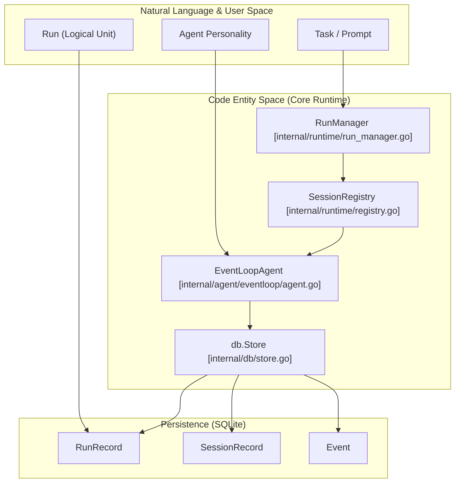
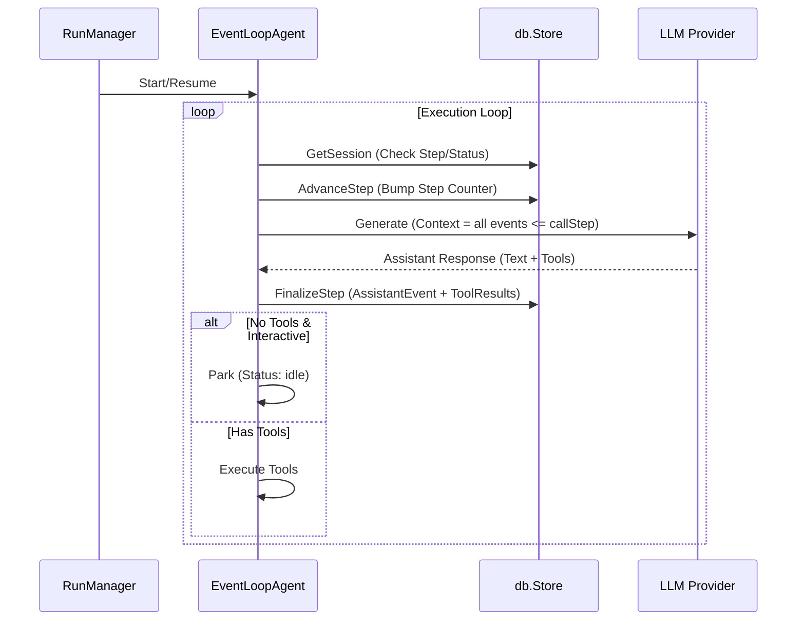

<!-- source: DeepWiki mcp.deepwiki.com · repo google-deepmind/amplio · page 2 Core Architecture · fetched 2026-10-26 -->

# Core Architecture

Relevant source files

The following files were used as context for generating this wiki page:

- [README.md](README.md)
- [docs/internals/session_lifecycle.md](docs/internals/session_lifecycle.md)
- [docs/internals/step_model.md](docs/internals/step_model.md)
- [internal/db/errtag.go](internal/db/errtag.go)
- [internal/db/store.go](internal/db/store.go)

Amplio is built on a **DB-first persistence model** where the database is the single source of truth for agent state. This design ensures that the system can robustly resume from crashes at any point in the agentic loop. The architecture centers around a hierarchical Run/Session model, a discrete step-based event stream, and a background orchestration layer that manages the lifecycle of autonomous and interactive agents.

### System Overview

The following diagram illustrates the relationship between the logical components of the system and the primary code entities that implement them.

**Diagram: Logical Architecture to Code Entity Mapping**

**Sources:** [internal/db/store.go:27-38](), [internal/runtime/run_manager.go:40-60](), [internal/agent/eventloop/agent.go:45-65]()

---

### DB-First Persistence

In Amplio, every state transition—from appending an event to updating a session's status—is durably committed to a SQLite database before the system proceeds. This "DB-first" approach means that the agent's memory and progress are not held in volatile memory but are reflected in a stream of events.

*   **Concurrency**: The `db.Store` interface is shared across the web server, agent goroutines, and observers [internal/db/store.go:27-31]().
*   **Error Classification**: The system uses `db.ErrStore` to distinguish between infrastructure failures (DB broken) and agentic failures (LLM error), allowing the loop to safely halt without attempting doomed writes [internal/db/errtag.go:25-35]().
*   **Atomicity**: Complex operations, such as terminating a sub-agent and notifying its parent, are performed in a single transaction to prevent inconsistent states [internal/db/store.go:94-109]().

For details, see [Persistence Layer (SQLite Store)](#2.3).

**Sources:** [internal/db/store.go:27-109](), [internal/db/errtag.go:25-35]()

---

### The Step and Event Model

The core of an agent's execution is the **Step**. A step represents a single turn of interaction or internal reasoning. 

*   **Step 0**: Reserved for bootstrap events like system prompts and task briefings [docs/internals/step_model.md:41-42]().
*   **The Invariant**: The `AssistantEvent` (the LLM's response) is always the last event of a step, followed only by its associated `ToolResultEvents` [docs/internals/step_model.md:7-9]().
*   **Race Prevention**: The system bumps the `current_step` *before* starting LLM generation. This ensures that any events arriving during generation (like a user message) land in the next step, preventing interleaved or out-of-order logs [docs/internals/step_model.md:85-97]().

For details, see [Step and Event Model](#2.1).

**Sources:** [docs/internals/step_model.md:7-97](), [internal/db/store.go:124-130]()

---

### Session Lifecycle and Execution Loop

Amplio distinguishes between a **Run** (a collection of work) and a **Session** (a single agent's execution thread). Sessions can be "Hot" (active goroutine) or "Cold" (persisted in DB, no active process) [docs/internals/session_lifecycle.md:8-10]().

**Diagram: Agent Execution Loop (EventLoopAgent)**

**Sources:** [internal/agent/eventloop/agent.go:180-250](), [docs/internals/session_lifecycle.md:12-38](), [docs/internals/step_model.md:51-80]()

*   **Statuses**: Sessions transition through states like `ongoing`, `awaiting` (parked for events), `idle` (waiting for user), or terminal states like `concluded`, `crashed`, and `cancelled` [docs/internals/session_lifecycle.md:19-26]().
*   **Event Classification**: Incoming events are classified as `Input` (which revives cold sessions) or `Notice` (which only notifies hot sessions) [docs/internals/session_lifecycle.md:74-80]().

For details, see [Session Lifecycle](#2.2) and [Runtime and Run Manager](#2.4).

**Sources:** [docs/internals/session_lifecycle.md:8-80](), [internal/runtime/run_manager.go:40-60]()

---

### Subsystem Connectivity

The `RunManager` acts as the central orchestrator, connecting the persistence layer to the agent execution logic.

| Subsystem | Responsibility | Key Interface/Struct |
| :--- | :--- | :--- |
| **Persistence** | Durable storage of all runs, sessions, and events. | `db.Store` [internal/db/store.go:38]() |
| **Runtime** | Managing the pool of active agent goroutines. | `RunManager` [internal/runtime/run_manager.go:40]() |
| **Agent** | The internal logic for LLM interaction and tool use. | `EventLoopAgent` [internal/agent/eventloop/agent.go:45]() |
| **Observer** | Background tasks like summarization and compaction. | `Observer` [internal/agent/observer.go]() |

**Sources:** [internal/db/store.go:38](), [internal/runtime/run_manager.go:40](), [internal/agent/eventloop/agent.go:45]()

---

