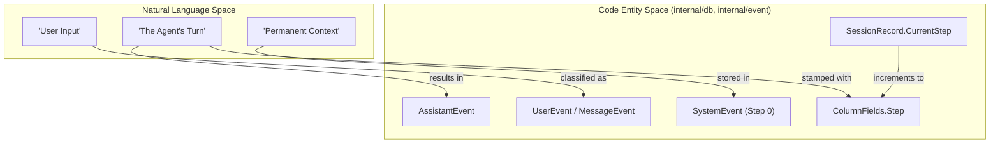
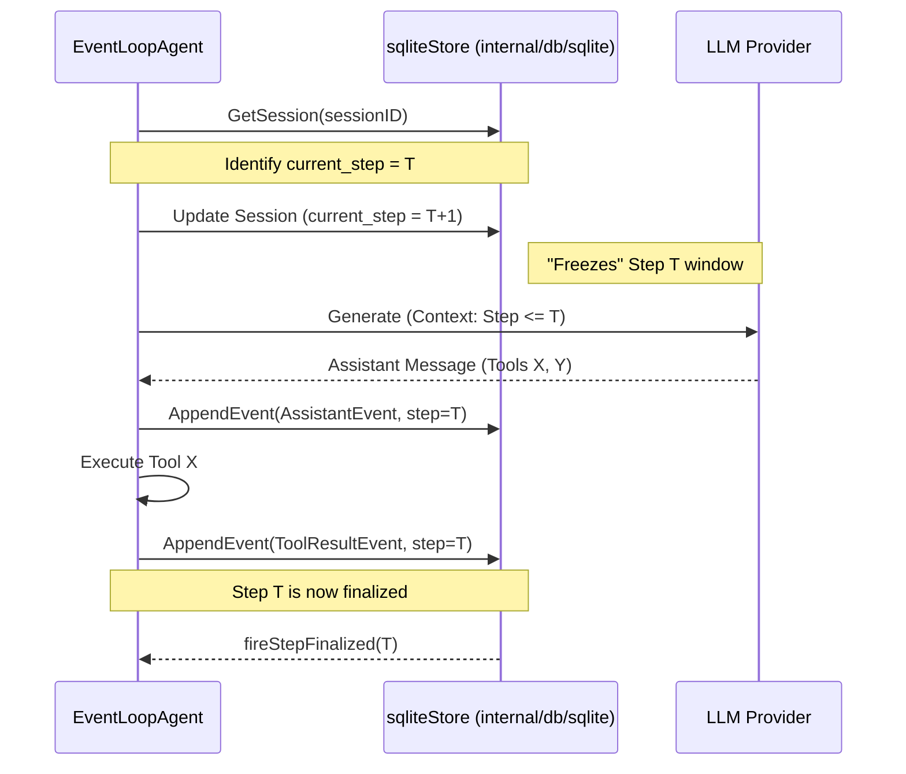

<!-- source: DeepWiki mcp.deepwiki.com · repo google-deepmind/amplio · page 2.1 Step and Event Model · fetched 2026-10-26 -->

# Step and Event Model

Relevant source files

The following files were used as context for generating this wiki page:

- [docs/internals/step_model.md](docs/internals/step_model.md)
- [internal/db/sqlite/sqlite.go](internal/db/sqlite/sqlite.go)
- [internal/db/types.go](internal/db/types.go)
- [internal/event/event.go](internal/event/event.go)
- [internal/server/artifacts_test.go](internal/server/artifacts_test.go)
- [internal/server/briefings_test.go](internal/server/briefings_test.go)
- [internal/server/grades_test.go](internal/server/grades_test.go)

The Step and Event Model is the fundamental state machine of Amplio. It provides a deterministic, crash-resilient structure for agentic loops by discretizing the continuous stream of events into numbered **steps**. This model ensures that an agent's state can always be reconstructed from the database, allowing for seamless recovery after process crashes or server restarts.

## Core Invariant: The Assistant Boundary

The primary invariant of the model is that the `AssistantEvent` is the **last** event of a step [docs/internals/step_model.md:7-8]().

When an agent iteration begins, the `Session.current_step` counter is incremented **before** the LLM generation starts [docs/internals/step_model.md:10-11](). The resulting `AssistantEvent` and its associated `ToolResultEvent`s are then stamped with the previous step number (the "call step") [docs/internals/step_model.md:11-13](). Any external events (like user messages) that arrive while the LLM is still generating are stamped with the new, incremented `current_step`, placing them logically in the *next* iteration [docs/internals/step_model.md:13-14]().

### Step Layout Structure

| Step | Content Type | Description |
| :--- | :--- | :--- |
| **Step 0** | **Bootstrap** | Permanent system events (System Prompt, Task, Workspace) [docs/internals/step_model.md:41-43](). |
| **Step T** | **Input** | 0 or more events (User messages, Child results) [docs/internals/step_model.md:28-29](). |
| **Step T** | **Assistant** | Exactly 1 `AssistantEvent` (The LLM's response/action) [docs/internals/step_model.md:30-31](). |
| **Step T** | **Tool Results** | 0 or more `ToolResultEvent`s (Results of tool calls) [docs/internals/step_model.md:32-33](). |

### Logical Flow to Code Entity Mapping
This diagram shows how natural language concepts of "Steps" and "Turns" map to specific database fields and event types.

Sources: [docs/internals/step_model.md:21-43](), [internal/db/types.go:142-164](), [internal/event/event.go:44-50]()

## Generation-Based Compaction

To manage context window limits, Amplio uses a generation-based compaction strategy. Every `SessionRecord` tracks a `CurrentGeneration` [internal/db/types.go:149]().

1.  **Step 0 Persistence:** Events in Step 0 are considered "bootstrap" events and survive all compactions [docs/internals/step_model.md:125-126]().
2.  **Generation Filtering:** When reconstructing context for an LLM call, the system filters events where `step == 0` OR `generation == current_generation` [docs/internals/step_model.md:125-126]().
3.  **Compaction Trigger:** When a context window is exceeded, a "Compaction Agent" summarizes the history. The summarized state is written as new events in a new `generation`, and the session's `CurrentGeneration` is incremented.

## Crash-Resume Mechanics

The database-first model allows the `RunManager` to resume sessions by inspecting the last finalized step and the presence of an `AssistantEvent`.

### Recovery Logic Table
The system determines the resume action based on the state of the last step [docs/internals/step_model.md:103-109]().

| DB State | Crash Point | Resume Action |
| :--- | :--- | :--- |
| `current_step=T+1`, Step T has no `AssistantEvent` | During LLM generation | Re-invoke LLM for Step T |
| Step T has `AssistantEvent`, but missing `ToolResultEvent`s | During tool execution | Insert placeholder results and continue |
| Step T is complete (Assistant + Tools) | After tools, before next call | Start normal next iteration |
| Session status = `concluded` | During park/idle | Re-enter park or check for new messages |

### Execution Loop and Persistence
The following diagram illustrates the interaction between the `EventLoopAgent` and the `sqliteStore` during a single iteration.

Sources: [docs/internals/step_model.md:112-118](), [internal/db/sqlite/sqlite.go:81-85](), [internal/db/types.go:161-164]()

## Implementation Details

### Event Classification
Events are categorized by their ability to wake a dormant session via the `Classify` function [internal/db/types.go:83-103]():
*   **ClassInput:** `UserEvent`, `MessageEvent`, and successful `ChildResultEvent`. These revive `idle` or `awaiting` sessions [internal/db/types.go:64-65]().
*   **ClassNotice:** `SystemEvent`, `ToolResultEvent`, and failed `ChildResultEvent`. These are persisted but do not trigger a session wake-up [internal/db/types.go:61-63]().

### Observer Cursors
The `SessionRecord` maintains three monotonic cursors to track progress through the step model [internal/db/types.go:161-164]():
1.  **LastFinalizedStep:** The highest step where the `AssistantEvent` and all tool results are written.
2.  **LastSummarizedStep:** The highest step that has been processed by the background summarizer.
3.  **LastPhasedStep:** The highest step where a logical "Phase" (e.g., a transition from autonomous work to user interaction) has been identified.

These cursors ensure that background tasks (like summarization or critic evaluation) never process incomplete steps [internal/db/types.go:155-160]().

Sources: [internal/db/types.go:58-103](), [internal/db/types.go:142-164](), [docs/internals/step_model.md:110-126]()

---

