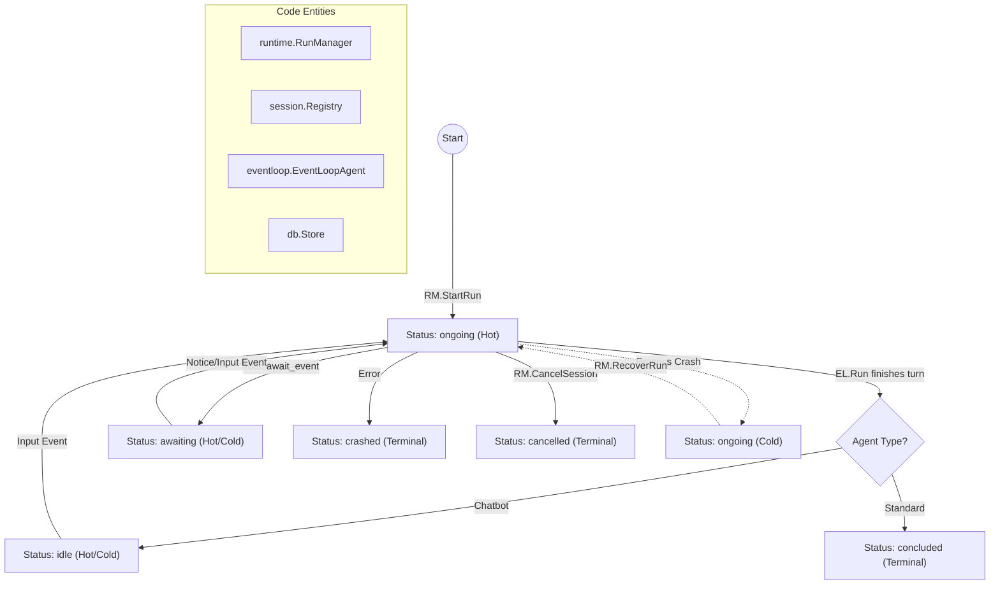
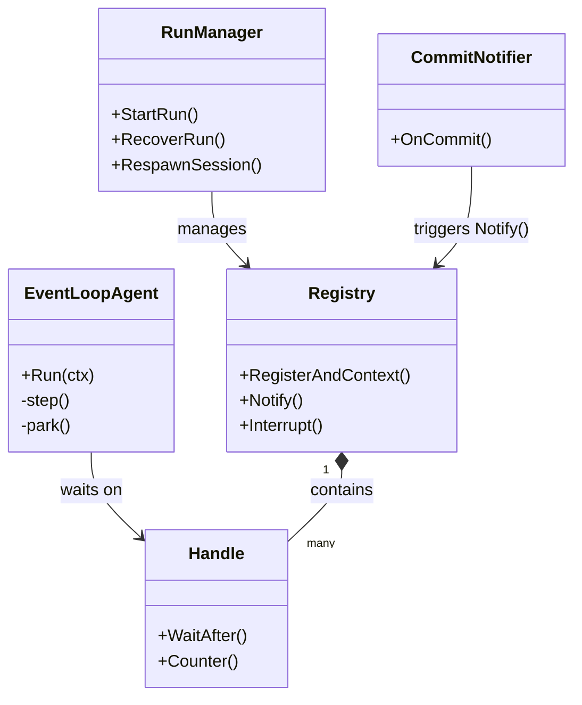

<!-- source: DeepWiki mcp.deepwiki.com · repo google-deepmind/amplio · page 2.2 Session Lifecycle · fetched 2026-10-26 -->

# Session Lifecycle

Relevant source files

The following files were used as context for generating this wiki page:

- [docs/internals/session_lifecycle.md](docs/internals/session_lifecycle.md)
- [internal/agent/eventloop/doc.go](internal/agent/eventloop/doc.go)
- [internal/agent/eventloop/eventloop_test.go](internal/agent/eventloop/eventloop_test.go)
- [internal/server/server_test.go](internal/server/server_test.go)
- [internal/session/registry.go](internal/session/registry.go)

The session lifecycle governs how an agent session is instantiated, how it transitions between logical states, how it handles physical process interruptions, and how it concludes or recovers. A **session** is defined as an agent's event stream paired with a logical **status** [docs/internals/session_lifecycle.md:6-7]().

## Logical Statuses

A session's status represents its logical state in the DB. This is distinct from whether a Go goroutine is physically executing for that session [docs/internals/session_lifecycle.md:14-16]().

| Status | Type | Description |
| :--- | :--- | :--- |
| `ongoing` | Active | The agent is actively executing its event loop [docs/internals/session_lifecycle.md:21](). |
| `awaiting` | Parked | Parked via `await_event`; the agent is waiting for specific external events [docs/internals/session_lifecycle.md:22](). |
| `idle` | Parked | Parked after a turn with no tool calls (interactive agents only) [docs/internals/session_lifecycle.md:23](). |
| `concluded` | Terminal | The agent has finished its task and submitted a result (autonomous agents only) [docs/internals/session_lifecycle.md:24](). |
| `crashed` | Terminal | Stopped by an uncaught error, durably recorded in the DB [docs/internals/session_lifecycle.md:25](). |
| `cancelled` | Terminal | Explicitly stopped by an operator or a parent session [docs/internals/session_lifecycle.md:26](). |

**Sources:** [docs/internals/session_lifecycle.md:19-26](), [internal/db/db.go:138-144]()

## The Hot/Cold Goroutine Model

Amplio distinguishes between the **logical status** (DB state) and the **physical liveness** (goroutine existence).

*   **Hot Session:** The goroutine is alive and registered in the `session.Registry`. Reviving a hot session is an in-memory wake-up via a `session.Handle` [docs/internals/session_lifecycle.md:58-59]().
*   **Cold Session:** The goroutine has exited (e.g., due to an idle timeout or process restart). Reviving a cold session requires a **Respawn**, where the `RunManager` reconstructs the agent state from the DB event stream [docs/internals/session_lifecycle.md:60-61]().

The `session.Registry` manages these live handles, providing a `Waiter` primitive (a monotonic counter and broadcast channel) to coordinate wakes [internal/session/registry.go:28-36]().

### Session State Transitions
The following diagram bridges the logical status names in the code to the physical lifecycle of the goroutine.

**Diagram: Session Lifecycle State Machine**

**Sources:** [docs/internals/session_lifecycle.md:19-50](), [internal/runtime/manager.go:120-150](), [internal/agent/eventloop/eventloop.go:180-220]()

## Event Classification: Input vs. Notice

Every event written to a session's stream is classified to determine if it should trigger a session revival [docs/internals/session_lifecycle.md:70-74]().

1.  **Input Class:** Events that represent new information requiring agent action (e.g., `UserEvent`, `MessageEvent` from another agent, `RecoverEvent`). These revive dormant (non-`ongoing`) sessions [docs/internals/session_lifecycle.md:80]().
2.  **Notice Class:** Events that are purely informational or internal (e.g., `AssistantEvent`, `ToolResultEvent`, `CompactionEvent`). These are persisted but only processed if the session is already `ongoing` or `awaiting` [docs/internals/session_lifecycle.md:79]().

**Exception:** Environment notifications (`$AMPLIO_NOTIFY`) are `Input` class but **do not** revive terminal sessions (`concluded`, `crashed`, `cancelled`) to prevent runaway scripts from resurrecting finished agents [docs/internals/session_lifecycle.md:87-94]().

**Sources:** [docs/internals/session_lifecycle.md:77-80](), [internal/runtime/notifier.go:85-110]()

## Recover vs. Restart

*   **Recover:** Used after a process crash to find sessions that are logically `ongoing` but physically dead. The `RunManager` scans for these and injects a `RecoverEvent` to resume their execution loops [docs/internals/session_lifecycle.md:118-124]().
*   **Restart:** Triggered by a `UserEvent` or a parent agent sending a message to a `concluded` or `crashed` session. This moves the status back to `ongoing` and respawns the goroutine [docs/internals/session_lifecycle.md:80]().

**Sources:** [docs/internals/session_lifecycle.md:47-50](), [internal/runtime/manager.go:350-380]()

## Coordination Mechanics

### Await Event
Agents use the `await_event` tool to park. The `EventLoopAgent` calls `Handle.WaitAfter` [internal/session/registry.go:113-115](), which blocks the goroutine until the `session.Registry` receives a notification from the `db.Store` commit listener [internal/runtime/notifier.go:40-60]().

### Cancellation Cascade
When a run or session is cancelled:
1.  The `RunManager` calls `Registry.Interrupt(sessionID)` to cancel the Go context of the live goroutine [internal/session/registry.go:196-203]().
2.  The `db.Store` status is updated to `cancelled` [internal/db/sqlite/session.go:80-95]().
3.  If a parent session is cancelled, the `RunManager` recursively cancels all child sessions discovered via the `Session` table hierarchy [docs/internals/session_lifecycle.md:26]().

### Child-Result Exactly-Once Delivery
When an autonomous agent finishes, it must deliver its result to its parent. Amplio uses an atomic DB transaction `TerminateAndNotifyParent` to:
1.  Set the child's status to `concluded`.
2.  Append a `ChildResultEvent` to the parent's event stream.
This ensures that the parent is notified exactly once, even if the process crashes during the transition [docs/internals/session_lifecycle.md:42-44]().

**Sources:** [internal/db/sqlite/session.go:150-180](), [docs/internals/session_lifecycle.md:42-44]()

## Code Entity Association

The following diagram maps the logical concepts of the session lifecycle to the specific Go structs and methods that implement them.

**Diagram: Implementation Mapping**

**Sources:** [internal/runtime/manager.go:45-60](), [internal/agent/eventloop/eventloop.go:70-90](), [internal/session/registry.go:119-125](), [internal/runtime/notifier.go:25-35]()

---

