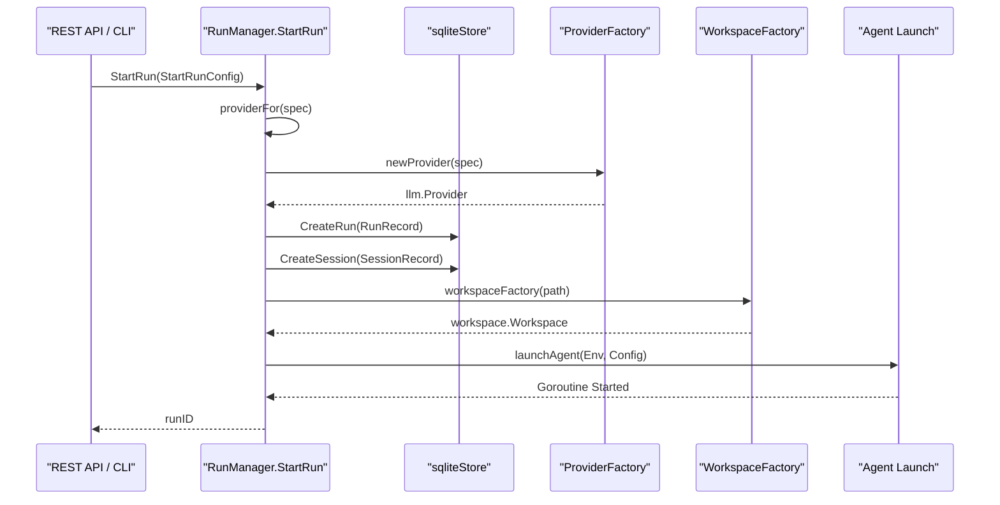
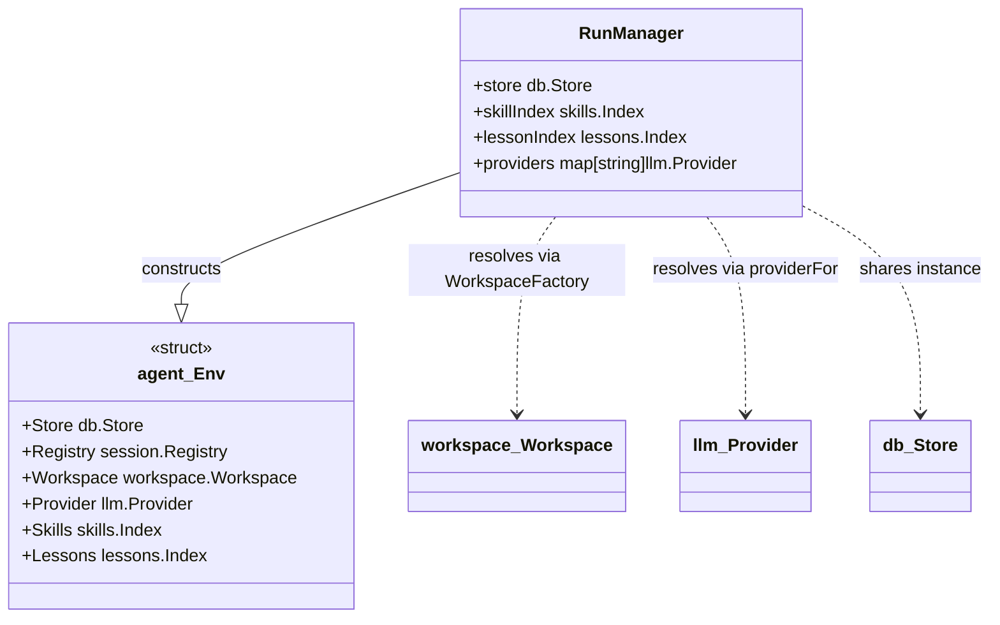

<!-- source: DeepWiki mcp.deepwiki.com · repo google-deepmind/amplio · page 2.4 Runtime and Run Manager · fetched 2026-10-26 -->

# Runtime and Run Manager

Relevant source files

The following files were used as context for generating this wiki page:

- [cmd/amplio/system.go](cmd/amplio/system.go)
- [internal/llm/openai/openai.go](internal/llm/openai/openai.go)
- [internal/llm/spec_test.go](internal/llm/spec_test.go)
- [internal/runtime/manager.go](internal/runtime/manager.go)
- [internal/runtime/manager_test.go](internal/runtime/manager_test.go)
- [internal/runtime/respawn_race_test.go](internal/runtime/respawn_race_test.go)
- [internal/tool/bash/bash.go](internal/tool/bash/bash.go)

The `RunManager` is the central orchestration layer of Amplio. It bridges the static configuration and persistence layers with the active execution of agents. It is responsible for launching new runs, recovering sessions after crashes or restarts, managing LLM provider lifecycles, and tracking in-flight ephemeral tasks.

## RunManager Overview

The `RunManager` struct acts as the primary entry point for managing the lifecycle of agent runs and their constituent sessions. It is initialized during the system bootstrap in `setupSystem` [cmd/amplio/system.go:77-108]().

### Key Responsibilities
*   **Orchestration**: Mapping `RunConfig` objects to living agent goroutines via `StartRun` [internal/runtime/manager.go:179-242]().
*   **Session Recovery**: Identifying and reviving "spine" sessions (ongoing or awaiting) during system startup or after a crash [internal/runtime/manager.go:343-413]().
*   **Provider Caching**: Managing a shared cache of `llm.Provider` instances to avoid redundant initialization across runs [internal/runtime/manager.go:142-154]().
*   **Workspace Resolution**: Reconstructing agent workspaces (plain, git, etc.) during session initialization [internal/runtime/manager.go:41-42]().
*   **Ephemeral Tracking**: Maintaining a registry of non-session workers, such as the report critic or title generator [internal/runtime/manager.go:70-71]().

### Data Flow: StartRun Lifecycle

This diagram illustrates the sequence of operations when `StartRun` is invoked to begin a new autonomous or interactive task.

**Sources:** [internal/runtime/manager.go:179-242](), [internal/runtime/manager.go:142-154](), [internal/runtime/manager.go:415-460]()

## Session Recovery and Respawning

Amplio implements a "crash-resume" model. When the server starts, or when a session is nudged, the `RunManager` uses `RecoverRun` and `RespawnSession` to ensure the agent execution loop continues from the last persisted state in the SQLite DB.

### RecoverRun
`RecoverRun` is called during system initialization for every active run. It performs a "spine" analysis to determine which sessions need a living goroutine [internal/runtime/manager.go:343-413]():
1.  Queries the `SessionStore` for all sessions in a specific `runID`.
2.  Filters for "spine" sessions: those with status `Ongoing`, `Awaiting`, or `Crashed`.
3.  Invokes `RespawnSession` for each identified session.

### RespawnSession
`RespawnSession` is the mechanism for reviving a single session [internal/runtime/manager.go:271-341](). To prevent race conditions where an incoming event might trigger a duplicate goroutine, it uses a synchronous "slot reservation" in the `SessionRegistry` [internal/runtime/respawn_race_test.go:120-134]().

If the session was not "at rest" (i.e., it was interrupted mid-turn), a `RecoverEvent` is appended to the DB to signal the agent that it should reconcile its internal state with the environment [internal/runtime/manager.go:321-326]().

**Sources:** [internal/runtime/manager.go:343-413](), [internal/runtime/manager.go:271-341](), [internal/runtime/manager_test.go:48-122]()

## LLM Provider Management

The `RunManager` maintains a `providers` map to cache `llm.Provider` instances. Providers are stateless and safe to share across multiple runs and sessions [internal/runtime/manager.go:62-63]().

### Provider Resolution
When a run starts, the `RunManager` calls `providerFor(spec)` [internal/runtime/manager.go:142-154]().
*   If the `spec` (e.g., `openai:gpt-4o`) exists in the cache, the existing instance is returned.
*   Otherwise, the `ProviderFactory` (injected during `NewRunManager`) is called to build a new instance.
*   **System Providers**: The manager also holds shared "Fast" (for judging/compaction) and "HQ" (for summarization) providers used globally for background tasks [internal/runtime/manager.go:99-108]().

**Sources:** [internal/runtime/manager.go:142-154](), [internal/runtime/manager.go:99-108](), [cmd/amplio/system.go:88-97]()

## Ephemeral Agent Registry

Not all active tasks in Amplio are associated with a persistent `SessionID`. Tasks like generating a run report (the `Finalizer`) or generating a run title are considered ephemeral.

The `EphemeralAgentRegistry` allows these tasks to register their presence so the UI can display active background work to the user [internal/runtime/manager.go:77-81]().

| Task | Trigger | Provider Tier |
| :--- | :--- | :--- |
| **Title Generator** | Start of a new run | `systemFast` |
| **Finalizer (Critic)** | Main agent conclusion | `systemHQ` |
| **Compaction** | Context window threshold | `systemFast` / `systemHQ` |

**Sources:** [internal/runtime/manager.go:77-81](), [cmd/amplio/system.go:114-130]()

## Implementation Details: Workspace and Env Construction

Before launching an agent goroutine, the `RunManager` assembles an `agent.Env`. This environment provides the agent with all necessary subsystem handles.

### Runtime Entity Mapping
This diagram shows how `RunManager` constructs the `agent.Env` by gathering entities from different subsystems.

**Sources:** [internal/runtime/manager.go:415-460](), [internal/runtime/manager.go:50-71]()

### Workspace Reconstruction
Workspaces are reconstructed using the `WorkspaceFactory` [internal/runtime/manager.go:42]().
*   For root agents, the workspace path is taken from `RunConfig.Workspace`.
*   For sub-agents (spawned agents), the workspace is often a sub-directory or a linked path within the parent's workspace.
*   Workspaces provide the `CWD` for `bash` tool execution [internal/tool/bash/bash.go:61-68]().

**Sources:** [internal/runtime/manager.go:415-460](), [internal/workspace/workspace.go:1-20]()

---

