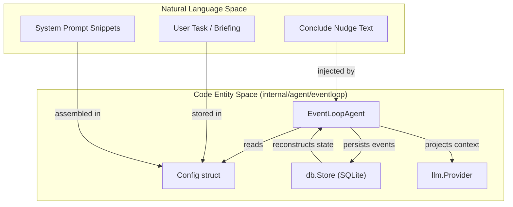
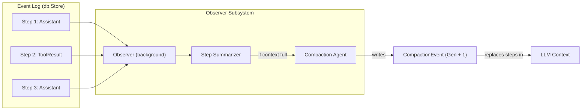

<!-- source: DeepWiki mcp.deepwiki.com · repo google-deepmind/amplio · page 3 Agent System · fetched 2026-10-26 -->

# Agent System

Relevant source files

The following files were used as context for generating this wiki page:

- [internal/agent/agent.go](internal/agent/agent.go)
- [internal/agent/eventloop/eventloop.go](internal/agent/eventloop/eventloop.go)
- [internal/agent/standard/standard.go](internal/agent/standard/standard.go)

The Amplio agent system is a robust framework for executing Large Language Models (LLMs) in a persistent, tool-enabled loop. The system is designed around a **DB-first** philosophy, where every agent action, tool result, and system event is persisted to a SQLite store before being projected back into the model's context. This ensures that agents can resume seamlessly from crashes or restarts without losing state.

## The Agent Interface

All agents in Amplio implement a minimal `Agent` interface, which defines their lifecycle within a run. Agents are managed by the `RunManager` and operate within a shared `Env` that provides access to system resources like the database, workspace, and LLM providers.

*   **`Agent` Interface**: Defines the `Run(ctx)` method, which blocks until the agent completes its task, crashes, or is cancelled [internal/agent/agent.go:32-39]().
*   **`Env` Struct**: A shared object graph injected into every agent, containing dependencies like `Store`, `LLM` providers, `Workspace`, and `SkillIndex` [internal/agent/agent.go:48-65]().
*   **Agent Registry**: A global registry where agent types (e.g., `standard_agent`, `chatbot`) are registered with their respective factories and `Traits` [internal/agent/agent.go:113-131]().

**Sources:** [internal/agent/agent.go:31-65](), [internal/agent/agent.go:113-131]()

## Event Loop Execution Engine

The `EventLoopAgent` is the core execution engine of the system. It implements the standard "Observe-Orient-Decide-Act" loop by interacting with the database and the LLM.

*   **Bootstrap (Step 0)**: Upon starting, the agent writes "bootstrap" events (SystemEvents) to the database, including the task description, system prompts, and tool definitions [internal/agent/eventloop/eventloop.go:80-84]().
*   **The Loop**: In each turn, the agent:
    1.  Projects the database event log into a sequence of LLM messages (`buildMessages`).
    2.  Calls the LLM to generate a response.
    3.  Persists the `AssistantEvent` (containing text and/or tool calls).
    4.  Executes requested tools and persists `ToolResultEvent`s.
*   **Reconciliation**: If the system restarts, the agent reads the existing event log to determine the current step and resumes the loop exactly where it left off.
*   **Nudge Mechanism**: To prevent accidental termination, autonomous agents that return an empty response (no text, no tools) are "nudged" by the system to either provide a final summary or continue working [internal/agent/eventloop/eventloop.go:57-60]().

For details, see [Event Loop Agent](#3.1).

**Sources:** [internal/agent/eventloop/eventloop.go:135-151](), [internal/agent/eventloop/eventloop.go:57-60]()

## Agent Types: Standard and Chatbot

Amplio provides two primary agent implementations that differ in their interaction patterns and termination logic.

| Agent Type | Name | Interaction Mode | Termination Behavior |
| :--- | :--- | :--- | :--- |
| **Standard** | `standard_agent` | Autonomous | Concludes when it issues a turn with no tool calls [internal/agent/standard/standard.go:37-40](). |
| **Chatbot** | `chatbot` | Interactive | Parks in an `Idle` state awaiting user input after a no-tool turn [internal/agent/agent.go:105-111](). |

Both types use layered system prompts, combining core execution principles with dynamic briefings and environment-specific instructions [internal/agent/standard/standard.go:91-98]().

For details, see [Agent Types: Standard and Chatbot](#3.2).

**Sources:** [internal/agent/standard/standard.go:42-47](), [internal/agent/agent.go:105-111]()

## Agent Toolset

Agents interact with the world through a structured toolset. Tools are defined using a "dual-call" pattern: they are first described to the LLM via JSON schema, and then executed by the `EventLoopAgent` when requested.

*   **System Tools**: `bash` (with process management), `view_file`, `edit_file`, and `ls`.
*   **Coordination Tools**: `spawn` (to create sub-agents), `send_message`, and `await_event`.
*   **Recall Tools**: `recall_skills` and `recall_lessons` for RAG-based knowledge retrieval.

For details, see [Agent Toolset](#3.3).

**Sources:** [internal/agent/standard/standard.go:61-72](), [internal/agent/eventloop/eventloop.go:124-124]()

## System Integration Diagram

The following diagram illustrates how the `EventLoopAgent` bridges the gap between the high-level task and the underlying code entities.

### Agent Execution Logic

**Sources:** [internal/agent/eventloop/eventloop.go:69-132](), [internal/agent/agent.go:48-65]()

## Background Observer and Critic

The agent system is supported by background processes that monitor progress and maintain context efficiency.

*   **Observer**: A background routine that watches the event stream to detect "Phases" (logical chunks of work) and triggers step summarization.
*   **Compaction**: When the event log becomes too long for the LLM's context window, a `compaction_agent` is spawned to summarize old steps, allowing the main agent to continue with a "compressed" memory.
*   **Critic**: Once a run concludes, a high-quality LLM (the `keen-critic`) analyzes the trajectory to produce a `RunReport`, containing grades, achievements, and lessons learned.

For details, see [Observer, Phases, and Compaction](#3.4) and [Critic and Run Reports](#3.5).

### Context Management Flow

**Sources:** [internal/agent/eventloop/eventloop.go:62-67](), [internal/agent/agent.go:67-77]()

---

