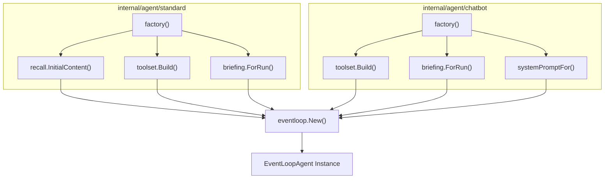
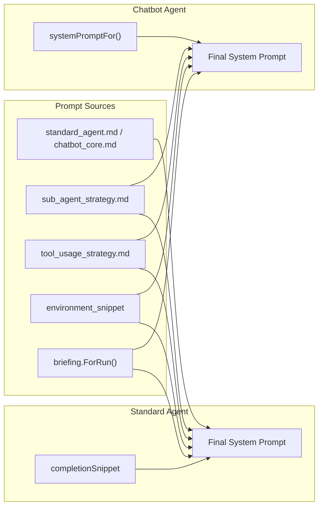

<!-- source: DeepWiki mcp.deepwiki.com · repo google-deepmind/amplio · page 3.2 Agent Types: Standard and Chatbot · fetched 2026-10-26 -->

# Agent Types: Standard and Chatbot

Relevant source files

The following files were used as context for generating this wiki page:

- [internal/agent/chatbot/chatbot.go](internal/agent/chatbot/chatbot.go)
- [internal/agent/eventloop/prompts/sub_agent_strategy.md](internal/agent/eventloop/prompts/sub_agent_strategy.md)
- [internal/agent/standard/standard.go](internal/agent/standard/standard.go)
- [internal/agent/standard/standard_agent.md](internal/agent/standard/standard_agent.md)

Amplio supports two primary agent implementations: the **Standard Agent** and the **Chatbot**. Both are built upon the `EventLoopAgent` core but differ in their intended autonomy, system prompt construction, and termination behavior.

## Overview of Agent Factories

Agent types are registered in a global registry using `agent.Register` [internal/agent/agent.go:76-85](). Each registration provides a factory function that assembles the agent's environment, tools, and system prompts.

| Agent Type | Purpose | Interaction Model |
| :--- | :--- | :--- |
| `standard_agent` | Autonomous research and coding. | Background/Autonomous |
| `chatbot` | Interactive assistance and sidecar support. | Interactive/UI-driven |

### Data Flow: Factory to EventLoop

The following diagram illustrates how the factory functions in `standard.go` and `chatbot.go` assemble the `eventloop.Config` before initializing the `EventLoopAgent`.

**Agent Initialization Flow**

Sources: [internal/agent/standard/standard.go:49-106](), [internal/agent/chatbot/chatbot.go:71-117]()

---

## The Standard Agent (`standard_agent`)

The `standard_agent` is designed for long-horizon, autonomous tasks. It is defined in the `internal/agent/standard` package [internal/agent/standard/standard.go:42]().

### System Prompt Assembly
The system prompt for the standard agent is a layered assembly of specialized snippets:
1.  **Core Instructions**: The `standard_agent.md` file, which defines research methodologies (Focused vs. Open-ended) [internal/agent/standard/standard_agent.md:1-19]().
2.  **Execution Principles**: General guidelines for reasoning and planning [internal/agent/standard/standard.go:92]().
3.  **Environment Snippet**: Information about the runtime environment [internal/agent/standard/standard.go:93]().
4.  **Strategy Snippets**: Guidance on tool usage and sub-agent delegation [internal/agent/standard/standard.go:94-95]().
5.  **Completion Snippet**: Defines how the agent signals it is done [internal/agent/standard/standard.go:37-41]().
6.  **Briefings**: User-provided or run-specific markdown instructions [internal/agent/standard/standard.go:98]().

### Recall Seeding
Unique to the standard agent is the `InitialRecall` mechanism. During factory construction, if a `SkillIndex` or `LessonIndex` is available, the agent seeds its initial context with relevant snippets derived from the task description using `recall.InitialContent` [internal/agent/standard/standard.go:76-82]().

### Termination Behavior
The standard agent uses an "absence of tool calls" signal for completion. The `completionSnippet` instructs the agent to provide a final plain-text summary without any tool calls to signal the end of the task [internal/agent/standard/standard.go:37-40]().

Sources: [internal/agent/standard/standard.go:37-106](), [internal/agent/standard/standard_agent.md:1-19]()

---

## The Chatbot Agent (`chatbot`)

The `chatbot` agent is optimized for interactive sessions and acting as a "sidecar" to an autonomous agent. It is defined in `internal/agent/chatbot` [internal/agent/chatbot/chatbot.go:64]().

### Role-Based Prompting
The chatbot dynamically adjusts its system prompt based on its role within the run. The `systemPromptFor` function checks if the session is the root of the run or if an autonomous agent already exists [internal/agent/chatbot/chatbot.go:49-60]().

*   **Root Prompt**: Used when the chatbot is the primary agent in the run [internal/agent/chatbot/chatbot.go:42]().
*   **Sidecar Prompt**: Used when the chatbot is added to a run that already has a `standard_agent` root [internal/agent/chatbot/chatbot.go:43](). This prompt adjusts the chatbot's perspective to be a collaborator rather than the primary driver.

### Interaction Traits
The chatbot is registered with the `Interactive: true` trait [internal/agent/chatbot/chatbot.go:67](). This tells the `RunManager` and frontend that this agent expects frequent user input and should be prioritized in the chat UI.

Sources: [internal/agent/chatbot/chatbot.go:41-69](), [internal/agent/chatbot/chatbot.go:97-114]()

---

## Common Components

Both agent types share a significant portion of their logic and configuration via the `eventloop` and `toolset` packages.

### Shared System Snippets
Standardized snippets are imported to ensure consistent behavior across different agent types:
*   **Sub-Agent Strategy**: Guidance on using `spawn_agent`, workspace modes (`share` vs `link`), and coordination via `send_message` and `await_event` [internal/agent/eventloop/prompts/sub_agent_strategy.md:3-12]().
*   **Artifact Directory**: Instructions on where to store and retrieve files [internal/agent/chatbot/chatbot.go:108]().

### Toolset Construction
Both agents utilize `toolset.Build` to generate their available tools [internal/agent/standard/standard.go:61-72](), [internal/agent/chatbot/chatbot.go:79-90](). This includes:
*   **Bash**: For command execution.
*   **Recall**: For searching skills and lessons.
*   **Coordination**: For managing sub-agents and communication.

**System Prompt Composition Map**

Sources: [internal/agent/standard/standard.go:91-98](), [internal/agent/chatbot/chatbot.go:104-109](), [internal/agent/eventloop/prompts/sub_agent_strategy.md:3-12]()

### Briefing Injection
Both factories call `briefing.ForRun` to fetch relevant markdown files [internal/agent/standard/standard.go:59](), [internal/agent/chatbot/chatbot.go:95]().
*   **Root Agents**: Receive `scope:root` briefings and user-selected briefings.
*   **Sub-agents**: Only receive briefings relevant to their specific task or global scope.

Sources: [internal/agent/standard/standard.go:59-60](), [internal/agent/chatbot/chatbot.go:95-96]()

---

