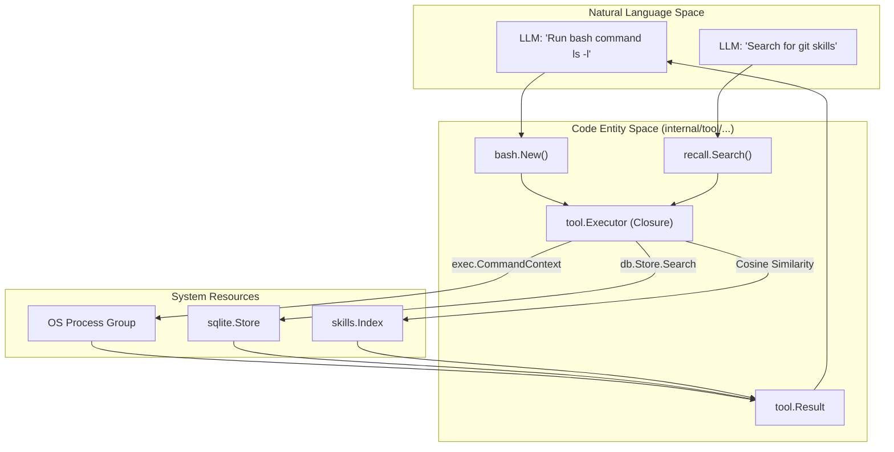
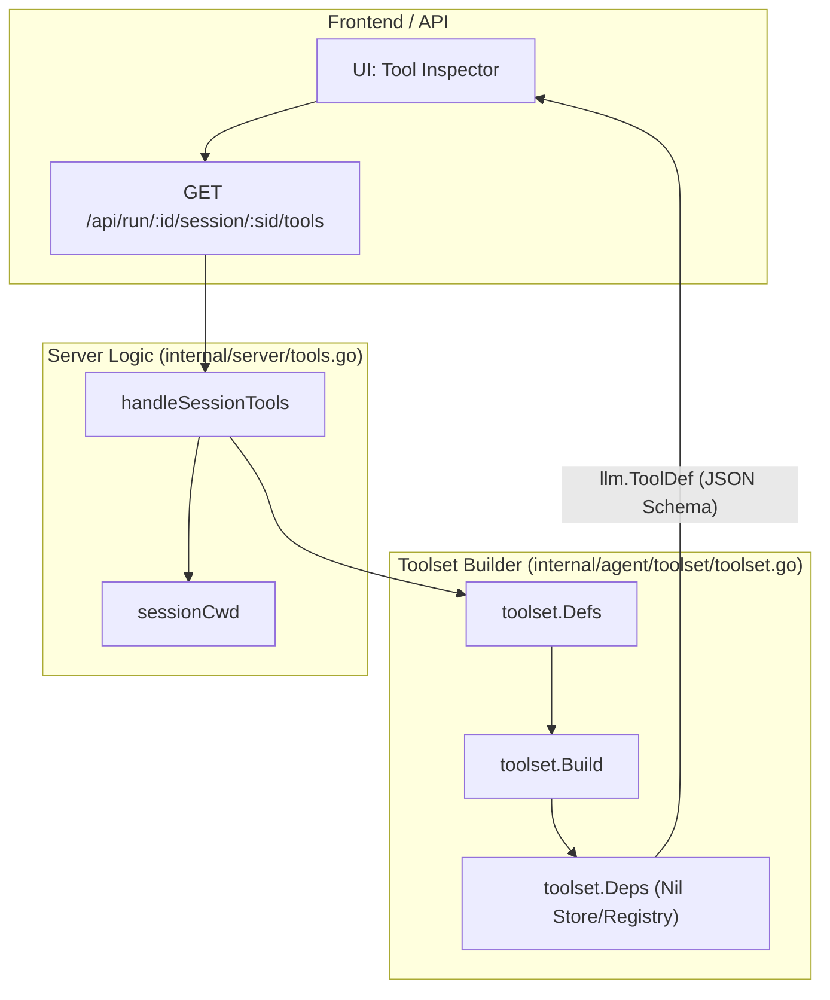

<!-- source: DeepWiki mcp.deepwiki.com · repo google-deepmind/amplio · page 3.3 Agent Toolset · fetched 2026-10-26 -->

# Agent Toolset

Relevant source files

The following files were used as context for generating this wiki page:

- [cmd/amplio/system.go](cmd/amplio/system.go)
- [internal/agent/toolset/toolset.go](internal/agent/toolset/toolset.go)
- [internal/llm/openai/openai.go](internal/llm/openai/openai.go)
- [internal/llm/spec_test.go](internal/llm/spec_test.go)
- [internal/server/tools.go](internal/server/tools.go)
- [internal/tool/bash/bash.go](internal/tool/bash/bash.go)
- [internal/tool/spawn/spawn_test.go](internal/tool/spawn/spawn_test.go)

The Agent Toolset provides the interface between an agent's reasoning loop and the external world. Amplio employs a "dual-call" pattern for tool definitions to ensure that the documentation presented to the LLM (schemas) and the tools displayed in the UI (trajectory viewer) never drift from the actual executable implementation.

## Toolset Construction

The `toolset` package is responsible for assembling the list of tools shared by both the `standard_agent` and the `chatbot`.

### The Dual-Call Pattern
To prevent drift between the runtime and the UI, the toolset is designed to be called twice:
1.  **Runtime Construction**: Called by agent factories with real dependencies (`db.Store`, `session.Registry`, etc.) to build executable tools [internal/agent/toolset/toolset.go:19-20]().
2.  **Display/Schema Construction**: Called with `nil` dependencies to generate `llm.ToolDef` objects. Constructors capture dependencies in closures, allowing schemas to be generated even when the underlying services are unavailable [internal/agent/toolset/toolset.go:45-49]().

### Data Flow and Dependencies
The `Deps` struct encapsulates all resources a tool might need. Tools are appended in a specific order, ensuring consistent presentation to the LLM [internal/agent/toolset/toolset.go:50-70]().

| Dependency | Purpose |
| :--- | :--- |
| `Store` | Persistence for inspection and recall tools [internal/agent/toolset/toolset.go:56](). |
| `Registry` | Coordination and session management [internal/agent/toolset/toolset.go:57](). |
| `Env` | Workspace and spawning context [internal/agent/toolset/toolset.go:58](). |
| `SkillIndex` | Vector search for pre-defined skills [internal/agent/toolset/toolset.go:61](). |
| `LessonIndex` | Search for lessons mined from previous runs [internal/agent/toolset/toolset.go:62](). |

Sources: [internal/agent/toolset/toolset.go:1-112]()

## Core Tools

### Bash Tool
The `bash` tool provides shell execution with strict safety and resource management.
*   **Process Group Management**: On timeout or cancellation, the tool kills the entire process group to prevent orphaned children [internal/tool/bash/bash.go:161-163]().
*   **Output Capping**: To prevent context window overflow or memory exhaustion from runaway processes, output is capped (default 32,000 characters) [internal/tool/bash/bash.go:47-53]().
*   **Environment Injection**: Subprocesses receive `AMPLIO_RUN_ID`, `AMPLIO_SESSION_ID`, and `AMPLIO_ARTIFACT_DIR` [internal/tool/bash/bash.go:72-82]().
*   **Notify Shim**: Agents are provided with an `amplio-notify` binary in their `PATH`, allowing background scripts to report status back to the agent loop [internal/tool/bash/bash.go:94-97]().

### File Manipulation
*   **view_file**: Reads files from the workspace or artifact directory [internal/agent/toolset/toolset.go:72]().
*   **edit_file**: Provides structured editing capabilities [internal/agent/toolset/toolset.go:73]().

### Coordination and Spawning
*   **spawn**: Creates a sub-agent session. It supports `link` mode, which creates a git worktree or linked workspace so the child can work in parallel without interfering with the parent's file state [internal/tool/spawn/spawn_test.go:99-116]().
*   **send_message**: Inter-agent communication [internal/agent/toolset/toolset.go:74]().
*   **await_event**: Parks the agent until a specific signal or message is received [internal/agent/toolset/toolset.go:76]().

### Inspect and Recall
*   **Session Tools**: `session_list`, `session_steps`, and `session_peek` allow agents to observe the state of their peers or sub-agents [internal/agent/toolset/toolset.go:77-79]().
*   **Recall Tools**: `recall_search` and `recall_load` interface with the `skills.Index` and `lessons.Index` to retrieve relevant expertise or past experiences [internal/agent/toolset/toolset.go:89-91]().

Sources: [internal/tool/bash/bash.go:15-185](), [internal/agent/toolset/toolset.go:65-92](), [internal/tool/spawn/spawn_test.go:74-120]()

## Tool Architecture and Data Flow

The following diagram illustrates how the natural language request for a tool execution maps to the underlying code entities and system resources.

### Tool Execution Mapping
"Natural Language Space to Code Entity Space"

Sources: [internal/agent/toolset/toolset.go:65-92](), [internal/tool/bash/bash.go:105-124](), [internal/tool/bash/bash.go:149-163]()

### Dual-Call Discovery Flow
This diagram shows how the `Server` provides tool definitions to the UI using the same logic the `Agent` uses for execution.

Sources: [internal/server/tools.go:48-69](), [internal/agent/toolset/toolset.go:98-112]()

## Artifact Directory
Agents are provided with a dedicated scratch space defined by the `AMPLIO_ARTIFACT_DIR` environment variable [internal/tool/bash/bash.go:36-43](). This directory is persistent across the run and is used for:
1.  **Intermediate Files**: Large data outputs that should not be in the LLM context window.
2.  **Cross-Agent Sharing**: A common area where sub-agents and parent agents can exchange large artifacts.
3.  **UI Integration**: The frontend linkifies paths starting with this variable to allow users to download or view generated files [internal/tool/bash/bash.go:41-43]().

Sources: [internal/tool/bash/bash.go:34-43](), [internal/tool/bash/bash.go:77-78]()

---

