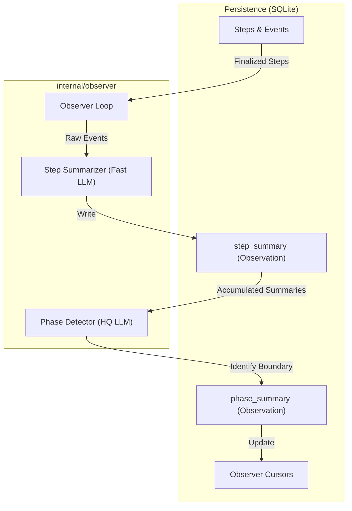

<!-- source: DeepWiki mcp.deepwiki.com · repo google-deepmind/amplio · page 3.4 Observer, Phases, and Compaction · fetched 2026-10-26 -->

# Observer, Phases, and Compaction

Relevant source files

The following files were used as context for generating this wiki page:

- [internal/agent/eventloop/doc.go](internal/agent/eventloop/doc.go)
- [internal/observer/phase.go](internal/observer/phase.go)
- [internal/observer/phase_kind_test.go](internal/observer/phase_kind_test.go)
- [internal/observer/prompts_test.go](internal/observer/prompts_test.go)

The **Observer** is a background subsystem responsible for analyzing agent trajectories in real-time. It transforms raw, low-level execution events into high-level semantic units called **Phases** and provides the necessary summarization for **Context Compaction**. This ensures that agents can maintain long-running sessions without exceeding LLM context windows or losing narrative coherence.

## System Architecture

The Observer runs as a background goroutine for each active session, monitoring the `sqliteStore` for new finalized steps. It performs three primary functions:
1.  **Step Summarization**: Distilling individual steps into concise `step_summary` observations.
2.  **Phase Detection**: Grouping sequences of steps into logical "Phases" based on activity shifts.
3.  **Compaction**: Triggering a specialized agent to compress the session history when the token count or step count exceeds defined thresholds.

### Data Flow and Code Entities

The following diagram illustrates how the Observer interacts with the persistence layer and the LLM providers to process session history.

**Observer Data Flow**

**Sources:** [internal/observer/observer.go:1-50](), [internal/db/store.go:1-100]()

---

## Phase Detection

A **Phase** is a contiguous range of steps representing a coherent unit of work. The Observer uses an "HQ" (High Quality) LLM to identify these boundaries. The definition of a boundary depends on the agent's `Traits` ([internal/agent/agent.go:25-40]()).

### Boundary Clauses
The system uses different criteria for ending a phase based on whether the session is autonomous or interactive:

| Session Type | Boundary Clause (`__BOUNDARY_CLAUSE__`) |
| :--- | :--- |
| **Autonomous** | A distinct semantic transition: activity shifts (exploration → debugging), milestones (tests passing), or hard pivots. |
| **Interactive** | A macro-level shift in the user's overarching goal or domain of focus (moving between distinct subsystems). |

**Sources:** [internal/observer/phase.go:56-62](), [internal/observer/phase_kind_test.go:85-95]()

### Implementation Details
*   **Thresholds**: A phase close is triggered once `phaseCharThreshold` (200,000 chars) of raw events accumulate [internal/observer/phase.go:34-40]().
*   **Hard Cap**: If carryover causes a chunk to exceed `phaseCharHardCap` (800,000 chars), it is truncated at a step boundary [internal/observer/phase.go:43-44]().
*   **System Prompt**: The `phaseSystemPrompt` is constructed by injecting the appropriate boundary clause into a template that instructs the LLM to find the `end_step`, evaluate productivity, and extract artifacts [internal/observer/phase.go:87-101]().

---

## Step Summarization

Every finalized step is passed through a "Fast" LLM to produce a `step_summary`. This summary is stored as a `phase_summary` observation in the database but at a "step" granularity.

*   **Objective**: To provide a judgmental, analytical summary of the agent's behavior (e.g., identifying thrashing, repetitive debugging, or successful progress).
*   **Artifact Extraction**: The summarizer identifies up to 5 high-signal artifacts (file paths, commands, etc.) [internal/observer/phase.go:98-100]().
*   **Lesson Verification**: The observer tracks lessons loaded via `recall_load` and asks the LLM to judge if the lesson was `helpful`, `neutral`, `unhelpful`, or `harmful` based on subsequent actions [internal/observer/phase.go:105-110]().

**Sources:** [internal/observer/phase.go:88-101](), [internal/observer/prompts_test.go:27-42]()

---

## Context Compaction

Compaction is the process of reducing the "live" context of an agent by replacing a range of detailed steps with a single summary event. This is managed by the `EventLoopAgent`.

### The Compaction Process
When a session exceeds the context limit, the agent triggers a **Generation Bump**.
1.  **Trigger**: The `EventLoopAgent` detects that the message history is too long.
2.  **Compaction Agent**: A specialized, internal agent is spawned to read the history and the `phase_summary` entries produced by the Observer.
3.  **Summary Generation**: The compaction agent produces a narrative summary of the steps being "archived."
4.  **Generation Increment**: The `generation` field in the database is incremented. All events from the previous generation are hidden from the primary agent's active context, replaced by the new summary.

### Compaction Invariants
*   **Step Continuity**: Compaction always occurs at a step boundary.
*   **AssistantEvent Invariant**: The `AssistantEvent` is always the last event of a step. Compaction must respect this to ensure the agent resumes in a valid state [internal/agent/eventloop/doc.go:17-21]().

**Sources:** [internal/agent/eventloop/doc.go:15-22](), [internal/db/store.go:150-200]()

---

## Technical Summary of Observer Cursors

The `sqliteStore` maintains three specific cursors to track the Observer's progress:

| Cursor Name | Description |
| :--- | :--- |
| `last_finalized_step` | The highest step number where all events (including the `AssistantEvent`) have been written. |
| `last_summarized_step` | The highest step for which a `step_summary` has been generated. |
| `last_phased_step` | The highest step included in a finalized `phase_summary`. |

**Sources:** [internal/persistence/sqlite/store.go:50-100]() (Conceptual reference to store implementation).

---

