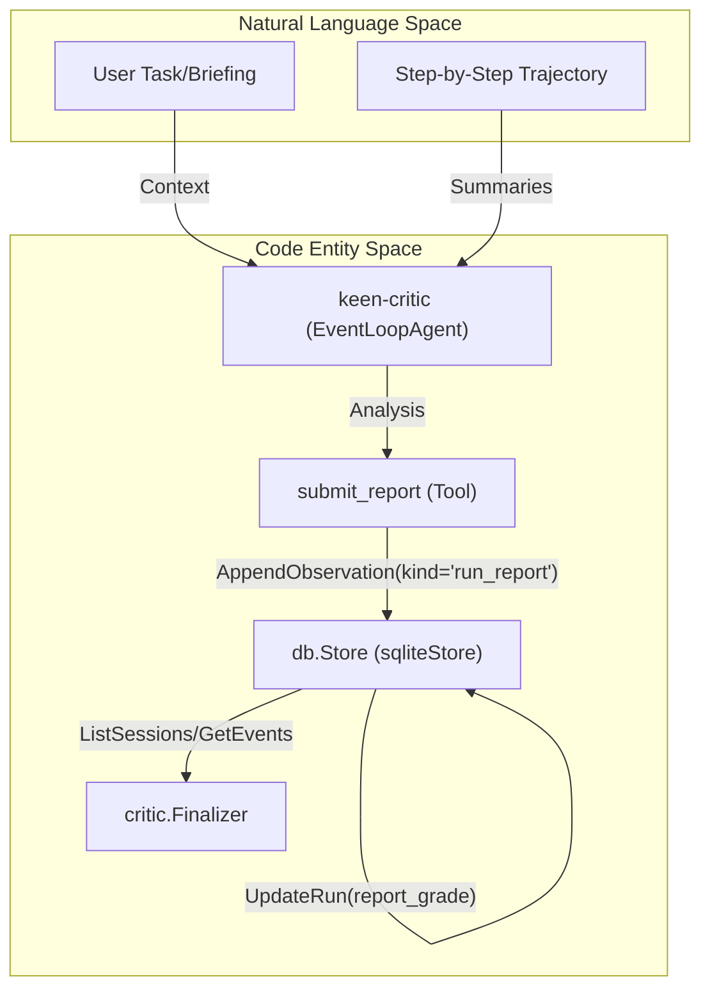
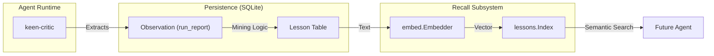

<!-- source: DeepWiki mcp.deepwiki.com · repo google-deepmind/amplio · page 3.5 Critic and Run Reports · fetched 2026-10-26 -->

# Critic and Run Reports

Relevant source files

The following files were used as context for generating this wiki page:

- [cmd/amplio/recall.go](cmd/amplio/recall.go)
- [cmd/amplio/reports.go](cmd/amplio/reports.go)
- [cmd/amplio/reports_test.go](cmd/amplio/reports_test.go)
- [cmd/amplio/serve_test.go](cmd/amplio/serve_test.go)
- [cmd/amplio/spec.go](cmd/amplio/spec.go)
- [cmd/amplio/titlegen.go](cmd/amplio/titlegen.go)
- [internal/agent/critic/finalizer.go](internal/agent/critic/finalizer.go)
- [internal/db/sqlite/grades_test.go](internal/db/sqlite/grades_test.go)
- [internal/db/sqlite/sqlite.go](internal/db/sqlite/sqlite.go)
- [internal/server/artifacts_test.go](internal/server/artifacts_test.go)
- [internal/server/briefings_test.go](internal/server/briefings_test.go)
- [internal/server/grades_test.go](internal/server/grades_test.go)

The **Finalizer** and **Critic** subsystem is responsible for evaluating the performance of autonomous runs. Once a run's main agent concludes its task, the Finalizer triggers a high-quality (HQ) LLM agent—the **keen-critic**—to analyze the session trajectory, assign a grade, extract lessons, and identify key artifacts.

## Overview and Triggering

The `Finalizer` struct in [internal/agent/critic/finalizer.go:74-83]() manages the lifecycle of report generation. It ensures idempotency and serializes generation per run using a per-run mutex map [internal/agent/critic/finalizer.go:105-114]().

Reports are triggered in three ways:
1.  **Auto-trigger**: The background observer detects that the `main-agent` session has transitioned to `concluded` [internal/agent/critic/finalizer.go:127-149]().
2.  **Backfill**: On system startup, the `backfillReports` function scans for concluded runs that lack a report (e.g., if the server crashed before finalizing) and processes them [cmd/amplio/reports.go:32-45]().
3.  **On-demand**: Operators can manually trigger a report generation via the REST API.

### Debouncing with ReportSkipMinSteps
To prevent "report spam" from minor reactivations (where a concluded agent is nudged by a stray notification and re-concludes after only a few steps), the system implements a threshold check:
*   **`ReportSkipMinSteps` (30)**: If a previous report exists, a new one is only generated if the main agent has advanced at least 30 steps since the last report [internal/agent/critic/finalizer.go:68-68]().
*   Small deltas are accumulated; no data is lost, only debounced until the threshold is met [internal/agent/critic/finalizer.go:65-67]().

Sources: [internal/agent/critic/finalizer.go:15-170](), [cmd/amplio/reports.go:32-61]()

## The Keen-Critic Agent

The critic is not a simple heuristic but a specialized `EventLoopAgent` instance (often using a high-tier model like Claude 3.5 Sonnet or Gemini 1.5 Pro). It is provided with a projection of the run's history and a specific toolset to submit its findings.

### Data Flow: Run to Report

The following diagram illustrates how the `Finalizer` orchestrates data from the `sqliteStore` into the `keen-critic` agent and back into the database as an `Observation`.

**Report Generation Flow**

Sources: [internal/agent/critic/finalizer.go:89-118](), [internal/db/sqlite/sqlite.go:155-158]()

## Report Structure and Schema

Reports are stored as `Observation` records with the kind `run_report` [internal/agent/critic/finalizer.go:51-51](). The data payload is a structured JSON object containing:

| Field | Description |
| :--- | :--- |
| **Summary** | A high-level narrative of what the agent accomplished. |
| **Grade** | A numeric score (1-5) representing the critic's evaluation. |
| **Achievements** | A list of successful milestones reached during the run. |
| **Failures** | Explicit errors or missed requirements. |
| **Struggles** | Inefficiencies, loops, or difficulties that didn't necessarily cause failure. |
| **Artifacts** | Pointers to relevant files produced (e.g., logs, binaries, documents). |
| **Phases** | A breakdown of the run into logical segments (e.g., "Exploration", "Implementation"). |

### Grade System
The system maintains two distinct grades for every run in the `Run` table:
*   **`report_grade`**: The automated grade assigned by the `keen-critic` [internal/db/sqlite/sqlite.go:158-158]().
*   **`grade`**: A human-provided override (0=ungraded, 1=garbage, 5=excellent) [internal/db/sqlite/sqlite.go:157-157]().

The UI displays the human grade if present; otherwise, it shows the critic's grade.

Sources: [internal/db/sqlite/sqlite.go:150-160](), [internal/server/grades_test.go:31-43]()

## Lesson Mining

A critical side-effect of the Finalizer is **Lesson Mining**. As the critic analyzes failures and struggles, it extracts generalized "lessons" that are indexed into the `Lesson` table [internal/db/sqlite/sqlite.go:169-169]().

These lessons are:
1.  **Stored Permanently**: Unlike session events which may be archived, lessons persist to inform future runs.
2.  **Vectorized**: Lessons are passed to the `embed.Embedder` to generate vectors for the `lessons.Index` [cmd/amplio/recall.go:146-152]().
3.  **Retrieved via Recall**: Future agents performing similar tasks will "recall" these lessons via the `recall_knowledge` tool, allowing the system to learn from past mistakes across different runs.

**Lesson Persistence Architecture**

Sources: [cmd/amplio/recall.go:123-152](), [internal/agent/critic/finalizer.go:78-78]()

## Implementation Details

### In-Flight Tracking
Because report generation can take 30-60 seconds (due to HQ LLM latency), the `Finalizer` uses an `InflightTracker` (implemented by the `EphemeralAgentRegistry`) to signal to the UI that a report is currently being generated [internal/agent/critic/finalizer.go:38-51](). This prevents the UI from showing a "No Report" state immediately after a run concludes.

### Panic Recovery
The `safeFinalize` wrapper ensures that if the critic agent panics (e.g., due to malformed LLM output or provider timeouts), it does not crash the main server process or stop the backfill loop for other runs [cmd/amplio/reports.go:54-61]().

Sources: [internal/agent/critic/finalizer.go:138-140](), [cmd/amplio/reports.go:47-61]()

---

