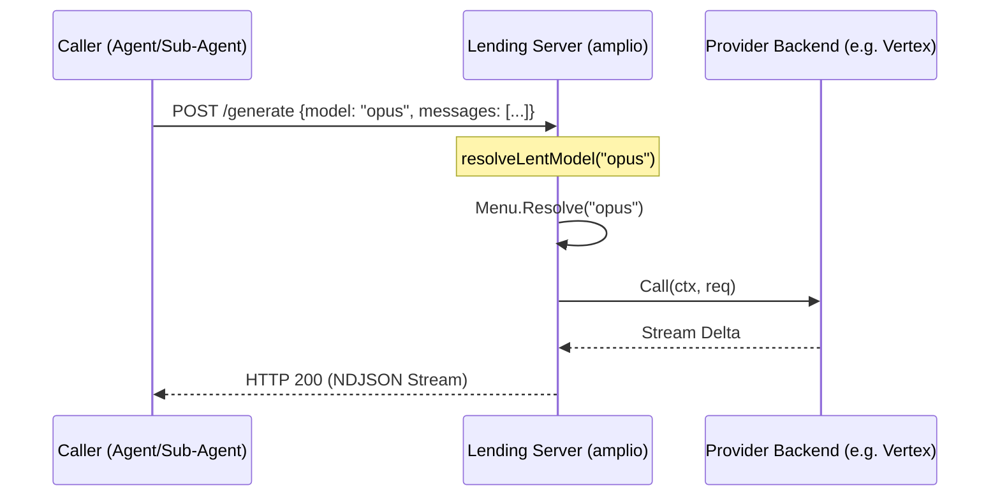

<!-- source: DeepWiki mcp.deepwiki.com · repo google-deepmind/amplio · page 4 LLM Provider Layer · fetched 2026-10-26 -->

# LLM Provider Layer

<details>
<summary>Relevant source files</summary>

The following files were used as context for generating this wiki page:

- [cmd/amplio/spec_test.go](cmd/amplio/spec_test.go)
- [docs/guide/models.md](docs/guide/models.md)
- [internal/config/load.go](internal/config/load.go)
- [internal/llm/bridge/transport_http.go](internal/llm/bridge/transport_http.go)
- [internal/llm/label.go](internal/llm/label.go)
- [internal/llm/label_test.go](internal/llm/label_test.go)
- [internal/llm/menu.go](internal/llm/menu.go)
- [internal/llm/menu_test.go](internal/llm/menu_test.go)
- [internal/server/llmapi.go](internal/server/llmapi.go)

</details>


The LLM Provider Layer is Amplio's abstraction for communicating with Large Language Models. It decouples the agent execution logic from specific API implementations, allowing the system to use diverse backends (Vertex AI, Anthropic, OpenAI, local subprocesses) through a unified interface. This layer manages model resolution, credential handling, and a specialized "spec string" format that encodes both infrastructure configuration and model-specific parameters.

## Architecture Overview

The provider layer sits between the **Agent System** and external **LLM APIs**. It is governed by the `llm.Provider` interface, which provides a standard `Call` method for generation and a `ModelID` method for identification [docs/guide/models.md:54-57]().

### Component Interaction

The following diagram illustrates how a request from an agent is resolved into a specific provider implementation using the **Menu** and **Spec** systems.

**LLM Resolution Pipeline**
```mermaid
graph TD
    subgraph "Natural Language Space (UI/Config)"
        A["'opus'" (Nickname)]
        B["'opus-5 · xhigh'" (Short Label)]
        C["'vertex-claude:claude-opus-5?effort=high'" (Raw Spec)]
    end

    subgraph "Code Entity Space (internal/llm)"
        D["llm.Menu.Resolve()"]
        E["llm.ParseSpec()"]
        F["llm.Spec struct"]
        G["llm.Provider Interface"]
    end

    subgraph "Provider Backends"
        H["anthropic.Provider"]
        I["gemini.Provider"]
        J["openai.Provider"]
        K["bridge.Provider"]
    end

    A --> D
    B --> D
    C --> D
    D --> E
    E --> F
    F --> G
    G --> H
    G --> I
    G --> J
    G --> K
    
    style G stroke-width:4px
```
**Sources:** [internal/llm/menu.go:47-55](), [internal/llm/spec.go:36-41](), [internal/llm/label.go:81-91]()

---

## The LLM Spec Format

Amplio uses a URI-like string format to define models. This format distinguishes between **Client Args** (interpreted by Amplio to configure the connection) and **Model Args** (passed verbatim to the LLM API).

**Spec Grammar:**
`<provider>{client_args}:<model>?model_args#nickname` [docs/guide/models.md:6-12]()

| Component | Description | Example |
| :--- | :--- | :--- |
| **Provider** | The registry key for the backend implementation. | `vertex-claude`, `openai`, `subprocess` |
| **Client Args** | `{k=v}` block. Interpreted by Amplio (e.g., `base_url`, `max_tokens`). | `{base_url=http://localhost:11434}` |
| **Model** | The specific model identifier for the provider. | `claude-3-5-sonnet`, `gpt-4o` |
| **Model Args** | `?k=v` query. Passed untouched to the upstream API. | `?thinking.type=adaptive&temperature=0.7` |
| **Nickname** | `#label`. A display-only override for the UI. | `#my-local-llama` |

For a deep dive into the grammar and canonicalization rules, see **[LLM Spec Format and Menu](#4.1)**.

**Sources:** [docs/guide/models.md:3-25](), [internal/llm/label.go:56-68]()

---

## Menu and Resolution System

The `llm.Menu` represents the set of models a server offers. It is the authority on how to reach a model. When a user or agent requests a model by a "handle" (a nickname, a short label, or a partial spec), the Menu resolves it to a canonical `llm.Spec` [internal/llm/menu.go:24-42]().

### Resolution Rules
1. **Nicknames Win:** An exact match on a `#nickname` takes precedence [internal/llm/menu.go:172-176]().
2. **Client Block Isolation:** The server's menu supplies the `client_args` (endpoints, credentials). Callers are forbidden from providing their own client blocks to prevent SSRF or unauthorized execution [internal/llm/menu.go:82-85]().
3. **Model Arg Merging:** Caller-supplied model arguments (like `temperature`) are merged into the menu's defaults, with the caller winning [internal/llm/menu.go:139-147]().

For details on the resolution pipeline and ShortLabel heuristics, see **[LLM Spec Format and Menu](#4.1)**.

**Sources:** [internal/llm/menu.go:55-78](), [internal/llm/menu_test.go:198-204]()

---

## Provider Backends

Amplio supports several built-in provider families. Each handles its own authentication, retry logic, and specific features like "thinking" (reasoning) tokens.

| Prefix | Backend | Key Features |
| :--- | :--- | :--- |
| `vertex-claude` | Anthropic on Google Cloud | Supports `cache_ttl`, Vertex AI auth [docs/guide/models.md:47](). |
| `vertex-gemini` | Gemini on Google Cloud | Typed `ThinkingConfig`, Google ADC auth [docs/guide/models.md:49](). |
| `openai` | OpenAI-Compatible | Universal `/v1/chat/completions` support via `base_url` [docs/guide/models.md:51](). |
| `subprocess` | Local Bridge | Spawns a local binary to handle requests [docs/guide/models.md:52](). |
| `bridge` | Remote Bridge | Dials a remote HTTP/Unix socket bridge [internal/llm/bridge/transport_http.go:35-40](). |

For implementation details on retries, thinking signatures, and tool handling, see **[Provider Implementations](#4.2)**.

**Sources:** [docs/guide/models.md:45-53](), [internal/llm/bridge/transport_http.go:109-115]()

---

## Bridge Protocol and Lending

The **Bridge Protocol** is an NDJSON-based communication standard that allows Amplio to talk to LLMs through an intermediary. This is used for two purposes:
1. **Subprocess/Remote Bridges:** Reaching models not natively supported by Go or behind corporate gateways.
2. **LLM Lending:** An Amplio server can act as a bridge for other Amplio instances, sharing its credentials securely via a dedicated `lend_llm` listener [internal/server/llmapi.go:29-38]().

**Lending and Bridge Data Flow**

**Sources:** [internal/server/llmapi.go:44-61](), [internal/server/llmapi.go:82-95]()

For the NDJSON message format and transport details, see **[Bridge Protocol](#4.3)**.

**Sources:** [internal/llm/bridge/transport_http.go:75-81](), [internal/server/llmapi.go:48-56]()

---

