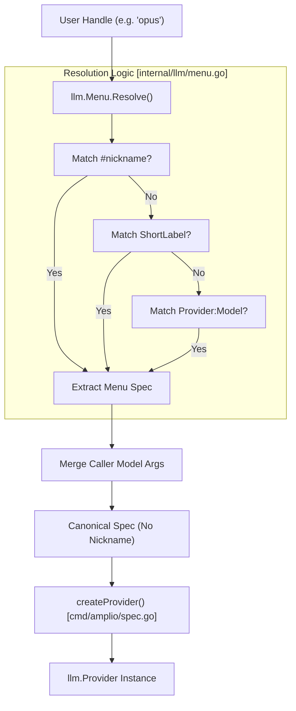
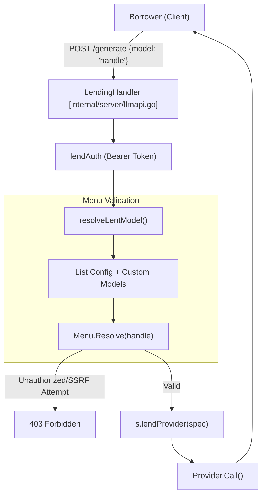

<!-- source: DeepWiki mcp.deepwiki.com · repo google-deepmind/amplio · page 4.1 LLM Spec Format and Menu · fetched 2026-10-26 -->

# LLM Spec Format and Menu

<details>
<summary>Relevant source files</summary>

The following files were used as context for generating this wiki page:

- [cmd/amplio/spec_test.go](cmd/amplio/spec_test.go)
- [frontend/src/lib/components/RunCard.svelte](frontend/src/lib/components/RunCard.svelte)
- [internal/config/load.go](internal/config/load.go)
- [internal/llm/bridge/transport_http.go](internal/llm/bridge/transport_http.go)
- [internal/llm/label.go](internal/llm/label.go)
- [internal/llm/label_test.go](internal/llm/label_test.go)
- [internal/llm/menu.go](internal/llm/menu.go)
- [internal/llm/menu_test.go](internal/llm/menu_test.go)
- [internal/server/llmapi.go](internal/server/llmapi.go)
- [internal/server/llmapi_test.go](internal/server/llmapi_test.go)

</details>


Amplio uses a structured string grammar for defining LLM configurations, known as a **Spec**. This format allows for complex provider settings, model parameters, and human-readable nicknames to be encoded into a single string. The **Menu** system manages the resolution of these specs, ensuring that sensitive infrastructure details (like API endpoints) remain server-side while allowing clients to request models by nickname or alias.

## 1. LLM Spec Grammar

A full LLM spec follows this canonical structure:
`provider{client_args}:model?model_args#nickname`

| Component | Description | Example |
| :--- | :--- | :--- |
| **Provider** | The backend implementation (e.g., `openai`, `vertex-claude`, `bridge`). | `openai` |
| **Client Block** | Optional `{key=value}` block for infrastructure settings (URLs, profiles, timeouts). These are consumed by Amplio's provider factory. | `{base_url=http://localhost:11434/v1}` |
| **Model** | The specific model identifier required by the provider. | `gpt-4o` |
| **Model Args** | Optional `?key=value` query string for inference parameters (temperature, top_p, effort). These are forwarded to the LLM. | `?temperature=0.7` |
| **Nickname** | Optional `#name` for display and easy reference. It is never sent to the provider. | `#my-local-gpt` |

### Parsing and Canonicalization
The `ParseSpec` function in `internal/llm/spec.go` (not provided in snippet, but referenced by `ShortLabel` in [internal/llm/label.go:82-91]()) decomposes the string. The `BaseSpec` function is used to strip nicknames before a spec is used to instantiate a provider [internal/llm/label.go:73-76]().

**Sources:** [internal/llm/label.go:48-76](), [internal/llm/label_test.go:95-107]()

---

## 2. The Menu Resolution Pipeline

The `Menu` struct [internal/llm/menu.go:47-50]() acts as a registry of models offered by the server. It serves two purposes:
1. **Display:** Providing the list of models for the UI picker.
2. **Security:** Acting as an allowlist for the **Lending API**.

### Resolution Logic
When a user or a bridged client provides a "handle" (which could be a nickname, a short label, or a partial spec), the `Resolve` function [internal/llm/menu.go:55-78]() follows these rules:

1.  **Nickname Match:** If the handle matches a `#nickname` defined in the menu, it resolves to that entry's full spec [internal/llm/menu.go:174]().
2.  **ShortLabel Match:** If no nickname matches, it tries to match the handle against the `ShortLabel` heuristic (e.g., `opus-5 · xhigh`) [internal/llm/menu.go:175]().
3.  **Spec Match:** If the handle is a spec (e.g., `openai:gpt-4o`), it must match the `provider` and `model` of exactly one menu entry [internal/llm/menu.go:34]().
4.  **Argument Merging:** If a spec is provided, the caller's `model_args` are merged over the menu entry's args, with the caller winning [internal/llm/menu.go:139-148]().
5.  **Client Block Protection:** Callers are **forbidden** from providing their own `{client_args}`. The server always supplies these from the menu entry to prevent SSRF or arbitrary execution via `subprocess` [internal/llm/menu.go:82-85]().

### Menu Resolution Data Flow
This diagram illustrates how a user-provided handle is transformed into a concrete `llm.Provider`.


**Sources:** [internal/llm/menu.go:24-148](), [internal/server/llmapi.go:82-95]()

---

## 3. ShortLabel Heuristics

Because specs can be extremely long, `ShortLabel` derives a compact, human-readable string for UI chips and menus.

*   **Priority:** An explicit `#nickname` always wins [internal/llm/label.go:92-94]().
*   **Redundancy Stripping:** `claude-opus-5` becomes `opus-5` [internal/llm/label.go:133]().
*   **Facets:** Key distinguishing features like `effort` or `thinking_level` are appended with a `·` separator [internal/llm/label.go:152-155]().
*   **Contextual Hostnames:** For `openai` providers, the host/port is surfaced to distinguish between local and remote servers [internal/llm/label.go:148-150]().
*   **Bridge Symbol:** Bridged models are prefixed with `⇄` [internal/llm/label.go:119]().
*   **Truncation:** Labels are capped at 40 characters to prevent UI layout breakage [internal/llm/label.go:46]().

**Sources:** [internal/llm/label.go:24-156](), [internal/llm/label_test.go:21-91]()

---

## 4. LLM Lending API

Lending allows one Amplio instance (the "Lender") to share its LLM credentials with another instance or client (the "Borrower").

### Security Model
*   **Separate Listener:** Lending runs on a dedicated port defined by `lend_llm` in `config.toml` [internal/config/load.go:49]().
*   **Dedicated Token:** It uses `AMPLIO_BRIDGE_TOKEN`, which is separate from the main administrative token [internal/server/llmapi.go:40-43]().
*   **Restricted Surface:** The lending listener only exposes `/generate`, `/embed`, `/models`, and `/health`. It provides no access to run data or shell tools [internal/server/llmapi.go:47-60]().

### Request Handling
When a `/generate` request arrives at the lending listener, the server uses the `Menu` resolution pipeline to ensure the requested model is authorized.


**Sources:** [internal/server/llmapi.go:29-107](), [internal/server/llmapi_test.go:58-81](), [internal/llm/bridge/transport_http.go:109-157]()

---

## 5. Configuration Reference

Bridges and lending are configured in `config.toml`.

| Key | Type | Description |
| :--- | :--- | :--- |
| `run.llms` | `[]string` | The primary list of models offered in the UI. |
| `bridge` | `map` | Named bridge endpoints to simplify specs. |
| `lend_llm` | `string` | Bind address for the lending listener (e.g., `127.0.0.1:26760`). |
| `lend_llm_token_env`| `string` | Env var name containing the lending secret. |

**Example Bridge Config:**
```toml
[bridge.corp]
url = "https://llm-proxy.corp.example.com"
token_env = "CORP_PROXY_TOKEN"
```
A spec can then use `bridge{endpoint=corp}:gpt-4o` instead of specifying the full URL.

**Sources:** [internal/config/load.go:31-67](), [internal/llm/bridge/transport_http.go:64-73]()

---

