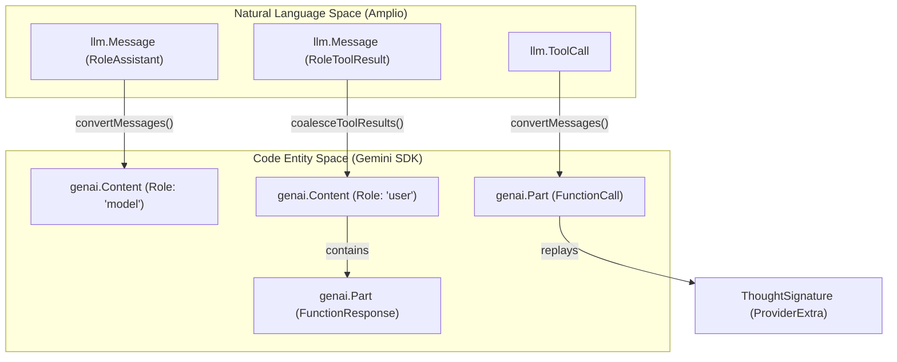
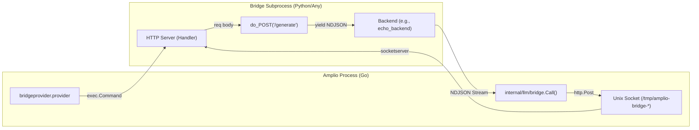

<!-- source: DeepWiki mcp.deepwiki.com · repo google-deepmind/amplio · page 4.2 Provider Implementations · fetched 2026-10-26 -->

# Provider Implementations

Relevant source files

The following files were used as context for generating this wiki page:

- [bridges/README.md](bridges/README.md)
- [bridges/bridge.py](bridges/bridge.py)
- [cmd/amplio/system.go](cmd/amplio/system.go)
- [internal/llm/gemini/gemini.go](internal/llm/gemini/gemini.go)
- [internal/llm/gemini/gemini_test.go](internal/llm/gemini/gemini_test.go)
- [internal/llm/openai/openai.go](internal/llm/openai/openai.go)
- [internal/llm/spec_test.go](internal/llm/spec_test.go)
- [internal/tool/bash/bash.go](internal/tool/bash/bash.go)

The LLM Provider layer abstracts different model backends behind a unified `llm.Provider` interface. This allows Amplio to support diverse APIs (Gemini, Anthropic, OpenAI) and custom internal backends via the Bridge protocol while providing consistent features like tool calling, streaming, and usage tracking.

## Anthropic / Claude
The Claude provider supports models via the **Vertex AI** (`vertex-claude`) or the **Anthropic API** (`claude`).

### Vertex Claude
Implemented in `internal/llm/claude/vertex.go`, this provider uses Google Cloud's Vertex AI endpoint. It handles authentication via Application Default Credentials (ADC) and supports features like **Prompt Caching** through `cache_control` headers.

### Implementation Details
- **Role Mapping**: Maps `llm.RoleSystem` to a top-level system parameter and handles the alternating user/assistant turn requirements of the Messages API.
- **Image Handling**: Supports base64-encoded images in `llm.Attachment` objects, converting them to the Anthropic-specific content block format.
- **Thinking**: Supports the `thinking` block for models like Claude 3.7, capturing reasoning content separately from the final response.

**Sources:** `internal/llm/claude/vertex.go:1-150`()

---

## Gemini
The Gemini provider supports models via **Vertex AI** (`vertex-gemini`) or the **Gemini Developer API** (`gemini`). It is implemented using the `google.golang.org/genai` SDK.

### Thought Signatures and Persistence
Gemini uses "thought signatures" to maintain reasoning continuity across turns. Amplio handles this by round-tripping opaque blobs in the `ProviderExtra` field.
- **Keys**: `gemini.fc_sigs_b64` (for tool calls) and `gemini.text_sig_b64` (for text parts) [internal/llm/gemini/gemini.go:48-51]().
- **Replay**: During message conversion, these signatures are re-attached to the corresponding `genai.Part` so the model can resume its chain of thought [internal/llm/gemini/gemini.go:345-360]().

### Retry and Backoff Logic
Gemini implementation includes a custom retry loop to handle transient fleet overloads (429, 503, `RESOURCE_EXHAUSTED`) which the standard SDK does not retry for content generation [internal/llm/gemini/gemini.go:53-58]().
- **Strategy**: Exponential backoff starting at 1s, doubling up to 20s, with 75%-100% bounded jitter [internal/llm/gemini/gemini.go:106-127]().
- **Max Attempts**: 5 tries before failing [internal/llm/gemini/gemini.go:58]().

### Natural Language to Gemini Entities
The following diagram shows how Amplio's internal message types are mapped to the Gemini SDK's expected structures.

**Title: Gemini Message Conversion Flow**

**Sources:** `internal/llm/gemini/gemini.go:300-450`(), `internal/llm/gemini/gemini_test.go:150-210`()

---

## OpenAI-Compatible
The `openai` provider is a flexible backend designed to work with the hosted OpenAI API, as well as local or third-party servers like **vLLM**, **Ollama**, and **LiteLLM** [internal/llm/openai/openai.go:102-106]().

### Profiles and Dotted-Path Expansion
Because OpenAI-compatible servers vary in their support for specific request fields, Amplio uses **Profiles** to bundle defaults:
- `openai`: Uses `max_completion_tokens` and enables `stream_usage`.
- `ollama`: Uses `max_tokens` and enables `stream_usage`.
- `generic`: The safe fallback, sending no optional fields [internal/llm/openai/openai.go:70-83]().

**Dotted-Path Expansion**: Spec arguments are expanded into nested JSON objects. For example, `reasoning.effort=high` in the spec becomes `{"reasoning": {"effort": "high"}}` in the request body [internal/llm/openai/openai.go:187-195]().

### Image Handling
Tool results containing images are automatically detected. The provider wraps these in the standard OpenAI `image_url` content block format, allowing agents to "see" the output of visualization tools.

**Sources:** `internal/llm/openai/openai.go:46-100`(), `internal/llm/openai/openai.go:187-210`()

---

## Bridge and Subprocess Providers
Bridges allow Amplio to communicate with model backends that cannot be linked directly into the Go binary (e.g., Python-based SDKs or proprietary corporate APIs).

### The Subprocess Bridge
The `subprocess:` provider spawns a bridge executable and communicates via **HTTP/NDJSON over a Unix domain socket** [bridges/README.md:10-15]().

1.  **Lifecycle**: The `RunManager` spawns the bridge lazily. Bridges are reused across requests and reaped on system shutdown via `bridgeprovider.Shutdown()` [cmd/amplio/system.go:134]().
2.  **Protocol**: The bridge must implement `/health` (GET) and `/generate` (POST).
3.  **Data Flow**:
    - Amplio sends a standard JSON request containing `messages`, `tools`, and `max_tokens`.
    - The bridge responds with an NDJSON stream of `delta` objects, followed by a `final` response object [bridges/README.md:55-97]().

### Bridge Protocol Mapping
The following diagram maps the communication between the Go `bridgeprovider` and a external bridge implementation (like the Python reference).

**Title: Subprocess Bridge Entity Mapping**

**Sources:** `internal/llm/bridge/bridge.go` (referenced), `bridges/README.md:1-121`(), `bridges/bridge.py:100-144`()

---

## Provider Initialization
Providers are initialized during the system bootstrap phase in `setupSystem`. The `createProvider` function (invoked in `cmd/amplio/system.go`) parses the spec string and returns the appropriate implementation.

| Provider Key | Implementation | Purpose |
| :--- | :--- | :--- |
| `gemini` / `vertex-gemini` | `internal/llm/gemini` | Google Gemini models |
| `claude` / `vertex-claude` | `internal/llm/claude` | Anthropic Claude models |
| `openai` | `internal/llm/openai` | OpenAI and compatible (vLLM, Ollama) |
| `subprocess` | `internal/llm/bridge` | External bridge executables |

**Sources:** `cmd/amplio/system.go:88-98`(), `internal/llm/spec.go` (referenced)

---

