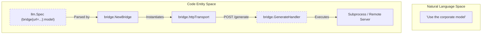
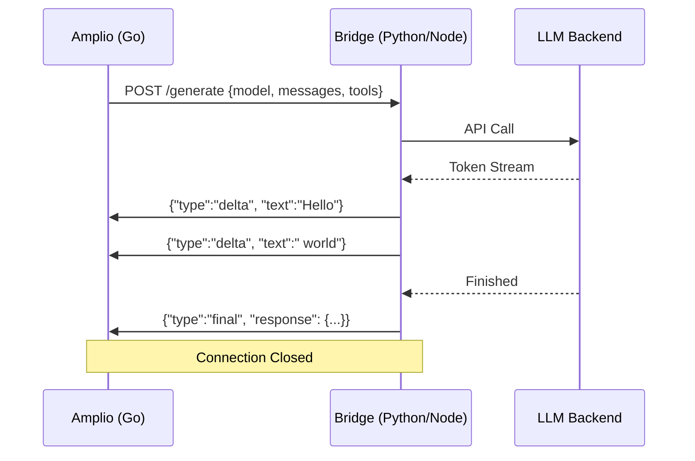

<!-- source: DeepWiki mcp.deepwiki.com · repo google-deepmind/amplio · page 4.3 Bridge Protocol · fetched 2026-10-26 -->

# Bridge Protocol

Relevant source files

The following files were used as context for generating this wiki page:

- [bridges/README.md](bridges/README.md)
- [bridges/bridge.py](bridges/bridge.py)
- [cmd/amplio/spec_test.go](cmd/amplio/spec_test.go)
- [cmd/amplio/system.go](cmd/amplio/system.go)
- [internal/config/load.go](internal/config/load.go)
- [internal/llm/bridge/transport_http.go](internal/llm/bridge/transport_http.go)
- [internal/llm/menu.go](internal/llm/menu.go)
- [internal/llm/menu_test.go](internal/llm/menu_test.go)
- [internal/llm/openai/openai.go](internal/llm/openai/openai.go)
- [internal/llm/spec_test.go](internal/llm/spec_test.go)
- [internal/server/llmapi.go](internal/server/llmapi.go)
- [internal/tool/bash/bash.go](internal/tool/bash/bash.go)

The **Bridge Protocol** is a lightweight, NDJSON-based communication standard that allows Amplio to interface with LLM providers hosted outside the main Go binary. This abstraction enables support for proprietary APIs, specialized SDKs (e.g., in Python), or remote credential-hosting workstations without bloating the core engine's dependencies.

### Architecture Overview

The protocol operates over HTTP/1.1 using either Unix domain sockets (for local subprocesses) or TCP (for remote "lending" servers).

#### Data Flow: Natural Language to Code Entities
The following diagram maps the logical flow of a bridge request from the agent's intent to the specific code entities managing the transport.

**Sources:** [internal/llm/bridge/transport_http.go:113-157](), [internal/server/llmapi.go:44-61](), [bridges/README.md:1-16]()

---

### Transport Mechanisms

Amplio supports two primary bridge transports:

1.  **Subprocess (`subprocess:`):** Amplio lazily spawns a bridge executable and communicates via a private Unix socket. The lifecycle is managed by the runtime, including automatic restarts and reaping on exit [bridges/README.md:43-46]().
2.  **Remote/HTTP (`bridge:`):** Amplio dials a pre-existing endpoint (HTTP/HTTPS/Unix). This is typically used for "LLM Lending," where a workstation shares its credentials with a restricted container [internal/server/llmapi.go:29-38]().

#### Configuration and Specs
Bridge endpoints can be aliased in `config.toml` to avoid repeating complex URLs in LLM specs.

| Spec Component | Description | Example |
| :--- | :--- | :--- |
| **Provider** | `bridge` or `subprocess` | `bridge{...}:gpt-4` |
| **Client Args** | Transport-level knobs (URL, Token, Timeout) | `{url=unix:///tmp/llm.sock}` |
| **Model Handle** | Verbatim string passed to the bridge | `:corp-model-v1` |
| **Model Args** | LLM-specific parameters (Temperature, etc.) | `?temperature=0.7` |

**Sources:** [internal/config/load.go:63-67](), [internal/llm/bridge/transport_http.go:65-73](), [bridges/README.md:20-34]()

---

### Wire Protocol (NDJSON)

The bridge must implement an HTTP server responding to two primary endpoints.

#### 1. `GET /health`
Used by Amplio to verify the bridge is ready. Amplio polls this for up to 15 seconds after spawning a subprocess [bridges/README.md:52-53]().

#### 2. `POST /generate`
The core generation endpoint. It accepts a JSON request and returns an NDJSON (Newline Delimited JSON) stream.

**Request Schema:**
The request includes the model handle, messages, tools, and `provider_extra` cargo [bridges/README.md:58-75]().

**Response Stream:**
The bridge emits two types of lines:
- `delta`: Partial updates for streaming (text, thoughts, or tool call fragments) [bridges/README.md:82-85]().
- `final`: The authoritative full response, including usage statistics and the final `provider_extra` state [bridges/README.md:87-94]().

**Sources:** [bridges/README.md:48-97](), [bridges/bridge.py:100-144]()

---

### Provider Extra Round-tripping

A critical feature of the bridge protocol is the ability to round-trip opaque data via `provider_extra`. This allows bridges to persist state (like reasoning/thinking signatures or internal IDs) across turns without Amplio needing to understand the content [bridges/README.md:104-107]().

1.  Bridge includes `provider_extra` in a `final` message.
2.  Amplio persists this data in the `AssistantEvent` in the SQLite store.
3.  On the next turn, Amplio includes that same `provider_extra` object in the corresponding message within the `messages` array of the new request.

**Sources:** [bridges/README.md:104-107](), [internal/llm/bridge/transport_http.go:32-33]()

---

### LLM Lending

Amplio can act as a bridge itself via the "Lending" feature. This is configured via `lend_llm` in `config.toml`.

- **Security:** Lending uses a separate listener and a distinct `AMPLIO_BRIDGE_TOKEN` to prevent callers from accessing the main Amplio management API [internal/server/llmapi.go:33-43]().
- **Menu Resolution:** The lending server consults a `llm.Menu` to resolve nicknames or specs against an allowlist, ensuring callers cannot bypass restrictions or perform SSRF by providing arbitrary `base_url` values [internal/llm/menu.go:47-78](), [internal/server/llmapi.go:82-91]().

#### Implementation Details
- **`LendingHandler`**: Constructs the HTTP mux for the lending listener [internal/server/llmapi.go:44-61]().
- **`resolveLentModel`**: Validates the requested model against the server's configured models and custom models in the DB [internal/server/llmapi.go:82-91]().

**Sources:** [internal/server/llmapi.go:15-107](), [internal/config/load.go:45-52]()

---

### Reference Implementation

The codebase provides a reference bridge in Python (`bridges/bridge.py`) that demonstrates:
- Handling Unix sockets via `socketserver.ThreadingUnixStreamServer` [bridges/bridge.py:89-98]().
- Parsing `AMPLIO_BRIDGE_SPEC` from environment variables [bridges/bridge.py:152-158]().
- Implementing an `echo` backend that simulates `delta` and `final` responses [bridges/bridge.py:41-83]().
- Proper NDJSON flushing and error handling [bridges/bridge.py:130-142]().

**Sources:** [bridges/bridge.py:1-169](), [bridges/README.md:111-120]()

---

