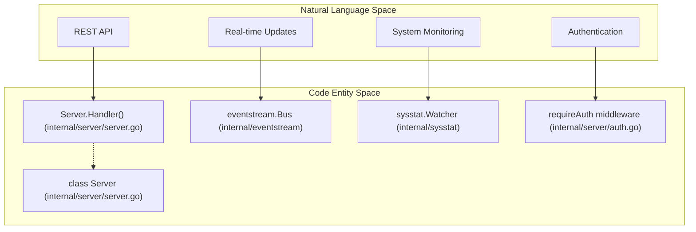
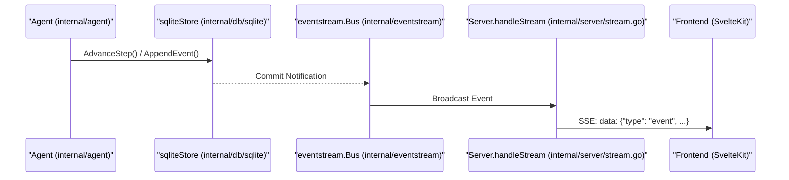

<!-- source: DeepWiki mcp.deepwiki.com · repo google-deepmind/amplio · page 5 Server and REST API · fetched 2026-10-26 -->

# Server and REST API

Relevant source files

The following files were used as context for generating this wiki page:

- [internal/agent/eventloop/eventloop_test.go](internal/agent/eventloop/eventloop_test.go)
- [internal/server/about.go](internal/server/about.go)
- [internal/server/server.go](internal/server/server.go)
- [internal/server/server_test.go](internal/server/server_test.go)

The Amplio server is a Go-based HTTP service that exposes the run store, agent management, and workspace abstractions to both the CLI and the SvelteKit frontend. It is designed around a **read-open/write-gated** security model, allowing easy sharing of run results while protecting agent execution and data modification [internal/server/server.go:148-151]().

The server orchestrates several internal subsystems, including the `RunManager` for agent lifecycles, `db.Store` for persistence, and an `eventstream.Bus` for real-time updates [internal/server/server.go:45-53]().

### Route Categories
The server's `Handler` [internal/server/server.go:152]() organizes routes into several functional categories:
*   **Authentication**: Login via magic-link tokens and session management [internal/server/server.go:156-157]().
*   **Run Management**: CRUD operations for runs, including status updates, starring, and deletion [internal/server/server.go:160-175]().
*   **Telemetry & Trajectory**: Fetching event logs, chat history, and agent trajectories [internal/server/server.go:183-195]().
*   **Artifacts & Blobs**: Serving files generated by agents and raw data blobs [internal/server/server.go:197-203]().
*   **System & Intelligence**: LLM model listing, pre-flight testing, and follow-up suggestions [internal/server/server.go:211]().

For a full list of endpoints and their schemas, see [REST API Reference](#5.1).

### Server Architecture and Data Projection
The server acts as a projection layer between the SQLite database and the frontend. It transforms internal database records (e.g., `db.RunRecord`) into Data Transfer Objects (DTOs) like `RunDTO` to ensure the frontend receives a clean, consistent view of the system state.

#### Server Entity Mapping
The following diagram maps high-level server concepts to their implementing code entities.

**Diagram: Server Component Mapping**

**Sources:** [internal/server/server.go:45-94](), [internal/server/server.go:152-211](), [internal/eventstream/bus.go:25-30](), [internal/sysstat/watcher.go:30-40]().

### Authentication Model
Amplio uses a token-based authentication system. By default, all `GET` requests are open to facilitate "readonly" sharing of agent results. Any "write" action (POST, PATCH, DELETE) requires a valid token [internal/server/server.go:148-151]().
*   **Magic Links**: Users typically access the server via a URL containing a `?token=...` parameter.
*   **Cookies**: The `POST /api/auth/login` endpoint exchanges a token for a `HttpOnly` cookie, allowing subsequent writes without the token in the URL [internal/server/server_test.go:159-162]().
*   **Lending**: A specialized mechanism allows sharing LLM credentials with the server for specific sessions without exposing the primary admin token.

For details on security headers and token management, see [Authentication and Security](#5.2).

### SSE Streaming
To provide a responsive UI, the server implements Server-Sent Events (SSE) via the `/api/stream` endpoint. This stream broadcasts events from the `eventstream.Bus` to all connected clients [internal/server/server.go:207]().

**Diagram: Event Flow to Frontend**

**Sources:** [internal/server/server.go:207](), [internal/eventstream/bus.go:50-60](), [internal/db/sqlite/sqlite.go:120-135]().

### Workspaces
The server manages agent working directories through a **Workspace** abstraction. This allows agents to operate in plain directories, Git repositories, or specialized internal filesystems like `citc`. The server resolves workspace aliases and handles the initialization of agent-specific environments [internal/server/server.go:210]().

For details on supported backends and workspace resolution, see [Workspaces](#5.3).

### System Introspection
The server provides endpoints for inspecting its own configuration and the host environment:
*   **About Page**: Surfaces build identity (commit, version), data directory paths, and configured LLM tiers [internal/server/about.go:49-77]().
*   **System Stats**: Provides real-time CPU, memory, and process tree information, which is used to detect "orphan" processes left behind by crashed agents [internal/server/server.go:89-94]().

**Sources:**
- [internal/server/server.go:17-152]()
- [internal/server/server_test.go:59-212]()
- [internal/server/about.go:29-107]()
- [internal/server/auth.go:20-50]()

---

