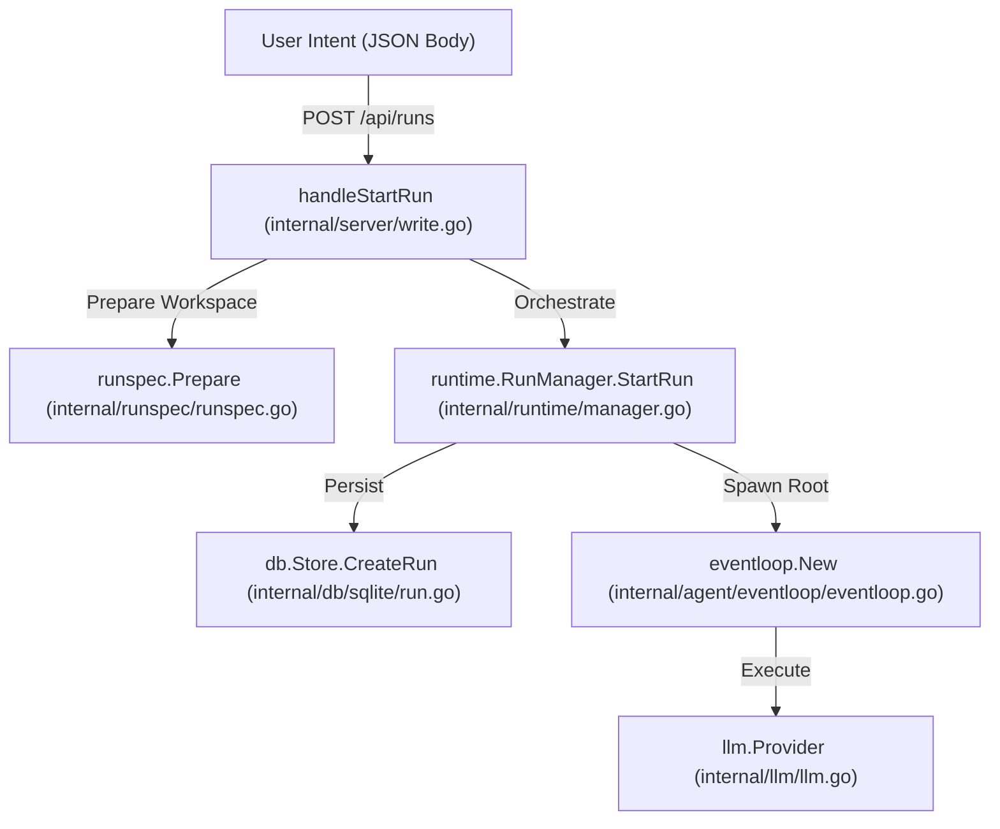
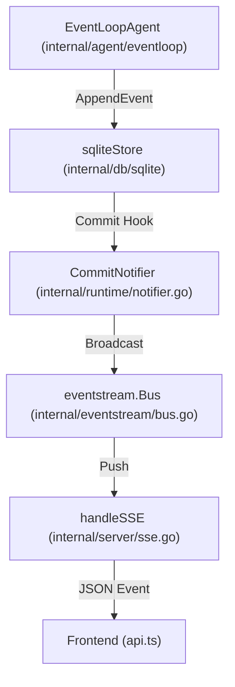

<!-- source: DeepWiki mcp.deepwiki.com · repo google-deepmind/amplio · page 5.1 REST API Reference · fetched 2026-10-26 -->

# REST API Reference

Relevant source files

The following files were used as context for generating this wiki page:

- [internal/agent/eventloop/eventloop_test.go](internal/agent/eventloop/eventloop_test.go)
- [internal/server/chat.go](internal/server/chat.go)
- [internal/server/dto.go](internal/server/dto.go)
- [internal/server/read.go](internal/server/read.go)
- [internal/server/server_test.go](internal/server/server_test.go)
- [internal/server/write.go](internal/server/write.go)

The Amplio REST API provides a comprehensive interface for managing autonomous runs, interacting with agent sessions, and retrieving telemetry and artifacts. The server implements a "read-open/write-gated" model where data retrieval is generally public (for sharing), while mutations require authentication via a magic-link token or HttpOnly cookie [internal/server/server_test.go:122-137]().

## Run Management

Runs are the top-level entity in Amplio, representing a single task or conversation. The API supports full CRUD operations, along with state transitions like cancellation and archiving.

### Endpoints

| Method | Path | Description |
| :--- | :--- | :--- |
| `GET` | `/api/runs` | List runs with pagination and filtering. |
| `POST` | `/api/runs` | Start a new autonomous or interactive run. |
| `GET` | `/api/runs/{id}` | Retrieve full details for a specific run, including all sessions. |
| `PATCH` | `/api/runs/{id}` | Update run metadata (title, note, starred, archived, grade). |
| `DELETE` | `/api/runs/{id}` | Permanently delete a run and its associated data. |
| `POST` | `/api/runs/{id}/cancel` | Signal all active sessions in the run to terminate. |
| `POST` | `/api/runs/{id}/restart` | Restart a crashed or finished run from its last valid state. |
| `GET` | `/api/runs/counts` | Get global tallies of active and updated runs. |

### Starting a Run
The `POST /api/runs` endpoint handles both autonomous tasks and interactive chatbot sessions [internal/server/write.go:31-106](). 
- **Autonomous**: Requires a `task`. Uses `standard_agent` by default.
- **Interactive**: Requires `interactive: true` and a `message`. Uses `chatbot` agent type [internal/server/write.go:58-63]().

### Run Data Flow: Natural Language to Code Entities
This diagram maps the transition from a user's intent to the internal management structures.

Sources: [internal/server/write.go:31-106](), [internal/runtime/manager.go:94-150](), [internal/runspec/runspec.go:25-50]()

## Session Telemetry and Chat

Sessions represent individual agents within a run. The API provides projected views of their activity, optimized for different UI requirements.

### Endpoints

| Method | Path | Description |
| :--- | :--- | :--- |
| `GET` | `/api/runs/{id}/sessions/{sid}/chat` | Get a projected chat view (bubbles + phase cards). |
| `GET` | `/api/runs/{id}/sessions/{sid}/trajectory` | Get the full event log (steps, tool calls, results). |
| `POST` | `/api/runs/{id}/sessions/{sid}/notify` | Send an environment message to a session (e.g., via `amplio notify`). |
| `POST` | `/api/runs/{id}/chatbot` | Attach a chatbot sidecar to an existing autonomous run. |

### Chat Projection
The `/chat` endpoint transforms raw events into `chatBubble` and `phaseCard` objects [internal/server/chat.go:31-61](). It rolls up historical steps into summarized "Phase Cards" based on the background observer's analysis, keeping the UI performant for long-running sessions [internal/server/chat.go:81-88]().

### Environment Notifications
`POST /api/runs/{id}/sessions/{sid}/notify` is used by the `amplio notify` CLI tool to send external signals into the agent's event loop [internal/server/write.go:131-178]().
- **Flood Guard**: Enforces `maxEnvNoticesPerStep = 50` to prevent runaway scripts from bloating the DB [internal/server/write.go:111-117]().
- **Wake Mechanism**: Revives `PARKED` (idle/awaiting) sessions but ignores `FINISHED` ones [internal/server/write.go:122-126]().

Sources: [internal/server/chat.go:95-180](), [internal/server/write.go:131-178]()

## Artifacts and Blobs

Agents produce artifacts (files in the workspace) and blobs (ephemeral data like tool-output images).

| Method | Path | Description |
| :--- | :--- | :--- |
| `GET` | `/api/runs/{id}/artifacts/*` | Serve files from the run's artifact directory. |
| `GET` | `/api/blobs/{digest}` | Retrieve a content-addressed blob. |

Artifacts are served with a restrictive Content Security Policy (CSP) to sandbox potentially malicious HTML/JS generated by agents [internal/server/server.go:180-195]().

## Recall and Intelligence

The API exposes the underlying intelligence systems for skill retrieval and run analysis.

| Method | Path | Description |
| :--- | :--- | :--- |
| `GET` | `/api/recall/search` | Search the skills and lessons index via vector similarity. |
| `POST` | `/api/runs/{id}/report` | Manually trigger the "Keen Critic" to generate a run report. |
| `GET` | `/api/runs/{id}/followups` | Get LLM-suggested follow-up tasks for a concluded run. |
| `GET` | `/api/models` | List available LLM models and providers. |

Sources: [internal/server/read.go:210-250](), [internal/server/write.go:230-260]()

## Real-time Updates (SSE)

Amplio uses a Server-Sent Events (SSE) stream to push real-time updates to the frontend.

`GET /api/events`

The stream transmits `EventDTO` objects which include:
- **Run Updates**: Status changes, starring, or archiving.
- **Session Updates**: New events (Assistant, ToolResult, User, etc.).
- **System Stats**: CPU/Memory usage and LLM credential status.

The `eventstream.Bus` handles internal distribution, while `handleSSE` manages the HTTP connection and client-side heartbeat [internal/server/sse.go:30-100]().

### SSE Event Routing
This diagram shows how internal system events are projected to the REST API stream.

Sources: [internal/runtime/notifier.go:25-60](), [internal/server/sse.go:30-80](), [internal/eventstream/bus.go:20-45]()

## Authentication

Amplio uses a magic-link token system [internal/server/auth.go:20-40]().
1. **Token Access**: Appending `?token=<secret>` to any URL authorizes write requests.
2. **Cookie Login**: `POST /api/auth/login?token=<secret>` sets an `HttpOnly` session cookie [internal/server/server_test.go:159-192]().
3. **Read-Only Sharing**: Once logged in via cookie, the token can be stripped from the URL, allowing the user to share the link. Recipients without the token or cookie can view the run but cannot modify it (e.g., cannot cancel, star, or send chat messages) [internal/server/server_test.go:122-125]().

Sources: [internal/server/auth.go:45-90](), [internal/server/server_test.go:115-154]()

---

