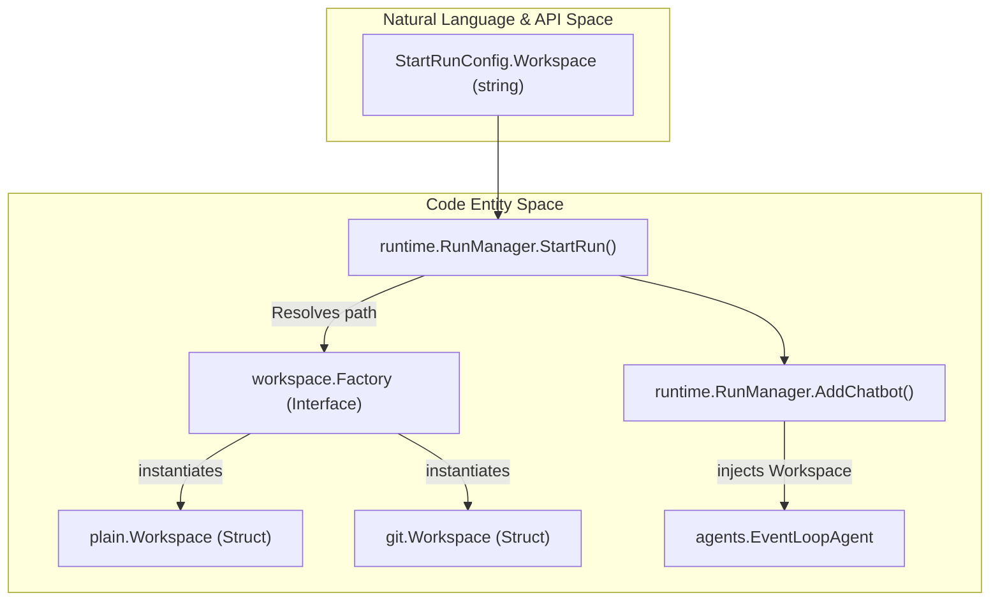
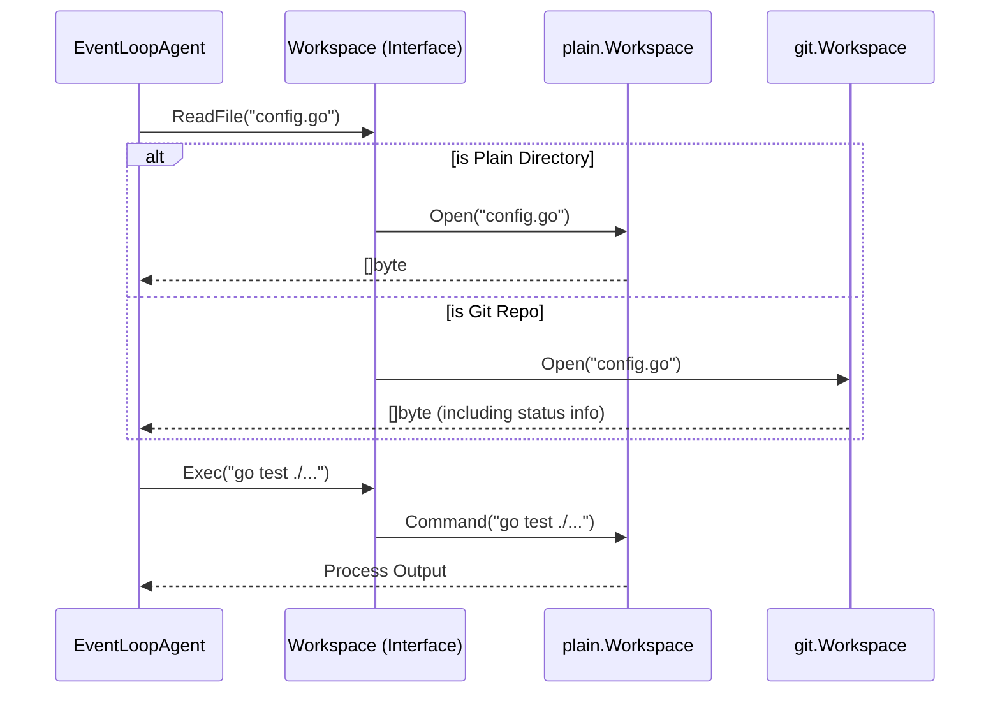

<!-- source: DeepWiki mcp.deepwiki.com · repo google-deepmind/amplio · page 5.3 Workspaces · fetched 2026-10-26 -->

# Workspaces

Relevant source files

The following files were used as context for generating this wiki page:

- [internal/runtime/artifactdir_test.go](internal/runtime/artifactdir_test.go)
- [internal/runtime/briefings_test.go](internal/runtime/briefings_test.go)
- [internal/server/workspaces_oss_test.go](internal/server/workspaces_oss_test.go)
- [internal/server/workspaces_test.go](internal/server/workspaces_test.go)

The Workspace abstraction in Amplio provides a uniform interface for agents to interact with filesystems across different version control systems and storage backends. By decoupling the agent's file operations from the underlying storage mechanism, Amplio allows agents to operate seamlessly in plain directories, Git repositories, Jujutsu (jj) working copies, or CitC (Client in the Cloud) workspaces.

## Workspace Abstraction

The `Workspace` interface defines the core capabilities required by an agent to perform its tasks, such as reading files, listing directories, and executing shell commands.

### Backend Implementations

Amplio supports multiple workspace backends, each tailored to specific environment types:

| Backend | Implementation | Description |
| :--- | :--- | :--- |
| **Plain** | `internal/workspace/plain` | Standard filesystem access for non-version-controlled directories. |
| **Git** | `internal/workspace/git` | Integrated with Git, allowing agents to see staged/unstaged changes. |
| **JJ** | `internal/workspace/jj` | Support for Jujutsu version control. |
| **CitC** | `internal/workspace/citc` | (Internal) Support for Google's Client in the Cloud. |

The `RunManager` uses a `WorkspaceFactory` to instantiate the correct backend based on the `Workspace` string provided in the `RunConfig` [internal/runtime/run_manager.go:37-39]().

### Workspace Resolution and Aliasing

When a run starts, the `RunManager` resolves the workspace path. In the OSS build, the resolver is limited to plain paths only to ensure machine independence [internal/server/workspaces_oss_test.go:21-24]().

#### Workspace Data Flow
The following diagram illustrates how a workspace string from a `StartRunConfig` is resolved into a functional `Workspace` entity used by the `EventLoopAgent`.

**Diagram: Workspace Resolution and Injection**

Sources: [internal/runtime/run_manager.go:40-43](), [internal/runtime/run_manager.go:70-71]()

## Workspace Creation and Recent Roots

Workspaces are typically associated with a "Recent Root," a directory where Amplio tracks frequently used workspaces.

*   **Recent Workspaces**: The server maintains a list of recently used workspaces, sorted by Most Recently Used (MRU) based on directory modification times (`mtime`) [internal/server/workspaces_test.go:27-38]().
*   **Capping**: The list is capped at `recentWorkspacesLimit` to keep the UI manageable [internal/server/workspaces_test.go:63-74]().
*   **Artifact Directory Ownership**: A run owns its artifact directory from the moment of creation. The `RunManager` ensures the artifact directory exists during `StartRun`; if the directory cannot be created (e.g., due to a file conflict), the run fails immediately [internal/runtime/artifactdir_test.go:28-58]().

## AGENTS.md and Standing Instructions

Workspaces can contain an `AGENTS.md` file at their root. This file serves as a source of "standing instructions" for any agent operating within that workspace.

*   **Loading**: When an agent is initialized, the system looks for `AGENTS.md` in the workspace root.
*   **Injection**: The contents of this file are appended to the agent's system prompt, providing workspace-specific context, coding standards, or project goals that the agent must adhere to.

## Sub-agent Linked Workspaces

When a parent agent uses the `spawn` tool to create a sub-agent, it can define the sub-agent's workspace.

1.  **Shared Workspace**: By default, sub-agents can share the parent's workspace.
2.  **Sub-directory Isolation**: A parent can restrict a sub-agent to a specific subdirectory of the current workspace.
3.  **New Workspace**: A parent can spawn an agent in a completely different workspace path.

The `RunManager` handles the reconstruction of these workspace links during session respawns or recoveries to ensure the sub-agent maintains access to the correct files [internal/runtime/run_manager.go:23-25]().

## Workspace Resolver Implementation

The resolver is responsible for mapping a user-provided string (which might be a path, a URL, or a shorthand alias) to a physical location and a backend type.

**Diagram: Workspace Backend Interaction**

Sources: [internal/runtime/run_manager.go:37-39](), [internal/workspace/plain/plain.go:1-20](), [internal/workspace/git/git.go:1-20]()

### Briefing Resolution
During workspace initialization in `StartRun`, the system also resolves "Briefings"—named markdown files that provide specific task instructions. These are validated and frozen onto the run configuration at start time [internal/runtime/briefings_test.go:28-31](). If a selected briefing is missing, it is dropped to allow the run to proceed, but valid briefings are stored in the `Run.Config.Briefings` slice [internal/runtime/briefings_test.go:41-68]().

Sources:
- [internal/server/workspaces_oss_test.go:21-37]()
- [internal/server/workspaces_test.go:24-74]()
- [internal/runtime/artifactdir_test.go:28-80]()
- [internal/runtime/briefings_test.go:28-68]()
- [internal/runtime/run_manager.go:37-71]()

---

