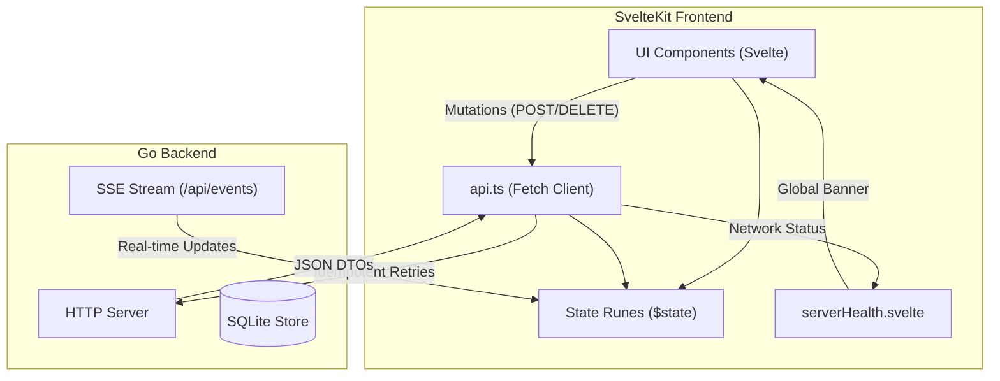

<!-- source: DeepWiki mcp.deepwiki.com · repo google-deepmind/amplio · page 6 Frontend · fetched 2026-10-26 -->

# Frontend

<details>
<summary>Relevant source files</summary>

The following files were used as context for generating this wiki page:

- [frontend/package.json](frontend/package.json)
- [frontend/src/lib/api.ts](frontend/src/lib/api.ts)
- [frontend/src/lib/types.ts](frontend/src/lib/types.ts)

</details>


The Amplio frontend is a single-page application (SPA) built with **SvelteKit** and **TypeScript** [frontend/package.json:17-22](). It provides a real-time interface for monitoring agent trajectories, interacting with chatbots, and managing the lifecycle of complex multi-agent runs. The frontend follows a "DB-first" philosophy, where the UI reflects the state persisted in the SQLite backend, updated via a combination of polling and Server-Sent Events (SSE).

## Technology Stack

The frontend architecture is centered around reactive state management and efficient data fetching:

*   **Framework**: Svelte 5 utilizing "runes" (`$state`, `$derived`, `$effect`) for fine-grained reactivity [frontend/src/lib/serverHealth.svelte:17-20]().
*   **Routing**: SvelteKit file-based routing. The application is built as a static site using `@sveltejs/adapter-static` [frontend/package.json:16](), which is then served by the Go backend.
*   **API Client**: A custom `api.ts` wrapper around `fetch` that handles authentication via cookies, idempotent retries, and error classification [frontend/src/lib/api.ts:156-175]().
*   **Styling**: Plain CSS with a focus on high-density information display suitable for technical debugging.

## Application Structure

The frontend is organized into logical views centered around the `Run` and `Session` hierarchy.

### Routing Overview
The routing structure reflects the data model:
*   `/`: The Dashboard. Lists recent runs with filtering and pagination.
*   `/runs/[runId]`: The Run Detail view. This is a layout-heavy view containing the trajectory, chat, and process monitors.
*   `/runs/[runId]/[sessionId]`: Deep-link to a specific sub-agent session within a run.

### Data Flow Diagram
The following diagram illustrates how the frontend components interact with the backend API and the internal state management.

**Frontend Data Flow**

Sources: [frontend/src/lib/api.ts:85-135](), [frontend/src/lib/serverHealth.svelte:20-40](), [frontend/src/lib/types.ts:45-78]()

## Core Modules

### API Client and State Management
The `api.ts` client is the central gateway for all backend communication. It implements sophisticated retry logic specifically for "proxy errors" (502, 503, 504) while ensuring that non-idempotent mutations (like starting a run) are never automatically retried [frontend/src/lib/api.ts:168-175](). It also integrates with `serverHealth.svelte` to provide a global "Server Reconnecting" overlay when the network is interrupted [frontend/src/lib/api.ts:98-102]().

For details, see [API Client and State Management](#6.1).

### Dashboard and Run Management
The dashboard utilizes the `RunSummary` DTO to display a high-level view of all agent activity [frontend/src/lib/types.ts:45-78](). It supports:
*   **RunCard**: A reusable component for displaying run status, workspace info, and providing quick actions like starring or grading [frontend/src/lib/types.ts:195-215]().
*   **StartRunForm**: A specialized UI for configuring new runs, selecting LLM models, and attaching briefings.

For details, see [Dashboard and Run Management UI](#6.2).

### Run Detail Views
The Run Detail view is the most complex part of the UI, managing the "Trajectory" (a step-by-step history of agent actions) and the "Chat" (interactive dialogue) [frontend/src/lib/types.ts:104-126]().
*   **RunNav**: A sidebar for navigating between the root agent and spawned sub-agents.
*   **Trajectory Viewer**: Renders the `TrajPhase` and `TrajStep` data, including tool calls and environment observations [frontend/src/lib/types.ts:135-168]().
*   **Process Monitor**: A Linux-specific view that polls the server for the live process tree of the agent's workspace.

For details, see [Run Detail Views](#6.3).

## Type Mapping
The frontend types strictly mirror the Go DTOs (Data Transfer Objects) to ensure type safety across the network boundary.

| Frontend Type | Go Equivalent | Description |
| :--- | :--- | :--- |
| `RunSummary` | `dto.RunSummary` | Compact data for the dashboard list [frontend/src/lib/types.ts:45](). |
| `RunDetail` | `dto.RunDetail` | Full metadata for a single run [frontend/src/lib/types.ts:195](). |
| `SessionDTO` | `dto.Session` | Metadata for an individual agent session [frontend/src/lib/types.ts:182](). |
| `EventDTO` | `eventstream.Event` | A single entry in the agent's history [frontend/src/lib/types.ts:24](). |
| `ChatBubble` | `dto.ChatBubble` | A projected message for the Chat UI [frontend/src/lib/types.ts:104](). |

**Code Entity Mapping: UI to API**
```mermaid
classDiagram
    class "RunCard.svelte" {
        +RunSummary data
        +toggleStar()
        +setGrade()
    }
    class "api.ts" {
        +getRuns(page)
        +postRunAction(id, action)
        +getRunDetail(id)
    }
    class "RunSummary" {
        +string run_id
        +string status
        +string llm_name
    }
    "RunCard.svelte" --> "RunSummary" : consumes
    "RunCard.svelte" --> "api.ts" : calls
    "api.ts" ..> "RunSummary" : returns
```
Sources: [frontend/src/lib/api.ts:156-200](), [frontend/src/lib/types.ts:45-78]()

---

