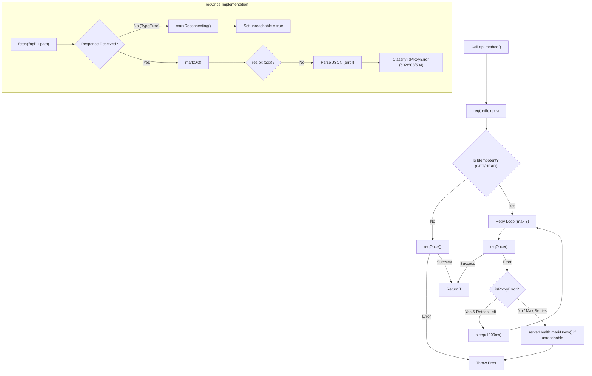
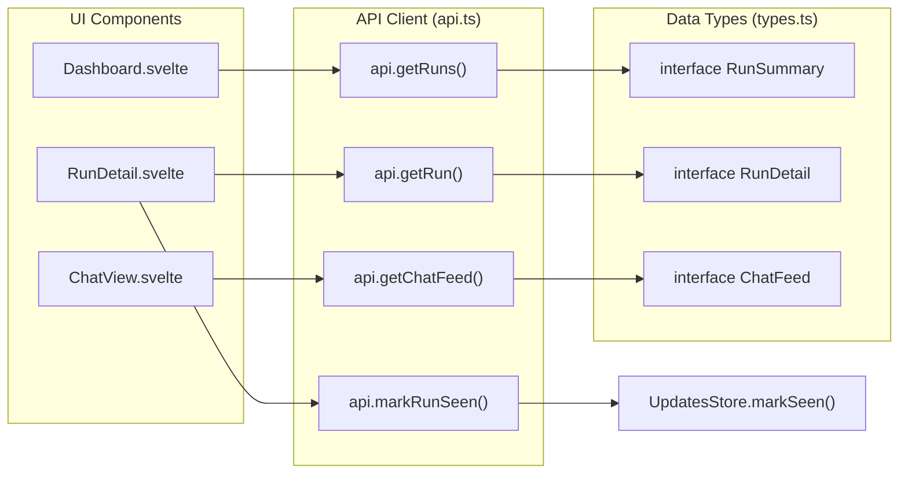

<!-- source: DeepWiki mcp.deepwiki.com · repo google-deepmind/amplio · page 6.1 API Client and State Management · fetched 2026-10-26 -->

# API Client and State Management

Relevant source files

The following files were used as context for generating this wiki page:

- [frontend/src/lib/api.ts](frontend/src/lib/api.ts)
- [frontend/src/lib/types.ts](frontend/src/lib/types.ts)
- [frontend/src/lib/updates.svelte.ts](frontend/src/lib/updates.svelte.ts)

The Amplio frontend utilizes a centralized `api.ts` client to manage all communications with the backend server. This client is designed for resilience, handling transient network failures through idempotent retries and providing real-time feedback on server health via a global state management system.

## Request Lifecycle and Retry Logic

The API client distinguishes between **idempotent reads** (`GET`, `HEAD`) and **mutations** (`POST`, `PATCH`, `DELETE`). Mutations are never automatically retried to prevent side effects like double-creation of runs [frontend/src/lib/api.ts:164-167]().

### Idempotent Retry Strategy
For read operations, the client employs a retry loop that attempts to recover from transient infrastructure blips [frontend/src/lib/api.ts:173-195]().

1.  **Transient Failure Detection**: The client identifies "proxy errors" which include transport failures (no response reached the client) and specific HTTP gateway statuses (`502 Bad Gateway`, `503 Service Unavailable`, `504 Gateway Timeout`) [frontend/src/lib/api.ts:60-60, 81-84]().
2.  **Retry Schedule**: It attempts up to 2 retries with a 1-second delay between attempts [frontend/src/lib/api.ts:175-177]().
3.  **Escalation**: If all retries fail, the error is thrown to the caller. If the failure was due to a transport error (unreachable), the global `serverHealth` state is updated to `markDown()` [frontend/src/lib/api.ts:189-191]().

### Request Flow Diagram
The following diagram illustrates the lifecycle of a request through the `req` and `reqOnce` functions.

**Request Lifecycle (api.ts)**

**Sources:** [frontend/src/lib/api.ts:85-135](), [frontend/src/lib/api.ts:156-196]()

## Server Health Monitoring

State management for connectivity is handled by the `serverHealth` svelte store. This provides a unified way for the UI to react to backend availability.

*   **`markOk()`**: Resets the state to `healthy`. Called upon any successful HTTP response [frontend/src/lib/api.ts:105-105]().
*   **`markReconnecting()`**: Sets a transient state. If a request doesn't succeed within a 3-second grace period, the UI typically shows a "Reconnecting" banner [frontend/src/lib/api.ts:98-98]().
*   **`markDown()`**: Triggered when a request ultimately fails after all retries, signaling a hard disconnection [frontend/src/lib/api.ts:190-190]().

**Sources:** [frontend/src/lib/api.ts:98-105](), [frontend/src/lib/serverHealth.svelte.ts:1-50]()

## Key Data Types (DTOs)

The frontend types in `types.ts` mirror the Go structs defined in the backend persistence and event stream layers.

### Run and Session Entities
A `Run` is the top-level container, while `Sessions` represent individual agent executions within that run.

| Type | Key Fields | Description |
| :--- | :--- | :--- |
| `RunSummary` | `run_id`, `task`, `starred`, `grade`, `has_updates` | Used for dashboard listing and high-level status [frontend/src/lib/types.ts:45-78](). |
| `SessionDTO` | `session_id`, `parent_id`, `agent_type`, `status` | Represents an individual agent's state and lineage [frontend/src/lib/types.ts:182-193](). |
| `RunDetail` | `run_id`, `task`, `note`, `workspace`, `llm` | Full metadata for a specific run, including system LLM configurations [frontend/src/lib/types.ts:195-225](). |

### Event and Trajectory Data
Events are the granular units of progress within a session.

*   **`EventDTO`**: The raw data for a single event, including its `step`, `kind` (e.g., `call`, `result`, `assistant`), and `content` [frontend/src/lib/types.ts:241-255]().
*   **`Trajectory`**: A structured view of a session's history, organized into `phases` and `steps` for the Trajectory Viewer [frontend/src/lib/types.ts:164-168]().
*   **`ChatBubble`**: A UI-centric projection of events used in the Chat View, classifying events as `operator`, `chatbot`, `agent`, or `compaction` [frontend/src/lib/types.ts:104-126]().

**Sources:** [frontend/src/lib/types.ts:17-255]()

## Updates State Management

The `updates` store (`UpdatesStore`) manages "unread" notifications for runs. This is server-authoritative; the frontend tracks `last_seen_at` via the database to determine if a run has new activity since the operator last viewed it [frontend/src/lib/updates.svelte.ts:17-32]().

*   **`refreshCounts()`**: Fetches global tallies of active runs and runs with updates from `/api/runs/counts` [frontend/src/lib/updates.svelte.ts:50-58]().
*   **`markSeen(runId)`**: Optimistically clears the local badge and sends a `PATCH` request to the server to update the `last_seen_at` timestamp [frontend/src/lib/updates.svelte.ts:81-91]().

**Sources:** [frontend/src/lib/updates.svelte.ts:37-117]()

## Data Flow: Code Entity Mapping

The following diagram bridges the frontend UI components to the API client functions and the underlying DTOs.

**Frontend Data Flow**

**Sources:** [frontend/src/lib/api.ts:200-428](), [frontend/src/lib/types.ts:45-180](), [frontend/src/lib/updates.svelte.ts:81-91]()

---

