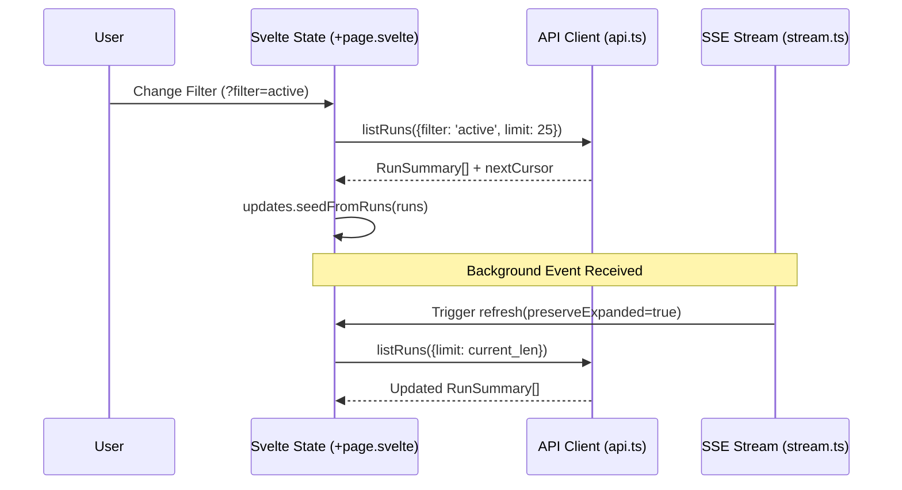
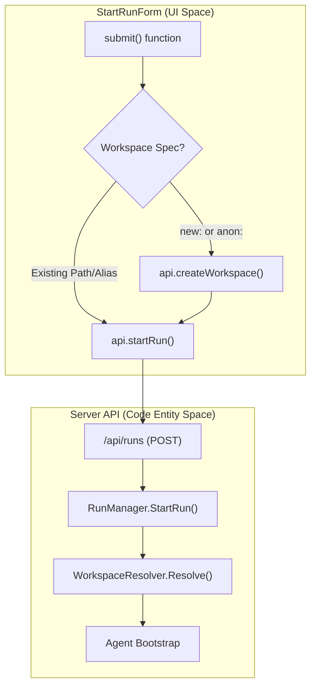

<!-- source: DeepWiki mcp.deepwiki.com · repo google-deepmind/amplio · page 6.2 Dashboard and Run Management UI · fetched 2026-10-26 -->

# Dashboard and Run Management UI

Relevant source files

The following files were used as context for generating this wiki page:

- [frontend/src/lib/briefingLibrary.ts](frontend/src/lib/briefingLibrary.ts)
- [frontend/src/lib/components/BriefingSelect.svelte](frontend/src/lib/components/BriefingSelect.svelte)
- [frontend/src/lib/components/RunCard.svelte](frontend/src/lib/components/RunCard.svelte)
- [frontend/src/lib/components/StartRunForm.svelte](frontend/src/lib/components/StartRunForm.svelte)
- [frontend/src/routes/+page.svelte](frontend/src/routes/+page.svelte)
- [internal/server/llmapi_test.go](internal/server/llmapi_test.go)

The Dashboard serves as the central orchestration hub for Amplio, providing a unified interface for run discovery, lifecycle management, and new run initiation. It implements a server-side filtered and paginated view of all agent activities, paired with a specialized form for configuring autonomous and interactive runs.

## Main Dashboard and Run List

The dashboard (`frontend/src/routes/+page.svelte`) provides a high-level view of system activity. It leverages the `listRuns` API to fetch `RunSummary` objects, which include metadata about the root session's status, task, and workspace.

### Filtering and Pagination
Filtering is implemented server-side to ensure consistent results across large datasets. Filters are driven by URL search parameters, making views deep-linkable and ensuring that the browser's back button behaves predictably via `replaceState` [frontend/src/routes/+page.svelte:98-108]().

| Filter Parameter | Code Entity | Description |
| :--- | :--- | :--- |
| `filter` | `statusFilter` | Groups runs by state: `active`, `done`, `failed`, or `updates` [frontend/src/routes/+page.svelte:82-89](). |
| `q` | `search` | Text-based search across titles and tasks [frontend/src/routes/+page.svelte:58-58](). |
| `starred` | `starredOnly` | Filters for runs flagged by the user [frontend/src/routes/+page.svelte:59-59](). |
| `grade` | `gradeFilter` | Matches the effective grade (human or critic) [frontend/src/routes/+page.svelte:63-63](). |

Pagination uses a cursor-based model (`nextCursor`) with a default `PAGE_SIZE` of 25 [frontend/src/routes/+page.svelte:37-37](). The "Load more" functionality appends results to the `runs` state, while SSE (Server-Sent Events) updates trigger a `refresh(true)` call that preserves the expanded list length up to `MAX_RUNS_PAGE` (200) to prevent UI snapping [frontend/src/routes/+page.svelte:42-42](), [frontend/src/routes/+page.svelte:127-150]().

### Data Flow: Dashboard Refresh
The following diagram illustrates how the dashboard maintains state between user interactions and background updates.

**Dashboard State Synchronization**

Sources: [frontend/src/routes/+page.svelte:127-150](), [frontend/src/routes/+page.svelte:155-173]().

## RunCard Component

The `RunCard` (`frontend/src/lib/components/RunCard.svelte`) is the primary unit of the run list. It encapsulates status visualization, metadata display (workspace chips), and operational controls.

### Status and Identity
Each card displays a unique animal icon generated from the `run_id` via `iconForName` [frontend/src/lib/components/RunCard.svelte:76-76](). The icon serves as a toggle for the "Star" status [frontend/src/lib/components/RunCard.svelte:107-110](). The `StatusBadge` component reflects the `root_status` of the run.

### Workspace Integration
The card renders workspace chips based on the backend type:
*   **Editor Link:** If `cider_url` is present, the chip acts as an external link to the development environment [frontend/src/lib/components/RunCard.svelte:96-96]().
*   **Naming:** For `citc` workspaces that are unnamed, the overflow menu provides a "Name workspace..." option that opens a `WorkspaceNameModal` [frontend/src/lib/components/RunCard.svelte:97-104]().

### Two-Step Confirmations
To prevent accidental disruption of multi-agent workflows, destructive or cascading actions require a two-step "arm and commit" gesture:
1.  **Cancel:** Available for `ongoing` or `awaiting` runs. The first click arms a timer (`CONFIRM_WINDOW_MS = 4000`); the second click calls `api.cancelRun` [frontend/src/lib/components/RunCard.svelte:144-164]().
2.  **Delete:** Permanently removes the run and all associated database records/artifacts [frontend/src/lib/components/RunCard.svelte:189-206]().

Sources: [frontend/src/lib/components/RunCard.svelte:68-105](), [frontend/src/lib/components/RunCard.svelte:144-206]().

## StartRunForm and Briefing Selection

The `StartRunForm` (`frontend/src/lib/components/StartRunForm.svelte`) handles the creation of new runs. It supports two primary modes: **Autonomous** (task-driven) and **Interactive** (chatbot-driven) [frontend/src/lib/components/StartRunForm.svelte:33-33]().

### Workspace Resolution Logic
Run initiation is a two-stage process when creating new workspaces:
1.  **Resolving:** If the workspace spec starts with `new:` or `anon:`, the form calls `api.createWorkspace` first. This stage can take 5-30 seconds depending on the backend [frontend/src/lib/components/StartRunForm.svelte:121-126]().
2.  **Starting:** Once the workspace path is resolved, `api.startRun` is called with the task/message and configuration [frontend/src/lib/components/StartRunForm.svelte:132-145]().

### Briefing Selection
The `BriefingSelect` component allows users to attach curated context to a run. 
*   **Prefetching:** Briefings are prefetched via `loadBriefings` and cached in `briefingLibrary.ts` to ensure the UI is responsive [frontend/src/lib/briefingLibrary.ts:34-49]().
*   **Organization:** Briefings are grouped by their path prefix (e.g., `workflow/`, `corp/`) [frontend/src/lib/components/BriefingSelect.svelte:77-85]().
*   **Scope:** The UI displays tags for briefings that are `root only` (only applied to the main agent) vs. those applied to all sub-agents [frontend/src/lib/components/BriefingSelect.svelte:123-123]().

### Run Initiation Logic

Sources: [frontend/src/lib/components/StartRunForm.svelte:107-151](), [frontend/src/lib/briefingLibrary.ts:17-30](), [frontend/src/lib/components/BriefingSelect.svelte:77-85]().

## Run Prefill Mechanism
The "New run like this" feature allows users to clone the configuration of an existing run.
*   **Data Flow:** `RunCard` calls `setRunPrefill` with the run's task, title, and LLM spec [frontend/src/lib/components/RunCard.svelte:119-127]().
*   **Consumption:** `StartRunForm` uses an `$effect` to monitor `peekRunPrefill()`. When detected, it populates the form fields and focuses the textarea [frontend/src/lib/components/StartRunForm.svelte:69-79]().
*   **Intentional Dropping:** The workspace is intentionally excluded from prefill to ensure the new run starts in a clean environment [frontend/src/lib/components/StartRunForm.svelte:67-68]().

Sources: [frontend/src/lib/components/RunCard.svelte:119-127](), [frontend/src/lib/components/StartRunForm.svelte:69-79]().

---

