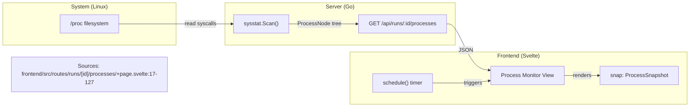

<!-- source: DeepWiki mcp.deepwiki.com · repo google-deepmind/amplio · page 6.3 Run Detail Views · fetched 2026-10-26 -->

# 6.3 Run Detail Views

<details>
<summary>Relevant source files</summary>

The following files were used as context for generating this wiki page:

- [frontend/src/lib/components/RunNav.svelte](frontend/src/lib/components/RunNav.svelte)
- [frontend/src/lib/components/SessionTree.svelte](frontend/src/lib/components/SessionTree.svelte)
- [frontend/src/lib/components/ToolDefs.svelte](frontend/src/lib/components/ToolDefs.svelte)
- [frontend/src/lib/serverInfo.svelte.ts](frontend/src/lib/serverInfo.svelte.ts)
- [frontend/src/routes/runs/[id]/+page.svelte](frontend/src/routes/runs/[id]/+page.svelte)
- [frontend/src/routes/runs/[id]/chat/+page.svelte](frontend/src/routes/runs/[id]/chat/+page.svelte)
- [frontend/src/routes/runs/[id]/processes/+page.svelte](frontend/src/routes/runs/[id]/processes/+page.svelte)
- [frontend/src/routes/runs/[id]/sessions/[sid]/+page.svelte](frontend/src/routes/runs/[id]/sessions/[sid]/+page.svelte)
- [go.mod](go.mod)
- [go.sum](go.sum)

</details>


The Run Detail Views provide the primary interface for observing and interacting with an active or historical Amplio run. This documentation covers the navigation logic, the trajectory viewer, the process monitor, and the tool inspection system.

## Navigation and Session Selection

The `RunNav` component provides the primary sidebar navigation for a run. It handles the logic for deep-linking into specific modes (Trajectory, Chat, Artifacts, Processes) and implements session-selection heuristics.

### Session Selection Logic
Because "Trajectory" and "Chat log" views are per-session, the sidebar must decide which session to target when a user clicks a top-level category.
*   **Remembered State:** The system attempts to recall the last viewed session ID for the current run using `recallSession` [frontend/src/lib/components/RunNav.svelte:45-46]().
*   **Mode Defaults:**
    *   **Trajectory:** Defaults to the autonomous root agent (usually `main-agent`). If no autonomous agent exists, it falls back to the first root session [frontend/src/lib/components/RunNav.svelte:52-53]().
    *   **Chat log:** Defaults to the `chatbot` agent type if present, otherwise falling back to the autonomous root [frontend/src/lib/components/RunNav.svelte:49-51]().

### Platform Gating
The **Processes** view is gated by the server's operating system. The `ServerInfo` store fetches the platform from the `/api/about` endpoint [frontend/src/lib/serverInfo.svelte.ts:38-51](). The "Processes" entry is only rendered if `serverInfo.isLinux` is true, as the process monitor relies on Linux-specific `/proc` filesystem scanning [frontend/src/lib/components/RunNav.svelte:91-100]().

**Sources:**
*   [frontend/src/lib/components/RunNav.svelte:17-117]()
*   [frontend/src/lib/serverInfo.svelte.ts:1-54]()

---

## Trajectory Viewer

The Trajectory Viewer ([frontend/src/routes/runs/[id]/sessions/[sid]/+page.svelte]()) renders the step-by-step execution history of a session. It is designed for high-performance viewing of long-running agents through lazy loading and event pairing.

### Data Flow and Lazy Loading
To avoid overloading the browser with thousands of events, the viewer uses a tiered loading strategy:
1.  **Step Headers:** Only the step numbers and basic metadata (from the `LogViewStore`) are rendered initially.
2.  **On-Demand Fetching:** Events for a specific step are fetched via `api.getEvents` only when a user expands a `<details>` row [frontend/src/routes/runs/[id]/sessions/[sid]/+page.svelte:76-92]().
3.  **Ranged Fetching:** The "Expand all" feature triggers a single `api.getEventsRange` request for the entire selected phase to minimize round-trips [frontend/src/routes/runs/[id]/sessions/[sid]/+page.svelte:97-116]().
4.  **Live Updates:** If the user is viewing the latest step of an ongoing session, an effect automatically re-fetches the current step to show streaming updates [frontend/src/routes/runs/[id]/sessions/[sid]/+page.svelte:130-136]().

### Event Pairing
The `pairEvents` function simplifies the UI by grouping related events. It matches `tool_result` events to their corresponding `tool_calls` using the `tool_call_id` [frontend/src/routes/runs/[id]/sessions/[sid]/+page.svelte:58-74](). This allows the UI to render the result (e.g., bash output) directly beneath the call that generated it, rather than as a separate chronological entry.

### Deep-Linking
The viewer supports deep-linking via the `?step=N` or `?step=N-M` URL parameters. When detected, the `targetRange` effect programmatically expands the relevant steps and scrolls the first one into view [frontend/src/routes/runs/[id]/sessions/[sid]/+page.svelte:142-181]().

**Sources:**
*   [frontend/src/routes/runs/[id]/sessions/[sid]/+page.svelte:17-181]()

---

## Process Monitor

The Process Monitor provides visibility into background processes started by an agent's `bash` tool calls.

### Polling Lifecycle
Unlike the event stream, process data is **polled** every 5 seconds [frontend/src/routes/runs/[id]/processes/+page.svelte:47]().
*   **Orphan Detection:** Processes are grouped by the `session_id` exported into their environment by the `bash` tool. This allows the UI to track processes even if the launching shell has exited [frontend/src/routes/runs/[id]/processes/+page.svelte:108-111]().
*   **Resource Conservation:** Polling is automatically suspended when the browser tab is hidden to save server resources [frontend/src/routes/runs/[id]/processes/+page.svelte:79-82]().

### Process Tree Representation
The UI renders a recursive tree of processes. Each node displays the PID, state (e.g., Zombie, Uninterruptible), CPU time, and memory usage [frontend/src/routes/runs/[id]/processes/+page.svelte:196-200]().

**Sources:**
*   [frontend/src/routes/runs/[id]/processes/+page.svelte:17-200]()

---

## Tool Definitions Inspector

The `ToolDefs` component allows users to inspect the exact tools available to an agent.

### Live Reconstruction
Tool definitions are not stored per-event to save space. Instead, the `api.getSessionTools` endpoint reconstructs the toolset live based on the agent's type and current configuration [frontend/src/lib/components/ToolDefs.svelte:117-124]().

### Schema Inspection
The inspector provides two views for every tool:
1.  **Simplified View:** Extracts `properties`, `types`, and `descriptions` from the JSON Schema [frontend/src/lib/components/ToolDefs.svelte:72-84]().
2.  **Raw Schema:** Displays the full, authoritative JSON Schema sent to the LLM [frontend/src/lib/components/ToolDefs.svelte:149-151]().

**Sources:**
*   [frontend/src/lib/components/ToolDefs.svelte:17-156]()

---

## System Architecture Diagrams

### Trajectory Loading Logic
This diagram associates UI interaction logic with the underlying API and data structures.

```mermaid
graph TD
    subgraph "Natural Language Space"
        "User expands step row" --> "Fetch step events"
        "User clicks Expand All" --> "Fetch phase range"
        "Deep link ?step=5" --> "Auto-expand and scroll"
    end

    subgraph "Code Entity Space"
        "Fetch step events" --> "loadStep(step)"["loadStep(step) in +page.svelte"]
        "loadStep(step)" --> "api.getEvents"["api.getEvents() in api.ts"]
        "Fetch phase range" --> "expandAll()"["expandAll() in +page.svelte"]
        "expandAll()" --> "api.getEventsRange"["api.getEventsRange() in api.ts"]
        "Auto-expand and scroll" --> "targetRange"["targetRange effect in +page.svelte"]
        "targetRange" --> "HTMLDetailsElement.open"["DOM: details.open = true"]
    end

    Sources["Sources: frontend/src/routes/runs/[id]/sessions/[sid]/+page.svelte:76-181"]
```

### Process Monitoring Data Flow
This diagram shows how system-level process information flows to the frontend.



## Chat View

The Chat View ([frontend/src/routes/runs/[id]/chat/+page.svelte]()) facilitates real-time interaction with a `chatbot` agent.

*   **Optimistic UI:** When a user sends a message, it is added to the `optimistic` array and rendered immediately before the server confirms receipt [frontend/src/routes/runs/[id]/chat/+page.svelte:107-108]().
*   **Streaming Preview:** The `preview` state captures incoming SSE chunks from the LLM, allowing the assistant's response to be rendered as it is generated [frontend/src/routes/runs/[id]/chat/+page.svelte:101-105]().
*   **Sub-agent Tracking:** The `liveTree` derivation calculates the hierarchy of agents spawned by the chatbot to show active background work [frontend/src/routes/runs/[id]/chat/+page.svelte:55-85]().

**Sources:**
*   [frontend/src/routes/runs/[id]/chat/+page.svelte:17-160]()

---

