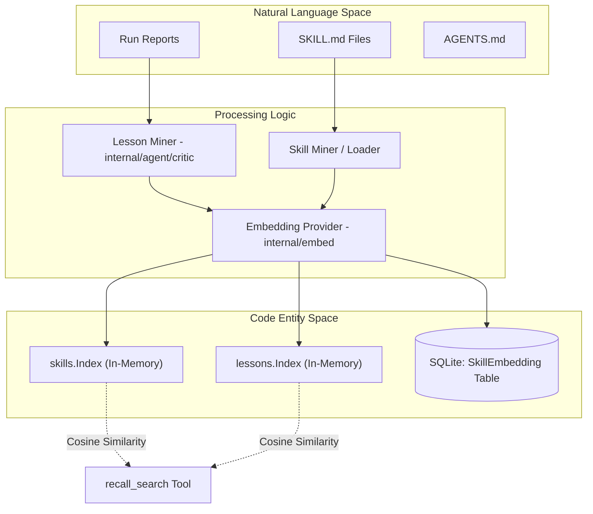
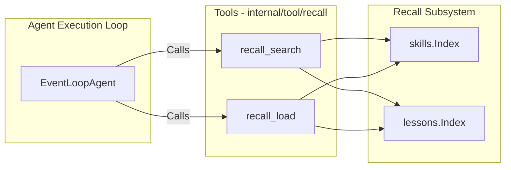

<!-- source: DeepWiki mcp.deepwiki.com · repo google-deepmind/amplio · page 7 Recall System: Skills and Lessons · fetched 2026-10-26 -->

# Recall System: Skills and Lessons

Relevant source files

The following files were used as context for generating this wiki page:

- [cmd/amplio/system.go](cmd/amplio/system.go)
- [docs/guide/prompt-context.md](docs/guide/prompt-context.md)
- [internal/agent/eventloop/eventloop_test.go](internal/agent/eventloop/eventloop_test.go)
- [internal/agent/toolset/toolset.go](internal/agent/toolset/toolset.go)
- [internal/llm/openai/openai.go](internal/llm/openai/openai.go)
- [internal/llm/spec_test.go](internal/llm/spec_test.go)
- [internal/server/server_test.go](internal/server/server_test.go)
- [internal/tool/bash/bash.go](internal/tool/bash/bash.go)

The Recall System is Amplio's long-term memory and knowledge retrieval architecture. Unlike briefings or `AGENTS.md` which are "pushed" into every agent's context at startup, recall is a "pull" mechanism: agents use tools to search for and load relevant information on demand. This system bridges the gap between static operator instructions and the vast, evolving knowledge generated across many runs.

The system manages two primary corpora:
1.  **Skills**: Human-authored markdown files providing specific domain expertise or tool instructions.
2.  **Lessons**: Machine-mined insights extracted from past run reports by the Critic subsystem.

### System Architecture

The recall subsystem is initialized during the two-stage `setupSystem` bootstrap process. It requires an `embed_model` to be configured in `config.toml` to function.

#### Startup Sequence: LoadCached then Build
The system follows a two-stage startup to ensure agents can begin working immediately even if the full index is still being computed:
1.  **LoadCached**: The system first loads existing embeddings from the SQLite `SkillEmbedding` table. This allows the `recall_search` tool to be available instantly with "warm" data [cmd/amplio/system.go:110-112]().
2.  **Build**: A background process reconciles the filesystem (skills) and database (lessons). It identifies new or changed content, requests new embeddings from the `Embedder`, and updates the in-memory cosine-similarity index [internal/agent/toolset/toolset.go:85-88]().

### High-Level Component Interaction

The following diagram illustrates how natural language skills and machine-generated lessons are transformed into vector space for agent retrieval.

**Recall Data Flow: Natural Language to Vector Space**

Sources: [cmd/amplio/system.go:110-121](), [internal/agent/toolset/toolset.go:85-91](), [internal/agent/critic/critic.go:21-35]()

---

### Skills Index

Skills are static, human-authored expertise modules. Each skill is a directory containing a `SKILL.md` file. This format allows skills to be versioned in git and shared across different Amplio instances.

*   **Format**: A `SKILL.md` file contains a YAML-like header (name, description) and markdown content.
*   **Layering**: Skills are gathered from multiple source directories defined in `config.toml`.
*   **Storage**: While the source is markdown, the vectors are cached in the `SkillEmbedding` table to avoid redundant LLM calls on restart.

For details on file formats and indexing logic, see [Skills Index](#7.1).

---

### Lessons and Briefings

Lessons represent the "experience" of the system. They are dynamic and grow as more runs are completed.

*   **Lesson Mining**: After a run concludes, the `Finalizer` (specifically the `keen-critic` agent) analyzes the trajectory. It extracts "Lessons Learned"—failures to avoid or successful patterns to repeat—and stores them in the database [internal/agent/critic/critic.go:118-120]().
*   **Briefings**: These are named markdown files with front-matter (e.g., `scope: all` or `scope: root`) used to provide per-run context. Unlike skills, these are explicitly selected by the operator at run creation [docs/guide/prompt-context.md:36-41]().
*   **Standing Instructions**: The `AGENTS.md` file provides global rules that apply to all agents in a workspace or machine.

For details on the mining process and briefing configuration, see [Lessons and Briefings](#7.2).

---

### Agent Recall Tools

Agents interact with the recall system through a standardized toolset built in `internal/agent/toolset/toolset.go`.

| Tool | Purpose | Code Entity |
| :--- | :--- | :--- |
| `recall_search` | Performs a cosine-similarity search across skills and lessons using the agent's query. | `recall.Search` |
| `recall_load` | Retrieves the full text of a specific skill or lesson by ID. | `recall.Load` |

The `toolset.Build` function ensures these tools are only injected if the `SkillIndex` or `LessonIndex` are successfully initialized [internal/agent/toolset/toolset.go:89-92]().

**Recall Tool Integration**

Sources: [internal/agent/toolset/toolset.go:65-93](), [internal/agent/eventloop/eventloop.go:80-94]()

---

### Embedding Providers

The system abstracts embedding logic through the `embed.Embedder` interface. It supports multiple backends, typically matching the primary LLM provider (e.g., Vertex AI, OpenAI, or a local bridge provider). The `embed_model` spec follows the same grammar as LLM specs, allowing for `provider:model` resolution.

Sources: [internal/llm/spec.go:24-32](), [cmd/amplio/system.go:49-50]()

---

