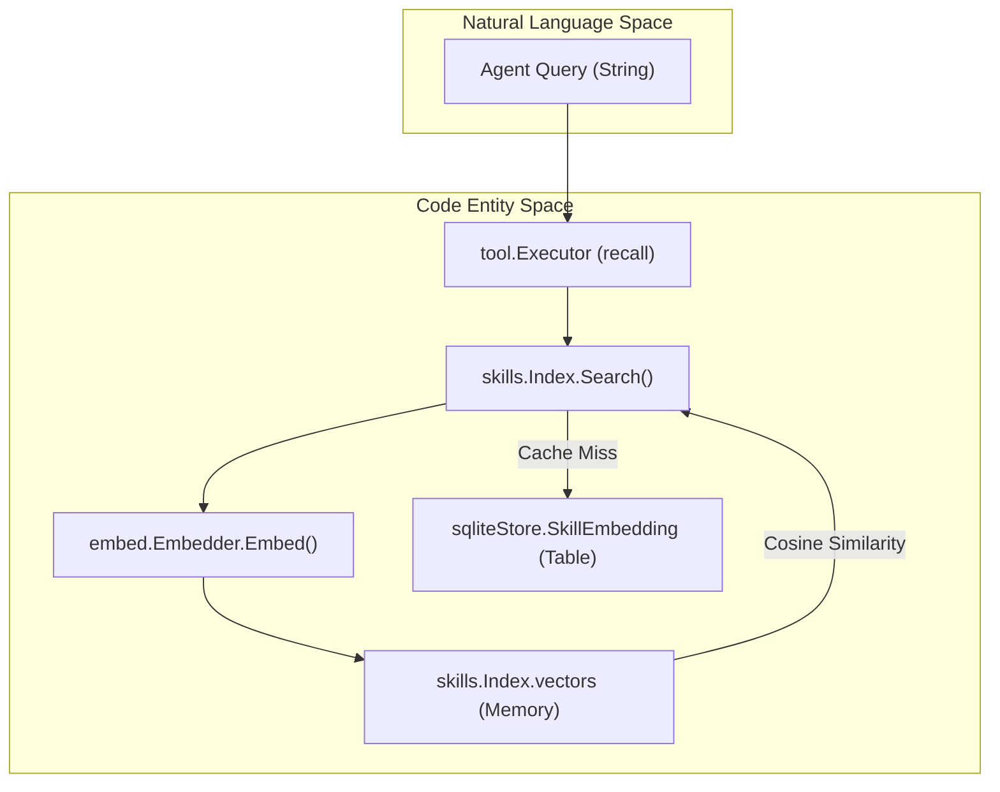
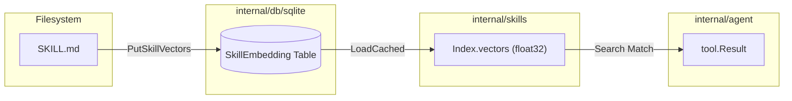

<!-- source: DeepWiki mcp.deepwiki.com · repo google-deepmind/amplio · page 7.1 Skills Index · fetched 2026-10-26 -->

# Skills Index

Relevant source files

The following files were used as context for generating this wiki page:

- [cmd/amplio/system.go](cmd/amplio/system.go)
- [docs/guide/prompt-context.md](docs/guide/prompt-context.md)
- [internal/db/sqlite/sqlite.go](internal/db/sqlite/sqlite.go)
- [internal/llm/openai/openai.go](internal/llm/openai/openai.go)
- [internal/llm/spec_test.go](internal/llm/spec_test.go)
- [internal/server/artifacts_test.go](internal/server/artifacts_test.go)
- [internal/server/briefings_test.go](internal/server/briefings_test.go)
- [internal/server/grades_test.go](internal/server/grades_test.go)
- [internal/tool/bash/bash.go](internal/tool/bash/bash.go)

The **Skills Index** is a core component of the Amplio recall subsystem. It provides agents with a mechanism to dynamically retrieve relevant documentation and expert knowledge (Skills) using natural language search. Unlike briefings or `AGENTS.md`, which are injected into every turn, skills are "pulled" on-demand via the `recall` tool [docs/guide/prompt-context.md:73-76]().

## Skill Definition (SKILL.md)

A "Skill" is defined as a directory containing a `SKILL.md` file [docs/guide/prompt-context.md:78-79](). This file uses a structured format to provide metadata for the indexing engine.

| Field | Description |
| :--- | :--- |
| `name` | The unique identifier for the skill. |
| `description` | A concise summary used for embedding and semantic matching. |
| `body` | The full content of the skill (Markdown), which is returned to the agent upon a successful recall match. |

Sources: [docs/guide/prompt-context.md:78-80]()

## Subsystem Architecture

The skills subsystem bridges the gap between raw filesystem documents and the agent's context through a multi-stage process involving embedding generation, SQLite caching, and a brute-force cosine similarity index.

### Natural Language to Code Entity Mapping

The following diagram illustrates how natural language queries from an agent are resolved to specific code entities and data structures within the `internal/skills` and `internal/db` packages.

**Query Resolution Flow**

Sources: [internal/skills/skills.go:1-100](), [cmd/amplio/system.go:110-113](), [internal/db/sqlite/sqlite.go:174-176]()

## Implementation Details

### The Index Struct
The `skills.Index` is the primary orchestrator for skill retrieval. It maintains an in-memory collection of skill vectors to perform rapid "brute-force" cosine similarity calculations against agent queries.

Key characteristics:
*   **Startup Lifecycle**: The index is initialized during `setupSystem` [cmd/amplio/system.go:112-113]().
*   **Source Directories**: Configured via the `[skills] dirs` key in `config.toml` [docs/guide/prompt-context.md:79-80]().
*   **Reconciliation**: The index reconciles the filesystem state with the database cache using `PutSkillVectors` [internal/db/sqlite/sqlite.go:173-176]().

### SQLite Embedding Cache
To avoid redundant calls to expensive embedding models (configured via `embed_model`), Amplio caches skill data in the `SkillEmbedding` table [internal/db/sqlite/sqlite.go:174-176]().

**Table Schema (SkillEmbedding)**
The table was migrated to include the following columns to allow the index to hydrate fully from the cache without re-scanning slow filesystem sources:
*   `description`: The text used for the vector representation.
*   `path`: The source file location.
*   `body`: The actual content returned to the agent.
*   `vector`: The blob containing the float32 embedding.

Sources: [internal/db/sqlite/sqlite.go:170-176]()

### Data Flow: Skill Ingestion and Retrieval

The following diagram shows the data flow from the filesystem into the `sqliteStore` and eventually into the agent's `tool.Result`.

**Skill Data Lifecycle**

Sources: [internal/db/sqlite/sqlite.go:170-176](), [cmd/amplio/system.go:110-113]()

## Configuration and Constraints

### Embedding Model Requirement
Recall is strictly dependent on the `embed_model` configuration. If this is not set, the skill index is disabled, and a warning is issued at startup [docs/guide/prompt-context.md:85-86]().

### Blocked Skills
The system supports a blocked-skills configuration to prevent specific skills from being indexed or served to agents, even if they exist in the configured source directories. This is typically managed via the `config.Config` object passed during `setupRecall` [cmd/amplio/system.go:112-113]().

Sources: [cmd/amplio/system.go:42-57](), [docs/guide/prompt-context.md:85-86]()

---

