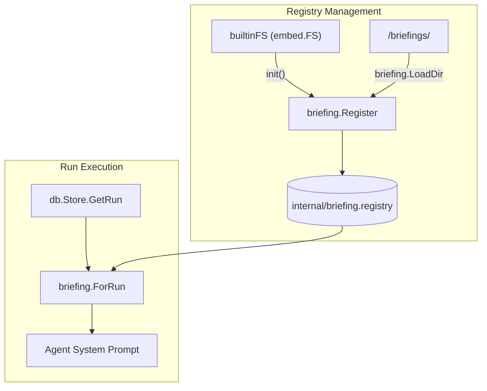
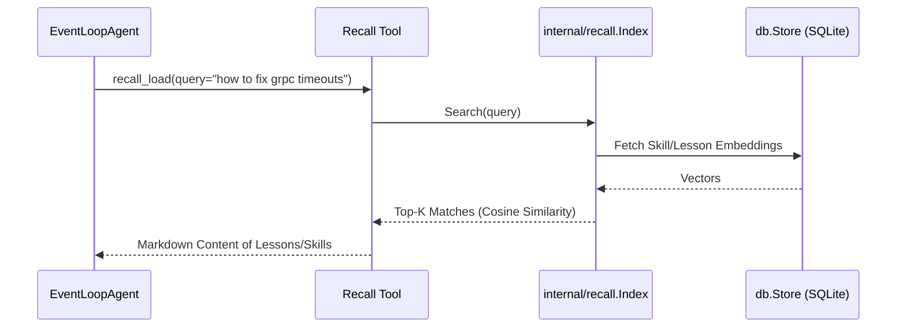

<!-- source: DeepWiki mcp.deepwiki.com · repo google-deepmind/amplio · page 7.2 Lessons and Briefings · fetched 2026-10-26 -->

# Lessons and Briefings

Relevant source files

The following files were used as context for generating this wiki page:

- [docs/guide/prompt-context.md](docs/guide/prompt-context.md)
- [internal/briefing/briefing.go](internal/briefing/briefing.go)
- [internal/briefing/builtin.go](internal/briefing/builtin.go)
- [internal/briefing/builtin/second_opinion.md](internal/briefing/builtin/second_opinion.md)
- [internal/briefing/forrun.go](internal/briefing/forrun.go)

Amplio provides several mechanisms for injecting context into an agent's execution loop. These range from global "standing instructions" to per-run documentation and dynamically retrieved "lessons" mined from previous executions. This multi-layered approach ensures agents have access to necessary knowledge without overwhelming their context windows.

## Context Layering Overview

Context is delivered to agents through four distinct channels, varying in scope and delivery method:

| Type | Managed By | Scope | Delivery |
| :--- | :--- | :--- | :--- |
| **System Prompt** | Amplio Core | Every agent | Hardcoded prefix |
| **Briefings** | Operator (Per-Run) | Run/Sub-agents | Appended to System Prompt |
| **AGENTS.md** | Operator (Environment) | Workspace/Data-dir | Step-0 System Event |
| **Skills / Lessons** | Agent (On-demand) | Single Turn | `recall_load` Tool Result |

**Sources:** [docs/guide/prompt-context.md:1-14](), [internal/briefing/briefing.go:18-27]()

---

## Briefings

Briefings are named Markdown files that contain specific guidance, API manuals, or workflows. Unlike `AGENTS.md`, which applies to all runs, briefings are explicitly selected by the operator when starting a specific run [docs/guide/prompt-context.md:38-41]().

### Briefing Structure and Scope
Briefings are defined with YAML front matter that determines their identity and visibility:

*   **`name`**: The unique identifier. This is stored in the run's configuration, ensuring that moving the file does not orphan existing runs [internal/briefing/briefing.go:61-68]().
*   **`scope`**:
    *   `all`: Delivered to the root agent and all sub-agents spawned within the run [internal/briefing/briefing.go:48]().
    *   `root`: Delivered only to the run's primary agent [internal/briefing/briefing.go:49]().

### Loading and Registry
Briefings are managed by a central `registry` map in `internal/briefing/briefing.go`.

1.  **Built-in Briefings**: Shipped with the binary via `embed.FS` and registered during `init()` [internal/briefing/builtin.go:28-49](). Example: `second-opinion` [internal/briefing/builtin/second_opinion.md:1-5]().
2.  **User Briefings**: Loaded from `<data-dir>/briefings/` at server startup [internal/briefing/briefing.go:101-121]().
3.  **Overrides**: If a user briefing shares a name with a built-in one, the user version overrides the built-in [internal/briefing/briefing.go:95-97]().

### Data Flow: Briefing Injection
The `briefing.ForRun` function retrieves the selection from the database and composes the final text for the agent [internal/briefing/forrun.go:32-47]().

**Sources:** [internal/briefing/briefing.go:73-92](), [internal/briefing/builtin.go:31-50](), [internal/briefing/forrun.go:32-47]()

---

## AGENTS.md Standing Instructions

`AGENTS.md` files provide "standing instructions" that apply to every run within a specific scope. These are ideal for house styles, build commands, or restricted directories [docs/guide/prompt-context.md:27-28]().

### Resolution Logic
Amplio looks for `AGENTS.md` in two locations:
1.  **Global**: `<data-dir>/AGENTS.md` (applies to all runs on the machine) [docs/guide/prompt-context.md:20]().
2.  **Workspace**: `<workspace>/AGENTS.md` (applies to runs within that specific workspace) [docs/guide/prompt-context.md:21]().

If both exist, they are concatenated. The text is read **once** at run creation and stored in the run's record. Subsequent edits to the files do not affect ongoing runs [docs/guide/prompt-context.md:30-34]().

### Delivery
Unlike briefings, `AGENTS.md` content is delivered as a **Step 0 System Event**. This ensures it is visible to all agents in the run's trajectory but does not bloat the static system prompt [docs/guide/prompt-context.md:23-25]().

---

## Lessons and Recall

While skills are static documents provided by the operator, **Lessons** are dynamic knowledge artifacts generated by the system itself.

### Lesson Mining
When a run concludes, a "Critic" agent generates a final report. During this process, the critic extracts reusable lessons—observations about what worked, what failed, and generalizable strategies [docs/guide/prompt-context.md:81-83]().

1.  **Extraction**: The critic identifies lessons from the run trajectory.
2.  **Persistence**: Lessons are stored in the SQLite database, surviving even if the original run is deleted [docs/guide/prompt-context.md:81-83]().
3.  **Indexing**: Lessons are embedded using the configured `embed_model` and added to the recall index.

### Recall Mechanism
Agents access lessons and skills via the `recall_load` tool. This is a "pull" mechanism where the agent requests relevant context based on its current task [docs/guide/prompt-context.md:75-77]().

**Sources:** [docs/guide/prompt-context.md:73-86](), [internal/briefing/briefing.go:18-20]()

---

## Technical Implementation Summary

### Key Data Structures
*   **`briefing.Briefing`**: Holds the parsed content, name, and scope of a briefing file [internal/briefing/briefing.go:64-71]().
*   **`briefing.registry`**: A thread-safe map (`sync.RWMutex`) storing all available briefings [internal/briefing/briefing.go:73-76]().
*   **`db.Store`**: Persists the selected briefing names in the `RunConfig` and stores mined lessons in the database [internal/briefing/forrun.go:32-37]().

### Diagnostic Access
The final composed prompt (including briefings and AGENTS.md) is written as the `system_prompt` marker in the session's step-0 event. It can be inspected via the web UI or the CLI [docs/guide/prompt-context.md:88-96]().

**Sources:** [internal/briefing/briefing.go:73-76](), [docs/guide/prompt-context.md:90-96]()

---

