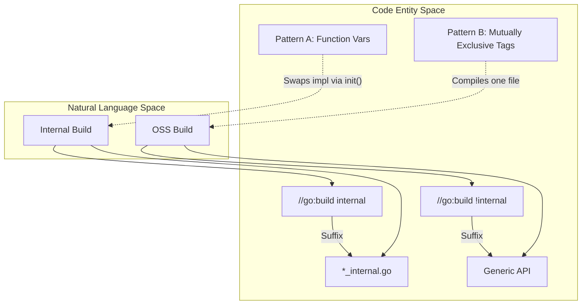
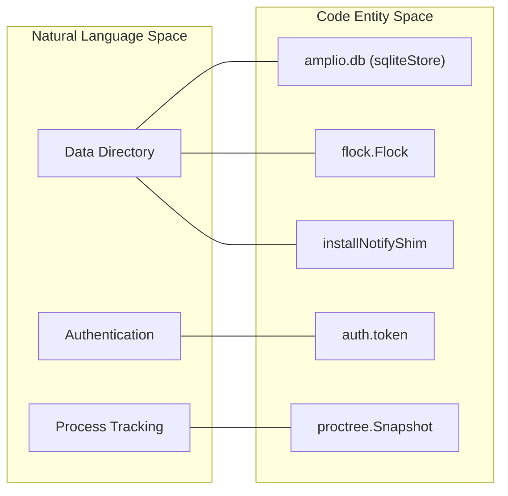

<!-- source: DeepWiki mcp.deepwiki.com · repo google-deepmind/amplio · page 8 Operations and Deployment · fetched 2026-10-26 -->

# Operations and Deployment

Relevant source files

The following files were used as context for generating this wiki page:

- [cmd/amplio/serverinfo.go](cmd/amplio/serverinfo.go)
- [cmd/amplio/serverinfo_test.go](cmd/amplio/serverinfo_test.go)
- [docs/guide/operations.md](docs/guide/operations.md)
- [docs/internals/internal-oss-separation.md](docs/internals/internal-oss-separation.md)
- [docs/internals/tls.md](docs/internals/tls.md)
- [internal/proctree/proctree.go](internal/proctree/proctree.go)
- [internal/server/processes.go](internal/server/processes.go)

This page outlines the day-to-day operational requirements and deployment strategies for Amplio. It covers instance management, security configurations, data persistence, and the build conventions that maintain parity between internal and open-source versions of the codebase.

## Instance Management

Amplio is designed around a **Data Directory** model. Each instance of the server requires exclusive access to its data directory, enforced via a filesystem advisory lock (`flock`) [cmd/amplio/serverinfo.go:120-138](). 

Multiple instances can run on the same host provided they are assigned unique data directories and listen ports [docs/guide/operations.md:5-12]().

### Instance Isolation
Each data directory contains its own:
*   **SQLite Database**: The primary source of truth for runs, sessions, and events [docs/guide/operations.md:82-82]().
*   **Artifacts and Blobs**: Per-run scratch files and tool-result images [docs/guide/operations.md:83-84]().
*   **Auth Tokens**: Unique credentials for write access [cmd/amplio/serverinfo.go:48-59]().
*   **Mined Lessons**: Lessons extracted by critics are local to the instance's database [docs/guide/operations.md:21-23]().

### Data Directory Layout
| Path | Entity | Purpose |
| :--- | :--- | :--- |
| `amplio.db` | `sqliteStore` | WAL-mode database containing all structured data. |
| `lock` | `flock` | Exclusive ownership lock for the directory. |
| `server.json` | `serverInfo` | Metadata (PID, URL, Token) for CLI discovery. |
| `auth.token` | Token File | Durable credential for magic-link authentication. |
| `bin/` | Notify Shims | Symlinks to the `amplio` binary for agent usage. |

**Sources:** [cmd/amplio/serverinfo.go:37-46](), [cmd/amplio/serverinfo.go:120-132](), [docs/guide/operations.md:78-86]().

## Security and Access Control

Amplio uses a **Read-Open, Write-Gated** security model [docs/guide/operations.md:31-33]().

1.  **Read Access**: Anyone who can reach the network port can view runs, transcripts, and logs.
2.  **Write Access**: Mutations (starting runs, sending messages, deleting) require a 32-byte crypto-random token [cmd/amplio/serverinfo.go:67-83]().
3.  **Sandboxing**: Amplio does **not** sandbox the agent's shell. Agents run with the same permissions as the user who started the `amplio serve` process [docs/guide/operations.md:121-126]().

### TLS and HTTP/2
Browsers limit concurrent HTTP/1.1 connections, which can cause the UI to stall when multiple Server-Sent Event (SSE) streams are open. Amplio automatically enables **HTTP/2 multiplexing** when TLS is configured [docs/internals/tls.md:1-15]().

*   **Auto-TLS**: If `mkcert` is found on the `$PATH`, Amplio can automatically generate locally-trusted certificates [docs/internals/tls.md:99-108]().
*   **Manual TLS**: Users can provide `cert.pem` and `key.pem` in the data directory [docs/internals/tls.md:18-20]().

**Sources:** [docs/guide/operations.md:25-47](), [docs/internals/tls.md:1-20]().

## Backups and Recovery

### SQLite WAL-Safe Backups
Because Amplio operates in **Write-Ahead Log (WAL) mode**, a simple file copy (`cp`) of `amplio.db` may result in a corrupted or incomplete backup if the server is active [docs/guide/operations.md:87-90](). 

Backups should be performed using the SQLite `.backup` command or equivalent API calls that respect the WAL [docs/guide/operations.md:92-103]().

### Process Recovery
Amplio is designed to be crash-resilient. Upon startup, the `RunManager` scans the database for sessions that were in an active state and schedules them for recovery [docs/guide/operations.md:59-68](). Ongoing tool calls are cancelled; agents receive feedback and decide whether to re-issue them [docs/guide/operations.md:72-75]().

**Sources:** [docs/guide/operations.md:59-75](), [docs/guide/operations.md:87-103]().

## Monitoring and Logs

### Process Monitoring
Amplio provides a Linux-only process tree monitor that attributes OS processes to specific runs and sessions [internal/proctree/proctree.go:15-23]().
*   **Attribution**: Accomplished via `AMPLIO_RUN_ID` and `AMPLIO_SESSION_ID` environment variables inherited by child processes [internal/proctree/proctree.go:17-20]().
*   **Orphan Detection**: The system identifies "orphan" processes whose launching shell has exited but the process remains active [internal/proctree/proctree.go:55-55]().
*   **Caching**: The server caches process snapshots for 1 second (`procCacheTTL`) to prevent redundant `/proc` scans from multiple UI tabs [internal/server/processes.go:25-33]().

### Log Management
Logs are stored in the `logs/` subdirectory of the data directory, with one file per `serve` invocation [docs/guide/operations.md:111-112](). The log level and format (plain text or JSON) can be configured via flags or environment variables [docs/guide/operations.md:113-119]().

**Sources:** [internal/proctree/proctree.go:15-57](), [internal/server/processes.go:25-28](), [docs/guide/operations.md:111-119]().

## Internal vs. OSS Builds

Amplio is maintained as a single source tree that produces two distinct build configurations via Go build tags and a mirroring process [docs/internals/internal-oss-separation.md:9-17]().

### Build Configuration Bridge
The following diagram illustrates how build tags separate environment-specific logic (Internal) from generic logic (OSS).

**Sources:** [docs/internals/internal-oss-separation.md:26-83]().

### Operational Deployment Flow
This diagram maps the deployment entities to their roles in the running system.

**Sources:** [cmd/amplio/serverinfo.go:37-59](), [cmd/amplio/serverinfo.go:120-138](), [internal/proctree/proctree.go:62-69]().

## Further Reading
*   For a complete list of configuration keys and precedence, see **[Configuration Reference](#8.1)**.
*   For details on the Linux process monitoring implementation and system stats, see **[Process Monitoring and System Stats](#8.2)**.

---

