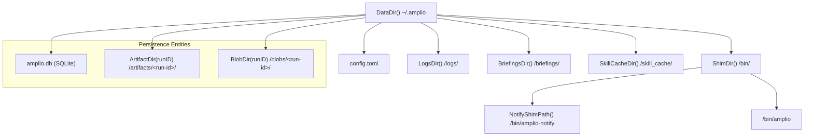
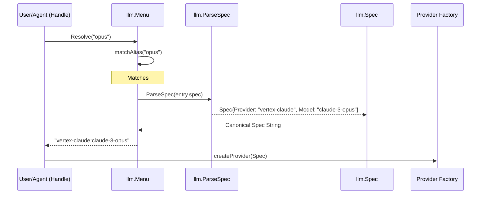

<!-- source: DeepWiki mcp.deepwiki.com · repo google-deepmind/amplio · page 8.1 Configuration Reference · fetched 2026-10-26 -->

# Configuration Reference

Relevant source files

The following files were used as context for generating this wiki page:

- [cmd/amplio/spec_test.go](cmd/amplio/spec_test.go)
- [docs/guide/cli.md](docs/guide/cli.md)
- [docs/guide/configuration.md](docs/guide/configuration.md)
- [internal/config/config.go](internal/config/config.go)
- [internal/config/load.go](internal/config/load.go)
- [internal/llm/bridge/transport_http.go](internal/llm/bridge/transport_http.go)
- [internal/llm/menu.go](internal/llm/menu.go)
- [internal/llm/menu_test.go](internal/llm/menu_test.go)
- [internal/server/llmapi.go](internal/server/llmapi.go)

Amplio is configured at startup using a layered precedence model. The system reads its settings from command-line flags, environment variables, and a `config.toml` file located in the data directory.

## Precedence Rules

For single values, the first one set wins according to the following hierarchy:
**Flag > Environment Variable > `config.toml` > Built-in Default**

[internal/config/load.go:43-48]()

### Resolution Logic
*   **Single Values:** The highest priority source that provides a value is used.
*   **Lists:** Lists (such as `skill_dirs` or `amplio_bin_paths`) **replace** rather than merge. Setting a list at a higher priority level (e.g., via flag) completely overrides the list defined in `config.toml` [docs/guide/configuration.md:59-62]().
*   **Tilde Expansion:** Paths starting with `~` are resolved against the user's home directory during configuration loading to ensure consistency across environments like systemd or containers where shells might not perform expansion [internal/config/config.go:78-90]().

### Configuration Mapping Table

| Setting | Flag | Environment Variable | `config.toml` Key |
| :--- | :--- | :--- | :--- |
| Data Directory | `--data-dir` | `AMPLIO_DATA_DIR` | N/A (determines file location) |
| Listen Address | `--listen` | `AMPLIO_LISTEN` | `listen` |
| System LLM (HQ) | `--system-llm-hq` | `AMPLIO_SYSTEM_LLM_HQ` | `system_llm_hq` |
| System LLM (Fast) | `--system-llm-fast` | `AMPLIO_SYSTEM_LLM_FAST` | `system_llm_fast` |
| Embedding Model | `--embed-model` | `AMPLIO_EMBED_MODEL` | `embed_model` |
| Skill Directories | `--skill-dir` | `AMPLIO_SKILL_DIRS` | `[skills] dirs` |
| Lend LLM Address | N/A | `AMPLIO_LEND_LLM` | `lend_llm` |

Sources: [internal/config/config.go:38-50](), [internal/config/load.go:31-59](), [docs/guide/configuration.md:49-58]()

---

## Data Directory Layout

The Data Directory is the root for all persistent state. By default, this is `~/.amplio` [internal/config/config.go:92-93]().

### Directory Structure Diagram
This diagram maps the logical data layout to the internal path helper functions in `internal/config/config.go`.

Sources: [internal/config/config.go:112-162](), [docs/guide/configuration.md:87-103]()

---

## `config.toml` Reference

The `config.toml` file is the primary location for persistent server settings.

### Global Settings
*   **`listen`**: The HTTP bind address for `amplio serve`. Defaults to `localhost:26759` [internal/config/load.go:90]().
*   **`db`**: Path to the SQLite database. Defaults to `<data-dir>/amplio.db` [internal/config/load.go:33]().
*   **`token`**: The web authentication token. If empty, a random token is generated and stored in `auth.token` [internal/config/load.go:34]().
*   **`system_llm_hq`**: High-quality model used for auto-critic reports and phase summaries [internal/config/load.go:35]().
*   **`system_llm_fast`**: Fast model used for routine step summarization [internal/config/load.go:36]().
*   **`embed_model`**: The model used for generating embeddings for skills and lessons. If unset, the recall subsystem is disabled [internal/config/load.go:121-126]().

### `[run]` Section
*   **`llms`**: A list of model specs offered in the UI model picker. The first entry serves as the default model for new runs [internal/config/load.go:141-146]().

### `[skills]` Section
*   **`dirs`**: List of directories to scan for `SKILL.md` files. These are layered; if two skills have the same name, the one from the later directory wins [internal/config/load.go:71-74]().
*   **`blocked`**: A list of skill names to explicitly exclude from the index [internal/config/load.go:75]().

### `[bridge.<name>]` Section
Defines named endpoints for the LLM Bridge protocol.
*   **`url`**: The endpoint URL (e.g., `https://host:port` or `unix:///path`) [internal/config/load.go:64]().
*   **`token_env`**: The name of the environment variable holding the bearer token for this bridge [internal/config/load.go:65]().
*   **`idle_timeout`**: Duration (e.g., `90s`) to wait for a response before timing out [internal/config/load.go:66]().

Sources: [internal/config/load.go:28-82](), [docs/guide/configuration.md:15-40]()

---

## LLM System Tiers and Menu Resolution

Amplio uses a `Menu` system to resolve model nicknames or short labels into full canonical `Spec` strings.

### Model Resolution Flow
This diagram illustrates how a user-provided string (like a nickname) is transformed into a functional `llm.Provider` via the `Menu.Resolve` logic.

Sources: [internal/llm/menu.go:55-78](), [internal/llm/menu_test.go:31-74]()

### Pre-defined System Tiers
The server requires two specific tiers for background operations:
1.  **HQ Tier (`system_llm_hq`)**: Used by the `Finalizer` and `Compaction` agents for reasoning-heavy tasks [internal/config/load.go:35]().
2.  **Fast Tier (`system_llm_fast`)**: Used by the `Observer` for generating concise step summaries [internal/config/load.go:36]().

---

## LLM Lending and Auth

Amplio can "lend" its LLM credentials to other instances (e.g., a containerized Amplio without its own API keys).

### Lending Configuration
*   **`lend_llm`**: Bind address for the dedicated lending listener (e.g., `127.0.0.1:26760`). This is a **separate** listener from the main API for security isolation [internal/config/load.go:45-49]().
*   **`lend_llm_token_env`**: Specifies the environment variable containing the bearer token required by callers of the lending listener [internal/config/load.go:50-52]().

### Authentication Model
1.  **Main API Auth**: Uses a token (stored in `auth.token`) passed via `Authorization: Bearer <token>` or an `HttpOnly` cookie. This grants full administrative access, including shell execution via agents [internal/server/llmapi.go:40-43]().
2.  **Lending Auth**: Uses a separate token defined by `LendLLMTokenEnv`. It only grants access to `/generate`, `/embed`, and `/models` endpoints [internal/server/llmapi.go:48-56]().

### Bridge Endpoints
Bridges allow Amplio to communicate with LLMs via a standardized NDJSON protocol.
*   **Protocol**: HTTP/HTTPS or Unix Sockets [internal/llm/bridge/transport_http.go:176-197]().
*   **Environment Defaults**: If `url` is missing in a spec, it falls back to `AMPLIO_BRIDGE_URL`. If `token_env` is missing, it defaults to `AMPLIO_BRIDGE_TOKEN` [internal/llm/bridge/transport_http.go:41-54]().

Sources: [internal/server/llmapi.go:29-61](), [internal/llm/bridge/transport_http.go:113-157]()

---

