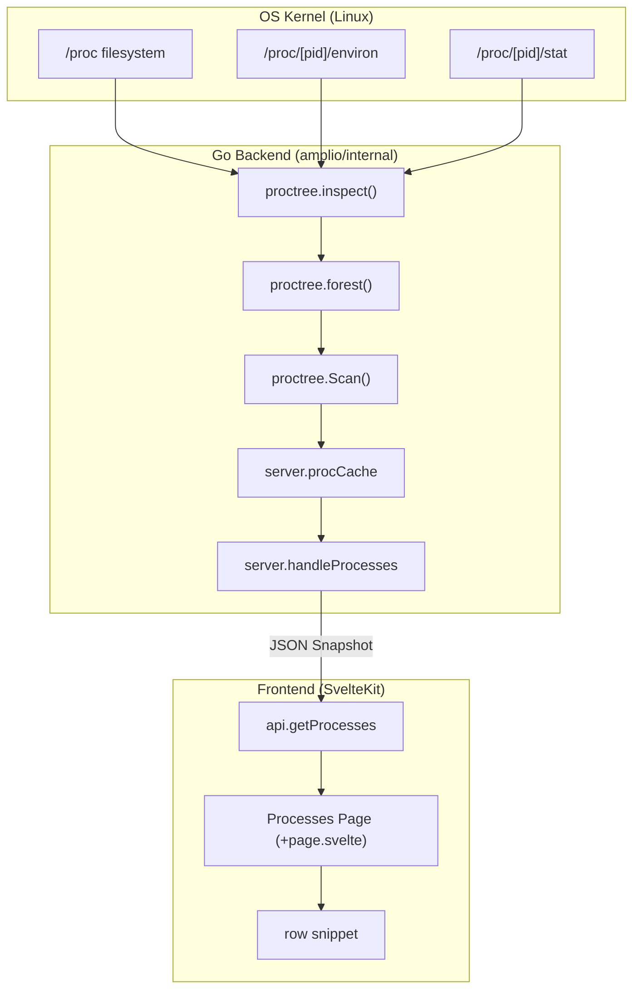
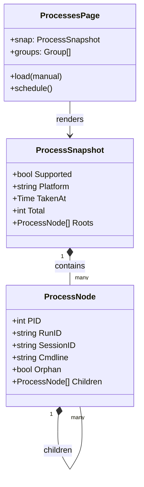

<!-- source: DeepWiki mcp.deepwiki.com · repo google-deepmind/amplio · page 8.2 Process Monitoring and System Stats · fetched 2026-10-26 -->

# Process Monitoring and System Stats

Relevant source files

The following files were used as context for generating this wiki page:

- [frontend/src/routes/runs/[id]/processes/+page.svelte](frontend/src/routes/runs/[id]/processes/+page.svelte)
- [frontend/src/routes/runs/[id]/sessions/[sid]/+page.svelte](frontend/src/routes/runs/[id]/sessions/[sid]/+page.svelte)
- [go.mod](go.mod)
- [go.sum](go.sum)
- [internal/proctree/proctree.go](internal/proctree/proctree.go)
- [internal/proctree/proctree_linux.go](internal/proctree/proctree_linux.go)
- [internal/proctree/proctree_other.go](internal/proctree/proctree_other.go)
- [internal/server/processes.go](internal/server/processes.go)

Amplio includes a specialized subsystem for monitoring OS-level processes spawned by agents. This system is designed to detect background servers, watchers, and test runs that outlive the bash tool calls that started them. It provides visibility into the "side effects" of agent execution on the host system.

## Process Tree Monitoring (proctree)

The process monitoring system is implemented in the `proctree` package. It utilizes a Linux-specific `/proc` scanning mechanism to attribute processes to specific Amplio runs and sessions.

### Attribution Mechanism
Attribution does not rely on a central registry or database state. Instead, it uses environment variables injected into the process by the `bash` tool [internal/proctree/proctree.go:17-23]().
*   **AMPLIO_RUN_ID**: Identifies the run.
*   **AMPLIO_SESSION_ID**: Identifies the specific agent session.

Because these variables are inherited by child processes, any descendant of an agent's bash call carries these markers unless the environment is explicitly replaced (e.g., via `env -i`) [internal/proctree/proctree.go:25-27]().

### Linux implementation
The scanner performs a parallel walk of `/proc` using a configurable number of workers (default 8) to bound latency [internal/proctree/proctree_linux.go:36-39]().

1.  **PID Discovery**: Reads `/proc` to find all numeric entries [internal/proctree/proctree_linux.go:178-193]().
2.  **Filter by UID**: Skips processes not owned by the Amplio server user to avoid `EACCES` errors when reading environments [internal/proctree/proctree_linux.go:88-93]().
3.  **Marker Inspection**: Reads `/proc/<pid>/environ` to find the `AMPLIO_RUN_ID` [internal/proctree/proctree_linux.go:94-102]().
4.  **Stat Extraction**: Parses `/proc/<pid>/stat` to get parent PIDs, CPU usage, memory (RSS), and start time [internal/proctree/proctree_linux.go:124-149]().
5.  **Forest Construction**: Organizes the flat list of processes into a tree structure. Processes whose parent is missing from the sampled set (or is PID 1) are treated as roots [internal/proctree/proctree_linux.go:199-213]().

### Orphan Process Detection
A process is marked as an `Orphan` if its parent PID is 1 (reparented to init), indicating the launching shell or intermediate parent has exited [internal/proctree/proctree_linux.go:208-209](). This is critical for identifying leaked background processes.

**Sources:** [internal/proctree/proctree.go:15-69](), [internal/proctree/proctree_linux.go:1-226](), [internal/proctree/proctree_other.go:1-35]()

## Data Flow: Kernel to Frontend

The system uses a polling model rather than a stream because the Linux kernel does not provide events for arbitrary descendant forks/exits [frontend/src/routes/runs/[id]/processes/+page.svelte:22-26]().

### Diagram: Process Monitoring Architecture
This diagram bridges the system-level `/proc` filesystem to the frontend UI components.

**Sources:** [internal/proctree/proctree_linux.go:46-83](), [internal/server/processes.go:62-75](), [frontend/src/routes/runs/[id]/processes/+page.svelte:61-73]()

## Server-Side Caching

To prevent multiple concurrent users from triggering redundant `/proc` walks, the server implements a `procCache` with a 1-second TTL (`procCacheTTL`) [internal/server/processes.go:28-33]().

*   **Coalescing**: Concurrent requests for the same `runID` within the TTL window receive the same snapshot [internal/server/processes.go:35-43]().
*   **Security**: The `handleProcesses` endpoint requires full authentication because process command lines frequently contain sensitive data (tokens, paths) that the standard read-only API does not expose [internal/server/processes.go:56-58]().

**Sources:** [internal/server/processes.go:15-75]()

## Frontend Implementation

The process monitor UI (`/runs/[id]/processes`) provides a hierarchical view of the sampled process tree.

### Polling Lifecycle
*   **Interval**: Polls every 5 seconds (`POLL_MS`) [frontend/src/routes/runs/[id]/processes/+page.svelte:47]().
*   **Visibility Awareness**: The UI stops polling when the browser tab is hidden to save system resources [frontend/src/routes/runs/[id]/processes/+page.svelte:79-82]().
*   **Manual Refresh**: Users can trigger an immediate scan via the "Refresh" button [frontend/src/routes/runs/[id]/processes/+page.svelte:165-168]().

### Data Representation
The frontend groups processes by their `session_id` to attribute them to specific agents within a run [frontend/src/routes/runs/[id]/processes/+page.svelte:112-123]().

| Metric | Implementation |
| :--- | :--- |
| **CPU Time** | Calculated from `utime` + `stime` fields in `/proc/[pid]/stat`, formatted to show decimals for values < 10s to distinguish "asleep" vs "active" [frontend/src/routes/runs/[id]/processes/+page.svelte:137-140](). |
| **Memory** | Displays RSS (Resident Set Size) converted to human-readable units (K, M, G) [frontend/src/routes/runs/[id]/processes/+page.svelte:129-133](). |
| **State** | Maps single-character kernel states (R, S, D, Z, T) to human-readable labels like "zombie" or "running" [frontend/src/routes/runs/[id]/processes/+page.svelte:149-151](). |

### Diagram: Code Entity Space - UI to Logic
This diagram shows the relationship between Svelte state and the Go data structures.

**Sources:** [frontend/src/routes/runs/[id]/processes/+page.svelte:17-152](), [internal/proctree/proctree.go:42-69]()

## Platform Support
*   **Linux**: Fully supported via `/proc`.
*   **Other Platforms**: The `Scan` function returns `Supported: false`. The UI detects this and displays a message stating that process listing is not supported on the current platform (e.g., `darwin`) [internal/proctree/proctree_other.go:33-35](), [frontend/src/routes/runs/[id]/processes/+page.svelte:173-174]().

**Sources:** [internal/proctree/proctree_other.go:15-35]()

---

