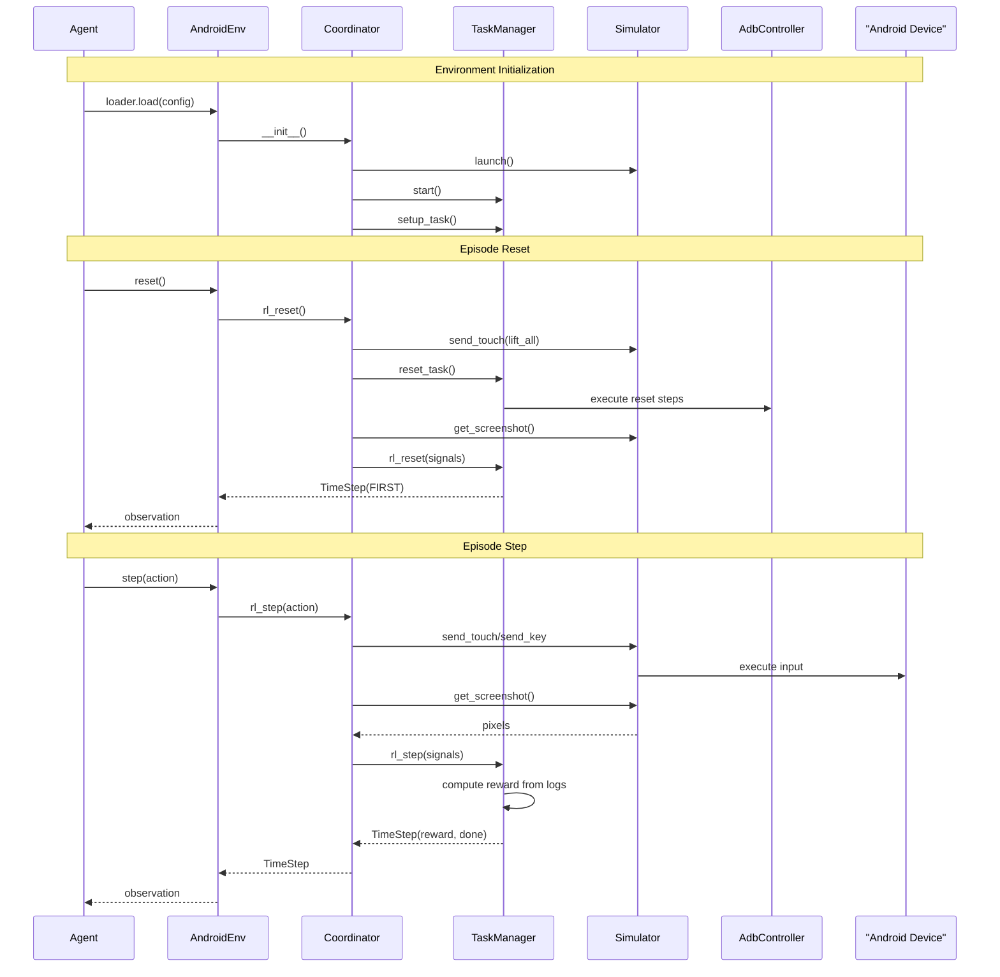
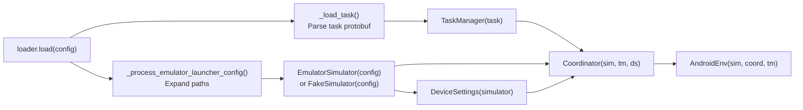
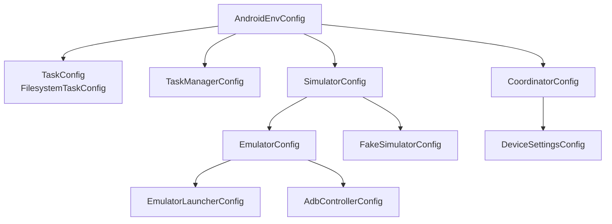

<!-- source: DeepWiki mcp.deepwiki.com · repo google-deepmind/android_env · page 1 Overview · fetched 2026-10-26 -->

# Overview

<details>
<summary>Relevant source files</summary>

The following files were used as context for generating this wiki page:

- [android_env/components/config_classes.py](android_env/components/config_classes.py)
- [android_env/components/coordinator.py](android_env/components/coordinator.py)
- [android_env/components/coordinator_test.py](android_env/components/coordinator_test.py)
- [android_env/components/task_manager.py](android_env/components/task_manager.py)
- [android_env/components/task_manager_test.py](android_env/components/task_manager_test.py)
- [android_env/environment.py](android_env/environment.py)
- [android_env/environment_test.py](android_env/environment_test.py)
- [android_env/loader.py](android_env/loader.py)
- [android_env/loader_test.py](android_env/loader_test.py)
- [android_env/wrappers/float_pixels_wrapper.py](android_env/wrappers/float_pixels_wrapper.py)
- [android_env/wrappers/last_action_wrapper.py](android_env/wrappers/last_action_wrapper.py)

</details>


## Purpose and Scope

This page provides a high-level introduction to **AndroidEnv**, a reinforcement learning environment for training agents to interact with Android applications. It covers the overall system architecture, major components, their responsibilities, and how they collaborate to provide a standard RL environment interface.

For detailed information about specific subsystems:
- Installation and setup procedures, see [Installation and Build System](#2.1)
- Configuration details, see [Configuration System](#2.2)
- Task definition and management, see [Task Management](#4)
- Simulator implementations, see [Simulator System](#5)
- Environment wrappers, see [Environment Wrappers](#7)

## What is AndroidEnv

AndroidEnv is a Python-based reinforcement learning environment that enables RL agents to interact with Android applications running on Android emulators or devices. It implements the `dm_env.Environment` interface, providing a standard RL loop with `reset()` and `step(action)` methods that return observations, rewards, and episode termination signals.

The environment bridges the gap between high-level RL abstractions and low-level Android device control by:
- Managing Android emulator lifecycle (launch, restart, cleanup)
- Translating agent actions (touch events, key presses) into Android input commands
- Extracting observations (screenshots, device state) from the Android device
- Monitoring application logs to compute rewards and detect episode termination
- Providing a flexible task definition system via Protocol Buffers

**Key Features:**
- Standard `dm_env.Environment` interface for compatibility with RL frameworks
- Support for multiple "fingers" (multi-touch) and keyboard inputs
- Configurable task definitions with custom reward functions
- Log-based reward extraction using regex patterns
- Automatic error recovery and simulator restart mechanisms
- Extensible wrapper system for observation/action transformations

Sources: [android_env/environment.py:1-191](), [android_env/loader.py:1-90]()

## System Architecture

AndroidEnv follows a layered architecture with clear separation of concerns. The system consists of four major layers that work together to provide the RL environment interface.

```mermaid
graph TB
    subgraph "Layer 1: External Interface"
        Agent["RL Agent"]
        Config["AndroidEnvConfig"]
        LoaderFn["loader.load()"]
    end
    
    subgraph "Layer 2: Environment API"
        AndroidEnv["AndroidEnv<br/>(environment.py)"]
        EnvInterface["AndroidEnvInterface<br/>(env_interface.py)"]
        Wrappers["BaseWrapper<br/>Observation/Action Transforms"]
    end
    
    subgraph "Layer 3: Core Orchestration"
        Coordinator["Coordinator<br/>(coordinator.py)"]
        TaskManager["TaskManager<br/>(task_manager.py)"]
        DeviceSettings["DeviceSettings<br/>(device_settings.py)"]
    end
    
    subgraph "Layer 4: Device Communication"
        BaseSimulator["BaseSimulator<br/>(base_simulator.py)"]
        EmulatorSim["EmulatorSimulator<br/>(emulator_simulator.py)"]
        AdbController["AdbController<br/>(adb_controller.py)"]
        AdbCallParser["AdbCallParser<br/>(adb_call_parser.py)"]
    end
    
    subgraph "Layer 5: Android Device"
        Emulator["Android Emulator Process"]
        ADB["ADB Daemon"]
        GRPC["gRPC Server<br/>Port 8554"]
    end
    
    Agent -->|"actions"| Wrappers
    Wrappers -->|"wrapped"| AndroidEnv
    AndroidEnv -->|"observations"| Wrappers
    Wrappers -->|"processed"| Agent
    
    Config --> LoaderFn
    LoaderFn -->|"creates"| AndroidEnv
    
    AndroidEnv -.->|"implements"| EnvInterface
    AndroidEnv --> Coordinator
    AndroidEnv --> TaskManager
    
    Coordinator --> TaskManager
    Coordinator --> DeviceSettings
    Coordinator --> BaseSimulator
    Coordinator --> AdbCallParser
    
    TaskManager --> AdbCallParser
    
    BaseSimulator <|..|"implements"| EmulatorSim
    EmulatorSim --> AdbController
    AdbCallParser --> AdbController
    
    AdbController -->|"ADB commands"| ADB
    EmulatorSim -->|"gRPC calls"| GRPC
    
    ADB --> Emulator
    GRPC --> Emulator
```

**Architecture: Natural Language to Code Mapping**

This diagram maps the conceptual layers to their corresponding code entities in the codebase.

Sources: [android_env/environment.py:32-191](), [android_env/components/coordinator.py:36-287](), [android_env/loader.py:47-68]()

### Major Components

The following table summarizes the core components and their primary responsibilities:

| Component | File Path | Primary Responsibility |
|-----------|-----------|----------------------|
| **AndroidEnv** | `android_env/environment.py` | Main environment class implementing `dm_env.Environment` interface |
| **Coordinator** | `android_env/components/coordinator.py` | Orchestrates interaction between simulator, task manager, and device settings |
| **TaskManager** | `android_env/components/task_manager.py` | Manages task lifecycle, reward extraction, and episode termination logic |
| **BaseSimulator** | `android_env/components/simulators/base_simulator.py` | Abstract interface for simulator implementations |
| **EmulatorSimulator** | `android_env/components/simulators/emulator/emulator_simulator.py` | Controls Android emulator via gRPC and ADB |
| **AdbController** | `android_env/components/adb_controller.py` | Executes ADB commands via subprocess |
| **AdbCallParser** | `android_env/components/adb_call_parser.py` | Translates `AdbRequest` protobufs into ADB shell commands |
| **DeviceSettings** | `android_env/components/device_settings.py` | Manages Android device display settings and orientation |
| **loader.load()** | `android_env/loader.py` | Factory function that constructs and initializes AndroidEnv |

Sources: [android_env/environment.py:1-191](), [android_env/components/coordinator.py:1-287](), [android_env/components/task_manager.py:1-438]()

### Component Interaction Flow

The following diagram illustrates how components interact during a typical RL episode, showing the call chain from agent to Android device:



**Sequence: RL Episode Lifecycle**

This diagram shows the complete flow from environment initialization through reset and step operations, mapping each operation to its implementing class.

Sources: [android_env/environment.py:66-114](), [android_env/components/coordinator.py:180-246](), [android_env/components/task_manager.py:99-234]()

## Core Component Responsibilities

### AndroidEnv Class

The `AndroidEnv` class ([environment.py:32-191]()) is the main entry point for RL agents. It implements the `dm_env.Environment` interface and provides:

```python
# Key methods from environment.py
def reset(self) -> dm_env.TimeStep:
    """Resets the environment for a new RL episode."""
    
def step(self, action: dict[str, np.ndarray]) -> dm_env.TimeStep:
    """Takes a step in the environment."""
    
def action_spec(self) -> dict[str, dm_env.specs.Array]:
    """Returns the action specification."""
    
def observation_spec(self) -> dict[str, dm_env.specs.Array]:
    """Returns the observation specification."""
```

**Additional AndroidEnv Methods:**
- `task_extras()` - Returns task-specific extra observations
- `execute_adb_call()` - Executes arbitrary ADB commands
- `load_state()` / `save_state()` - Checkpoint management
- `stats()` - Returns performance metrics

The class maintains internal state including `_latest_observation`, `_latest_action`, and `_latest_extras`, ensuring consistency when observations are None during error recovery.

Sources: [android_env/environment.py:32-191]()

### Coordinator Orchestration

The `Coordinator` class ([coordinator.py:36-287]()) is the central orchestrator that manages:

1. **Simulator Lifecycle**: Launches simulator, handles periodic restarts ([coordinator.py:114-169]())
2. **Action Execution**: Translates agent actions to simulator commands ([coordinator.py:213-246]())
3. **Observation Collection**: Gathers screenshots, orientation, and timing data ([coordinator.py:248-264]())
4. **Error Recovery**: Tracks simulator health and triggers relaunches on failure ([coordinator.py:93-112]())
5. **Statistics Tracking**: Maintains counters for restarts, errors, and other metrics ([coordinator.py:59-71]())

**Key Configuration:**
- `num_fingers`: Number of simultaneous touch points (default: 1)
- `enable_key_events`: Whether keyboard events are enabled
- `periodic_restart_time_min`: Time between periodic simulator restarts

Sources: [android_env/components/coordinator.py:36-287]()

### TaskManager Monitoring

The `TaskManager` class ([task_manager.py:42-438]()) handles all task-specific logic:

1. **Reward Extraction**: Parses Android logcat output using regex patterns ([task_manager.py:301-353]())
2. **Episode Termination**: Detects episode end conditions from logs and app state ([task_manager.py:196-234]())
3. **Task Setup/Reset**: Executes setup and reset steps defined in task proto ([task_manager.py:99-148]())
4. **Extras Collection**: Extracts task-specific observations (arrays, JSON objects) ([task_manager.py:386-437]())
5. **Multi-threaded Monitoring**: Runs `LogcatThread` and `DumpsysThread` concurrently ([task_manager.py:243-260]())

**Supported Reward Types:**
- Direct rewards: Extracted via regex with capture groups
- Score-based rewards: Computed as delta between consecutive scores
- Event-based rewards: Fixed reward values triggered by log patterns

Sources: [android_env/components/task_manager.py:42-438]()

## Environment Lifecycle

### Initialization via loader.load()

The `loader.load()` function ([loader.py:47-68]()) is the recommended way to create an `AndroidEnv` instance. It performs the following steps:



**Initialization Flow: loader.load() to AndroidEnv**

The loader handles path expansion (e.g., `~/Android/Sdk` → `/home/user/Android/Sdk`), component instantiation in dependency order, and returns a fully initialized environment.

Sources: [android_env/loader.py:47-90]()

### Reset Flow

The `reset()` method ([environment.py:66-88]()) initializes a new episode:

1. **Coordinator.rl_reset()** ([coordinator.py:180-211]())
   - Checks if simulator restart is needed
   - Lifts all fingers to neutral position
   - Calls `TaskManager.reset_task()`
   - Gathers initial observations

2. **TaskManager.reset_task()** ([task_manager.py:128-147]())
   - Pauses log monitoring
   - Executes reset steps (defined in task proto)
   - Resumes log monitoring
   - Resets internal counters

3. **TaskManager.rl_reset()** ([task_manager.py:149-165]())
   - Waits for first log line
   - Collects initial extras
   - Returns `TimeStep` with `step_type=FIRST`

Sources: [android_env/environment.py:66-88](), [android_env/components/coordinator.py:180-211](), [android_env/components/task_manager.py:128-165]()

### Step Flow

The `step(action)` method ([environment.py:90-114]()) executes one environment step:

1. **Coordinator.rl_step()** ([coordinator.py:213-246]())
   - Sends action to simulator (touch/key event)
   - Gathers new observations (screenshot, orientation, timedelta)
   - Passes signals to TaskManager

2. **TaskManager.rl_step()** ([task_manager.py:167-180]())
   - Increments step counter
   - Waits for log processing
   - Extracts accumulated rewards
   - Collects task extras
   - Determines transition type (MID, LAST)

3. **Transition Determination** ([task_manager.py:196-234]())
   - Checks if user exited app → `dm_env.truncation`
   - Checks for episode end signal in logs → `dm_env.termination`
   - Checks step/time limits → `dm_env.truncation`
   - Otherwise → `dm_env.transition`

Sources: [android_env/environment.py:90-114](), [android_env/components/coordinator.py:213-246](), [android_env/components/task_manager.py:167-234]()

## Configuration System Overview

AndroidEnv uses a hierarchical configuration system based on Python dataclasses defined in [config_classes.py:1-221](). The configuration tree structure is:



**Configuration Hierarchy**

Key configuration classes:
- **AndroidEnvConfig** ([config_classes.py:209-221]()): Top-level configuration
- **EmulatorLauncherConfig** ([config_classes.py:100-141]()): Emulator binary paths, AVD name, GPU mode
- **AdbControllerConfig** ([config_classes.py:23-43]()): ADB binary path, server port, device name
- **CoordinatorConfig** ([config_classes.py:61-75]()): Number of fingers, keyboard events, restart intervals
- **TaskManagerConfig** ([config_classes.py:175-189]()): Bad state thresholds, dumpsys check frequency

For detailed configuration documentation, see [Configuration System](#2.2).

Sources: [android_env/components/config_classes.py:1-221](), [android_env/loader.py:47-90]()

## Action and Observation Specifications

### Base Action Space

The base action space ([coordinator.py:81-85]()) consists of:

| Action Component | Type | Shape | Description |
|-----------------|------|-------|-------------|
| `action_type` | `DiscreteArray` | `()` | Action type: TOUCH (0), LIFT (1), REPEAT (2) |
| `touch_position` | `BoundedArray[float32]` | `(2,)` | Normalized coordinates [0.0, 1.0] for (x, y) |
| `action_type_N` | `DiscreteArray` | `()` | Action type for finger N (if num_fingers > 1) |
| `touch_position_N` | `BoundedArray[float32]` | `(2,)` | Touch position for finger N |

When `enable_key_events=True`, additional actions are available for keyboard input.

### Base Observation Space

The base observation space ([coordinator.py:87-91]()) provides:

| Observation | Type | Shape | Description |
|-------------|------|-------|-------------|
| `pixels` | `Array[uint8]` | `(H, W, 3)` | RGB screenshot from device |
| `orientation` | `Array[uint8]` | `(4,)` | One-hot encoded screen orientation |
| `timedelta` | `Array[int64]` | `()` | Microseconds since last observation |
| `extras` | `dict[str, np.ndarray]` | Variable | Task-specific observations from logs |

The observation space can be transformed by wrappers (see [Environment Wrappers](#7)) to provide different formats like grayscale images, resized screenshots, or discrete action spaces.

Sources: [android_env/components/coordinator.py:81-91](), [android_env/components/specs.py:1-100]()

## Key Interfaces and Contracts

### dm_env.Environment Interface

AndroidEnv implements the standard DeepMind Environment API:

```python
# From dm_env specification
class Environment(Protocol):
    def reset(self) -> TimeStep
    def step(self, action) -> TimeStep
    def observation_spec(self) -> specs.Array
    def action_spec(self) -> specs.Array
    def close(self) -> None
```

This ensures compatibility with RL frameworks like Acme, RLlib, and others that support the `dm_env` interface.

Sources: [android_env/environment.py:32-191]()

### AndroidEnvInterface Extensions

The `AndroidEnvInterface` abstract class ([env_interface.py]()) extends `dm_env.Environment` with Android-specific methods:

- `execute_adb_call(call: AdbRequest) -> AdbResponse` - Execute arbitrary ADB commands
- `load_state(request: LoadStateRequest) -> LoadStateResponse` - Load emulator snapshot
- `save_state(request: SaveStateRequest) -> SaveStateResponse` - Save emulator snapshot
- `task_extras(latest_only: bool) -> dict` - Retrieve task-specific observations
- `stats() -> dict` - Get environment statistics
- `raw_action` - Property returning the last action taken
- `raw_observation` - Property returning the last observation

These extensions enable advanced use cases like curriculum learning (via state save/load), debugging (via ADB commands), and task-specific data collection.

Sources: [android_env/env_interface.py:1-100](), [android_env/environment.py:126-191]()

### BaseSimulator Contract

All simulator implementations must inherit from `BaseSimulator` and implement:

- `launch()` - Start the simulator
- `get_screenshot() -> np.ndarray` - Capture current screen
- `send_touch(touches)` - Send touch events
- `send_key(keycode, event_type)` - Send keyboard events
- `create_adb_controller() -> AdbController` - Factory for ADB controller
- `create_log_stream() -> LogStream` - Factory for log stream
- `close()` - Cleanup resources

This abstraction allows the system to work with different backends (emulator, physical device, or fake/mock simulators for testing).

Sources: [android_env/components/simulators/base_simulator.py:1-200]()

## Error Handling and Recovery

AndroidEnv includes robust error handling with automatic recovery:

1. **Simulator Health Tracking**: `Coordinator._simulator_healthy` flag ([coordinator.py:74]())
2. **Automatic Restart**: Failed operations trigger simulator relaunch ([coordinator.py:114-169]())
3. **Retry Logic**: ADB commands and simulator operations include configurable retries
4. **Graceful Degradation**: Returns last known observation when new observation fails ([environment.py:104-106]())
5. **Statistics**: Tracks restart counts by failure type ([coordinator.py:59-71]())

**Restart Triggers:**
- Setup step failures → `relaunch_count_setup_steps`
- Reset step failures → `relaunch_count_reset_steps`
- Action execution errors → `relaunch_count_execute_action`
- Screenshot retrieval errors → `relaunch_count_fetch_observation`
- Periodic restart timer → `relaunch_count_periodic`

Sources: [android_env/components/coordinator.py:59-169](), [android_env/environment.py:90-114]()

## Quick Start Example

A minimal example of creating and using AndroidEnv:

```python
from android_env import loader
from android_env.components import config_classes

# Create configuration
config = config_classes.AndroidEnvConfig(
    task=config_classes.FilesystemTaskConfig(
        path='/path/to/task.textproto'
    ),
    simulator=config_classes.EmulatorConfig(
        emulator_launcher=config_classes.EmulatorLauncherConfig(
            avd_name='my_avd',
            android_sdk_root='~/Android/Sdk',
        )
    )
)

# Load environment
env = loader.load(config)

# Run episode
timestep = env.reset()
while not timestep.last():
    action = {
        'action_type': np.array(0),  # TOUCH
        'touch_position': np.array([0.5, 0.5])
    }
    timestep = env.step(action)
    print(f"Reward: {timestep.reward}")

env.close()
```

For complete examples with different agent types, see [Example Usage](#9.2).

Sources: [android_env/loader.py:47-68](), [android_env/environment.py:32-191]()

---

