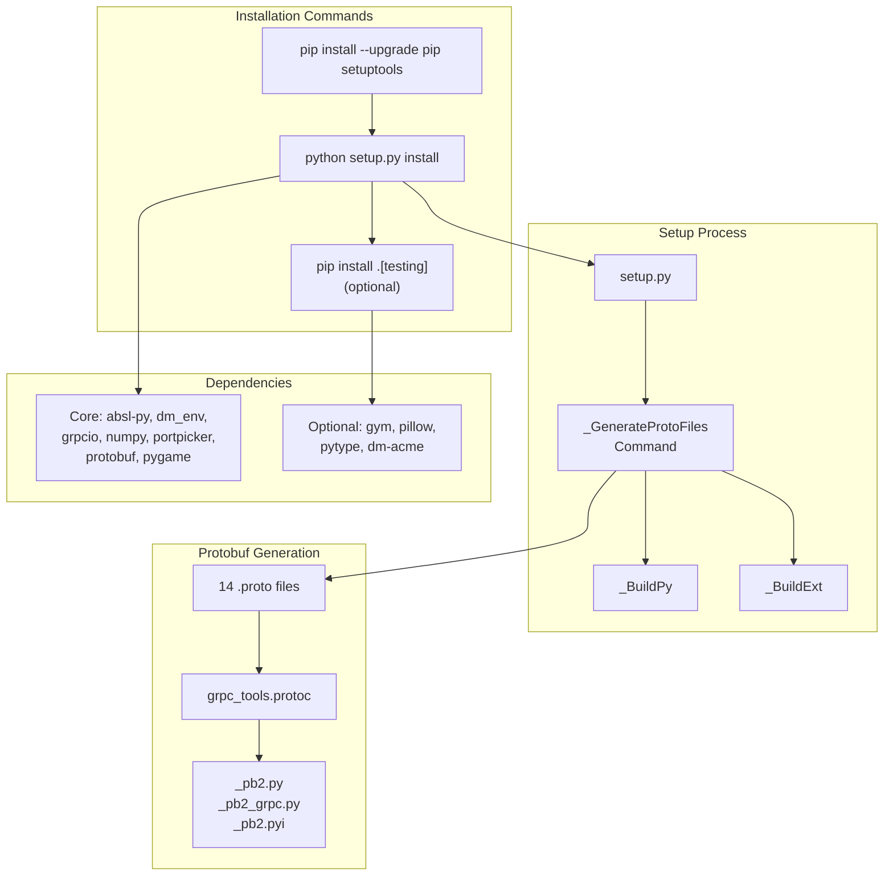
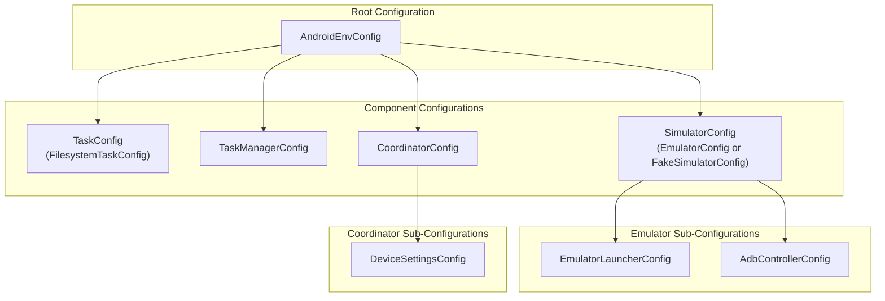
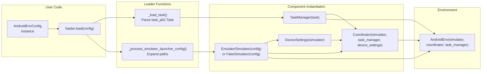
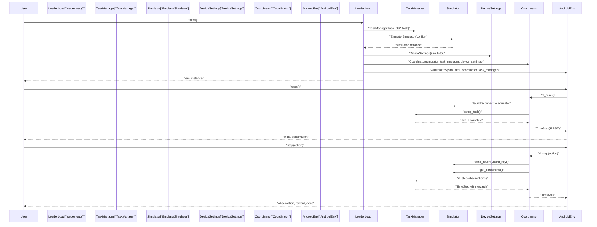

<!-- source: DeepWiki mcp.deepwiki.com · repo google-deepmind/android_env · page 2 Getting Started · fetched 2026-10-26 -->

# Getting Started

<details>
<summary>Relevant source files</summary>

The following files were used as context for generating this wiki page:

- [.github/workflows/tests.yml](.github/workflows/tests.yml)
- [android_env/components/config_classes.py](android_env/components/config_classes.py)
- [android_env/components/simulators/emulator/emulator_launcher.py](android_env/components/simulators/emulator/emulator_launcher.py)
- [android_env/components/simulators/emulator/emulator_launcher_test.py](android_env/components/simulators/emulator/emulator_launcher_test.py)
- [android_env/loader.py](android_env/loader.py)
- [android_env/loader_test.py](android_env/loader_test.py)
- [examples/run_acme_agent.py](examples/run_acme_agent.py)
- [examples/run_human_agent.py](examples/run_human_agent.py)
- [examples/run_random_agent.py](examples/run_random_agent.py)
- [pyproject.toml](pyproject.toml)
- [setup.py](setup.py)

</details>


This document provides an overview of installing, configuring, and running your first AndroidEnv experiment. It covers the basic installation process, the configuration system, and how to load an environment. For detailed information about the build system and protobuf generation, see [Installation and Build System](#2.1). For comprehensive configuration options and the loader system, see [Configuration System](#2.2). For complete working examples with different agent types, see [Quick Start Examples](#2.3).

## Prerequisites

Before installing AndroidEnv, ensure you have the following installed on your system:

| Requirement | Version | Description |
|-------------|---------|-------------|
| Python | ≥ 3.10 | Required for AndroidEnv and dependencies |
| Android SDK | Latest | Provides platform tools including ADB |
| Android Emulator | Latest | Required for running Android Virtual Devices (AVDs) |
| ADB | Latest | Included in Android SDK platform-tools |
| KVM | - | Linux kernel virtualization (for Linux systems) |

**Important**: AndroidEnv requires filesystem paths to the Android SDK, emulator binary, and ADB binary. These paths must be fully expanded (e.g., `/home/user/Android/Sdk/emulator/emulator` rather than `~/Android/Sdk/emulator/emulator`). The loader will perform path expansion, but paths in configuration should use the tilde (`~`) syntax for portability.

Sources: [pyproject.toml:16](), [android_env/components/config_classes.py:23-44](), [android_env/loader.py:76-89]()

## Installation Process

The installation process consists of three main stages: package installation, dependency resolution, and protobuf code generation.



**Installation Steps:**

1. **Install the package**:
   ```bash
   pip install --upgrade pip setuptools
   python setup.py install
   ```

2. **Install optional dependencies** (for testing or specific use cases):
   ```bash
   pip install .[testing]  # For testing utilities
   pip install .[acme]     # For Acme agent examples
   pip install .[gym]      # For Gym wrapper compatibility
   ```

The `setup.py` script automatically generates Python bindings from 14 protobuf definitions during installation. These protobufs define the data structures for tasks, ADB commands, emulator control, and accessibility features.

Sources: [setup.py:30-109](), [pyproject.toml:1-39](), [.github/workflows/tests.yml:30-34]()

## Configuration Hierarchy

AndroidEnv uses a hierarchical configuration system built from dataclasses. The root configuration object is `AndroidEnvConfig`, which contains nested configurations for all major components.



**Key Configuration Classes:**

| Class | Purpose | Key Parameters |
|-------|---------|----------------|
| `AndroidEnvConfig` | Root configuration | task, task_manager, coordinator, simulator |
| `FilesystemTaskConfig` | Task definition location | path (to .textproto or .binarypb file) |
| `EmulatorConfig` | Emulator simulator settings | emulator_launcher, adb_controller |
| `EmulatorLauncherConfig` | Emulator process parameters | emulator_path, avd_name, android_sdk_root |
| `AdbControllerConfig` | ADB connection settings | adb_path, adb_server_port |
| `CoordinatorConfig` | Environment behavior | num_fingers, enable_key_events |
| `TaskManagerConfig` | Task monitoring | max_bad_states, dumpsys_check_frequency |

Sources: [android_env/components/config_classes.py:22-221]()

## Loading an Environment

The `loader.load()` function is the primary entry point for creating AndroidEnv instances. It processes the configuration, loads the task definition, instantiates components in dependency order, and returns a fully configured environment.



**Basic Usage Example:**

```python
from android_env import loader
from android_env.components import config_classes

# Create configuration
config = config_classes.AndroidEnvConfig(
    task=config_classes.FilesystemTaskConfig(
        path='/path/to/task.textproto'
    ),
    simulator=config_classes.EmulatorConfig(
        emulator_launcher=config_classes.EmulatorLauncherConfig(
            emulator_path='~/Android/Sdk/emulator/emulator',
            android_sdk_root='~/Android/Sdk',
            android_avd_home='~/.android/avd',
            avd_name='my_avd',
            run_headless=True,
        ),
        adb_controller=config_classes.AdbControllerConfig(
            adb_path='~/Android/Sdk/platform-tools/adb',
        ),
    ),
)

# Load environment
with loader.load(config) as env:
    timestep = env.reset()
    action = {...}  # Create action matching action_spec()
    timestep = env.step(action)
```

The loader performs the following operations:

1. **Task Loading** ([loader.py:33-44]()): Parses the task protobuf from the filesystem path
2. **Path Expansion** ([loader.py:71-89]()): Expands user directory shortcuts (`~`) in paths
3. **Component Creation** ([loader.py:47-68]()): Instantiates simulator, task manager, device settings, and coordinator
4. **Environment Assembly**: Wraps all components in the AndroidEnv interface

Sources: [android_env/loader.py:47-90](), [examples/run_random_agent.py:46-63]()

## Component Interaction Flow

Once loaded, the environment follows a standard RL interaction pattern through the `reset()` and `step()` methods. Understanding the component interaction helps debug issues and optimize performance.



Sources: [android_env/loader.py:47-68](), [examples/run_random_agent.py:63-84]()

## Configuration Best Practices

When creating your configuration, follow these guidelines:

1. **Use Relative Paths**: Specify paths with `~` for user directory to ensure portability
   ```python
   emulator_path='~/Android/Sdk/emulator/emulator'  # Good
   emulator_path='/home/username/Android/Sdk/emulator/emulator'  # Avoid
   ```

2. **Headless Mode**: Set `run_headless=True` for training to reduce overhead
   ```python
   EmulatorLauncherConfig(run_headless=True)
   ```

3. **Port Configuration**: Leave ports at default (0) to auto-assign, or specify explicitly for multi-instance setups
   ```python
   EmulatorLauncherConfig(
       adb_port=5554,           # Explicit for multi-instance
       emulator_console_port=5555,
       grpc_port=8554,
   )
   ```

4. **GPU Mode**: Use `swangle_indirect` for headless compatibility
   ```python
   EmulatorLauncherConfig(gpu_mode='swangle_indirect')
   ```

5. **Network Restrictions**: Enable for reproducibility in training
   ```python
   EmulatorLauncherConfig(restrict_network=True)
   ```

Sources: [android_env/components/config_classes.py:99-141](), [android_env/loader.py:71-89]()

## Minimal Working Example

The simplest way to get started is to use the provided examples. Here's a condensed version of the random agent:

```python
from android_env import loader
from android_env.components import config_classes
import numpy as np

# Configure environment
config = config_classes.AndroidEnvConfig(
    task=config_classes.FilesystemTaskConfig(
        path='path/to/task.textproto'
    ),
    simulator=config_classes.EmulatorConfig(
        emulator_launcher=config_classes.EmulatorLauncherConfig(
            avd_name='my_avd',
            emulator_path='~/Android/Sdk/emulator/emulator',
            android_sdk_root='~/Android/Sdk',
            run_headless=False,  # Set to True for training
        ),
        adb_controller=config_classes.AdbControllerConfig(
            adb_path='~/Android/Sdk/platform-tools/adb',
        ),
    ),
)

# Load and run
with loader.load(config) as env:
    timestep = env.reset()
    
    for step in range(100):
        # Generate random action
        action = {
            'action_type': np.random.randint(0, 3, dtype=np.int32),
            'touch_position': np.random.random(2).astype(np.float32),
        }
        
        timestep = env.step(action)
        print(f'Step {step}: reward={timestep.reward}')
```

This example demonstrates:
- Configuration creation with default values
- Environment loading via context manager
- Basic reset/step interaction
- Action format (dictionary with `action_type` and `touch_position`)

Sources: [examples/run_random_agent.py:46-84]()

## Troubleshooting Common Issues

| Issue | Likely Cause | Solution |
|-------|--------------|----------|
| `FileNotFoundError` for emulator/adb | Incorrect paths in config | Verify paths with `which emulator` and `which adb` |
| Protobuf import errors | Build not completed | Run `python setup.py install` to generate protobufs |
| Emulator won't start | AVD not created or KVM unavailable | Create AVD via Android Studio; check `/dev/kvm` permissions |
| Port conflicts | Multiple emulator instances | Specify explicit ports or kill existing emulator processes |
| Import errors for `_pb2.py` files | Missing `grpcio-tools` | Install with `pip install grpcio-tools` |

For detailed troubleshooting and advanced configuration options, refer to the subsections:
- [Installation and Build System](#2.1) for build-related issues
- [Configuration System](#2.2) for configuration details and the `loader.load()` function
- [Quick Start Examples](#2.3) for complete working code examples

Sources: [setup.py:48-109](), [android_env/loader.py:47-90](), [.github/workflows/tests.yml:30-40]()

## Next Steps

After successfully loading your first environment, explore the following:

1. **[Installation and Build System](#2.1)**: Learn about protobuf generation, dependency management, and the build process
2. **[Configuration System](#2.2)**: Understand all configuration options and how the loader processes them
3. **[Quick Start Examples](#2.3)**: See complete examples with random agents, human agents, and Acme agents
4. **[Environment Wrappers](#7)**: Add preprocessing to observations and actions
5. **[Task Management](#4)**: Create custom tasks with reward specifications

The environment follows the `dm_env.Environment` interface, making it compatible with standard RL frameworks like Acme. For details on the core environment interface and interaction patterns, see [AndroidEnv Environment](#3.1).

Sources: [android_env/loader.py:1-90](), [examples/run_random_agent.py:1-91](), [examples/run_acme_agent.py:1-99]()

---

