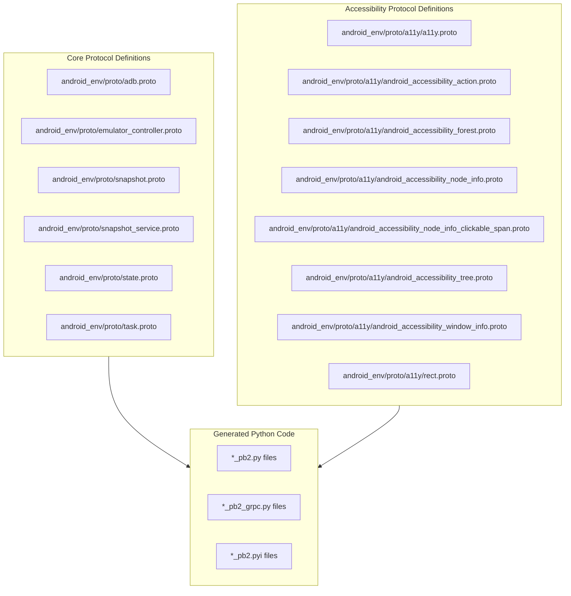
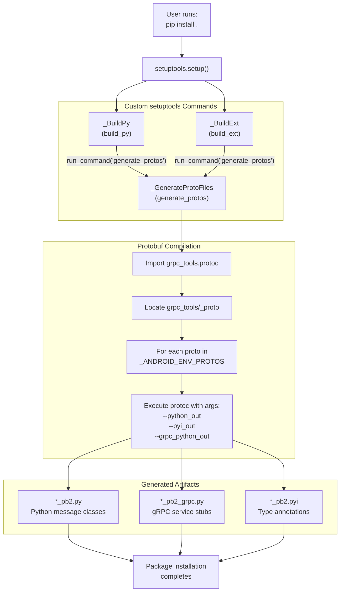
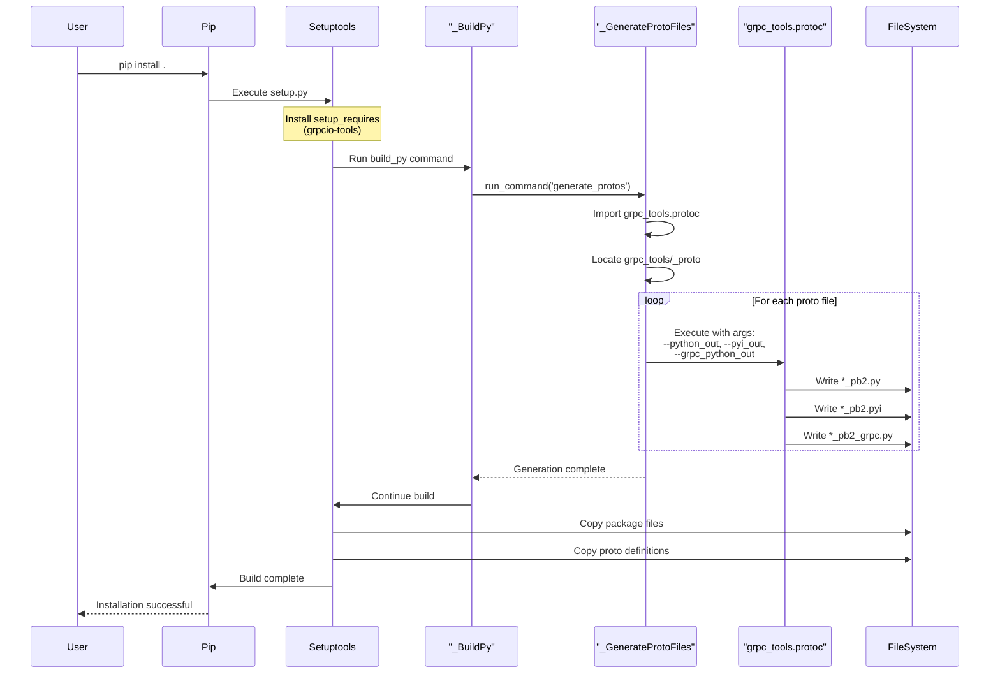
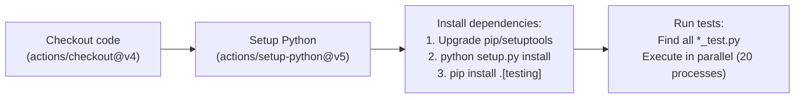

<!-- source: DeepWiki mcp.deepwiki.com · repo google-deepmind/android_env · page 2.1 Installation and Build System · fetched 2026-10-26 -->

# Installation and Build System

<details>
<summary>Relevant source files</summary>

The following files were used as context for generating this wiki page:

- [.github/workflows/tests.yml](.github/workflows/tests.yml)
- [pyproject.toml](pyproject.toml)
- [setup.py](setup.py)

</details>


## Purpose and Scope

This page covers the installation procedures, dependency management, and build system for AndroidEnv. Specifically, it documents:

- Package installation methods via pip
- Required and optional dependencies
- Protobuf code generation process
- Custom setuptools commands and build workflow
- Development environment setup

For information about configuring AndroidEnv after installation, see [Configuration System](#2.2). For running your first environment, see [Quick Start Examples](#2.3).

## Installation Methods

AndroidEnv is distributed as a Python package that can be installed via pip. The package supports Python 3.10 and higher, with active testing on Python 3.11, 3.12, and 3.13 [.github/workflows/tests.yml:21]().

### Standard Installation

Install AndroidEnv from the repository:

```bash
pip install git+https://github.com/google-deepmind/android_env
```

Or clone and install locally:

```bash
git clone https://github.com/google-deepmind/android_env
cd android_env
pip install .
```

The installation process automatically triggers protobuf code generation before installing the package [setup.py:95-97]().

### Development Installation

For development work with editable installation:

```bash
pip install -e .
```

This allows changes to the source code to be immediately reflected without reinstalling.

### Installation with Optional Dependencies

AndroidEnv provides optional dependency groups for specific use cases [pyproject.toml:27-34]():

| Dependency Group | Command | Purpose |
|-----------------|---------|---------|
| `testing` | `pip install .[testing]` | Adds gym, pillow, pytype for testing |
| `acme` | `pip install .[acme]` | Adds dm-acme for Acme integration |
| `gym` | `pip install .[gym]` | Adds gym for OpenAI Gym compatibility |

Multiple groups can be combined:

```bash
pip install .[testing,acme]
```

**Sources:** [pyproject.toml:1-40](), [.github/workflows/tests.yml:30-34]()

## Dependencies

### Core Dependencies

AndroidEnv requires the following packages [pyproject.toml:17-25]():

| Package | Minimum Version | Purpose |
|---------|----------------|---------|
| `absl-py` | 0.1.0 | Command-line flags and logging |
| `dm_env` | (latest) | DeepMind environment interface |
| `grpcio` | (latest) | gRPC communication with emulator |
| `numpy` | 1.21 | Numerical operations and observations |
| `portpicker` | 1.2.0 | Finding available ports for emulator |
| `protobuf` | 2.6 | Protocol buffer message definitions |
| `pygame` | (latest) | Human agent interface |

### Build-Time Dependencies

The build system requires `grpcio-tools` for protobuf compilation [setup.py:103]():

```python
setup_requires=['grpcio-tools']
```

This dependency is automatically installed during the build process before proto generation begins.

### Optional Dependencies

Optional packages extend functionality:

- **Testing Suite**: `gym`, `pillow`, `pytype` for running tests and type checking
- **Acme Integration**: `dm-acme` for using Acme agents with AndroidEnv
- **Gym Compatibility**: `gym` for OpenAI Gym wrappers

**Sources:** [pyproject.toml:17-34](), [setup.py:103]()

## Protobuf Build System

AndroidEnv uses Protocol Buffers for defining data structures and communication protocols. The build system automatically generates Python code from 14 protobuf definitions during installation.

### Protobuf Files

The following protobuf files are compiled [setup.py:30-45]():



| Protobuf File | Purpose |
|--------------|---------|
| `adb.proto` | ADB command requests and responses |
| `emulator_controller.proto` | Emulator control via gRPC |
| `snapshot.proto` | Emulator state snapshots |
| `snapshot_service.proto` | Snapshot service gRPC interface |
| `state.proto` | Environment state definitions |
| `task.proto` | Task definitions and specifications |
| `a11y/*.proto` | Accessibility tree and event structures (8 files) |

**Sources:** [setup.py:30-45]()

### Build Process Architecture

The build system uses custom setuptools commands to ensure protobuf generation occurs before package building:



**Sources:** [setup.py:48-109]()

### Custom Build Commands

#### _GenerateProtoFiles Command

The `_GenerateProtoFiles` class [setup.py:48-82]() implements the protobuf compilation:

```python
class _GenerateProtoFiles(setuptools.Command):
  """Command to generate protobuf bindings for AndroidEnv protos."""
```

Key functionality:
1. Imports `grpc_tools.protoc` after setuptools installs build dependencies [setup.py:63]()
2. Locates the gRPC protobuf includes directory [setup.py:65-68]()
3. Iterates through each proto file in `_ANDROID_ENV_PROTOS` [setup.py:70]()
4. Executes `protoc` with arguments for Python output, type stubs, and gRPC bindings [setup.py:71-79]()

The `protoc` invocation uses these key arguments:
- `--proto_path`: Includes both gRPC protos and repository root [setup.py:73-74]()
- `--python_out`: Generates `*_pb2.py` files [setup.py:75]()
- `--pyi_out`: Generates `*_pb2.pyi` type stub files [setup.py:76]()
- `--grpc_python_out`: Generates `*_pb2_grpc.py` gRPC service code [setup.py:77]()

#### Build Integration Commands

Two custom build commands ensure proto generation runs at the correct stage:

**_BuildExt** [setup.py:84-89]() - Triggers during extension building:
```python
class _BuildExt(build_ext):
  def run(self):
    self.run_command('generate_protos')
    build_ext.run(self)
```

**_BuildPy** [setup.py:92-97]() - Triggers during Python package building:
```python
class _BuildPy(build_py):
  def run(self):
    self.run_command('generate_protos')
    build_py.run(self)
```

These commands are registered in the `cmdclass` dictionary [setup.py:104-108]():

```python
cmdclass={
    'build_ext': _BuildExt,
    'build_py': _BuildPy,
    'generate_protos': _GenerateProtoFiles,
}
```

**Sources:** [setup.py:48-109]()

## Build Workflow

The complete build and installation workflow:



**Sources:** [setup.py:48-109](), [pyproject.toml:1-6]()

## Package Configuration

### Project Metadata

The package is configured in `pyproject.toml` [pyproject.toml:8-16]():

```toml
[project]
name = "android-env"
version = "1.2.2"
description = "AndroidEnv environment and library for training agents."
requires-python = ">=3.10"
```

Key properties:
- **Package name**: `android-env` (importable as `android_env`)
- **Current version**: 1.2.2
- **Python requirement**: 3.10 or higher

### Package Discovery

Setuptools automatically discovers packages while excluding examples [setup.py:100]():

```python
packages=find_packages(exclude=['examples'])
```

Protobuf files are included in the package distribution [setup.py:101]():

```python
package_data={'': ['proto/*.proto']}
```

**Sources:** [pyproject.toml:8-16](), [setup.py:99-102]()

## Continuous Integration

The GitHub Actions workflow validates the build system across multiple Python versions.

### Test Matrix

Tests run on [.github/workflows/tests.yml:19-21]():

| Python Version | Status |
|---------------|--------|
| 3.11 | Tested |
| 3.12 | Tested |
| 3.13 | Tested |

### CI Build Steps



The installation command sequence [.github/workflows/tests.yml:30-34]():

```bash
pip install --upgrade pip setuptools
python setup.py install
pip install .[testing]
```

This ensures:
1. Latest pip and setuptools are available
2. Main package installs with protobuf generation
3. Testing dependencies are available

**Sources:** [.github/workflows/tests.yml:1-41]()

## Verification

### Verify Installation

After installation, verify that AndroidEnv is correctly installed:

```python
import android_env
print(android_env.__file__)
```

### Verify Protobuf Generation

Check that protobuf files were generated:

```python
from android_env.proto import task_pb2
from android_env.proto import adb_pb2

# Create a sample protobuf message
task = task_pb2.Task()
print(f"Task protobuf available: {task is not None}")
```

The protobuf modules should import without errors, and the generated `_pb2.py` files should exist in the `android_env/proto/` directory.

### Common Installation Issues

| Issue | Cause | Solution |
|-------|-------|----------|
| Import error for proto modules | Protobuf generation failed | Run `python setup.py generate_protos` manually |
| `grpcio-tools` not found | Build dependency missing | Install: `pip install grpcio-tools` |
| Python version error | Python < 3.10 | Upgrade to Python 3.10 or higher |

**Sources:** [setup.py:48-109](), [pyproject.toml:16]()

## Development Setup

### Running Protobuf Generation Manually

During development, regenerate protobuf files manually:

```bash
python setup.py generate_protos
```

This executes the `_GenerateProtoFiles` command without reinstalling the package.

### Adding New Protobuf Definitions

To add a new protobuf file:

1. Create the `.proto` file in `android_env/proto/` or a subdirectory
2. Add the path to `_ANDROID_ENV_PROTOS` tuple in `setup.py` [setup.py:30-45]()
3. Run `python setup.py generate_protos` to generate bindings
4. Import and use the generated `*_pb2.py` module

Example:
```python
_ANDROID_ENV_PROTOS = (
    # ... existing protos ...
    'android_env/proto/new_feature.proto',  # Add here
)
```

**Sources:** [setup.py:30-45](), [setup.py:48-82]()

---

