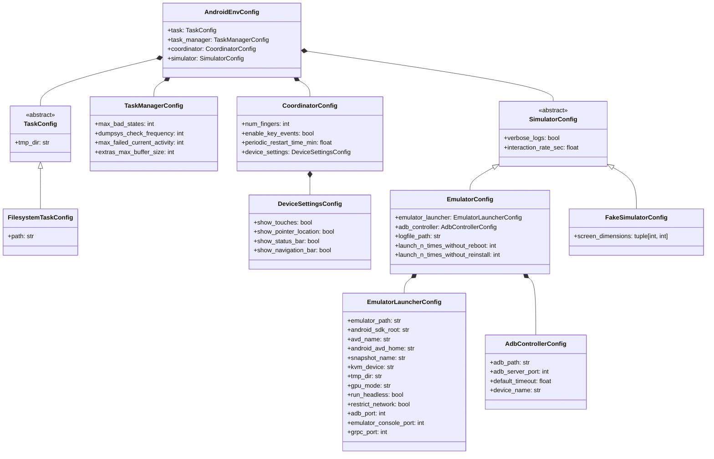
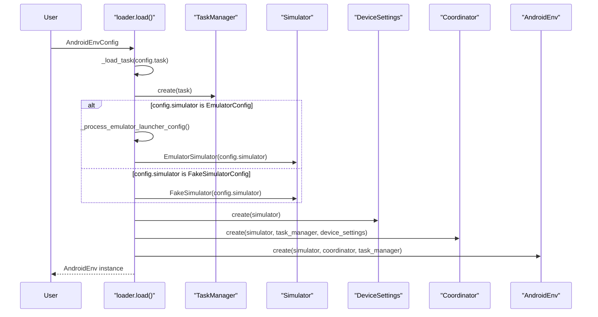
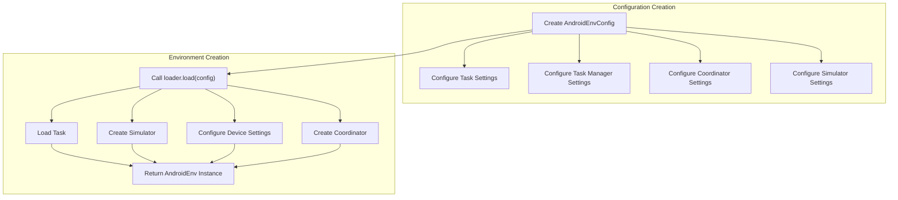

<!-- source: DeepWiki mcp.deepwiki.com · repo google-deepmind/android_env · page 2.2 Configuration System · fetched 2026-10-26 -->

# Configuration System

<details>
<summary>Relevant source files</summary>

The following files were used as context for generating this wiki page:

- [android_env/components/config_classes.py](android_env/components/config_classes.py)
- [android_env/loader.py](android_env/loader.py)
- [android_env/loader_test.py](android_env/loader_test.py)

</details>


This document describes the configuration system for AndroidEnv, which provides a flexible way to configure all aspects of the environment. The configuration classes enable users to specify settings for the Android emulator, task execution, and environment behavior.

## Overview

AndroidEnv uses a hierarchical configuration system based on dataclasses. At the top level, the `AndroidEnvConfig` class contains configurations for all major subsystems. Each subsystem has its own configuration class, creating a nested structure that allows for detailed control over the environment.

**Diagram: Configuration Class Hierarchy**



Sources: [android_env/components/config_classes.py:16-204]()

## Configuration Loading Process

When you create an AndroidEnv instance, you provide an `AndroidEnvConfig` object that is then used to initialize and configure all components of the environment. The following diagram shows the configuration loading process:

**Diagram: Configuration Loading Flow**



Sources: [android_env/loader.py:16-90]()

## Top-Level Configuration

The `AndroidEnvConfig` class is the top-level configuration class that contains all the settings needed to create an AndroidEnv instance. It includes configurations for the task, task manager, coordinator, and simulator.

```python
@dataclasses.dataclass
class AndroidEnvConfig:
  """Config class for AndroidEnv."""

  # Configs for main components.
  task: TaskConfig = dataclasses.field(default_factory=TaskConfig)
  task_manager: TaskManagerConfig = dataclasses.field(
      default_factory=TaskManagerConfig
  )
  coordinator: CoordinatorConfig = dataclasses.field(
      default_factory=CoordinatorConfig
  )
  simulator: SimulatorConfig = dataclasses.field(default_factory=EmulatorConfig)
```

Sources: [android_env/components/config_classes.py:192-204]()

## Task Configuration

The task configuration determines how the environment loads task definitions. The base `TaskConfig` class is abstract, and specific implementations provide different ways to load tasks.

### FilesystemTaskConfig

The `FilesystemTaskConfig` allows loading task definitions from protobuf files in the local filesystem. This is the most common way to define tasks.

```python
@dataclasses.dataclass
class FilesystemTaskConfig(TaskConfig):
  """Config for protobuf files stored in the local filesystem."""

  # Filesystem path to `.binarypb` or `.textproto` protobuf Task.
  path: str = ''
```

Sources: [android_env/components/config_classes.py:176-189](), [android_env/loader.py:33-44]()

## Task Manager Configuration

The `TaskManagerConfig` class configures the behavior of the `TaskManager`, which is responsible for managing task execution, monitoring task state, and determining reward signals.

```python
@dataclasses.dataclass
class TaskManagerConfig:
  """Config class for TaskManager."""

  # If max_bad_states episodes finish in a bad state in a row, restart
  # the simulation.
  max_bad_states: int = 3
  # The frequency to check for the current activity and view hierarchy.
  # The unit is raw observation (i.e. each call to AndroidEnv.step()).
  dumpsys_check_frequency: int = 150
  # The maximum number of tries for extracting the current activity before
  # forcing the episode to restart.
  max_failed_current_activity: int = 10
  # The maximum number of extras elements to store. If this number is exceeded,
  # elements are dropped in the order they were received.
  extras_max_buffer_size: int = 100
```

Sources: [android_env/components/config_classes.py:158-173]()

## Coordinator Configuration

The `CoordinatorConfig` class configures the `Coordinator`, which orchestrates interactions between the simulator, task manager, and device settings. It controls aspects like input handling and scheduling periodic restarts.

```python
@dataclasses.dataclass
class CoordinatorConfig:
  """Config class for Coordinator."""

  # Number of virtual "fingers" of the agent.
  num_fingers: int = 1
  # Whether to enable keyboard key events.
  enable_key_events: bool = False
  # Time between periodic restarts in minutes. If > 0, will trigger
  # a simulator restart at the beginning of the next episode once the time has
  # been reached.
  periodic_restart_time_min: float = 0.0
  # General Android settings.
  device_settings: DeviceSettingsConfig = dataclasses.field(
      default_factory=DeviceSettingsConfig
  )
```

Sources: [android_env/components/config_classes.py:53-67]()

### Device Settings Configuration

The `DeviceSettingsConfig` class configures the visual and interaction aspects of the Android device, such as whether to show touch indicators and navigation bars.

```python
@dataclasses.dataclass
class DeviceSettingsConfig:
  """Config class for DeviceSettings."""

  # Whether to show circles on the screen indicating touch position.
  show_touches: bool = True
  # Whether to show blue lines on the screen indicating touch position.
  show_pointer_location: bool = True
  # Whether or not to show the status (top) bar.
  show_status_bar: bool = False
  # Whether or not to show the navigation (bottom) bar.
  show_navigation_bar: bool = False
```

Sources: [android_env/components/config_classes.py:39-49](), [android_env/components/device_settings.py:41-174]()

## Simulator Configuration

The simulator configuration determines how AndroidEnv interacts with an Android device or emulator. The base `SimulatorConfig` class is abstract, with specific implementations for different simulator types.

```python
@dataclasses.dataclass
class SimulatorConfig:
  """Base class for all simulator configs."""

  # If true, the log stream of the simulator will be verbose.
  verbose_logs: bool = False
  # How often to (asynchronously) grab the screenshot from the simulator.
  # If <= 0, stepping the environment blocks on fetching the screenshot (the
  # environment is synchronous).
  interaction_rate_sec: float = 0.0
```

Sources: [android_env/components/config_classes.py:70-80]()

### Emulator Configuration

The `EmulatorConfig` class configures an Android emulator for use with AndroidEnv. It includes settings for the emulator launcher and ADB controller.

```python
@dataclasses.dataclass
class EmulatorConfig(SimulatorConfig):
  """Config class for EmulatorSimulator."""

  # Configuration for launching the Android Emulator.
  emulator_launcher: EmulatorLauncherConfig = dataclasses.field(
      default_factory=EmulatorLauncherConfig
  )
  # Configuration for talking to adb.
  adb_controller: AdbControllerConfig = dataclasses.field(
      default_factory=AdbControllerConfig
  )
  # Path to file which holds emulator logs. If not provided, it will be
  # determined by the EmulatorLauncher.
  logfile_path: str = ''
  # The number of times to try launching the emulator before rebooting (reboot
  # on the n+1-st try).
  launch_n_times_without_reboot: int = 1
  # The number of times to try launching the emulator before reinstalling
  # (reinstall on the n+1-st try).
  launch_n_times_without_reinstall: int = 2
```

Sources: [android_env/components/config_classes.py:127-147]()

#### Emulator Launcher Configuration

The `EmulatorLauncherConfig` class configures how the Android emulator is launched. It includes settings for the emulator binary, AVD (Android Virtual Device), and networking.

```python
@dataclasses.dataclass
class EmulatorLauncherConfig:
  """Config class for EmulatorLauncher."""

  # NOTE: If `adb_port`, `emulator_console_port` and `grpc_port` are defined
  # (i.e. not all equal to 0), it is assumed that the emulator they point to
  # exists already and EmulatorLauncher will be skipped.

  # Filesystem path to the `emulator` binary.
  emulator_path: str = '~/Android/Sdk/emulator/emulator'
  # Filesystem path to the Android SDK root.
  android_sdk_root: str = '~/Android/Sdk'
  # Name of the AVD.
  avd_name: str = ''
  # Local directory for AVDs.
  android_avd_home: str = '~/.android/avd'
  # Name of the snapshot to load.
  snapshot_name: str = ''
  # Path to the KVM device.
  kvm_device: str = '/dev/kvm'
  # Path to directory which will hold temporary files.
  tmp_dir: str = '/tmp/android_env/simulator/'
  # GPU mode override.
  # Please see
  # https://developer.android.com/studio/run/emulator-acceleration#accel-graphics.
  gpu_mode: str = 'swangle_indirect'  # Alternative: swiftshader_indirect, host
  # Whether to run in headless mode (i.e. without a graphical window).
  run_headless: bool = True
  # Whether to restrict network access.
  # If True, will disable networking on the device. This option is only
  # available for emulator version > 31.3.9 (June 2022).
  restrict_network: bool = False
  # Whether to set `SHOW_PERF_STATS=1` when launching the emulator to display
  # performance and memory statistics.
  show_perf_stats: bool = False

  # ADB port for the Android device.
  adb_port: int = 0
  # Port for telnet communication with the emulator.
  emulator_console_port: int = 0
  # Port for gRPC communication with the emulator.
  grpc_port: int = 0
```

Sources: [android_env/components/config_classes.py:83-123]()

#### ADB Controller Configuration

The `AdbControllerConfig` class configures how AndroidEnv interacts with the Android Debug Bridge (ADB) to communicate with the Android device.

```python
@dataclasses.dataclass
class AdbControllerConfig:
  """Settings for instatiating an `AdbController` instance."""

  # Filesystem path to the `adb` binary.
  # NOTE: This must be a full path and must not contain environment variables
  # or user folder shorthands (e.g. `~/some/path/to/adb`) since they will not be
  # expanded internally by AndroidEnv.
  adb_path: str = '~/Android/Sdk/platform-tools/adb'
  # Port for adb server.
  adb_server_port: int = 5037
  # Default timeout in seconds for internal commands.
  default_timeout: float = 120.0
  # Name of the device to communicate with.
  device_name: str = ''
```

Sources: [android_env/components/config_classes.py:22-36](), [android_env/loader.py:71-89]()

### Fake Simulator Configuration

The `FakeSimulatorConfig` class configures a fake simulator for testing purposes. It simulates an Android device without requiring a real emulator.

```python
@dataclasses.dataclass
class FakeSimulatorConfig(SimulatorConfig):
  """Config class for FakeSimulator."""

  # The dimensions in pixels of the device screen (HxW).
  screen_dimensions: tuple[int, int] = (0, 0)
```

Sources: [android_env/components/config_classes.py:150-154]()

## Creating and Using Configurations

To use AndroidEnv, you create an `AndroidEnvConfig` instance with your desired settings and pass it to the `loader.load()` function. The following diagram shows how configuration objects are used to create the environment:

**Diagram: Configuration Usage Flow**



Sources: [android_env/loader.py:16-90](), [android_env/loader_test.py:42-136]()

### Example Configuration

Here's an example of creating a configuration for an emulator-based environment:

```python
from android_env.components import config_classes

# Create the top-level config
config = config_classes.AndroidEnvConfig(
    # Configure the task
    task=config_classes.FilesystemTaskConfig(
        path='/path/to/task.textproto',
    ),
    
    # Configure the task manager
    task_manager=config_classes.TaskManagerConfig(
        max_bad_states=5,
        dumpsys_check_frequency=100,
    ),
    
    # Configure the coordinator
    coordinator=config_classes.CoordinatorConfig(
        num_fingers=1,
        enable_key_events=True,
        device_settings=config_classes.DeviceSettingsConfig(
            show_touches=True,
            show_pointer_location=False,
            show_status_bar=False,
        ),
    ),
    
    # Configure the simulator
    simulator=config_classes.EmulatorConfig(
        emulator_launcher=config_classes.EmulatorLauncherConfig(
            avd_name='my_avd',
            run_headless=True,
            snapshot_name='my_snapshot',
        ),
        adb_controller=config_classes.AdbControllerConfig(
            adb_path='/path/to/adb',
            default_timeout=60.0,
        ),
    ),
)
```

Sources: [android_env/loader_test.py:42-67](), [android_env/loader_test.py:103-120]()

## Path Expansion

Some configuration fields, such as file paths, are automatically expanded by the loader. For example, the `~` character in paths like `~/Android/Sdk` is expanded to the user's home directory before being used. This is handled by the `_process_emulator_launcher_config` function in the loader.

```python
def _process_emulator_launcher_config(
    emulator_config: config_classes.EmulatorConfig,
) -> None:
  """Adjusts the configuration of the emulator depending on some conditions."""

  # Expand the user directory if specified.
  launcher_config = emulator_config.emulator_launcher
  launcher_config.android_avd_home = os.path.expanduser(
      launcher_config.android_avd_home
  )
  launcher_config.android_sdk_root = os.path.expanduser(
      launcher_config.android_sdk_root
  )
  launcher_config.emulator_path = os.path.expanduser(
      launcher_config.emulator_path
  )
  emulator_config.adb_controller.adb_path = os.path.expanduser(
      emulator_config.adb_controller.adb_path
  )
```

Sources: [android_env/loader.py:71-89]()

## Summary

The AndroidEnv configuration system provides a flexible and comprehensive way to configure all aspects of the environment. By creating an `AndroidEnvConfig` instance with your desired settings, you can control the behavior of the task, task manager, coordinator, and simulator components.

Key points to remember:
- The configuration is hierarchical, with the `AndroidEnvConfig` at the top level
- Each subsystem has its own configuration class
- Default values are provided for most settings, making it easy to get started
- Path fields with `~` are automatically expanded to full paths
- The configuration is used by the `loader.load()` function to create the environment

For information about the Coordinator component, see [Coordinator](#2.2). For information about Task Management, see [Task Management](#3).

---

