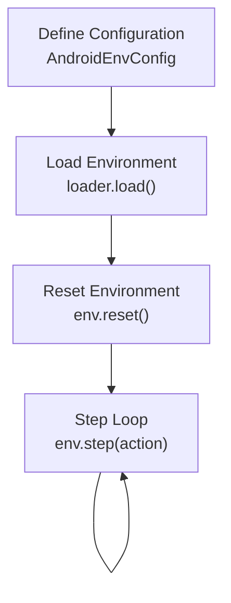
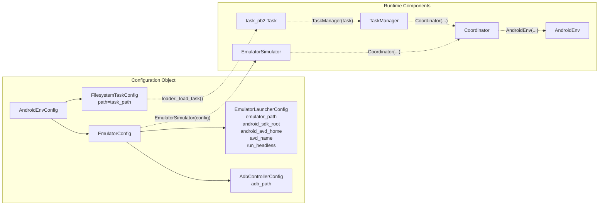
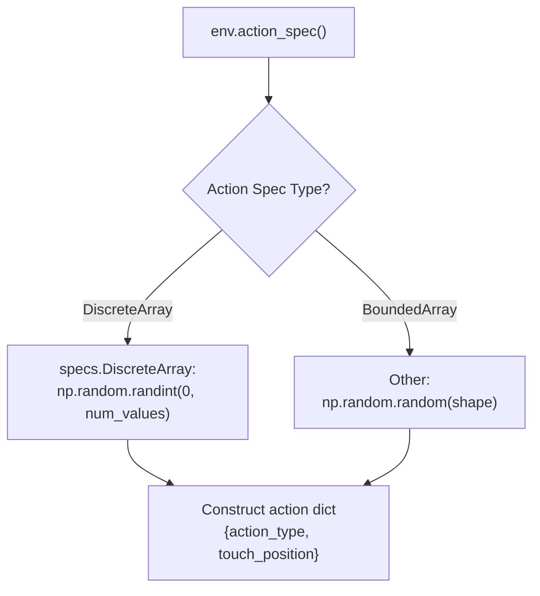
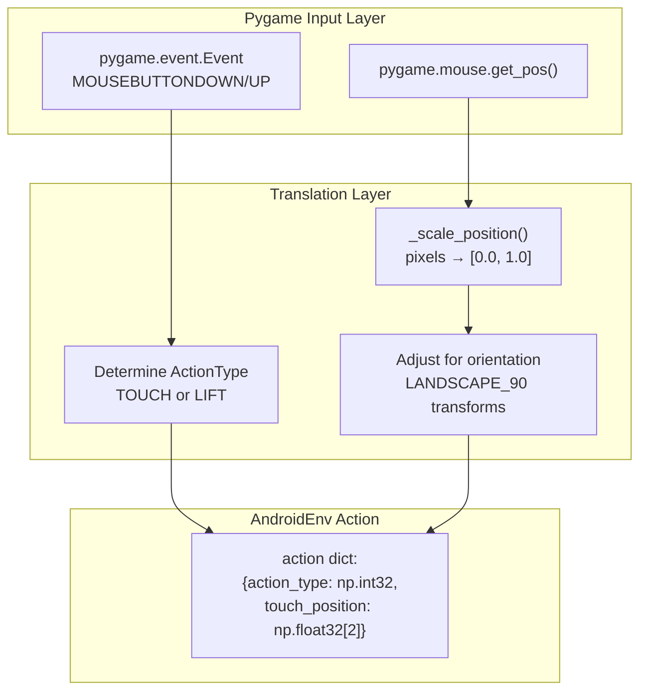
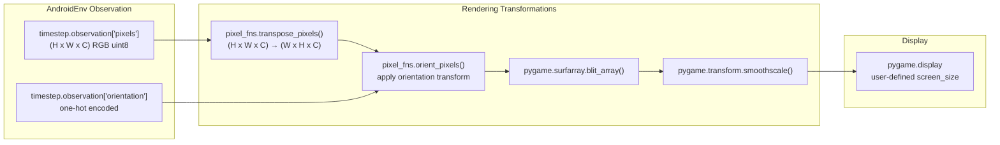
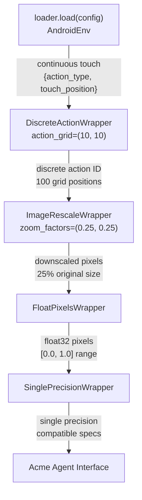

<!-- source: DeepWiki mcp.deepwiki.com · repo google-deepmind/android_env · page 2.3 Quick Start Examples · fetched 2026-10-26 -->

# Quick Start Examples

<details>
<summary>Relevant source files</summary>

The following files were used as context for generating this wiki page:

- [android_env/components/config_classes.py](android_env/components/config_classes.py)
- [android_env/components/simulators/emulator/emulator_launcher.py](android_env/components/simulators/emulator/emulator_launcher.py)
- [android_env/components/simulators/emulator/emulator_launcher_test.py](android_env/components/simulators/emulator/emulator_launcher_test.py)
- [android_env/loader.py](android_env/loader.py)
- [android_env/loader_test.py](android_env/loader_test.py)
- [examples/run_acme_agent.py](examples/run_acme_agent.py)
- [examples/run_human_agent.py](examples/run_human_agent.py)
- [examples/run_random_agent.py](examples/run_random_agent.py)

</details>


## Purpose and Scope

This page provides practical examples demonstrating how to configure and run AndroidEnv with different agent types. It covers three primary usage patterns: a random agent for testing, a human-controlled agent for manual interaction, and an Acme-based reinforcement learning agent for training. 

For details on installation and dependencies, see [Installation and Build System](#2.1). For comprehensive configuration options, see [Configuration System](#2.2). For advanced wrapper usage patterns, see [Environment Wrappers](#7).

---

## Common Usage Pattern

All AndroidEnv examples follow a consistent four-step pattern:



### Configuration Setup

Each example constructs an `AndroidEnvConfig` object with three main components:

| Component | Configuration Class | Purpose |
|-----------|-------------------|---------|
| Task | `FilesystemTaskConfig` | Specifies task definition protobuf path |
| Simulator | `EmulatorConfig` | Configures emulator launcher and ADB controller |
| Coordinator | `CoordinatorConfig` | Sets device settings and interaction parameters |
| Task Manager | `TaskManagerConfig` | Configures reward extraction and episode management |

The `loader.load()` function [android_env/loader.py:47-68]() instantiates all components in the correct dependency order.

**Sources:** [android_env/loader.py:33-68](), [android_env/components/config_classes.py:209-221]()

---

## Random Agent Example

### Overview

The random agent demonstrates basic environment interaction by taking uniformly random actions at each step. This example is useful for testing environment setup and verifying task configuration.

### Configuration Code Mapping



### Action Sampling Strategy

The random agent queries the environment's action specification and samples valid actions for each component:



The implementation [examples/run_random_agent.py:67-75]() handles both discrete and continuous action components by inspecting the spec type.

### Execution Flow

| Step | Code Location | Description |
|------|--------------|-------------|
| 1. Parse flags | [examples/run_random_agent.py:26-43]() | Extract emulator paths and task path from command line |
| 2. Create config | [examples/run_random_agent.py:48-62]() | Construct `AndroidEnvConfig` with nested configurations |
| 3. Load environment | [examples/run_random_agent.py:63]() | Call `loader.load(config)` to instantiate environment |
| 4. Reset | [examples/run_random_agent.py:77]() | Initialize episode with `env.reset()` |
| 5. Step loop | [examples/run_random_agent.py:79-83]() | Sample random actions and call `env.step(action)` |

**Sources:** [examples/run_random_agent.py:1-91](), [android_env/loader.py:47-68]()

---

## Human Agent Example

### Overview

The human agent uses pygame to create an interactive session where a user controls the Android device through mouse input. This example demonstrates action translation from UI events to AndroidEnv actions and observation rendering.

### Action Translation Pipeline



The action translation logic [examples/run_human_agent.py:52-94]() handles:
- **Action Type Mapping:** Mouse button down → `ActionType.TOUCH`, button up → `ActionType.LIFT`
- **Position Scaling:** Pygame pixel coordinates → normalized [0.0, 1.0] range
- **Orientation Handling:** Landscape orientations require coordinate transformation

### Observation Rendering Pipeline



The rendering implementation [examples/run_human_agent.py:114-125]() extracts RGB pixels, applies orientation-aware transformations using `pixel_fns`, and displays them on a pygame surface scaled to the desired screen size.

### Key Components

| Component | Code Location | Function |
|-----------|--------------|----------|
| Event Processing | [examples/run_human_agent.py:52-66]() | `_get_action_from_event()` translates pygame events |
| Mouse Tracking | [examples/run_human_agent.py:69-83]() | `_get_action_from_mouse()` samples current mouse state |
| Position Scaling | [examples/run_human_agent.py:86-94]() | `_scale_position()` normalizes coordinates |
| Reward Accumulation | [examples/run_human_agent.py:97-111]() | `_accumulate_reward()` tracks episode returns |
| Frame Rendering | [examples/run_human_agent.py:114-125]() | `_render_pygame_frame()` displays observations |

**Sources:** [examples/run_human_agent.py:1-210](), [android_env/components/action_type.py]()

---

## Acme Agent Example

### Overview

The Acme agent example demonstrates integration with DeepMind's Acme reinforcement learning library. It applies environment wrappers to transform observations and actions into formats suitable for deep RL algorithms, then trains a DQN agent.

### Wrapper Application Chain



Each wrapper in the chain [examples/run_acme_agent.py:50-57]() transforms the interface:

1. **DiscreteActionWrapper:** Converts continuous touch positions to a discrete grid of 100 positions (10×10)
2. **ImageRescaleWrapper:** Reduces observation size by 75% for computational efficiency
3. **FloatPixelsWrapper:** Normalizes uint8 pixels to float32 in [0.0, 1.0] range
4. **SinglePrecisionWrapper:** Ensures all arrays use single precision for Acme compatibility

For detailed wrapper behavior, see [Observation Wrappers](#7.3) and [Action Wrappers](#7.2).

### Agent Configuration and Training Loop

```mermaid
sequenceDiagram
    participant Config as "AndroidEnvConfig"
    participant Loader as "loader.load()"
    participant Env as "Wrapped Environment"
    participant Spec as "specs.make_environment_spec()"
    participant Network as "networks.DQNAtariNetwork"
    participant Agent as "dqn.DQN"
    participant Loop as "acme.EnvironmentLoop"
    
    Config->>Loader: config object
    Loader->>Env: base AndroidEnv
    Env->>Env: apply_wrappers()
    Env->>Spec: environment instance
    Spec->>Network: env_spec
    Network->>Agent: network + env_spec
    Agent->>Loop: agent + env
    Loop->>Loop: run(num_episodes)
```

The training setup [examples/run_acme_agent.py:60-91]():

1. Creates wrapped environment with appropriate transformations
2. Generates environment specification using `specs.make_environment_spec()`
3. Instantiates `DQNAtariNetwork` with discrete action space size
4. Configures DQN agent with hyperparameters (batch_size=10, samples_per_insert=2)
5. Runs training loop with `acme.EnvironmentLoop`

### Integration Points

| Component | Type | Purpose |
|-----------|------|---------|
| `discrete_action_wrapper.DiscreteActionWrapper` | Wrapper | Converts continuous actions to discrete grid |
| `image_rescale_wrapper.ImageRescaleWrapper` | Wrapper | Reduces observation dimensions |
| `float_pixels_wrapper.FloatPixelsWrapper` | Wrapper | Normalizes pixel values |
| `acme_wrappers.SinglePrecisionWrapper` | Wrapper | Ensures float32 precision |
| `specs.make_environment_spec()` | Acme Utility | Extracts action/observation specs |
| `networks.DQNAtariNetwork` | Acme Network | CNN architecture for pixel observations |
| `dqn.DQN` | Acme Agent | Deep Q-Network algorithm implementation |
| `acme.EnvironmentLoop` | Acme Runtime | Orchestrates agent-environment interaction |

**Sources:** [examples/run_acme_agent.py:1-99](), [android_env/wrappers/discrete_action_wrapper.py](), [android_env/wrappers/image_rescale_wrapper.py](), [android_env/wrappers/float_pixels_wrapper.py]()

---

## Common Configuration Patterns

### Required Command-Line Flags

All three examples require these flags:

```
--avd_name: Name of the Android Virtual Device to launch
--task_path: Filesystem path to task definition (.textproto or .binarypb)
```

### Optional Flags with Defaults

| Flag | Default Value | Description |
|------|--------------|-------------|
| `--android_avd_home` | `~/.android/avd` | AVD storage directory |
| `--android_sdk_root` | `~/Android/Sdk` | Android SDK installation path |
| `--emulator_path` | `~/Android/Sdk/emulator/emulator` | Emulator binary path |
| `--adb_path` | `~/Android/Sdk/platform-tools/adb` | ADB binary path |
| `--run_headless` | `False` (random/human)<br/>`True` (Acme) | Whether to hide emulator window |

### Configuration Object Construction

The standard pattern [examples/run_random_agent.py:48-62]():

```python
config = config_classes.AndroidEnvConfig(
    task=config_classes.FilesystemTaskConfig(
        path=FLAGS.task_path
    ),
    simulator=config_classes.EmulatorConfig(
        emulator_launcher=config_classes.EmulatorLauncherConfig(
            emulator_path=FLAGS.emulator_path,
            android_sdk_root=FLAGS.android_sdk_root,
            android_avd_home=FLAGS.android_avd_home,
            avd_name=FLAGS.avd_name,
            run_headless=FLAGS.run_headless,
        ),
        adb_controller=config_classes.AdbControllerConfig(
            adb_path=FLAGS.adb_path
        ),
    ),
)
```

Path expansion (tilde `~` to home directory) occurs automatically in `loader._process_emulator_launcher_config()` [android_env/loader.py:71-89]().

### Environment Lifecycle Management

All examples use the context manager pattern:

```python
with loader.load(config) as env:
    timestep = env.reset()
    # interaction loop
    timestep = env.step(action)
```

This ensures proper cleanup of:
- Emulator processes [android_env/components/simulators/emulator/emulator_launcher.py:145-166]()
- Log streams [android_env/components/log_stream.py]()
- gRPC connections [android_env/components/simulators/emulator/emulator_simulator.py]()

**Sources:** [examples/run_random_agent.py:48-83](), [examples/run_human_agent.py:133-203](), [examples/run_acme_agent.py:62-91](), [android_env/loader.py:71-89]()

---

