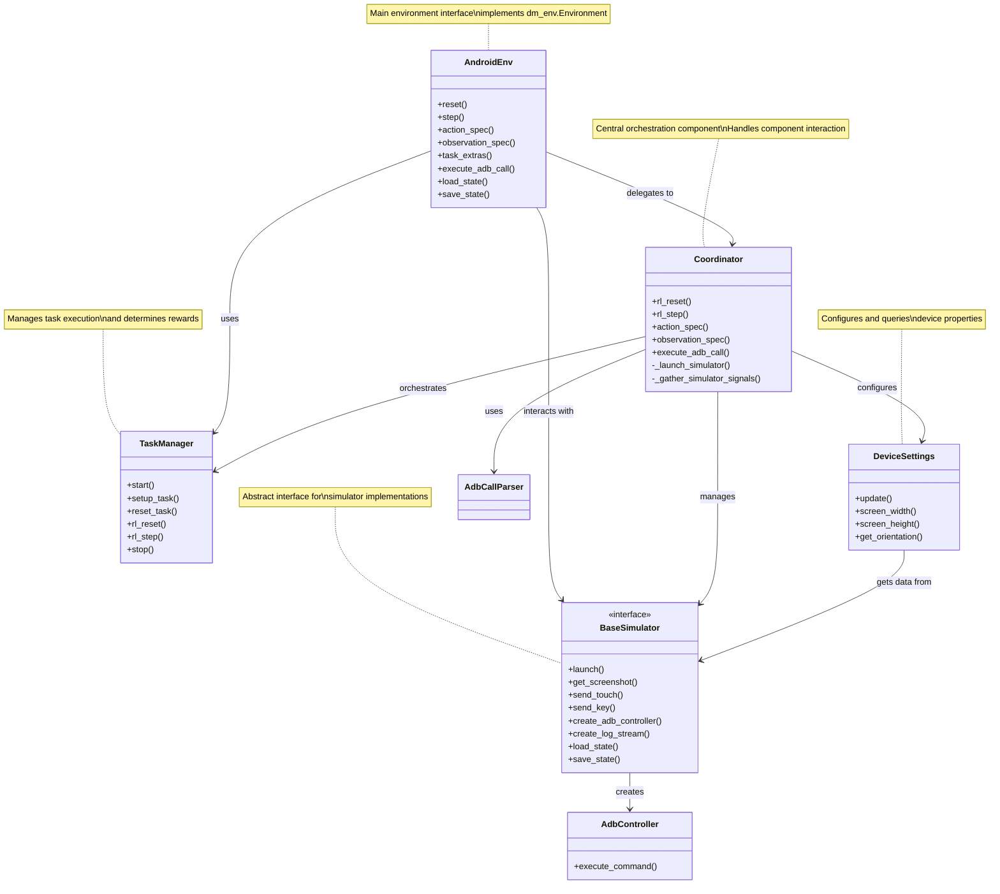
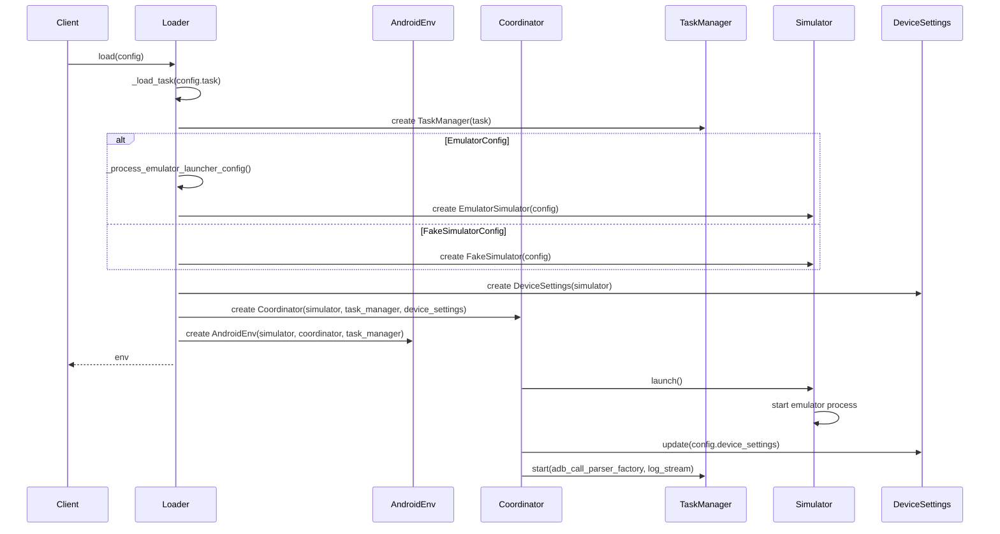
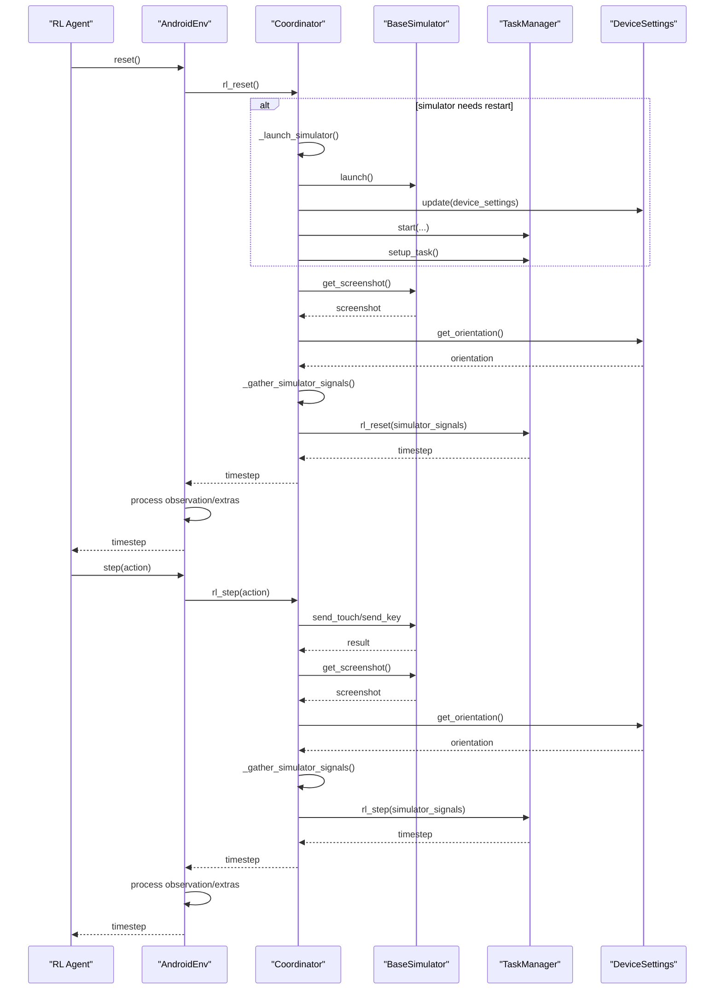
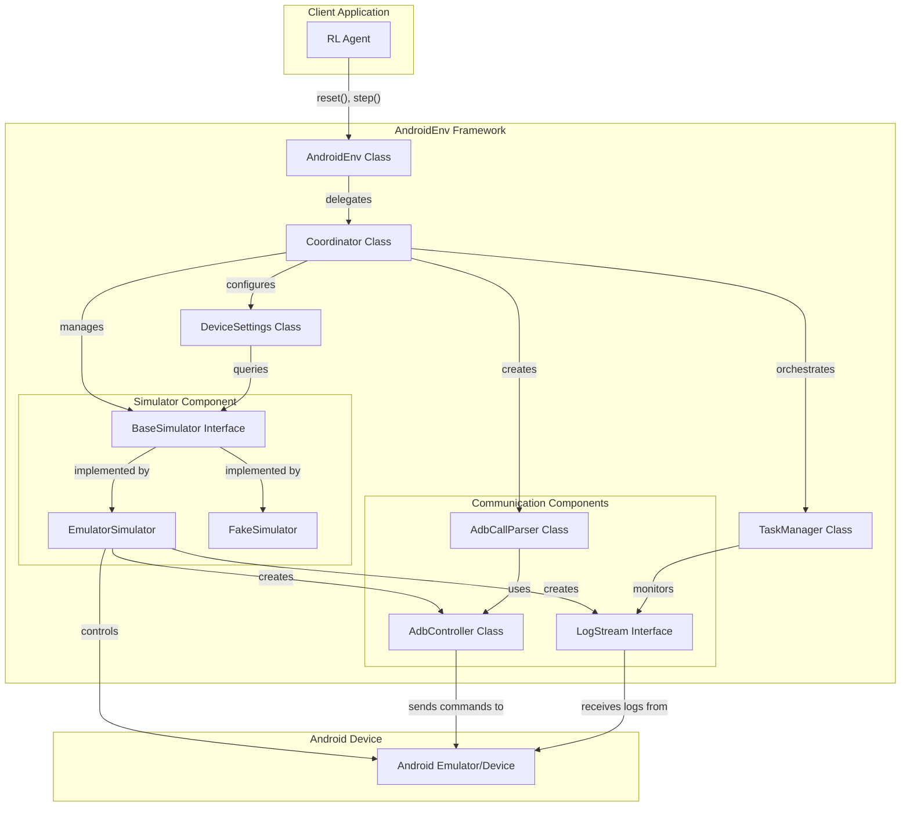
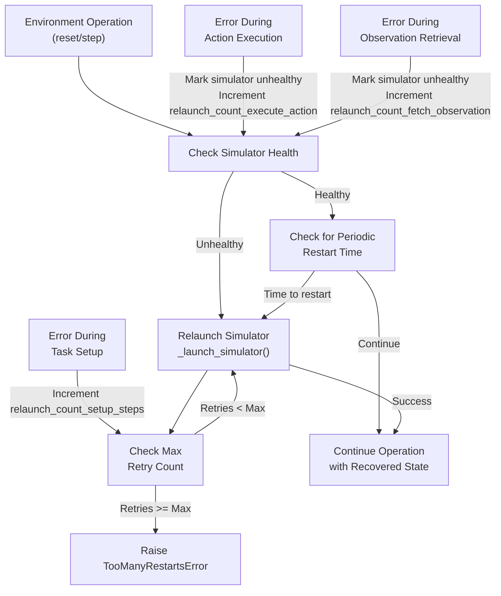
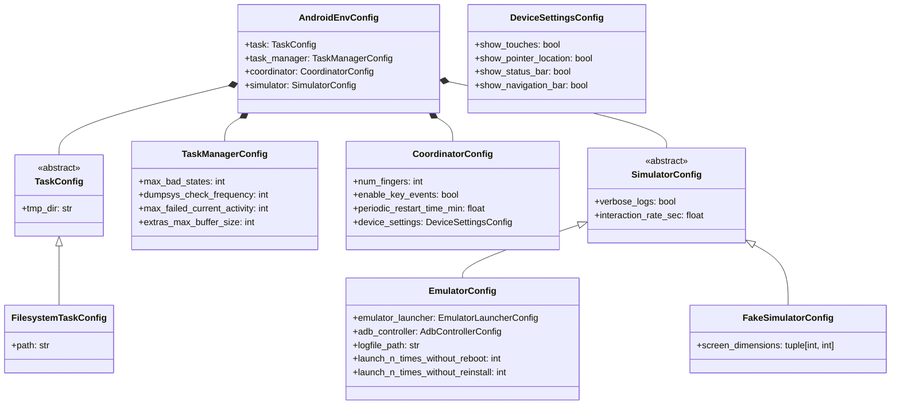

<!-- source: DeepWiki mcp.deepwiki.com · repo google-deepmind/android_env · page 3 Core Architecture · fetched 2026-10-26 -->

# Core System Architecture

Relevant source files

The following files were used as context for generating this wiki page:

- [android_env/components/coordinator.py](android_env/components/coordinator.py)
- [android_env/components/coordinator_test.py](android_env/components/coordinator_test.py)
- [android_env/components/task_manager.py](android_env/components/task_manager.py)
- [android_env/components/task_manager_test.py](android_env/components/task_manager_test.py)
- [android_env/env_interface.py](android_env/env_interface.py)
- [android_env/environment.py](android_env/environment.py)
- [android_env/environment_test.py](android_env/environment_test.py)
- [android_env/wrappers/base_wrapper.py](android_env/wrappers/base_wrapper.py)
- [android_env/wrappers/base_wrapper_test.py](android_env/wrappers/base_wrapper_test.py)
- [android_env/wrappers/float_pixels_wrapper.py](android_env/wrappers/float_pixels_wrapper.py)
- [android_env/wrappers/last_action_wrapper.py](android_env/wrappers/last_action_wrapper.py)

This page describes the high-level architecture of AndroidEnv, explaining the core components and their interactions. It covers how data flows through the system during initialization, reset, and stepping of the environment. For specific details about the environment interface itself, see [Environment Interface](#2.1). For configuration details, see [Configuration System](#2.3).

## System Components

AndroidEnv follows a layered architecture with clear separation of concerns between components. The system comprises several key components that work together to provide an RL environment interface to Android devices.

Sources: [android_env/environment.py:32-191](), [android_env/components/coordinator.py:38-283](), [android_env/components/device_settings.py:41-175]()

### Key Components

1. **AndroidEnv**: The main environment class that implements the dm_env.Environment interface. It delegates most of its functionality to the Coordinator and exposes additional Android-specific methods like task_extras() and execute_adb_call().

2. **Coordinator**: The central orchestration component that manages communication between the simulator, task manager, and device settings. It handles the core RL operations (reset and step) and manages simulator lifecycles.

3. **BaseSimulator**: An abstract interface that defines operations for interacting with Android devices. It has implementations like EmulatorSimulator (real Android emulator) and FakeSimulator (for testing).

4. **TaskManager**: Manages the execution of RL tasks, processing signals from the simulator, and determining rewards and episode termination.

5. **DeviceSettings**: Handles device configuration and provides information about the device such as screen dimensions and orientation.

6. **AdbController/AdbCallParser**: Provides low-level communication with the Android device through the Android Debug Bridge (ADB).

Sources: [android_env/loader.py:47-89](), [android_env/environment.py:32-45](), [android_env/components/coordinator.py:38-60]()

## Initialization Process

The initialization process begins with loading the environment using the `loader.load()` function, which constructs the component hierarchy based on the provided configuration.

Sources: [android_env/loader.py:33-89](), [android_env/components/coordinator.py:116-171]()

## Data Flow During Reset and Step

The reset and step operations involve complex interactions between components. The following diagram illustrates the data flow during these operations.

Sources: [android_env/environment.py:66-114](), [android_env/components/coordinator.py:182-248]()

### Reset Process

1. The agent calls `reset()` on AndroidEnv
2. AndroidEnv delegates to Coordinator's `rl_reset()`
3. Coordinator checks if the simulator needs restarting and launches it if necessary
4. Coordinator executes a lift action to ensure all fingers are lifted
5. Coordinator collects simulator signals (screenshot, orientation, timedelta)
6. TaskManager processes these signals and determines the initial timestep
7. AndroidEnv processes the timestep and returns it to the agent

### Step Process

1. The agent calls `step(action)` on AndroidEnv
2. AndroidEnv delegates to Coordinator's `rl_step(action)`
3. Coordinator sends the action to the simulator
4. Coordinator collects simulator signals
5. TaskManager processes these signals and determines the next timestep
6. AndroidEnv processes the timestep and returns it to the agent

## Component Communication

Components communicate primarily through method calls, with the Coordinator orchestrating most interactions. The following diagram illustrates the communication patterns between components.

Sources: [android_env/environment.py:32-191](), [android_env/components/coordinator.py:38-283](), [android_env/loader.py:47-89]()

## Error Handling and Recovery

The AndroidEnv system includes robust error handling and recovery mechanisms, primarily managed by the Coordinator. The following diagram illustrates the error handling flow.

Sources: [android_env/components/coordinator.py:95-115](), [android_env/components/coordinator.py:116-171](), [android_env/components/coordinator.py:226-248]()

Key error handling features:

1. **Health Monitoring**: The Coordinator tracks simulator health and triggers relaunches when necessary
2. **Periodic Restarts**: Optional periodic restarts prevent stale states during long-running sessions
3. **Retry Limits**: Configurable retry limits prevent infinite restart loops
4. **Error Statistics**: Detailed error statistics are collected and accessible via the stats() method
5. **Graceful Degradation**: When errors occur during a step, the environment can often continue with partial data

## Component Responsibilities

### AndroidEnv
- Implements the dm_env.Environment interface
- Processes observations and extras
- Maintains episode state
- Provides additional Android-specific methods

### Coordinator
- Central orchestration component
- Manages simulator lifecycle
- Processes actions and observations
- Handles error recovery
- Connects components together

### TaskManager
- Manages task execution
- Processes simulator signals
- Determines rewards and episode termination
- Monitors task progress

### BaseSimulator
- Provides interface for Android interaction
- Sends actions to device
- Gets screenshots and logs
- Manages device communication

### DeviceSettings
- Configures device properties
- Retrieves device information
- Manages screen and orientation settings

Sources: [android_env/environment.py:32-45](), [android_env/components/coordinator.py:38-60](), [android_env/components/device_settings.py:41-86]()

## Configuration Hierarchy

The configuration system uses a hierarchical structure of dataclasses to configure different components of the environment.

Sources: [android_env/components/config_classes.py:16-204]()

The configuration system is used during environment initialization to create and configure all components. The loader uses this configuration to instantiate the components in the correct order and with the appropriate settings.

## Integration with dm_env Interface

AndroidEnv implements the standard dm_env.Environment interface, which is used by most DeepMind RL agents. The following table shows how AndroidEnv maps its functionality to the dm_env interface:

| dm_env Method | AndroidEnv Implementation | Description |
|---------------|---------------------------|-------------|
| reset() | Delegates to Coordinator.rl_reset() | Resets the environment for a new episode |
| step(action) | Delegates to Coordinator.rl_step(action) | Executes an action and returns the next timestep |
| action_spec() | Delegates to Coordinator.action_spec() | Returns the action specification |
| observation_spec() | Delegates to Coordinator.observation_spec() | Returns the observation specification |

Sources: [android_env/environment.py:59-114](), [android_env/env_interface.py:31-110]()

In addition to the standard dm_env interface, AndroidEnv provides several additional methods to support Android-specific functionality:

- **task_extras()**: Returns extra information from the task
- **execute_adb_call()**: Executes an ADB command on the device
- **load_state()**: Loads a saved simulator state
- **save_state()**: Saves the current simulator state
- **stats()**: Returns internal statistics about the environment

Sources: [android_env/environment.py:127-190](), [android_env/env_interface.py:58-109]()

---

