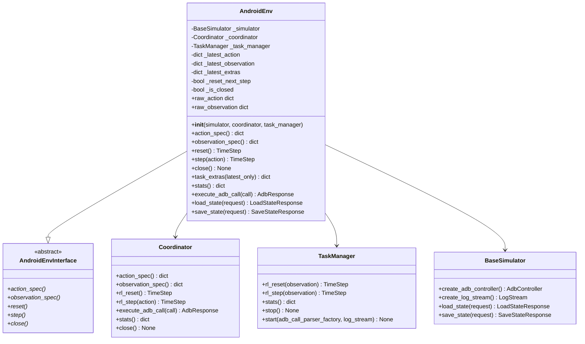
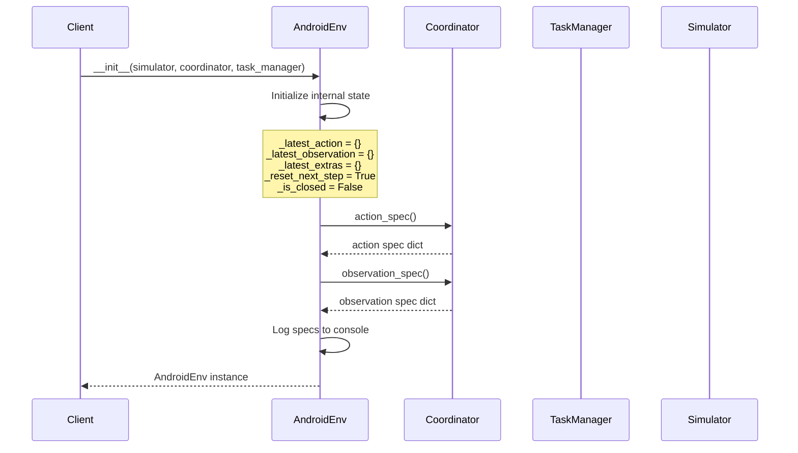
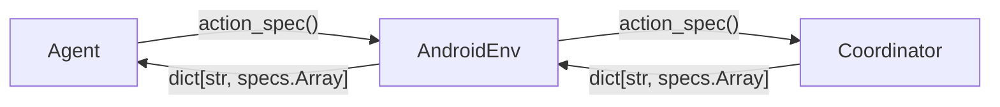
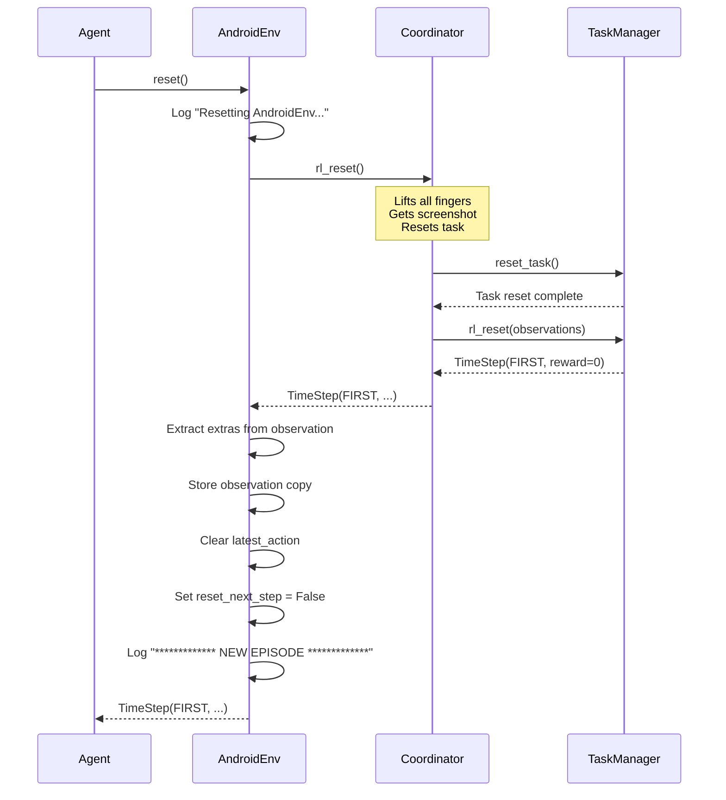
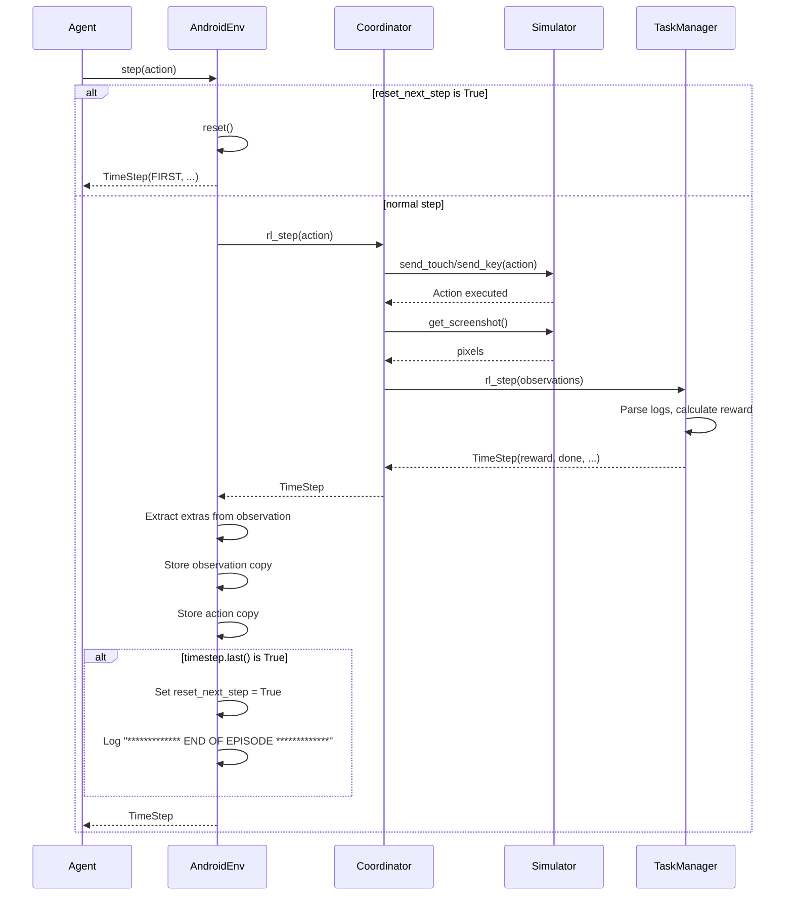
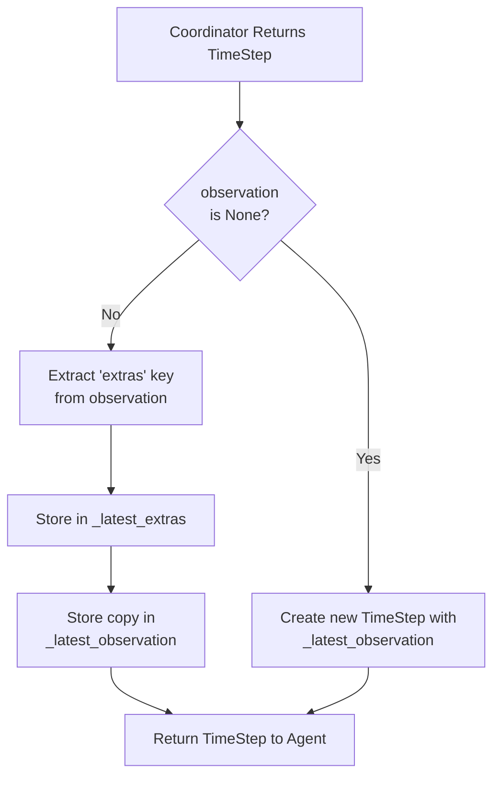
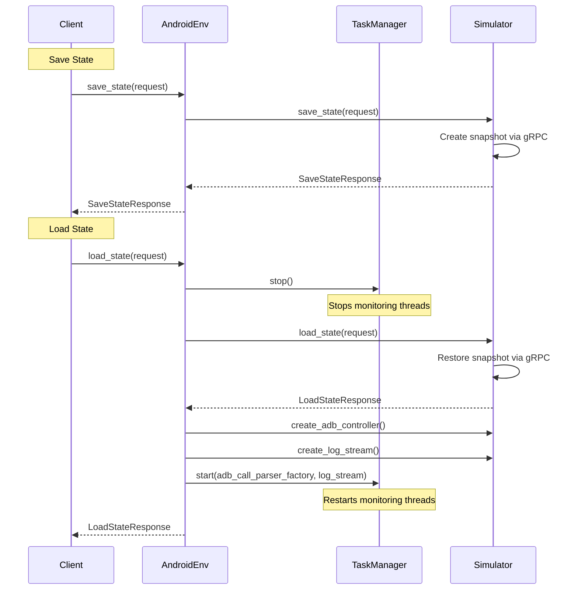
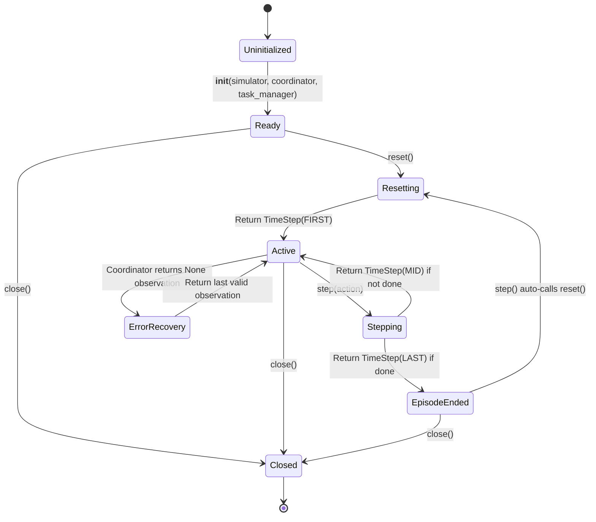

<!-- source: DeepWiki mcp.deepwiki.com · repo google-deepmind/android_env · page 3.1 AndroidEnv Environment · fetched 2026-10-26 -->

# AndroidEnv Environment

<details>
<summary>Relevant source files</summary>

The following files were used as context for generating this wiki page:

- [android_env/components/coordinator_test.py](android_env/components/coordinator_test.py)
- [android_env/components/task_manager_test.py](android_env/components/task_manager_test.py)
- [android_env/environment.py](android_env/environment.py)
- [android_env/environment_test.py](android_env/environment_test.py)

</details>


## Purpose and Scope

This page documents the `AndroidEnv` class, which serves as the main entry point for reinforcement learning agents interacting with Android applications. The class implements the `dm_env.Environment` interface and provides the public API for episode management, action execution, and observation retrieval.

For information about the abstract environment interface contract, see [Environment Interface](#3.2). For details on the orchestration logic that AndroidEnv delegates to, see [Coordinator](#3.3). For task-specific reward and monitoring logic, see [Task Manager](#4.2).

**Sources:** [android_env/environment.py:1-191]()

---

## Class Overview

The `AndroidEnv` class is defined in [android_env/environment.py:32-191]() and serves as a thin wrapper that coordinates interactions between the agent, simulator, coordinator, and task manager.

### Class Structure



**Sources:** [android_env/environment.py:32-54](), [android_env/env_interface.py]()

---

## Initialization and Dependencies

The `AndroidEnv` constructor requires three components that must be created externally (typically by the `loader.load()` function):

| Parameter | Type | Description |
|-----------|------|-------------|
| `simulator` | `BaseSimulator` | Manages Android emulator/device communication and lifecycle |
| `coordinator` | `Coordinator` | Orchestrates action execution and observation gathering |
| `task_manager` | `TaskManager` | Handles task-specific logic, rewards, and episode termination |

### Initialization Process



The constructor initializes internal state variables and logs the action and observation specifications for debugging purposes [android_env/environment.py:35-54]().

**Sources:** [android_env/environment.py:35-54](), [android_env/environment_test.py:56-91]()

---

## dm_env.Environment Interface Implementation

### Action and Observation Specifications

The `action_spec()` and `observation_spec()` methods delegate directly to the coordinator:



**Action Spec Example:**
```python
{
    'action_type': dm_env.specs.DiscreteArray(num_values=4),
    'touch_position': dm_env.specs.BoundedArray(
        shape=(2,), dtype=np.float32, minimum=0.0, maximum=1.0
    )
}
```

**Observation Spec Example:**
```python
{
    'pixels': dm_env.specs.Array(shape=(height, width, 3), dtype=np.uint8),
    'orientation': dm_env.specs.Array(shape=(4,), dtype=np.uint8),
    'timedelta': dm_env.specs.Array(shape=(), dtype=np.int64)
}
```

**Sources:** [android_env/environment.py:60-64](), [android_env/environment_test.py:58-91]()

---

### Reset Method

The `reset()` method initializes a new episode and returns a `FIRST` timestep:



**Key behaviors:**
- Calls `coordinator.rl_reset()` to execute the reset [android_env/environment.py:72]()
- Extracts and stores `extras` separately from the observation [android_env/environment.py:76-77]()
- Stores a copy of the observation for potential reuse [android_env/environment.py:77]()
- Handles `None` observations by returning the last valid observation [android_env/environment.py:78-80]()
- Clears the latest action and resets episode flags [android_env/environment.py:82-83]()

**Sources:** [android_env/environment.py:66-88](), [android_env/environment_test.py:93-145]()

---

### Step Method

The `step()` method executes an action and returns the resulting timestep:



**Key behaviors:**
- Automatically calls `reset()` if `_reset_next_step` is `True` [android_env/environment.py:94-95]()
- Delegates action execution to `coordinator.rl_step()` [android_env/environment.py:98]()
- Extracts and stores `extras` separately [android_env/environment.py:102]()
- Handles `None` observations by returning the last valid observation [android_env/environment.py:104-106]()
- Stores a copy of the action for later retrieval [android_env/environment.py:108]()
- Sets `_reset_next_step` flag when episode ends [android_env/environment.py:110-111]()

**Sources:** [android_env/environment.py:90-114](), [android_env/environment_test.py:149-207]()

---

### Close Method

The `close()` method cleans up resources:

```python
def close(self) -> None:
    """Cleans up running processes, threads and local files."""
    if not self._is_closed:
        logging.info('Cleaning up AndroidEnv...')
        if hasattr(self, '_coordinator'):
            self._coordinator.close()
        logging.info('Done cleaning up AndroidEnv.')
        self._is_closed = True
```

**Key behaviors:**
- Ensures idempotency with `_is_closed` flag [android_env/environment.py:118]()
- Delegates cleanup to coordinator [android_env/environment.py:121]()
- Automatically called by `__del__()` destructor [android_env/environment.py:55-56]()

**Sources:** [android_env/environment.py:116-123](), [android_env/environment_test.py:260-269]()

---

## State Management

AndroidEnv maintains several internal state variables to manage the episode lifecycle and provide access to recent data:

| Variable | Type | Purpose |
|----------|------|---------|
| `_latest_action` | `dict[str, np.ndarray]` | Stores the most recent action for retrieval via `raw_action` property |
| `_latest_observation` | `dict[str, np.ndarray]` | Stores the most recent observation (excluding extras) for fallback when coordinator returns `None` |
| `_latest_extras` | `dict[str, np.ndarray]` | Stores task-specific extras separately from the main observation |
| `_reset_next_step` | `bool` | Flag indicating whether the next `step()` call should trigger a `reset()` |
| `_is_closed` | `bool` | Flag preventing multiple cleanup operations |

### Observation Processing Flow



This design ensures agents always receive valid observations, even if the coordinator encounters transient errors [android_env/environment.py:101-106]().

**Sources:** [android_env/environment.py:46-50](), [android_env/environment.py:74-80](), [android_env/environment.py:101-106]()

---

## Extended Methods Beyond dm_env

AndroidEnv provides several methods beyond the standard `dm_env.Environment` interface:

### task_extras()

Returns task-specific extra information extracted from logs:

```python
def task_extras(self, latest_only: bool = True) -> dict[str, np.ndarray]:
    """Returns latest task extras."""
    task_extras = {}
    for k, spec in self._latest_extras.items():
        extra_values = spec.astype(spec.dtype)
        task_extras[k] = extra_values[-1] if latest_only else extra_values
    return task_extras
```

- When `latest_only=True`: Returns only the most recent value for each extra [android_env/environment.py:133]()
- When `latest_only=False`: Returns all accumulated values for each extra
- Creates a copy to avoid aliasing issues [android_env/environment.py:130]()

**Sources:** [android_env/environment.py:127-134](), [android_env/environment_test.py:142-144]()

---

### raw_action and raw_observation Properties

These properties provide access to the raw, unprocessed action and observation data:

```python
@property
def raw_action(self):
    return self._latest_action.copy()

@property
def raw_observation(self):
    return self._latest_observation.copy()
```

**Use cases:**
- Debugging and logging
- Analysis of agent behavior
- Wrapper implementations that need access to base environment data

Note that `raw_observation` excludes the `extras` key [android_env/environment_test.py:187]().

**Sources:** [android_env/environment.py:136-142](), [android_env/environment_test.py:184-188]()

---

### stats()

Aggregates statistics from both coordinator and task manager:

```python
def stats(self) -> dict[str, Any]:
    coordinator_stats = self._coordinator.stats()
    task_manager_stats = self._task_manager.stats()
    return coordinator_stats | task_manager_stats
```

Returns metrics such as:
- Episode step count
- Relaunch counts
- Task-specific measurements

**Sources:** [android_env/environment.py:144-147](), [android_env/environment_test.py:146-148]()

---

### execute_adb_call()

Executes arbitrary ADB commands on the Android device:

```python
def execute_adb_call(self, call: adb_pb2.AdbRequest) -> adb_pb2.AdbResponse:
    return self._coordinator.execute_adb_call(call)
```

This allows direct control over the Android device for advanced use cases. The method delegates to the coordinator, which uses `AdbCallParser` to translate protobuf requests into ADB shell commands.

**Sources:** [android_env/environment.py:149-150](), [android_env/environment_test.py:208-224]()

---

### load_state() and save_state()

These methods provide checkpointing functionality for the emulator state:



**load_state() behavior:**
1. Stops task manager monitoring threads [android_env/environment.py:166]()
2. Delegates state loading to simulator [android_env/environment.py:167]()
3. Restarts task manager with fresh log stream and ADB controller [android_env/environment.py:168-173]()

This ensures monitoring threads are properly reinitialized after the emulator state changes.

**Sources:** [android_env/environment.py:152-190](), [android_env/environment_test.py:226-258]()

---

## Complete Episode Lifecycle

The following diagram shows a complete episode lifecycle including reset, steps, and potential errors:



**Sources:** [android_env/environment.py:66-114]()

---

