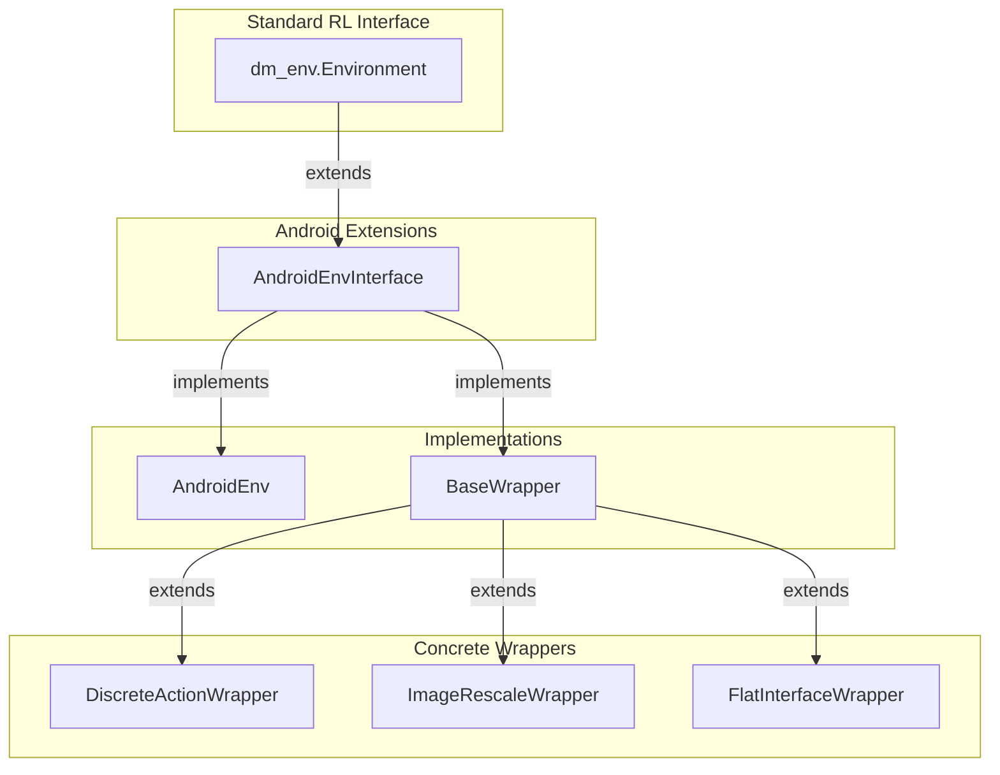
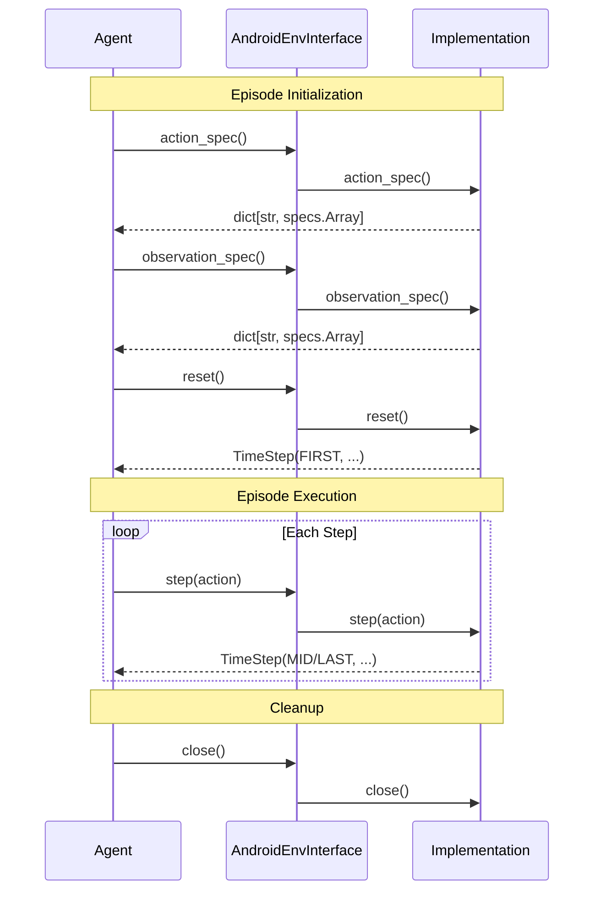
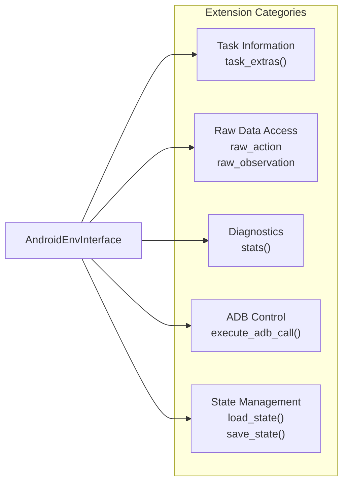
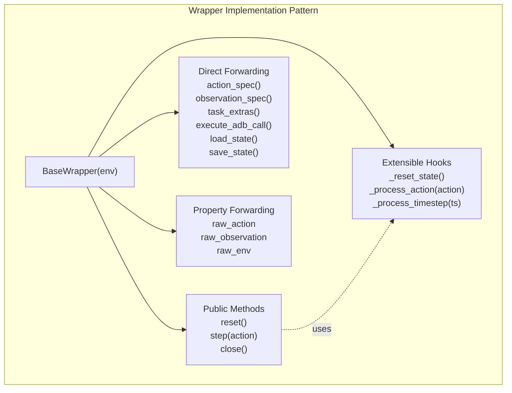
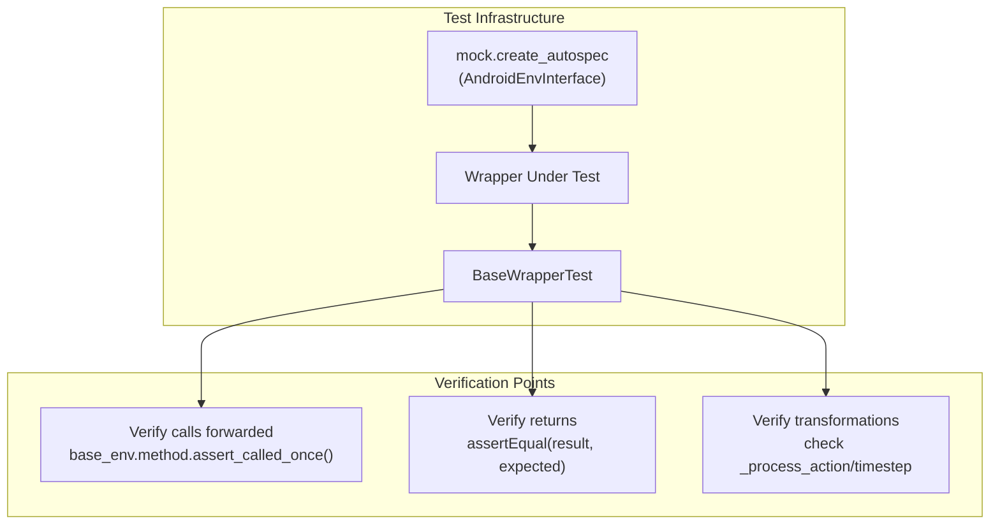

<!-- source: DeepWiki mcp.deepwiki.com · repo google-deepmind/android_env · page 3.2 Environment Interface · fetched 2026-10-26 -->

# Environment Interface

<details>
<summary>Relevant source files</summary>

The following files were used as context for generating this wiki page:

- [android_env/env_interface.py](android_env/env_interface.py)
- [android_env/wrappers/base_wrapper.py](android_env/wrappers/base_wrapper.py)
- [android_env/wrappers/base_wrapper_test.py](android_env/wrappers/base_wrapper_test.py)

</details>


## Purpose and Scope

This page documents the `AndroidEnvInterface` abstract base class, which defines the contract that all AndroidEnv environment implementations must satisfy. This interface extends the standard `dm_env.Environment` with Android-specific functionality such as task extras, ADB command execution, and state management.

For information about the main environment implementation, see [AndroidEnv Environment](#3.1). For details on how wrappers build upon this interface, see [Wrapper System](#7.1).

## Overview

The `AndroidEnvInterface` serves as the formal contract between RL agents and Android environment implementations. It combines the standard DeepMind Environment API (`dm_env.Environment`) with Android-specific extensions that enable advanced capabilities like arbitrary ADB command execution, state snapshots, and task-specific metadata extraction.



**Interface Hierarchy**: `AndroidEnvInterface` extends `dm_env.Environment` and is implemented by both the core `AndroidEnv` class and the `BaseWrapper` class, enabling a decorator pattern for environment transformations.

Sources: [android_env/env_interface.py:1-111](), [android_env/wrappers/base_wrapper.py:1-126]()

## Core dm_env.Environment Methods

The `AndroidEnvInterface` requires implementations to provide the standard dm_env methods. These form the basic RL interaction loop.

### Method Specifications

| Method | Return Type | Purpose |
|--------|-------------|---------|
| `action_spec()` | `dict[str, specs.Array]` | Describes the structure and bounds of valid actions |
| `observation_spec()` | `dict[str, specs.Array]` | Describes the structure and bounds of observations |
| `reset()` | `dm_env.TimeStep` | Initializes a new episode and returns the first observation |
| `step(action)` | `dm_env.TimeStep` | Executes an action and returns the resulting timestep |
| `close()` | `None` | Releases resources (emulator, threads, connections) |



**Standard RL Loop**: Implementations must provide these abstract methods to fulfill the `dm_env.Environment` contract.

Sources: [android_env/env_interface.py:37-55]()

### Action and Observation Structure

The base `AndroidEnvInterface` expects dictionary-based actions and observations:

**Base Action Format** (as defined by implementations):
```python
{
    'action_type': np.ndarray,      # Shape: (1,), dtype: int32
    'touch_position': np.ndarray    # Shape: (2,), dtype: float32
}
```

**Base Observation Format** (as defined by implementations):
```python
{
    'pixels': np.ndarray,           # Shape: (height, width, 3), dtype: uint8
    'orientation': np.ndarray,      # Shape: (4,), dtype: int32
    'timedelta': np.ndarray         # Shape: (1,), dtype: int64
}
```

These base formats can be transformed by wrappers (see [Action Wrappers](#7.2) and [Observation Wrappers](#7.3)).

Sources: [android_env/env_interface.py:38-43](), [android_env/env_interface.py:50-51]()

## Android-Specific Extensions

Beyond the standard dm_env methods, `AndroidEnvInterface` defines additional methods that provide Android-specific functionality.



**Extension Categories**: The interface provides five categories of Android-specific functionality beyond the standard RL interface.

Sources: [android_env/env_interface.py:59-110]()

### Task Extras

```python
def task_extras(self, latest_only: bool = True) -> dict[str, np.ndarray]:
```

Returns additional task-specific information extracted by the TaskManager. When `latest_only=True`, returns only the most recent values. Otherwise, returns accumulated values across the episode.

**Common Extras Include:**
- Game scores or metrics
- Task-specific state indicators
- Custom arrays defined in task protobuf

Sources: [android_env/env_interface.py:59-62](), [android_env/wrappers/base_wrapper.py:45-46]()

### Raw Data Properties

```python
@property
def raw_action(self) -> Any:
    """Returns the latest action."""

@property
def raw_observation(self) -> Any:
    """Returns the latest observation."""
```

These properties provide access to the unprocessed action and observation before wrapper transformations. Useful for debugging or logging the actual data sent to/received from the Android device.

Sources: [android_env/env_interface.py:64-70](), [android_env/wrappers/base_wrapper.py:104-110]()

### Statistics Collection

```python
def stats(self) -> dict[str, Any]:
```

Returns diagnostic information generated during environment execution. Implementations can include timing data, error counts, frame rates, or any other internal metrics. The default implementation returns an empty dictionary.

Wrappers can augment statistics by overriding `_wrapper_stats()` in `BaseWrapper`. Statistics from all layers are merged, with outer wrappers taking precedence.

Sources: [android_env/env_interface.py:72-75](), [android_env/wrappers/base_wrapper.py:69-76]()

### ADB Command Execution

```python
def execute_adb_call(self, call: adb_pb2.AdbRequest) -> adb_pb2.AdbResponse:
```

Allows clients to execute arbitrary ADB commands on the Android device. The request and response use protobuf messages defined in [android_env/proto/adb.proto](). 

**Use Cases:**
- Custom device configuration
- Installing additional apps
- Querying device state
- Executing shell commands

The default implementation returns an empty response. Full implementations delegate to the AdbCallParser and AdbController (see [ADB Call Parser](#6.2)).

Sources: [android_env/env_interface.py:77-80](), [android_env/wrappers/base_wrapper.py:99-102]()

### State Management

```python
def load_state(self, request: state_pb2.LoadStateRequest) -> state_pb2.LoadStateResponse:
def save_state(self, request: state_pb2.SaveStateRequest) -> state_pb2.SaveStateResponse:
```

Enables checkpointing and restoration of environment state. Requests use protobuf messages defined in [android_env/proto/state.proto]().

**State Management Features:**
- Save emulator snapshots via gRPC
- Load previous states for reproducibility
- Enable experience replay with exact state restoration

The default implementation raises `NotImplementedError`. Implementations that support state management (like those using `EmulatorSimulator`) provide full functionality. See [State Management](#5.4) for details.

Sources: [android_env/env_interface.py:82-110](), [android_env/wrappers/base_wrapper.py:78-97]()

## Implementation Guidelines

### Required Abstract Methods

Concrete implementations must override these methods from `AndroidEnvInterface`:

| Method | Required | Notes |
|--------|----------|-------|
| `action_spec()` | Yes | Must return dict of Array specs |
| `observation_spec()` | Yes | Must return dict of Array specs |
| `reset()` | Yes | Must return TimeStep with step_type=FIRST |
| `step(action)` | Yes | Must return TimeStep with appropriate step_type |
| `close()` | Yes | Must clean up all resources |

Sources: [android_env/env_interface.py:37-55]()

### Optional Extension Methods

These methods have default implementations that can be overridden:

| Method | Default Behavior | Override When |
|--------|------------------|---------------|
| `task_extras()` | Returns empty dict | Task provides extras |
| `raw_action` | No default (property) | Want to expose raw actions |
| `raw_observation` | No default (property) | Want to expose raw observations |
| `stats()` | Returns empty dict | Collecting diagnostics |
| `execute_adb_call()` | Returns empty response | Supporting ADB commands |
| `load_state()` | Raises NotImplementedError | Supporting state snapshots |
| `save_state()` | Raises NotImplementedError | Supporting state snapshots |

Sources: [android_env/env_interface.py:59-110]()

### BaseWrapper Pattern

The `BaseWrapper` class provides a canonical implementation of the decorator pattern for `AndroidEnvInterface`. It forwards all calls to the wrapped environment by default.



**BaseWrapper Architecture**: Public methods call extensible hooks, while specifications and extended methods forward directly to the wrapped environment.

**Key Extensibility Points in BaseWrapper:**

1. **`_reset_state()`** [android_env/wrappers/base_wrapper.py:48-49](): Called at the start of `reset()`, before delegating to wrapped environment. Override to reset wrapper-specific state.

2. **`_process_action(action)`** [android_env/wrappers/base_wrapper.py:51-52](): Called during `step()` to transform actions before passing to wrapped environment.

3. **`_process_timestep(timestep)`** [android_env/wrappers/base_wrapper.py:54-55](): Called during both `reset()` and `step()` to transform observations in the returned TimeStep.

4. **`_wrapper_stats()`** [android_env/wrappers/base_wrapper.py:69-71](): Override to add wrapper-specific statistics that merge with underlying environment stats.

Sources: [android_env/wrappers/base_wrapper.py:29-126]()

### Raw Environment Access

Wrappers provide a `raw_env` property that recursively unwraps to reach the innermost environment implementation:

```python
@property
def raw_env(self) -> env_interface.AndroidEnvInterface:
    """Recursively unwrap until we reach the true 'raw' env."""
    wrapped = self._env
    if hasattr(wrapped, 'raw_env'):
        return wrapped.raw_env
    return wrapped
```

This enables accessing the core `AndroidEnv` instance even when multiple wrappers are applied.

Sources: [android_env/wrappers/base_wrapper.py:112-118]()

## Method Call Flow Through Wrappers

The following diagram illustrates how method calls propagate through a wrapper stack:

```mermaid
sequenceDiagram
    participant Agent
    participant W2["Wrapper 2<br/>(Outer)"]
    participant W1["Wrapper 1<br/>(Inner)"]
    participant Env["AndroidEnv"]
    
    Note over Agent,Env: Step Execution
    Agent->>W2: step(action)
    W2->>W2: action = _process_action(action)
    W2->>W1: step(action)
    W1->>W1: action = _process_action(action)
    W1->>Env: step(action)
    Env-->>W1: timestep
    W1->>W1: timestep = _process_timestep(timestep)
    W1-->>W2: timestep
    W2->>W2: timestep = _process_timestep(timestep)
    W2-->>Agent: timestep
    
    Note over Agent,Env: Specification Query
    Agent->>W2: action_spec()
    W2->>W1: action_spec()
    W1->>Env: action_spec()
    Env-->>W1: spec
    W1-->>W2: spec
    W2-->>Agent: spec
    
    Note over Agent,Env: Extension Method
    Agent->>W2: task_extras()
    W2->>W1: task_extras()
    W1->>Env: task_extras()
    Env-->>W1: extras
    W1-->>W2: extras
    W2-->>Agent: extras
```

**Call Propagation**: Actions are transformed as they pass down through wrappers (outer to inner), while observations are transformed as they return up through wrappers (inner to outer). Specification and extension methods forward directly.

Sources: [android_env/wrappers/base_wrapper.py:36-43](), [android_env/wrappers/base_wrapper.py:45-61]()

## Testing with AndroidEnvInterface

The `AndroidEnvInterface` enables comprehensive testing through mocking:



**Testing Pattern**: Create autospec mocks of `AndroidEnvInterface` to test wrappers and other components in isolation.

**Example Test Pattern** [android_env/wrappers/base_wrapper_test.py:30-87]():

```python
base_env = mock.create_autospec(env_interface.AndroidEnvInterface)
wrapped_env = base_wrapper.BaseWrapper(base_env)

# Verify forwarding
fake_ts = 'fake_ts'
base_env.reset.return_value = fake_ts
assertEqual(fake_ts, wrapped_env.reset())
base_env.reset.assert_called_once()
```

This pattern enables testing:
- Method forwarding correctness
- Transformation logic in wrappers
- Statistics aggregation across wrapper layers
- State management delegation

Sources: [android_env/wrappers/base_wrapper_test.py:27-151]()

## Summary

The `AndroidEnvInterface` provides a well-defined contract that:

1. **Extends dm_env.Environment** with Android-specific capabilities
2. **Defines required methods** for the RL interaction loop (reset, step, specs, close)
3. **Provides optional extensions** for task extras, ADB control, and state management
4. **Enables the decorator pattern** through `BaseWrapper` for composable transformations
5. **Supports comprehensive testing** through interface mocking

Implementations must provide the core dm_env methods, while extensions can be implemented as needed based on environment capabilities. The wrapper system builds upon this interface to enable flexible observation and action transformations without modifying the core environment.

Sources: [android_env/env_interface.py:1-111](), [android_env/wrappers/base_wrapper.py:1-126]()

---

