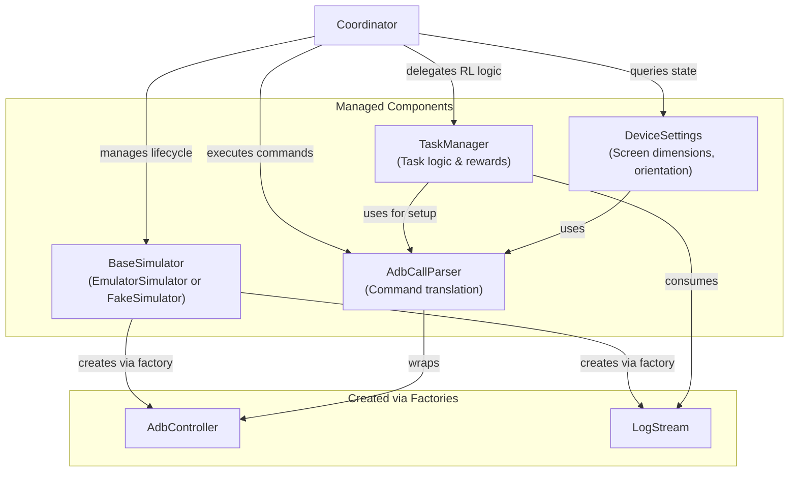
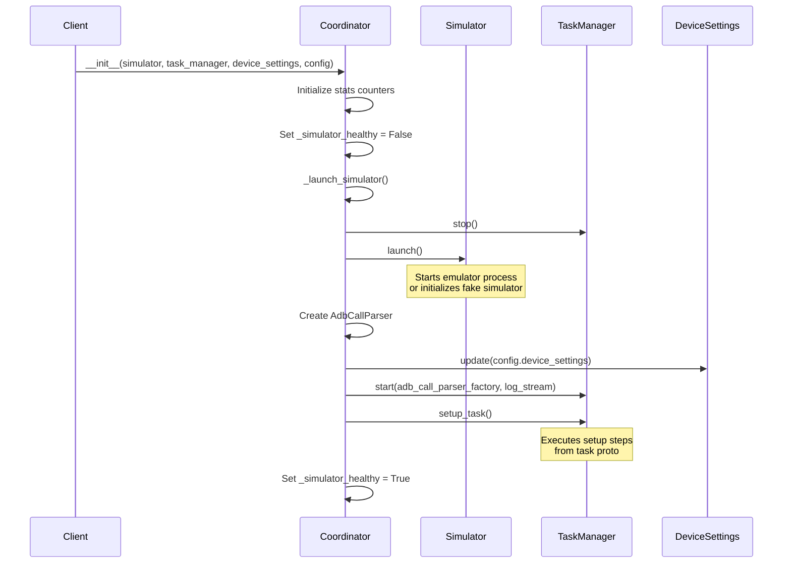
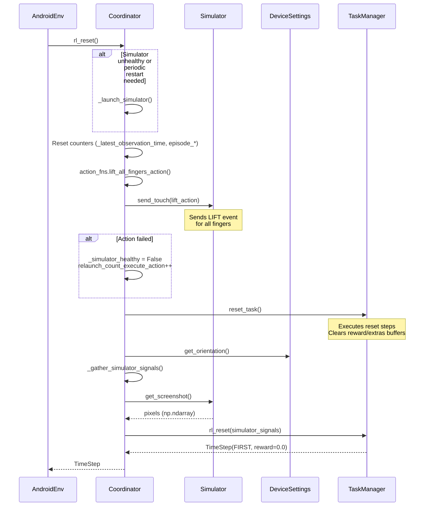
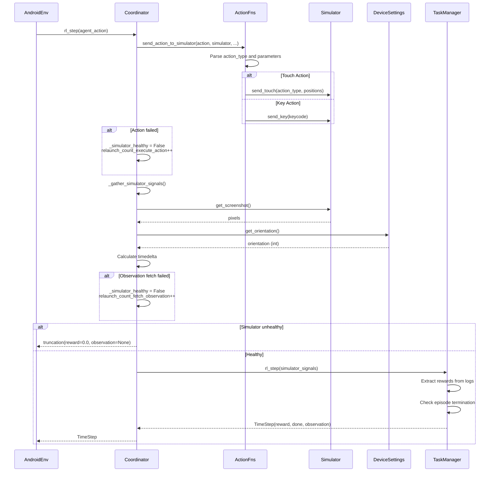
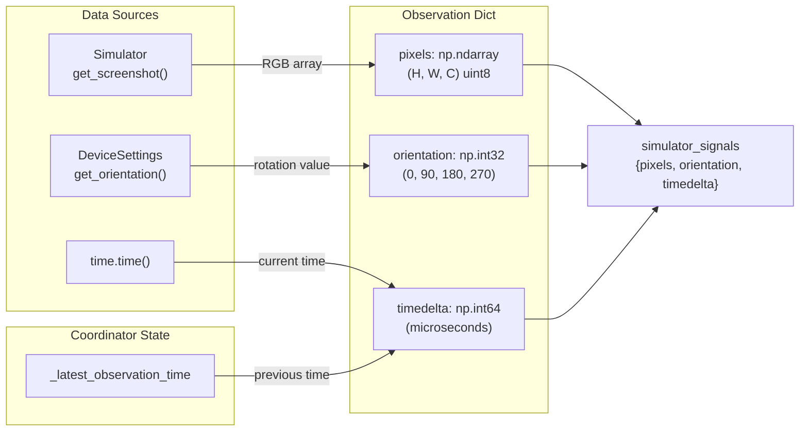
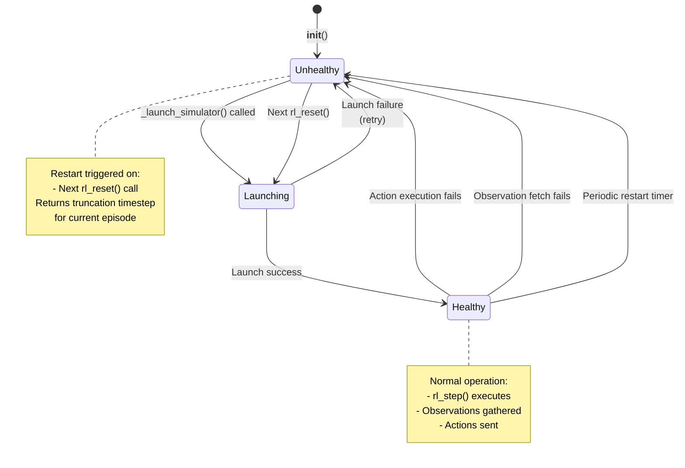
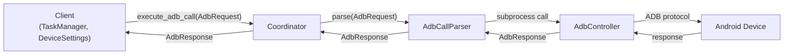
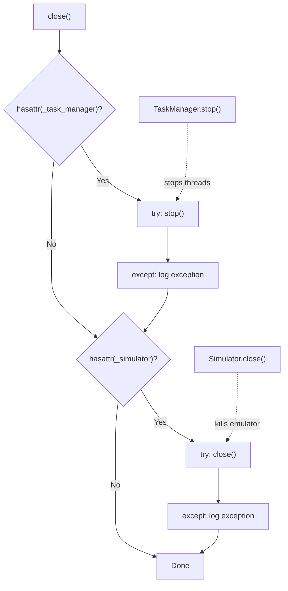
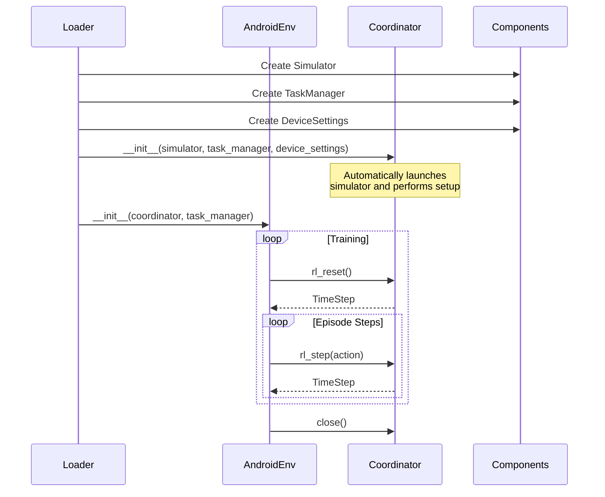

<!-- source: DeepWiki mcp.deepwiki.com · repo google-deepmind/android_env · page 3.3 Coordinator · fetched 2026-10-26 -->

# Coordinator

<details>
<summary>Relevant source files</summary>

The following files were used as context for generating this wiki page:

- [android_env/components/coordinator.py](android_env/components/coordinator.py)
- [android_env/components/task_manager.py](android_env/components/task_manager.py)
- [android_env/wrappers/float_pixels_wrapper.py](android_env/wrappers/float_pixels_wrapper.py)
- [android_env/wrappers/last_action_wrapper.py](android_env/wrappers/last_action_wrapper.py)

</details>


## Purpose and Scope

The Coordinator is the central orchestrator within AndroidEnv's core architecture. It manages the interactions between the simulator, task manager, device settings, and ADB communication components. This page documents the `Coordinator` class, its responsibilities for component lifecycle management, RL episode execution, observation gathering, and error recovery strategies.

For information about the overall environment interface, see [AndroidEnv Environment](#3.1). For details about task-specific logic and reward extraction, see [Task Manager](#4.2). For simulator abstraction and lifecycle, see [Simulator System](#5).

**Sources:** [android_env/components/coordinator.py:1-287]()

---

## Overview

The `Coordinator` class ([android_env/components/coordinator.py:36-287]()) serves as the hub that connects all major subsystems within AndroidEnv. It implements the orchestration logic required to:

- Launch and manage the simulator lifecycle
- Execute RL reset and step operations
- Gather observations from multiple sources
- Monitor system health and trigger restarts
- Route ADB commands to the appropriate handlers
- Aggregate statistics across components

The Coordinator operates as a mediator between the high-level `AndroidEnv` API and the lower-level components that interact with the Android device.

**Sources:** [android_env/components/coordinator.py:36-56]()

---

## Component Dependencies

The Coordinator manages four primary dependencies, each responsible for a specific aspect of the system:



**Component Roles:**

| Component | Initialization | Usage |
|-----------|---------------|-------|
| `BaseSimulator` | Constructor parameter | Action execution, screenshot capture, process lifecycle |
| `TaskManager` | Constructor parameter | RL timestep generation, reward extraction, episode termination |
| `DeviceSettings` | Constructor parameter | Screen dimensions, orientation tracking, settings updates |
| `AdbCallParser` | Created after simulator launch | Command routing, created via `_create_adb_call_parser()` |

**Sources:** [android_env/components/coordinator.py:39-56](), [android_env/components/coordinator.py:171-178]()

---

## Initialization and Simulator Launch

### Constructor Flow

The Coordinator's initialization automatically launches the simulator and performs initial setup:



**Sources:** [android_env/components/coordinator.py:39-79](), [android_env/components/coordinator.py:114-169]()

### Launch Retry Logic

The `_launch_simulator()` method ([android_env/components/coordinator.py:114-169]()) implements robust retry logic:

| Parameter | Default | Purpose |
|-----------|---------|---------|
| `max_retries` | 3 | Number of launch attempts before raising `TooManyRestartsError` |

The launch sequence can fail at multiple points, each tracked separately in statistics:

1. **Device Settings Update** ([android_env/components/coordinator.py:143-150]()): Increments `relaunch_count_update_settings`
2. **Task Setup** ([android_env/components/coordinator.py:157-164]()): Increments `relaunch_count_setup_steps`, raises `StepCommandError`

On successful launch, `_simulator_healthy` is set to `True` and `relaunch_count` is incremented ([android_env/components/coordinator.py:167-168]()).

**Sources:** [android_env/components/coordinator.py:114-169]()

---

## RL Episode Management

### Reset Operation

The `rl_reset()` method ([android_env/components/coordinator.py:180-211]()) initializes a new episode:



**Key Operations:**

1. **Health Check** ([android_env/components/coordinator.py:184-185]()): Relaunch if unhealthy or periodic restart needed
2. **Counter Reset** ([android_env/components/coordinator.py:188-191]()): Clear episode-specific statistics
3. **Finger Lift** ([android_env/components/coordinator.py:194-203]()): Ensure clean state by lifting all touch points
4. **Task Reset** ([android_env/components/coordinator.py:205-206]()): Delegate to TaskManager for task-specific reset
5. **Signal Gathering** ([android_env/components/coordinator.py:209]()): Collect initial observation
6. **TaskManager Reset** ([android_env/components/coordinator.py:211]()): Generate FIRST timestep

**Sources:** [android_env/components/coordinator.py:180-211]()

### Step Operation

The `rl_step()` method ([android_env/components/coordinator.py:213-246]()) executes one environment step:



**Error Handling:**

The step method includes two failure points:

1. **Action Execution** ([android_env/components/coordinator.py:225-233]()): Sets `_simulator_healthy = False`, increments `relaunch_count_execute_action`
2. **Observation Fetch** ([android_env/components/coordinator.py:236-241]()): Catches `ReadObservationError`, increments `relaunch_count_fetch_observation`

If either fails, the method returns a truncation timestep ([android_env/components/coordinator.py:243-244]()) to signal episode termination.

**Sources:** [android_env/components/coordinator.py:213-246]()

---

## Observation Collection

The `_gather_simulator_signals()` method ([android_env/components/coordinator.py:248-264]()) assembles the observation dictionary from multiple sources:



**Implementation Details:**

| Field | Type | Source | Description |
|-------|------|--------|-------------|
| `pixels` | `np.ndarray` | `Simulator.get_screenshot()` | Raw RGB screenshot from device |
| `orientation` | `np.int32` | `DeviceSettings.get_orientation()` | Screen rotation (0°, 90°, 180°, 270°) |
| `timedelta` | `np.int64` | Time calculation | Microseconds since last observation |

**Timedelta Calculation:**

The timedelta field ([android_env/components/coordinator.py:251-258]()) uses microsecond precision:
- First observation: `timedelta = 0`
- Subsequent observations: `timedelta = (current_time - _latest_observation_time) * 1e6`

This signal is passed to the TaskManager, which augments it with task-specific extras before returning the final observation.

**Sources:** [android_env/components/coordinator.py:248-264]()

---

## Error Recovery and Health Monitoring

### Health State Machine

The Coordinator maintains a `_simulator_healthy` flag that controls restart behavior:



**Sources:** [android_env/components/coordinator.py:74](), [android_env/components/coordinator.py:123](), [android_env/components/coordinator.py:167]()

### Restart Triggers

The Coordinator tracks multiple restart reasons in its statistics:

| Statistic Key | Trigger Condition | Location |
|---------------|-------------------|----------|
| `relaunch_count_periodic` | `_should_periodic_relaunch()` returns True | [coordinator.py:110]() |
| `relaunch_count_setup_steps` | `setup_task()` raises `StepCommandError` | [coordinator.py:161]() |
| `relaunch_count_update_settings` | `DeviceSettings.update()` fails | [coordinator.py:147]() |
| `relaunch_count_execute_action` | `send_action_to_simulator()` returns False | [coordinator.py:201](), [coordinator.py:232]() |
| `relaunch_count_fetch_observation` | `_gather_simulator_signals()` raises exception | [coordinator.py:240]() |

**Periodic Restart Logic:**

The `_should_periodic_relaunch()` method ([android_env/components/coordinator.py:93-112]()) checks if the simulator has been running beyond the configured threshold:

```python
if self._config.periodic_restart_time_min and self._simulator_start_time:
    sim_alive_time = (time.time() - self._simulator_start_time) / 60.0
    if sim_alive_time > self._config.periodic_restart_time_min:
        self._stats['relaunch_count_periodic'] += 1
        return True
return False
```

This prevents simulator staleness during long training runs.

**Sources:** [android_env/components/coordinator.py:93-112](), [android_env/components/coordinator.py:184-185]()

---

## Specification Methods

The Coordinator provides action and observation specifications that define the interface contract:

### Action Specification

The `action_spec()` method ([android_env/components/coordinator.py:81-85]()) delegates to `specs.base_action_spec()`:

```python
def action_spec(self) -> dict[str, dm_env.specs.Array]:
    return specs.base_action_spec(
        num_fingers=self._config.num_fingers,
        enable_key_events=self._config.enable_key_events,
    )
```

**Configuration Parameters:**

| Parameter | Type | Default | Description |
|-----------|------|---------|-------------|
| `num_fingers` | `int` | From config | Number of simultaneous touch points (1-10) |
| `enable_key_events` | `bool` | From config | Whether keyboard actions are enabled |

The resulting specification includes:
- `action_type`: Integer specifying TOUCH, LIFT, or KEY
- `touch_position`: Array of (x, y) positions for each finger
- `keycode`: Integer keycode (if key events enabled)

**Sources:** [android_env/components/coordinator.py:81-85]()

### Observation Specification

The `observation_spec()` method ([android_env/components/coordinator.py:87-91]()) uses device settings for screen dimensions:

```python
def observation_spec(self) -> dict[str, dm_env.specs.Array]:
    return specs.base_observation_spec(
        height=self._device_settings.screen_height(),
        width=self._device_settings.screen_width(),
    )
```

The base specification includes:
- `pixels`: `(height, width, 3)` RGB uint8 array
- `orientation`: Scalar int32
- `timedelta`: Scalar int64

TaskManager and wrappers may extend this with additional fields (e.g., `extras`, `last_action`).

**Sources:** [android_env/components/coordinator.py:87-91]()

---

## ADB Command Execution

The Coordinator provides a pass-through method for executing ADB commands:

```python
def execute_adb_call(self, call: adb_pb2.AdbRequest) -> adb_pb2.AdbResponse:
    return self._adb_call_parser.parse(call)
```

**Usage Pattern:**



This method allows components like TaskManager and DeviceSettings to execute ADB commands without directly accessing the AdbCallParser. The Coordinator creates a new AdbCallParser instance after each simulator launch ([android_env/components/coordinator.py:171-175]()).

**Sources:** [android_env/components/coordinator.py:177-178](), [android_env/components/coordinator.py:171-175]()

---

## Statistics and Monitoring

### Statistics Dictionary

The Coordinator maintains a comprehensive statistics dictionary ([android_env/components/coordinator.py:60-71]()):

```python
self._stats = {
    'relaunch_count': 0,
    'relaunch_count_periodic': 0,
    'relaunch_count_setup_steps': 0,
    'relaunch_count_reset_steps': 0,
    'relaunch_count_simulator_launch': 0,
    'relaunch_count_simulator_reset': 0,
    'relaunch_count_execute_action': 0,
    'relaunch_count_fetch_observation': 0,
    'relaunch_count_update_settings': 0,
    'failed_task_updates': 0,
}
```

**Statistic Categories:**

| Category | Keys | Purpose |
|----------|------|---------|
| Total relaunches | `relaunch_count` | Overall restart count |
| Restart reasons | `relaunch_count_*` | Breakdown by trigger |
| Task failures | `failed_task_updates` | Failed task operations |

The `stats()` method ([android_env/components/coordinator.py:269-272]()) returns a deep copy to prevent external modification:

```python
def stats(self) -> dict[str, Any]:
    return copy.deepcopy(self._stats)
```

**Sources:** [android_env/components/coordinator.py:60-71](), [android_env/components/coordinator.py:269-272]()

---

## Cleanup and Resource Management

The Coordinator implements proper resource cleanup through `close()` and `__del__()` methods:

### Close Method

The `close()` method ([android_env/components/coordinator.py:274-286]()) performs orderly shutdown:



**Error Tolerance:**

Both cleanup operations use bare `except` clauses ([android_env/components/coordinator.py:280](), [android_env/components/coordinator.py:285]()) to ensure cleanup continues even if one component fails. This is critical during shutdown when the system may be in an inconsistent state.

**Destructor:**

The `__del__()` method ([android_env/components/coordinator.py:266-267]()) ensures cleanup happens even if `close()` is not explicitly called:

```python
def __del__(self):
    self.close()
```

**Sources:** [android_env/components/coordinator.py:266-267](), [android_env/components/coordinator.py:274-286]()

---

## Integration with AndroidEnv

The Coordinator is instantiated by the loader system and passed to AndroidEnv. The typical flow:



AndroidEnv delegates all core environment operations to the Coordinator while maintaining the `dm_env.Environment` interface. The Coordinator handles all complexity of component coordination, allowing AndroidEnv to remain a thin wrapper.

**Sources:** [android_env/components/coordinator.py:36-287]()

---

