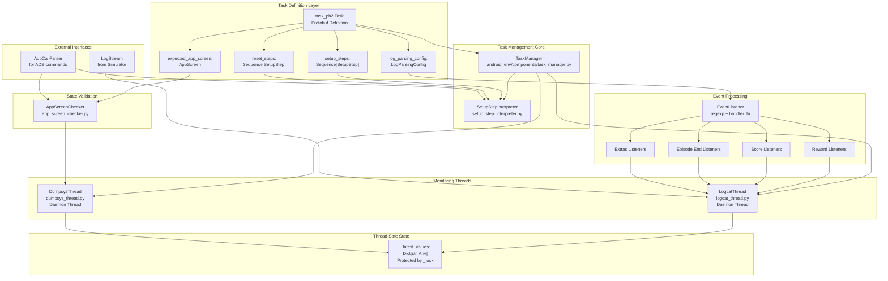
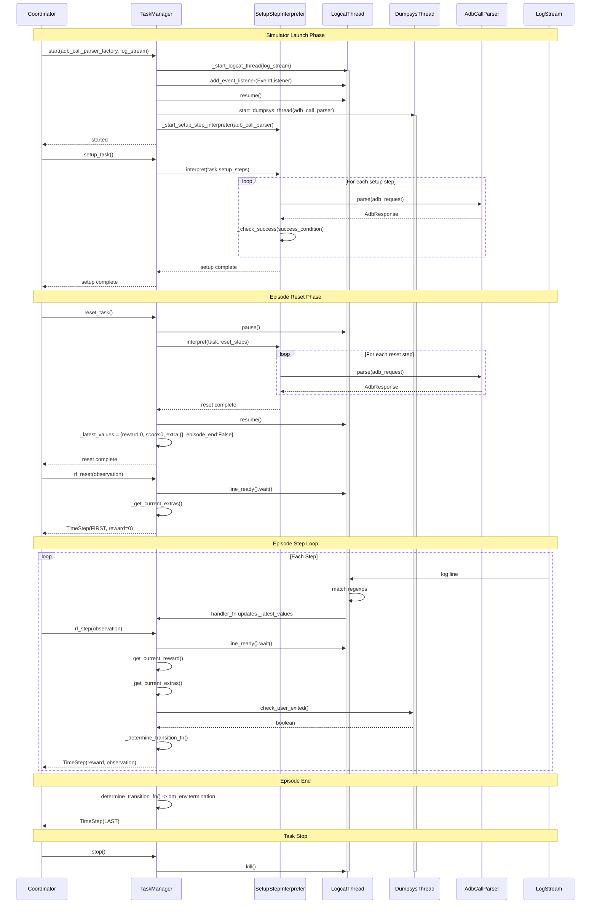
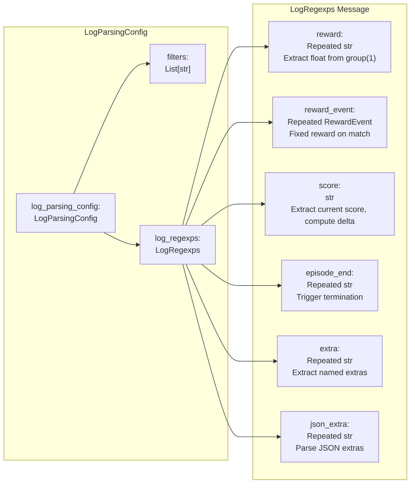
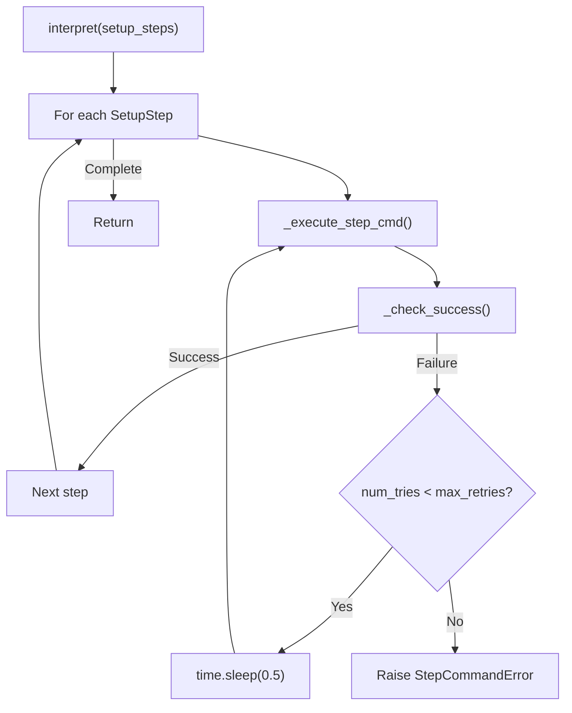
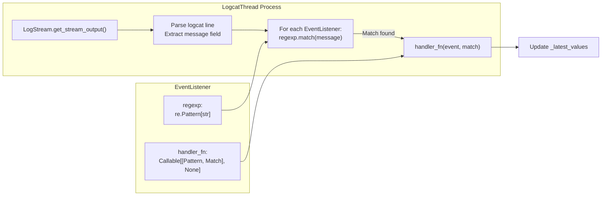
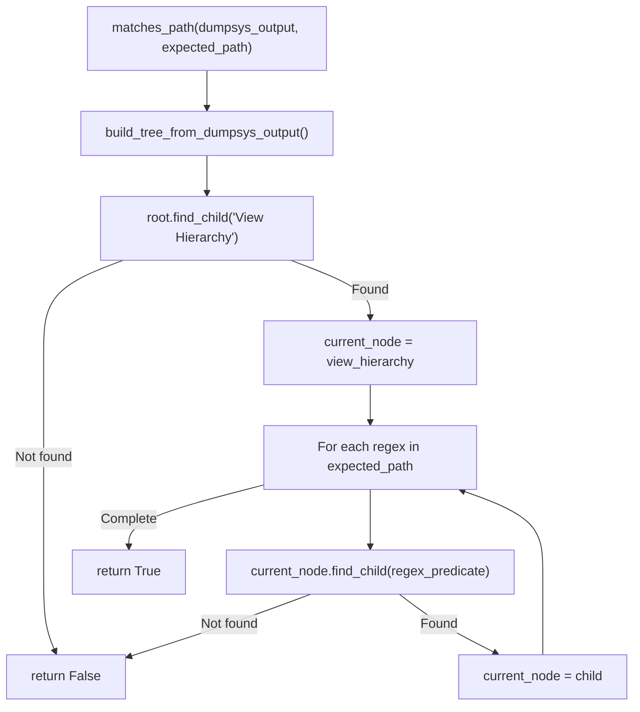
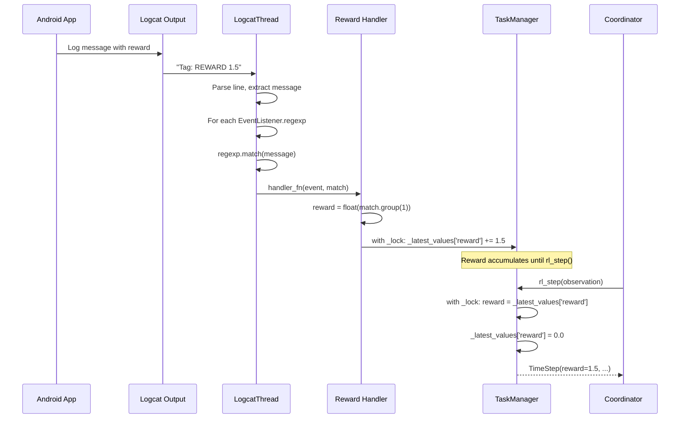
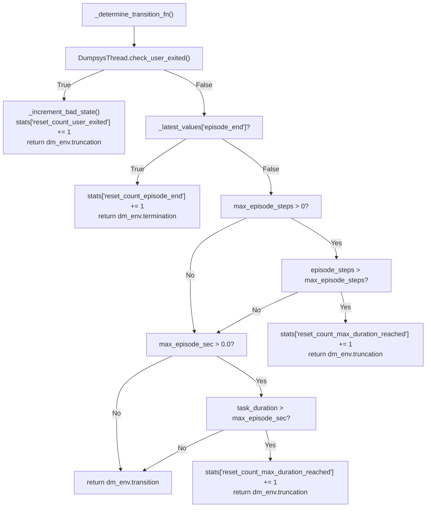

<!-- source: DeepWiki mcp.deepwiki.com · repo google-deepmind/android_env · page 4 Task Management · fetched 2026-10-26 -->

# Task Management

<details>
<summary>Relevant source files</summary>

The following files were used as context for generating this wiki page:

- [android_env/components/app_screen_checker.py](android_env/components/app_screen_checker.py)
- [android_env/components/coordinator.py](android_env/components/coordinator.py)
- [android_env/components/logcat_thread.py](android_env/components/logcat_thread.py)
- [android_env/components/logcat_thread_test.py](android_env/components/logcat_thread_test.py)
- [android_env/components/setup_step_interpreter.py](android_env/components/setup_step_interpreter.py)
- [android_env/components/task_manager.py](android_env/components/task_manager.py)
- [android_env/wrappers/float_pixels_wrapper.py](android_env/wrappers/float_pixels_wrapper.py)
- [android_env/wrappers/last_action_wrapper.py](android_env/wrappers/last_action_wrapper.py)

</details>


This page explains how tasks are defined, managed, and monitored throughout RL episodes in AndroidEnv. It covers the architecture of task management components, the task lifecycle from initialization to termination, and the mechanisms for extracting rewards and detecting episode endings from Android system logs.

For details about the Coordinator's role in orchestrating tasks, see [Core Architecture](#3). For information about the configuration system used to define tasks, see [Configuration System](#2.2).

## Purpose and Scope

Task management in AndroidEnv encompasses:

- **Task Definition**: How RL tasks are specified using protocol buffers
- **Task Initialization**: Executing setup and reset steps to prepare the environment
- **Reward Extraction**: Monitoring Android logs to extract rewards, scores, and task-specific extras
- **Episode Termination**: Detecting when episodes should end based on logs or time limits
- **State Monitoring**: Verifying the app is on the expected screen

## Task Management Architecture

The task management system consists of several cooperating components that handle different aspects of task execution and monitoring.



**Sources:**
- [android_env/components/task_manager.py:42-438]()
- [android_env/components/setup_step_interpreter.py:31-183]()
- [android_env/components/logcat_thread.py:27-132]()
- [android_env/components/app_screen_checker.py:176-270]()

## Task Lifecycle

The following diagram illustrates the complete lifecycle of a task from simulator launch through episode execution.



**Sources:**
- [android_env/components/coordinator.py:114-169]()
- [android_env/components/task_manager.py:99-133]()
- [android_env/components/task_manager.py:149-180]()
- [android_env/components/setup_step_interpreter.py:52-111]()

## Task Definition

Tasks are defined using the `task_pb2.Task` protocol buffer message, which specifies all aspects of task behavior. The task definition includes:

| Field | Type | Purpose |
|-------|------|---------|
| `setup_steps` | `Sequence[SetupStep]` | One-time initialization steps executed after simulator launch |
| `reset_steps` | `Sequence[SetupStep]` | Steps executed at the start of each episode |
| `log_parsing_config` | `LogParsingConfig` | Regular expressions for extracting rewards, scores, episode ends, and extras from logs |
| `expected_app_screen` | `AppScreen` | Expected activity and view hierarchy path for validation |
| `max_episode_steps` | `int32` | Maximum number of steps before episode truncation (0 = no limit) |
| `max_episode_sec` | `float` | Maximum episode duration in seconds (0.0 = no limit) |

The `LogParsingConfig` contains regular expression patterns for different event types:



**Sources:**
- [android_env/components/task_manager.py:45-87]()
- [android_env/components/task_manager.py:287-437]()

For complete details on task protobuf structure, see [Task Definition](#4.1).

## TaskManager Class

The `TaskManager` class is the central component responsible for task execution and monitoring. It coordinates setup, reset, reward extraction, and episode termination.

### Key Responsibilities

**Initialization and Lifecycle** ([task_manager.py:45-87]()):
- Accepts a `task_pb2.Task` and optional `TaskManagerConfig`
- Initializes thread-safe `_latest_values` dictionary for reward/extra accumulation
- Maintains statistics about resets and restarts

**Setup and Reset** ([task_manager.py:99-147]()):
- `setup_task()`: Executes one-time setup steps via `SetupStepInterpreter`
- `reset_task()`: Pauses log processing, executes reset steps, resumes processing, clears accumulated values

**RL Interface** ([task_manager.py:149-180]()):
- `rl_reset()`: Returns initial `TimeStep` with `step_type=FIRST`
- `rl_step()`: Returns `TimeStep` with accumulated reward and extras, determines episode continuation

**Thread Management** ([task_manager.py:116-126]()):
- `start()`: Initializes `LogcatThread`, `DumpsysThread`, and `SetupStepInterpreter`
- `stop()`: Gracefully terminates monitoring threads

For detailed information about TaskManager internals, see [Task Manager](#4.2).

## Setup Step Interpreter

The `SetupStepInterpreter` executes sequences of `SetupStep` messages to configure the environment. Each step can be:

| Step Type | Description | Example Use |
|-----------|-------------|-------------|
| `adb_request` | Execute an ADB command | Install APK, start activity, set settings |
| `sleep` | Pause for specified seconds | Wait for app to initialize |

Each step can include a `success_condition` with retry logic:

| Success Check | Description | Parameters |
|---------------|-------------|------------|
| `wait_for_app_screen` | Wait for specific activity and view hierarchy | `app_screen`, `timeout_sec` |
| `check_install` | Verify package is installed | `package_name`, `timeout_sec` |

The interpreter implements retry logic ([setup_step_interpreter.py:74-111]()):



**Sources:**
- [android_env/components/setup_step_interpreter.py:31-183]()

For detailed documentation of setup step execution, see [Setup Step Interpreter](#4.3).

## Monitoring System

The monitoring system continuously observes Android device state through two parallel mechanisms: log-based event extraction and state polling.

### LogcatThread: Log-Based Monitoring

The `LogcatThread` ([logcat_thread.py:35-132]()) runs as a daemon thread, processing log output line-by-line and triggering registered event listeners.

**Event Listener Pattern**:



**Listener Types** ([task_manager.py:287-437]()):

1. **Reward Listeners** ([task_manager.py:301-315]()): Extract float from regex group(1), accumulate in `_latest_values['reward']`
2. **Score Listeners** ([task_manager.py:338-353]()): Extract current score, compute delta from previous, accumulate reward
3. **Episode End Listeners** ([task_manager.py:355-368]()): Set `_latest_values['episode_end'] = True`
4. **Extras Listeners** ([task_manager.py:386-416]()): Extract named arrays using `ast.literal_eval()`, buffer in `_latest_values['extra']`
5. **JSON Extras Listeners** ([task_manager.py:418-437]()): Parse JSON objects, add each key-value pair as an extra

**Thread Synchronization** ([logcat_thread.py:72-131]()):
- `line_ready()` event ensures all listeners are notified before values are read
- `pause()` and `resume()` control log processing during reset

### DumpsysThread: State Polling

The `DumpsysThread` periodically checks Android device state to verify the app is on the expected screen. It uses `AppScreenChecker` to:

1. **Activity Validation** ([app_screen_checker.py:207-218]()): Compare current activity against `expected_app_screen.activity`
2. **View Hierarchy Validation** ([app_screen_checker.py:224-237]()): Match dumpsys output against `expected_app_screen.view_hierarchy_path`

The view hierarchy matching algorithm ([app_screen_checker.py:129-173]()):



**Sources:**
- [android_env/components/logcat_thread.py:35-132]()
- [android_env/components/task_manager.py:243-265]()
- [android_env/components/app_screen_checker.py:176-270]()

For comprehensive documentation of monitoring components, see [Monitoring System](#4.4).

## Reward Extraction Mechanisms

Rewards are extracted from Android logs using regular expressions defined in `task_pb2.Task.log_parsing_config.log_regexps`. The TaskManager creates event listeners for each pattern.

### Reward Accumulation Flow



### Reward Types

**1. Direct Reward** ([task_manager.py:301-315]()):
- Pattern contains one capture group matching a float
- Example: `r'REWARD ([-+]?[0-9]*\.?[0-9]+)'`
- Extracted value is added to accumulated reward

**2. Reward Event** ([task_manager.py:317-336]()):
- Pattern triggers a fixed reward amount
- Example: Pattern `r'TASK_COMPLETE'` with `reward=10.0`
- Useful for binary events (success/failure)

**3. Score-Based Reward** ([task_manager.py:338-353]()):
- Pattern extracts current score
- Reward is delta from previous score
- Example: `r'SCORE ([0-9]+)'`
- Maintains cumulative score in `_latest_values['score']`

### Extras Extraction

Extras provide additional task-specific information beyond scalar rewards.

**Array Extras** ([task_manager.py:386-416]()):
- Pattern uses named groups: `r'EXTRA (?P<name>\w+) (?P<extra>.*)'`
- Value is parsed using `ast.literal_eval()` to support lists, tuples, etc.
- Buffered in `_latest_values['extra'][name]` with max buffer size
- Boolean extras: if no value provided, defaults to `1`

**JSON Extras** ([task_manager.py:418-437]()):
- Pattern extracts JSON object: `r'JSON_EXTRA (?P<json_extra>.*)'`
- Parsed using `json.loads()`
- Each key-value pair becomes a separate extra
- Enables complex structured data transmission

**Extras Processing** ([task_manager.py:370-384]()):

```python
def _process_extra(self, extra_name: str, extra: Sequence[int | float]):
    extra = np.array(extra)
    with self._lock:
        latest_extras = self._latest_values['extra']
        if extra_name in latest_extras:
            # Buffer management: pop oldest if at max size
            if len(latest_extras[extra_name]) >= self._config.extras_max_buffer_size:
                latest_extras[extra_name].pop(0)
            latest_extras[extra_name].append(extra)
        else:
            latest_extras[extra_name] = [extra]
```

Extras are returned as stacked numpy arrays in the observation ([task_manager.py:188-194]()):

```python
def _get_current_extras(self) -> dict[str, Any]:
    extras = {}
    for name, values in self._latest_values['extra'].items():
        extras[name] = np.stack(values)  # Stack buffered values
    self._latest_values['extra'] = {}  # Clear buffer
    return extras
```

**Sources:**
- [android_env/components/task_manager.py:182-194]()
- [android_env/components/task_manager.py:301-437]()

## Episode Termination Logic

Episode termination is determined by `_determine_transition_fn()` ([task_manager.py:196-234]()), which checks multiple conditions in priority order and returns the appropriate dm_env transition function.

### Termination Decision Flow



### Termination Conditions

| Condition | Check Location | Result | Notes |
|-----------|----------------|--------|-------|
| User exited task | `DumpsysThread.check_user_exited()` | `dm_env.truncation` | App is no longer on expected screen |
| Episode end signal | `_latest_values['episode_end']` | `dm_env.termination` | Log pattern matched episode end regex |
| Step limit exceeded | `episode_steps > max_episode_steps` | `dm_env.truncation` | Only if `max_episode_steps > 0` |
| Time limit exceeded | `task_duration > max_episode_sec` | `dm_env.truncation` | Only if `max_episode_sec > 0.0` |
| None of above | - | `dm_env.transition` | Episode continues |

**Termination vs Truncation**:
- **Termination** ([task_manager.py:208-211]()): Task reached its natural conclusion (success/failure determined by cumulative reward)
- **Truncation** ([task_manager.py:200-232]()): Episode ended prematurely due to error or limit, outcome indeterminate

### Bad State Handling

When the user exits the task, the TaskManager increments a bad state counter ([task_manager.py:267-285]()):

```python
def _increment_bad_state(self) -> None:
    """Increments the bad state counter.
    
    Bad states are errors that shouldn't happen and that trigger an
    episode reset. If enough bad states have been seen consecutively,
    we restart the simulation in the hope of returning the simulation
    to a good state.
    """
    logging.warning('Bad state detected.')
    if self._config.max_bad_states:
        self._is_bad_episode = True
        self._bad_state_counter += 1
        logging.warning('Bad state counter: %d.', self._bad_state_counter)
        if self._bad_state_counter >= self._config.max_bad_states:
            logging.error('Too many consecutive bad states. Restarting simulator.')
            self._stats['restart_count_max_bad_states'] += 1
            self._should_restart = True
```

If too many consecutive bad episodes occur, the Coordinator will restart the simulator ([coordinator.py:114-169]()).

**Sources:**
- [android_env/components/task_manager.py:196-234]()
- [android_env/components/task_manager.py:267-285]()
- [android_env/components/coordinator.py:180-211]()

## Statistics Tracking

Both TaskManager and SetupStepInterpreter maintain statistics accessible via `stats()` methods.

**TaskManager Statistics** ([task_manager.py:64-72]()):

| Statistic | Description |
|-----------|-------------|
| `episode_steps` | Number of steps in current episode |
| `reset_count_step_timeout` | Episodes ended due to step timeout |
| `reset_count_user_exited` | Episodes truncated because user left app |
| `reset_count_episode_end` | Episodes terminated by log signal |
| `reset_count_max_duration_reached` | Episodes truncated by time/step limit |
| `restart_count_max_bad_states` | Simulator restarts due to consecutive bad states |
| `task_updates` | Number of task updates |

**SetupStepInterpreter Statistics** ([setup_step_interpreter.py:41-47]()):

| Statistic | Description |
|-----------|-------------|
| `error_count_adb_request` | Failed ADB requests during setup |
| `error_count_wait_for_app_screen` | Failed app screen waits |
| `error_count_check_install` | Failed package installation checks |
| `total_time_waiting_for_app_screen` | Cumulative time spent waiting for screens |

Statistics are aggregated by TaskManager ([task_manager.py:89-97]()):

```python
def stats(self) -> dict[str, Any]:
    """Returns a dictionary of stats.
    
    This method is expected to be called after setup_task() has been called.
    """
    output = copy.deepcopy(self._stats)
    if self._setup_step_interpreter is not None:
        output.update(self._setup_step_interpreter.stats())
    return output
```

**Sources:**
- [android_env/components/task_manager.py:64-97]()
- [android_env/components/setup_step_interpreter.py:41-50]()

---

