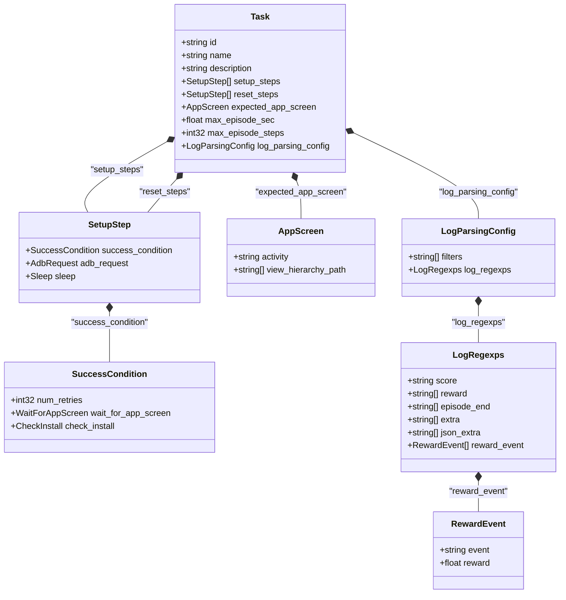
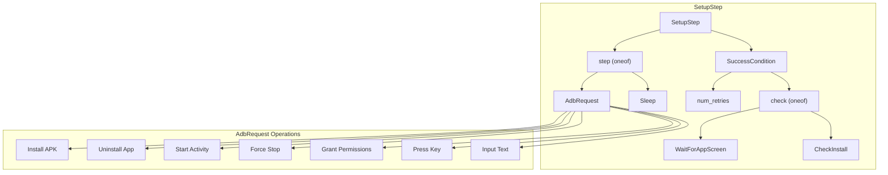
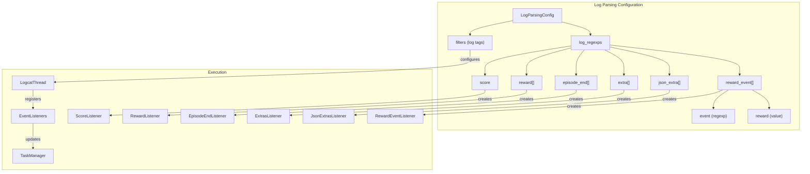
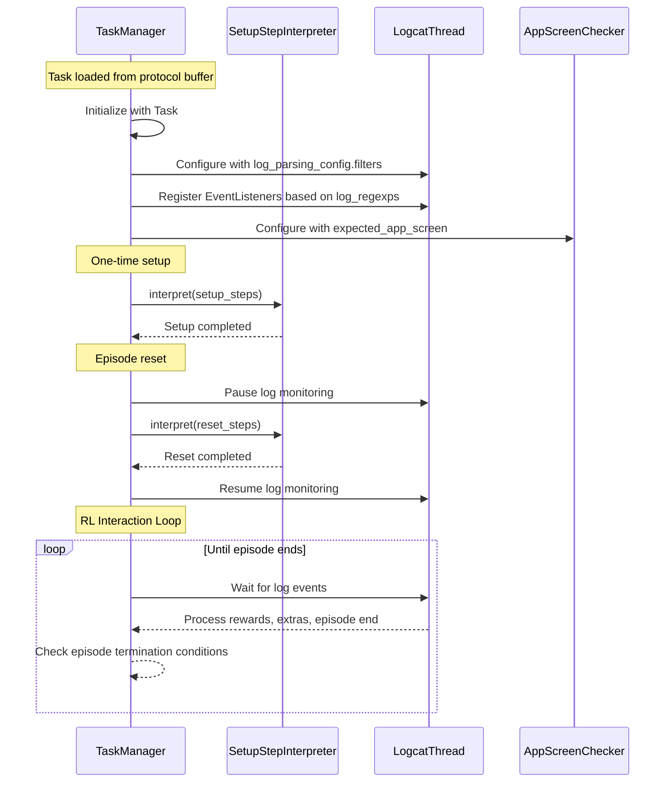

<!-- source: DeepWiki mcp.deepwiki.com · repo google-deepmind/android_env · page 4.1 Task Definition · fetched 2026-10-26 -->

# Task Definition

<details>
<summary>Relevant source files</summary>

The following files were used as context for generating this wiki page:

- [.github/workflows/tests.yml](.github/workflows/tests.yml)
- [android_env/components/coordinator.py](android_env/components/coordinator.py)
- [android_env/components/task_manager.py](android_env/components/task_manager.py)
- [android_env/wrappers/float_pixels_wrapper.py](android_env/wrappers/float_pixels_wrapper.py)
- [android_env/wrappers/last_action_wrapper.py](android_env/wrappers/last_action_wrapper.py)
- [pyproject.toml](pyproject.toml)
- [setup.py](setup.py)

</details>


This page explains how tasks are defined in the AndroidEnv framework using protocol buffers. Task definitions specify the instructions for setting up and resetting the Android environment, extracting rewards from app logs, defining episode termination conditions, and other critical components needed for reinforcement learning tasks on Android devices.

For information about how tasks are executed, see [Task Manager](#3.2).

## Task Structure Overview

In AndroidEnv, tasks are defined using Protocol Buffer messages, primarily through the `Task` message in the `task.proto` file. A complete task definition includes several key components that work together to create a well-specified reinforcement learning environment.



Sources: [android_env/proto/task.proto:15-211]()

## Core Task Properties

Each task in AndroidEnv has the following core properties:

| Property | Type | Description |
|----------|------|-------------|
| `id` | string | A globally unique identifier for the task |
| `name` | string | A human-readable name for the task |
| `description` | string | A description of what the task involves |
| `setup_steps` | SetupStep[] | Sequence of steps to perform one-time setup |
| `reset_steps` | SetupStep[] | Sequence of steps to reset the task between episodes |
| `expected_app_screen` | AppScreen | Definition of the expected screen state |
| `max_episode_sec` | float | Maximum episode duration in seconds (if ≤ 0, disabled) |
| `max_episode_steps` | int32 | Maximum number of steps per episode (if ≤ 0, disabled) |
| `log_parsing_config` | LogParsingConfig | Configuration for extracting information from logs |

Sources: [android_env/proto/task.proto:160-211]()

## Setup and Reset Steps

Tasks include two types of setup procedures:

1. **Setup Steps**: One-time initialization procedures performed when the environment first starts
2. **Reset Steps**: Procedures performed at the beginning of each episode

Each step can perform Android operations via ADB commands or timing operations:



Sources: [android_env/proto/task.proto:42-75](), [android_env/components/task_manager.py:96-121]()

### Success Conditions

Each setup step includes a success condition that verifies the step completed correctly:

1. **WaitForAppScreen**: Waits for a specific app screen to appear (activity and view hierarchy)
2. **CheckInstall**: Verifies an app is properly installed

The system will retry the step up to `num_retries` times if the success condition is not met.

Sources: [android_env/proto/task.proto:59-66](), [android_env/components/app_screen_checker.py:241-269]()

## App Screen Definition

The `AppScreen` message is a key component that defines how to verify the current state of the Android app by specifying:

1. The fully-qualified activity name (e.g., `"com.example.game/.GameActivity"`)
2. A sequence of regular expressions that match the view hierarchy structure

```
message AppScreen {
  // Fully-qualified name of the activity.
  string activity = 1;

  // A list of regexes to match at each level of the current view hierarchy.
  repeated string view_hierarchy_path = 2;
}
```

The `AppScreenChecker` component uses this definition to verify the device is in the expected state by:
1. Checking if the specified activity is running
2. Verifying the view hierarchy matches the expected structure using regular expressions

Sources: [android_env/proto/task.proto:23-40](), [android_env/components/app_screen_checker.py:176-239]()

## Log Parsing Configuration

The log parsing configuration is a critical part of task definitions, as it specifies how to extract rewards, scores, episode termination signals, and additional information from Android logs.



Sources: [android_env/proto/task.proto:112-158](), [android_env/components/task_manager.py:224-385](), [android_env/components/logcat_thread.py:35-132]()

### Log Filters

Log filters specify which log tags should be monitored in the Android logs:

```
repeated string filters = 1;
```

For example, a filter might be set to `"ActivityManager"` to monitor logs from the Android Activity Manager. The `LogcatThread` uses these filters to focus only on relevant log messages.

Sources: [android_env/proto/task.proto:117](), [android_env/components/logcat_thread.py:38-47]()

### Log Regular Expressions

Regular expressions define patterns to match in the log messages for extracting different types of information:

| Regexp Type | Description | Example Pattern |
|-------------|-------------|----------------|
| score | Score value that accumulates over time, with changes used as rewards | `"^score: ([-+]?[0-9]*\\.?[0-9]*)$"` |
| reward | Direct reward values from log messages | `"^[Rr]eward: ([-+]?[0-9]*\\.?[0-9]*)$"` |
| episode_end | Signals that an episode has ended | `"^game_over"`, `"^level_completed"` |
| extra | Additional information (extras) from logs | `"^extra: (?P<name>[^ ]*)[ ]?(?P<extra>.*)$"` |
| json_extra | Extras formatted as JSON | `"^json_extra: (?P<json_extra>.*)$"` |
| reward_event | Maps specific log events to reward values | `{event: "coin_collected", reward: 1.0}` |

Sources: [android_env/proto/task.proto:121-154](), [android_env/components/task_manager.py:267-368]()

### Reward Mechanisms

The task definition supports three mechanisms for generating rewards:

1. **Direct Reward**: Extracts a reward value directly from a log message
   ```python
   def _reward_handler(event, match):
     reward = float(match.group(1))
     with self._lock:
       self._latest_values['reward'] += reward
   ```

2. **Score-Based Reward**: Tracks a score value and generates rewards based on score changes
   ```python
   def _score_handler(event, match):
     current_score = float(match.group(1))
     with self._lock:
       current_reward = current_score - self._latest_values['score']
       self._latest_values['score'] = current_score
       self._latest_values['reward'] += current_reward
   ```

3. **Reward Events**: Maps specific log messages to predefined reward values
   ```python
   def get_reward_event_handler(reward):
     def _reward_event_handler(event, match):
       with self._lock:
         self._latest_values['reward'] += reward
     return _reward_event_handler
   ```

Sources: [android_env/components/task_manager.py:275-308]()

### Extras

Extras provide additional information from the app to the RL agent. This might include game state, positions of objects, or other information that's difficult to extract from raw pixels alone.

The task can define extras using two methods:
1. Named extras with specific values
2. JSON-formatted extras with multiple key-value pairs

Extras are processed and added to the observation dictionary:

```python
def _process_extra(extra_name, extra):
  extra = np.array(extra)
  with self._lock:
    latest_extras = self._latest_values['extra']
    if extra_name in latest_extras:
      # If latest extra is not flushed, append.
      if len(latest_extras[extra_name]) >= self._config.extras_max_buffer_size:
        latest_extras[extra_name].pop(0)
      latest_extras[extra_name].append(extra)
    else:
      latest_extras[extra_name] = [extra]
    self._latest_values['extra'] = latest_extras
```

Sources: [android_env/components/task_manager.py:325-384]()

## Episode Termination Conditions

A task definition includes several ways to determine when an episode should end:

1. **Explicit episode end signal**: Detected through log messages matching `episode_end` regexps
2. **Maximum duration**: Specified by `max_episode_sec` or `max_episode_steps`
3. **User exited the task**: Detected by the `DumpsysThread` when the app is no longer in the foreground

The `TaskManager._determine_transition_fn()` method evaluates these conditions and determines whether to return a transition, termination, or truncation timestep:

```python
def _determine_transition_fn(self) -> Callable[..., dm_env.TimeStep]:
  # Check if user exited the task
  if self._dumpsys_thread.check_user_exited():
    # ...
    return dm_env.truncation
  
  # Check if episode has ended
  if self._latest_values['episode_end']:
    # ...
    return dm_env.termination
  
  # Check if step limit or time limit has been reached
  if self._task.max_episode_steps > 0:
    if self._stats['episode_steps'] > self._task.max_episode_steps:
      # ...
      return dm_env.truncation
  
  if self._task.max_episode_sec > 0.0:
    task_duration = datetime.datetime.now() - self._task_start_time
    max_episode_sec = self._task.max_episode_sec
    if task_duration > datetime.timedelta(seconds=int(max_episode_sec)):
      # ...
      return dm_env.truncation
  
  return dm_env.transition
```

Sources: [android_env/components/task_manager.py:183-217]()

## Task Processing Flow

The following diagram illustrates how a task definition is processed within the AndroidEnv system:



Sources: [android_env/components/task_manager.py:95-167]()

## Example Task Definition

Here's a simplified example of a task definition for an imaginary game:

```protobuf
id: "com.example.game.level1"
name: "Example Game Level 1"
description: "Complete level 1 of the example game"

setup_steps {
  success_condition {
    wait_for_app_screen {
      app_screen {
        activity: "com.example.game/.MainActivity"
        view_hierarchy_path: ["^DecorView@.*\\[MainActivity\\]$"]
      }
      timeout_sec: 10.0
    }
  }
  adb_request {
    install {
      apk_path: "/path/to/game.apk"
    }
  }
}

reset_steps {
  success_condition {
    wait_for_app_screen {
      app_screen {
        activity: "com.example.game/.GameActivity"
        view_hierarchy_path: ["^DecorView@.*\\[GameActivity\\]$"]
      }
      timeout_sec: 5.0
    }
  }
  adb_request {
    start_activity {
      full_activity: "com.example.game/.GameActivity"
      extra_args: "--ez reset true"
    }
  }
}

expected_app_screen {
  activity: "com.example.game/.GameActivity"
  view_hierarchy_path: [
    "^DecorView@.*\\[GameActivity\\]$",
    "^android.widget.FrameLayout\\{.*\\}$"
  ]
}

max_episode_steps: 1000
max_episode_sec: 300.0

log_parsing_config {
  filters: ["ExampleGame"]
  log_regexps {
    score: "^score: ([-+]?[0-9]*\\.?[0-9]*)$"
    reward: ["^reward: ([-+]?[0-9]*\\.?[0-9]*)$"]
    episode_end: ["^game_over", "^level_completed"]
    extra: ["^extra: (?P<name>[^ ]*)[ ]?(?P<extra>.*)$"]
    reward_event {
      event: "coin_collected"
      reward: 1.0
    }
    reward_event {
      event: "enemy_defeated"
      reward: 5.0
    }
    reward_event {
      event: "damage_taken"
      reward: -2.0
    }
  }
}
```

This example shows how to define a complete task with:
- One-time setup (install APK)
- Episode reset (start activity with reset flag)
- Expected app screen verification
- Episode limits (1000 steps or 300 seconds)
- Log parsing for score, rewards, episode end, extras
- Event-based rewards for game events

Sources: [android_env/proto/task.proto:15-211]()

## Integration with the TaskManager

The `TaskManager` class loads the Task definition and uses it to:

1. Configure the `LogcatThread` to monitor appropriate logs
2. Set up event listeners based on log regular expressions
3. Configure the `AppScreenChecker` with the expected app screen
4. Execute setup and reset steps through the `SetupStepInterpreter`
5. Process rewards, extras, and episode termination signals

```python
# TaskManager initialization with a Task
task_manager = TaskManager(
    task=task_pb2.Task(),  # Task definition
    config=config_classes.TaskManagerConfig()  # Configuration
)

# Start task processing
task_manager.start(adb_call_parser_factory, log_stream)

# One-time setup
task_manager.setup_task()

# Reset for a new episode
task_manager.reset_task()

# Process RL steps
timestep = task_manager.rl_step(observation={'pixels': screenshot})
```

Sources: [android_env/components/task_manager.py:40-167]()

---

