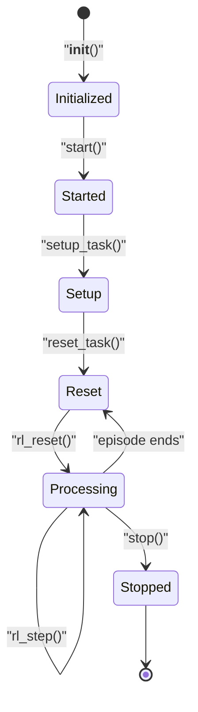
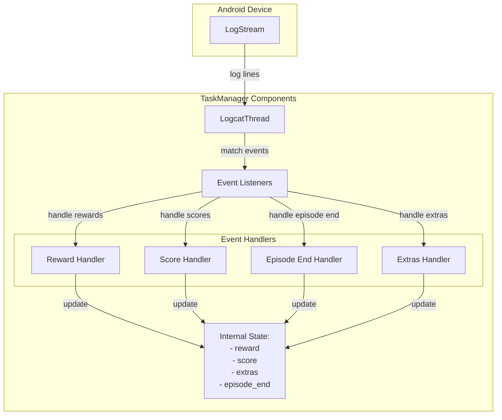
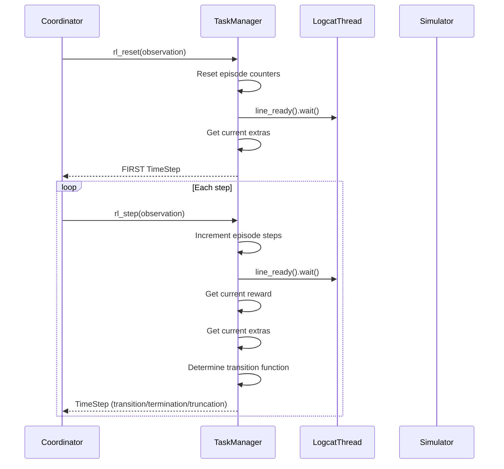
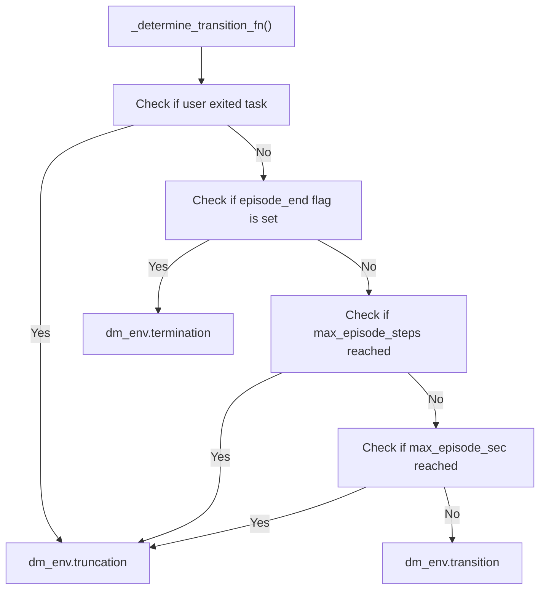

<!-- source: DeepWiki mcp.deepwiki.com · repo google-deepmind/android_env · page 4.2 Task Manager · fetched 2026-10-26 -->

# Task Manager

<details>
<summary>Relevant source files</summary>

The following files were used as context for generating this wiki page:

- [android_env/components/coordinator.py](android_env/components/coordinator.py)
- [android_env/components/task_manager.py](android_env/components/task_manager.py)
- [android_env/wrappers/float_pixels_wrapper.py](android_env/wrappers/float_pixels_wrapper.py)
- [android_env/wrappers/last_action_wrapper.py](android_env/wrappers/last_action_wrapper.py)

</details>


## Purpose and Scope

The Task Manager is a core component of AndroidEnv that handles all events and information related to reinforcement learning tasks. It processes Android device logs to detect rewards, scores, extras, and episode termination conditions. The Task Manager also executes task setup and reset steps, and determines appropriate transition functions during episodes.

This page covers the Task Manager's architecture, event processing, reward handling, and lifecycle management. For information about task definition, see [Task Definition](#3.1). For app screen verification, see [App Screen Checking](#3.3).

## Component Overview

The Task Manager sits between the Coordinator and the Android device, primarily handling task execution and monitoring task-related events through log processing.

```mermaid
flowchart TD
    subgraph "AndroidEnv Framework"
        Coordinator["Coordinator"]
        TaskManager["TaskManager"]
        LogcatThread["LogcatThread"]
        DumpsysThread["DumpsysThread"]
        SetupStepInterpreter["SetupStepInterpreter"]
        AppScreenChecker["AppScreenChecker"]
    end
    
    subgraph "Android Device"
        LogStream["LogStream"]
        AdbCallParser["AdbCallParser"]
    end
    
    Coordinator -- "rl_reset()/rl_step()" --> TaskManager
    
    TaskManager -- "interpret(setup_steps)" --> SetupStepInterpreter
    TaskManager -- "interpret(reset_steps)" --> SetupStepInterpreter
    TaskManager -- "monitors logs" --> LogcatThread
    TaskManager -- "checks app state" --> DumpsysThread
    
    LogcatThread -- "reads logs" --> LogStream
    DumpsysThread -- "checks screen" --> AppScreenChecker
    AppScreenChecker -- "verifies app state" --> AdbCallParser
    SetupStepInterpreter -- "issues commands" --> AdbCallParser

    TaskManager -. "returns TimeStep" .-> Coordinator
```



Sources: [android_env/components/task_manager.py:40-386]()

## Task Manager Lifecycle

The Task Manager has a defined lifecycle from initialization to stopping:



Sources: [android_env/components/task_manager.py:43-102](), [android_env/components/task_manager.py:116-136]()

### Initialization

The Task Manager is initialized with a task protobuf and optional configuration:

```python
def __init__(self, task: task_pb2.Task, config: config_classes.TaskManagerConfig | None = None)
```

Key configuration parameters include:
- `max_bad_states`: Maximum consecutive bad states before restarting
- `dumpsys_check_frequency`: How often to check device state
- `max_failed_current_activity`: Max failures for activity checks
- `extras_max_buffer_size`: Maximum size for extras buffers

Sources: [android_env/components/task_manager.py:43-85]()

### Starting and Stopping

Once initialized, the Task Manager can be started, which sets up its dependent components:

1. Starts the logcat thread to monitor device logs
2. Starts the dumpsys thread to check app screen status
3. Creates a setup step interpreter to handle task steps

The Task Manager can be stopped, which suspends all task processing.

Sources: [android_env/components/task_manager.py:105-115](), [android_env/components/task_manager.py:101-104]()

## Event Processing Architecture

The Task Manager uses a listener-based architecture to process events from Android logs.



Sources: [android_env/components/task_manager.py:224-385](), [android_env/components/logcat_thread.py:35-132]()

### Event Listeners

The TaskManager registers multiple event listeners with LogcatThread, each handling a different type of event:

1. **Reward Listeners**: Process direct reward values from logs
2. **RewardEvent Listeners**: Map predefined events to reward values 
3. **Score Listeners**: Track game scores, with rewards being the difference
4. **Episode End Listeners**: Detect when an episode should terminate
5. **Extras Listeners**: Parse additional information from logs
6. **JSON Extras Listeners**: Parse JSON-formatted extras

Each listener uses a regular expression to match log lines and a handler function to process the matched data.

Sources: [android_env/components/task_manager.py:267-385](), [android_env/components/logcat_thread.py:27-33]()

## Task Processing

The TaskManager processes tasks in three main phases:

### Setup Phase

The `setup_task()` method performs one-time task setup by executing the setup steps defined in the task protobuf. These steps are processed by the SetupStepInterpreter.

Sources: [android_env/components/task_manager.py:97-99]()

### Reset Phase

The `reset_task()` method prepares the task for a new episode by:
1. Pausing the logcat thread to avoid processing logs during reset
2. Executing reset steps defined in the task protobuf
3. Resuming the logcat thread
4. Resetting internal state variables

Sources: [android_env/components/task_manager.py:116-136]()

### Step Processing

The core of task processing happens in `rl_reset()` and `rl_step()` methods:



Sources: [android_env/components/task_manager.py:137-217]()

## Reward and Extras Handling

### Reward Processing

The TaskManager accumulates rewards from multiple sources:

1. **Direct rewards**: Extracted from log lines matching reward regular expressions
2. **Reward events**: Predefined events that map to specific reward values
3. **Score changes**: Rewards calculated as the difference between consecutive scores

All reward values are accumulated in the `_latest_values['reward']` field between steps and returned during `rl_step()`.

Sources: [android_env/components/task_manager.py:169-173](), [android_env/components/task_manager.py:274-299](), [android_env/components/task_manager.py:300-311]()

### Extras Processing

Extras provide additional information from the task to the agent. The TaskManager supports:

1. **Named extras**: Key-value pairs extracted from logs
2. **JSON extras**: Complex data structures parsed from JSON in logs
3. **Boolean extras**: Simple flags without values

Extras are accumulated in the `_latest_values['extra']` dictionary and returned as NumPy arrays during `rl_step()`.

Sources: [android_env/components/task_manager.py:175-181](), [android_env/components/task_manager.py:324-384]()

## Episode Transitions

The TaskManager determines the appropriate transition function for each step based on several conditions:



Sources: [android_env/components/task_manager.py:183-217]()

### Episode Termination Conditions

1. **User exited task**: Detected by the DumpsysThread checking if the user has left the app
2. **Episode end flag**: Set by event listeners when a log line matches an episode end pattern
3. **Step limit reached**: When the episode exceeds the `max_episode_steps` from the task configuration
4. **Time limit reached**: When the episode exceeds the `max_episode_sec` from the task configuration

Sources: [android_env/components/task_manager.py:183-217]()

## Bad State Detection

The TaskManager implements a mechanism to detect and handle bad states:

1. A bad state counter is incremented when errors like user exits are detected
2. If the counter exceeds `max_bad_states`, the simulator is restarted
3. The counter is reset when a successful episode is completed

This mechanism helps recover from error states that might otherwise cause the environment to get stuck.

Sources: [android_env/components/task_manager.py:247-265]()

## Integration with App Screen Checking

The TaskManager integrates with the AppScreenChecker through the DumpsysThread to verify that the correct app screen is displayed. This enables detection of:

1. Whether the task activity is still running
2. If the current view hierarchy matches the expected one

When the app screen does not match expectations, the TaskManager can increment the bad state counter and potentially truncate episodes.

Sources: [android_env/components/task_manager.py:186-192](), [android_env/components/app_screen_checker.py:176-269]()

## Statistics and Diagnostics

The TaskManager maintains statistics for diagnostics and monitoring:

```python
self._stats = {
    'episode_steps': 0,
    'reset_count_step_timeout': 0,
    'reset_count_user_exited': 0,
    'reset_count_episode_end': 0,
    'reset_count_max_duration_reached': 0,
    'restart_count_max_bad_states': 0,
    'task_updates': 0,
}
```

These statistics can be accessed via the `stats()` method, which combines TaskManager stats with those from the SetupStepInterpreter.

Sources: [android_env/components/task_manager.py:62-71](), [android_env/components/task_manager.py:87-95]()

## Summary

The TaskManager is a central component in AndroidEnv that manages the execution of tasks, processes rewards and observations, and determines appropriate episode transitions. It uses a combination of log monitoring, app state checking, and task-defined steps to create a reinforcement learning environment from Android applications.

---

