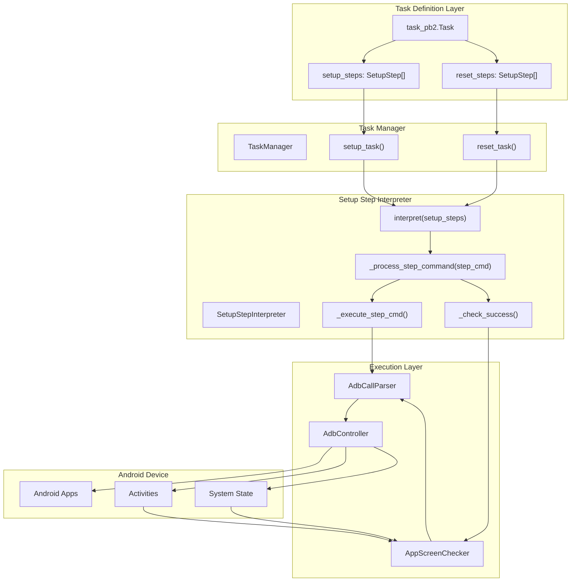
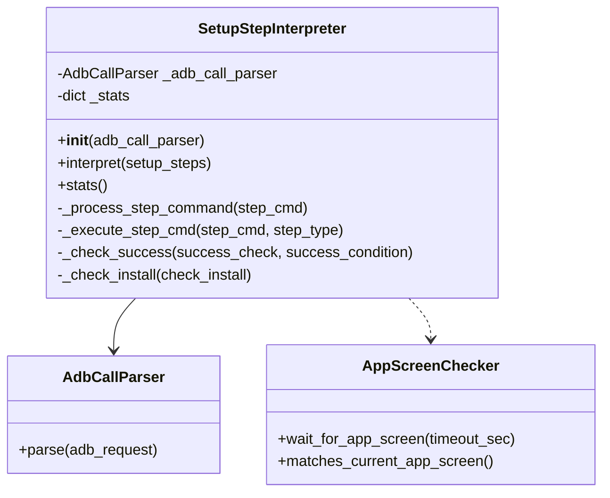
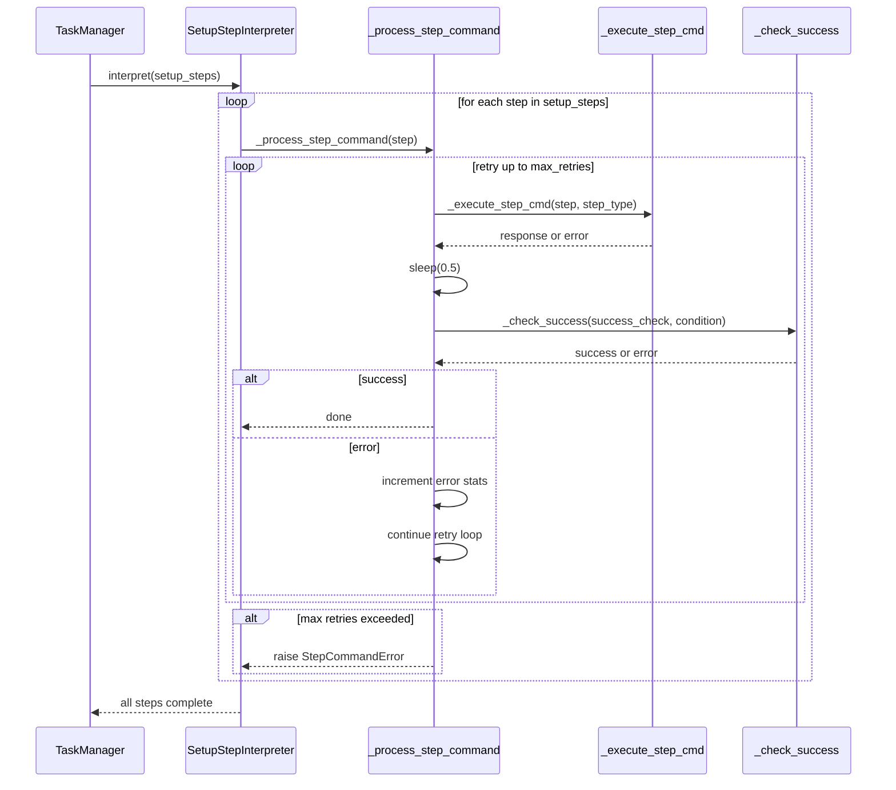
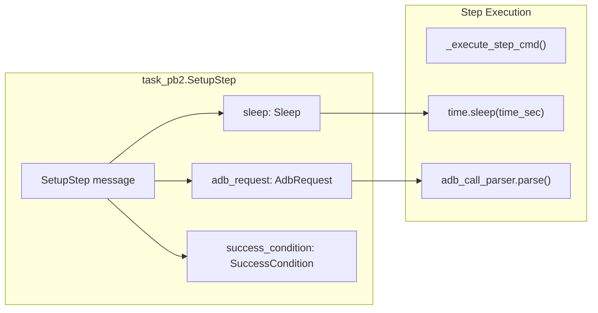
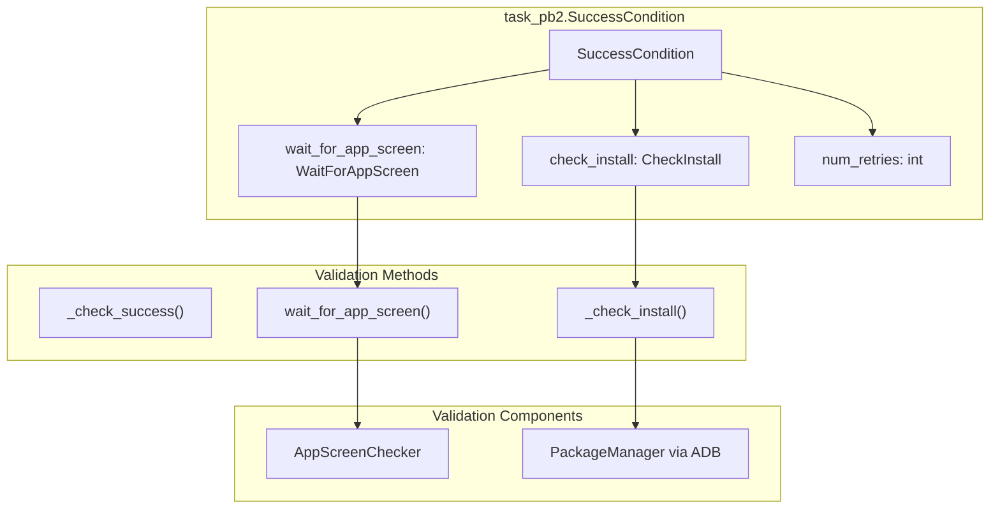
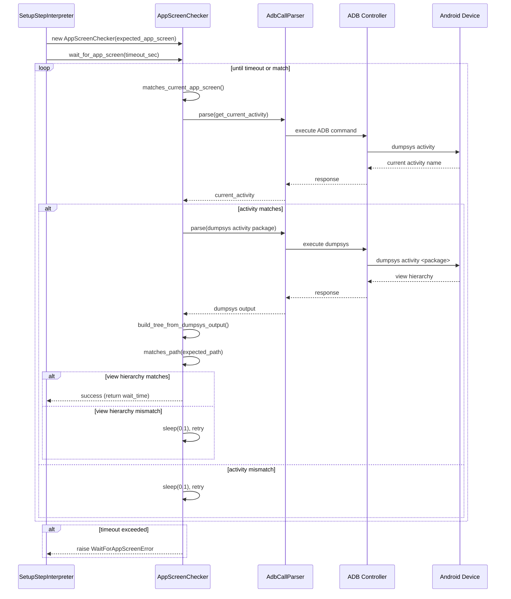
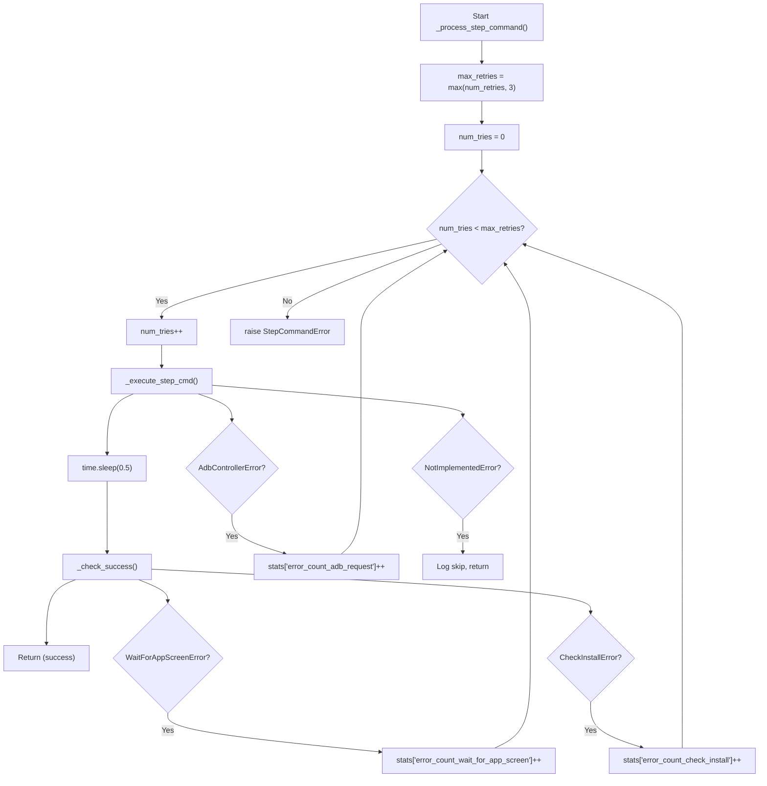
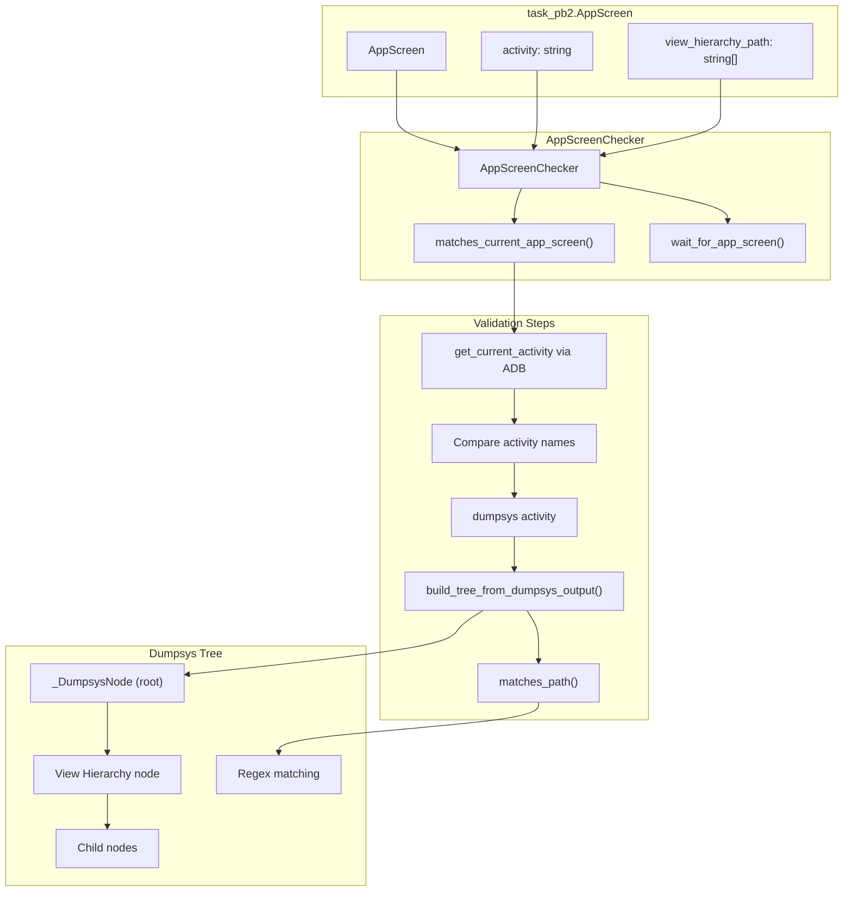
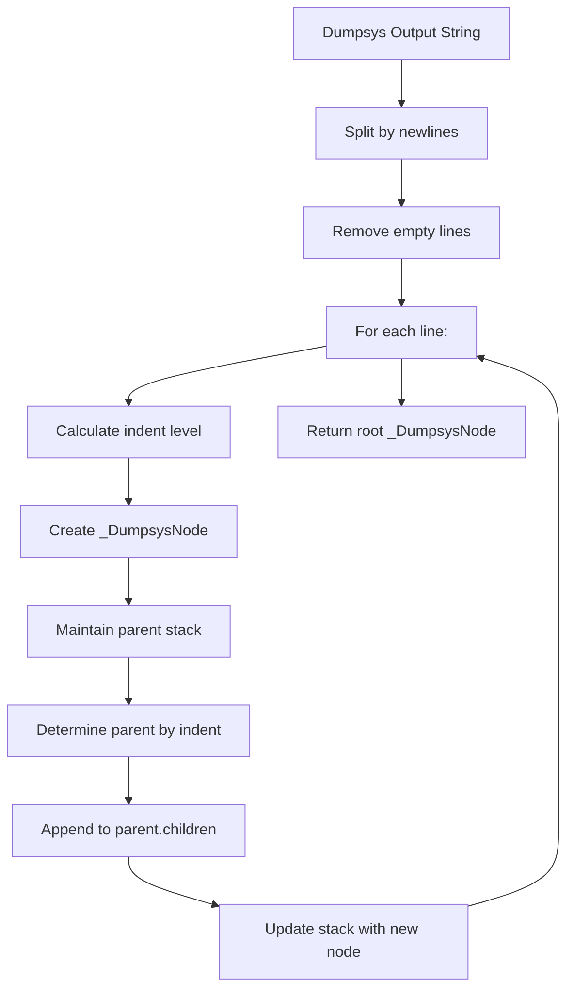
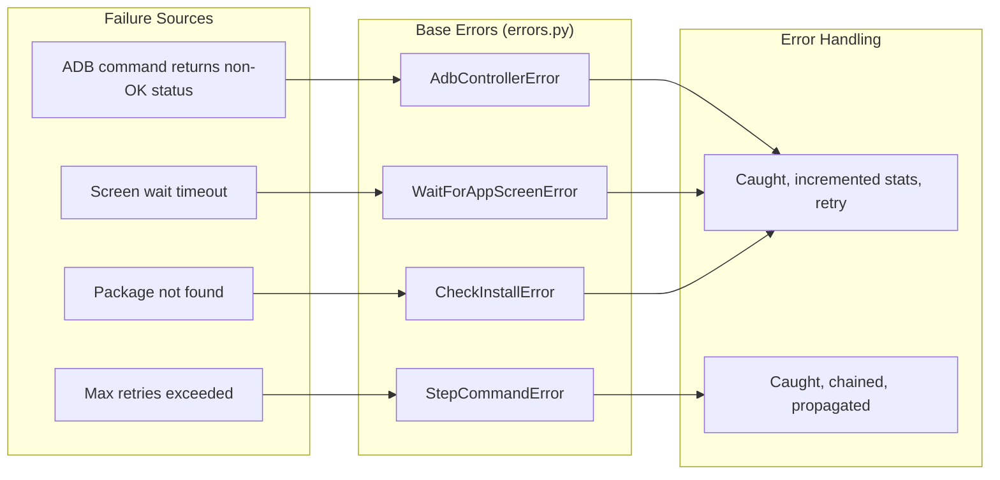

<!-- source: DeepWiki mcp.deepwiki.com · repo google-deepmind/android_env · page 4.3 Setup Step Interpreter · fetched 2026-10-26 -->

# Setup Step Interpreter

<details>
<summary>Relevant source files</summary>

The following files were used as context for generating this wiki page:

- [android_env/components/app_screen_checker.py](android_env/components/app_screen_checker.py)
- [android_env/components/logcat_thread.py](android_env/components/logcat_thread.py)
- [android_env/components/logcat_thread_test.py](android_env/components/logcat_thread_test.py)
- [android_env/components/setup_step_interpreter.py](android_env/components/setup_step_interpreter.py)

</details>


## Purpose and Scope

The `SetupStepInterpreter` is responsible for executing sequences of setup and reset steps defined in task specifications. These steps prepare the Android environment for task execution by installing applications, starting activities, waiting for specific screens to appear, and verifying installation states. The interpreter provides robust retry logic and success condition validation to ensure reliable task initialization.

For information about how tasks are defined and what setup steps they contain, see [Task Definition](#4.1). For information about how the TaskManager uses the interpreter during episode resets, see [Task Manager](#4.2).

**Sources**: [android_env/components/setup_step_interpreter.py:1-183]()

## Overview

The `SetupStepInterpreter` operates within the task management layer, executing predefined setup sequences during task initialization and episode resets. It translates high-level setup instructions from task protobuf definitions into concrete ADB operations, with built-in validation and error recovery.



**Sources**: [android_env/components/setup_step_interpreter.py:31-58](), [android_env/components/task_manager.py]()

## SetupStepInterpreter Class

The `SetupStepInterpreter` class is initialized with an `AdbCallParser` and maintains statistics about execution errors and timing.

### Initialization



The constructor initializes tracking statistics for different error types:

| Statistic Key | Description |
|---------------|-------------|
| `error_count_adb_request` | Number of failed ADB requests |
| `error_count_wait_for_app_screen` | Number of screen wait timeouts |
| `error_count_check_install` | Number of failed installation checks |
| `total_time_waiting_for_app_screen` | Cumulative time spent waiting for screens |

**Sources**: [android_env/components/setup_step_interpreter.py:31-50]()

### Main Interpretation Flow

The `interpret()` method is the primary entry point, iterating through a sequence of setup steps:



**Sources**: [android_env/components/setup_step_interpreter.py:52-111]()

## Step Types

The interpreter supports multiple step types, each serving a different initialization purpose. Step types are determined using protobuf's `WhichOneof` mechanism.

### Supported Step Types



| Step Type | Protobuf Field | Purpose | Implementation |
|-----------|---------------|---------|----------------|
| `sleep` | `step_cmd.sleep.time_sec` | Pause execution for a specified duration | `time.sleep(step_cmd.sleep.time_sec)` |
| `adb_request` | `step_cmd.adb_request` | Execute an ADB command | `_adb_call_parser.parse(step_cmd.adb_request)` |
| None | - | Success condition only | No execution, only validation |

**Sources**: [android_env/components/setup_step_interpreter.py:113-134]()

### Step Execution Details

The `_execute_step_cmd()` method uses Python's `match` statement for type dispatching:

- **Sleep Steps**: Direct invocation of `time.sleep()` for simple delays between operations
- **ADB Request Steps**: Delegates to `AdbCallParser.parse()`, which validates the request and executes the corresponding ADB command. If the response status is not `OK`, raises `AdbControllerError`
- **None**: Returns immediately when only success conditions need checking without prior execution

**Sources**: [android_env/components/setup_step_interpreter.py:113-134]()

## Success Conditions

Success conditions validate that a step completed successfully. They are optional but enable robust verification of system state changes.

### Success Condition Types



| Success Check | Purpose | Parameters | Validation Method |
|---------------|---------|------------|-------------------|
| `wait_for_app_screen` | Verify specific activity and view hierarchy are visible | `app_screen`, `timeout_sec` | Creates `AppScreenChecker`, polls until match or timeout |
| `check_install` | Verify package is installed on device | `package_name`, `timeout_sec` | Queries package manager via ADB until found or timeout |
| None | No validation | - | Returns immediately |

**Sources**: [android_env/components/setup_step_interpreter.py:136-182]()

### Wait for App Screen

The `wait_for_app_screen` success condition instantiates an `AppScreenChecker` and delegates screen validation:



**Sources**: [android_env/components/setup_step_interpreter.py:146-155](), [android_env/components/app_screen_checker.py:241-269]()

### Check Install

The `check_install` success condition polls the package manager until the specified package appears:

The implementation queries `adb shell pm list packages` repeatedly until the target package is found in the response, or the timeout is exceeded.

**Sources**: [android_env/components/setup_step_interpreter.py:161-182]()

## Retry Logic

Each setup step executes within a retry loop that handles transient failures and provides resilient initialization.

### Retry Mechanism



### Retry Configuration

- **Minimum Retries**: Each step gets at least 3 retry attempts
- **Configurable Retries**: The `success_condition.num_retries` field can specify higher values
- **Inter-Retry Delay**: A fixed 0.5-second sleep occurs after each step execution before success validation
- **Error Tracking**: Each retry increments type-specific error counters in the statistics dictionary

**Sources**: [android_env/components/setup_step_interpreter.py:74-111]()

### Error Types and Handling

| Error Type | Source | Retry Behavior | Stat Incremented |
|------------|--------|----------------|------------------|
| `AdbControllerError` | Failed ADB command execution | Continue retrying | `error_count_adb_request` |
| `WaitForAppScreenError` | Screen wait timeout | Continue retrying | `error_count_wait_for_app_screen` |
| `CheckInstallError` | Package not found | Continue retrying | `error_count_check_install` |
| `NotImplementedError` | Unknown step type | Skip step immediately, log warning | None |
| `StepCommandError` | Max retries exceeded | Propagate to caller, halt setup | None |

**Sources**: [android_env/components/setup_step_interpreter.py:87-111]()

## AppScreenChecker Integration

The `AppScreenChecker` provides sophisticated validation of the current app screen by comparing both the active activity name and the view hierarchy structure.

### AppScreenChecker Architecture



**Sources**: [android_env/components/app_screen_checker.py:176-239]()

### Activity Validation

The checker first validates that the current foreground activity matches the expected activity:

1. **Query Current Activity**: Issues `adb_request.get_current_activity` to retrieve the full activity name (e.g., `com.example.app/.MainActivity`)
2. **Compare Names**: Performs string equality check between current and expected activities
3. **Early Exit**: Returns `UNEXPECTED_ACTIVITY` outcome if mismatch, skipping view hierarchy checks

**Sources**: [android_env/components/app_screen_checker.py:207-218]()

### View Hierarchy Validation

If the activity matches and a view hierarchy path is specified, the checker validates the UI structure:

#### Dumpsys Tree Construction

The `build_tree_from_dumpsys_output()` function parses the indentation-based dumpsys output into a tree structure:



**Sources**: [android_env/components/app_screen_checker.py:85-126]()

#### Path Matching

The `matches_path()` function traverses the tree, matching each level against the corresponding regex in `expected_view_hierarchy_path`:

1. **Find View Hierarchy Root**: Searches for a node starting with "View Hierarchy" (up to `max_levels=3` deep)
2. **Traverse Path**: For each regex in the expected path, finds a matching child node using `find_child()` with the compiled regex predicate
3. **Return Result**: Returns `True` if all regexes match in sequence, `False` otherwise

**Sources**: [android_env/components/app_screen_checker.py:129-173]()

### Outcome Enumeration

The `AppScreenChecker.Outcome` enum provides detailed failure reasons:

| Outcome | Value | Meaning |
|---------|-------|---------|
| `SUCCESS` | 0 | Current screen matches expected screen |
| `EMPTY_EXPECTED_ACTIVITY` | 1 | No activity specified in AppScreen |
| `FAILED_ACTIVITY_EXTRACTION` | 2 | Unable to query current activity |
| `UNEXPECTED_ACTIVITY` | 3 | Activity name mismatch |
| `UNEXPECTED_VIEW_HIERARCHY` | 4 | View hierarchy path mismatch |

**Sources**: [android_env/components/app_screen_checker.py:179-190]()

## Error Handling

The `SetupStepInterpreter` defines a structured error hierarchy for different failure modes during setup execution.

### Error Type Mapping



### Error Propagation Chain

When max retries are exceeded, the interpreter chains the last caught exception:

```python
raise errors.StepCommandError(
    f'Step failed: [{step_cmd}]') from latest_error
```

This preserves the original error context while providing setup-level failure information.

**Sources**: [android_env/components/setup_step_interpreter.py:91-111](), [android_env/components/errors.py]()

## Statistics Tracking

The interpreter maintains detailed statistics accessible via the `stats()` method, which returns a deep copy of the internal `_stats` dictionary.

### Tracked Metrics

| Metric | Type | Description | When Incremented |
|--------|------|-------------|------------------|
| `error_count_adb_request` | int | ADB command failures | Each `AdbControllerError` caught during retry |
| `error_count_wait_for_app_screen` | int | Screen wait timeouts | Each `WaitForAppScreenError` caught during retry |
| `error_count_check_install` | int | Package install check failures | Each `CheckInstallError` caught during retry |
| `total_time_waiting_for_app_screen` | float | Cumulative screen wait time (seconds) | After each successful screen wait |

These statistics are useful for diagnosing task initialization issues and understanding the reliability of setup sequences.

**Sources**: [android_env/components/setup_step_interpreter.py:41-50]()

## Usage Example

A typical task definition might include setup steps like:

```
setup_steps {
  adb_request {
    install_apk {
      filesystem {
        path: "/path/to/app.apk"
      }
    }
  }
  success_condition {
    check_install {
      package_name: "com.example.app"
      timeout_sec: 30
    }
    num_retries: 5
  }
}

setup_steps {
  adb_request {
    start_activity {
      full_activity: "com.example.app/.MainActivity"
      extra_args: "--ez debug true"
    }
  }
  success_condition {
    wait_for_app_screen {
      app_screen {
        activity: "com.example.app/.MainActivity"
        view_hierarchy_path: ".*DecorView.*"
        view_hierarchy_path: ".*ContentView.*"
      }
      timeout_sec: 10
    }
    num_retries: 3
  }
}

setup_steps {
  sleep {
    time_sec: 2.0
  }
}
```

The `SetupStepInterpreter.interpret()` method would execute this sequence, retrying failed steps and validating success conditions to ensure the app is properly initialized before task execution begins.

**Sources**: [android_env/components/setup_step_interpreter.py:52-58](), [android_env/proto/task.proto]()

---

