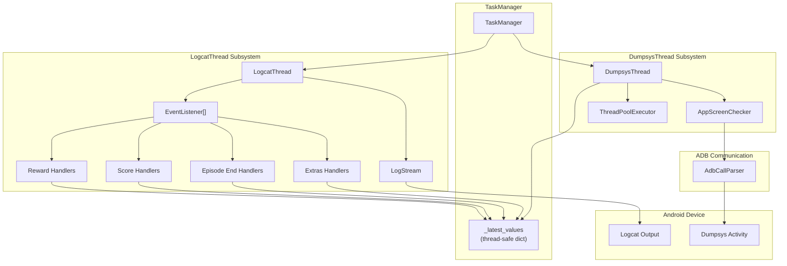
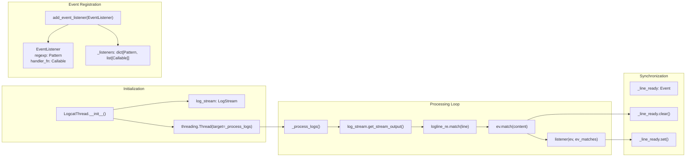
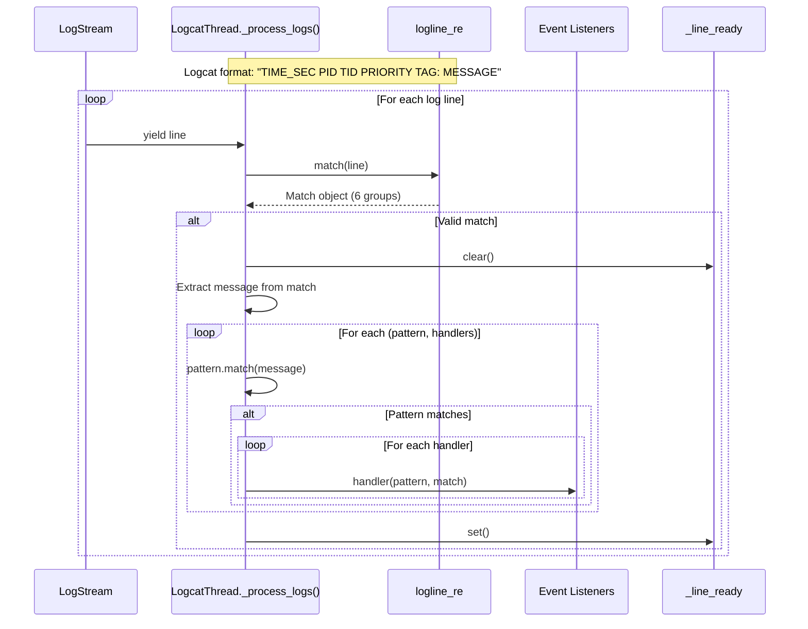
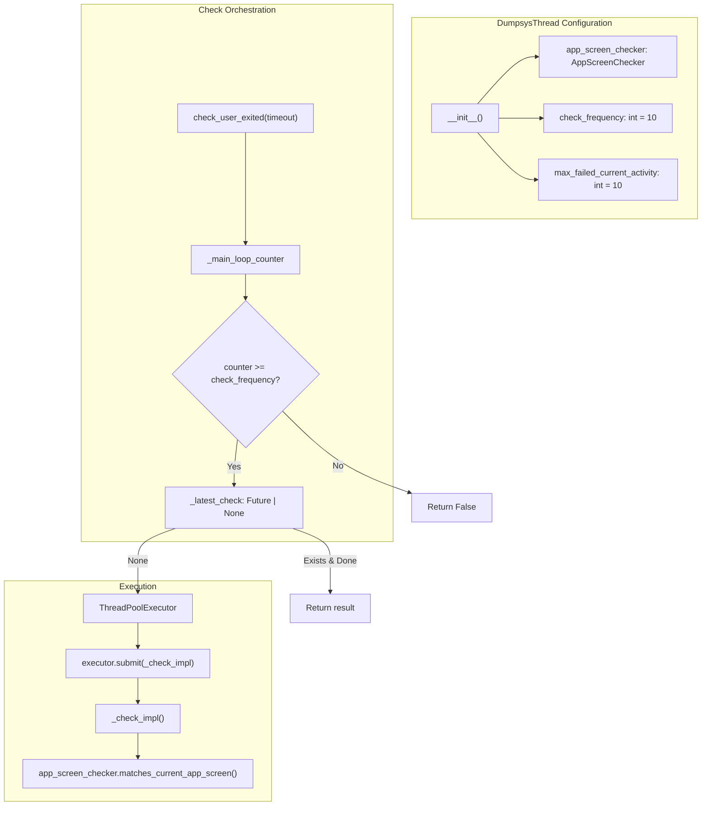
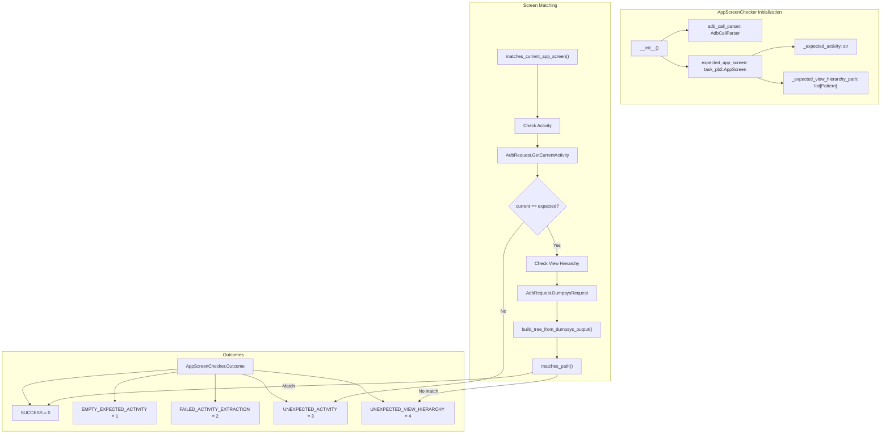
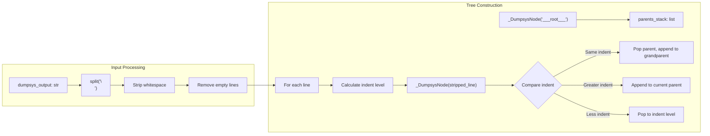
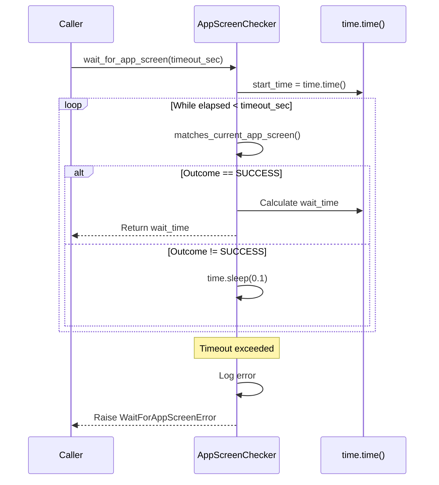
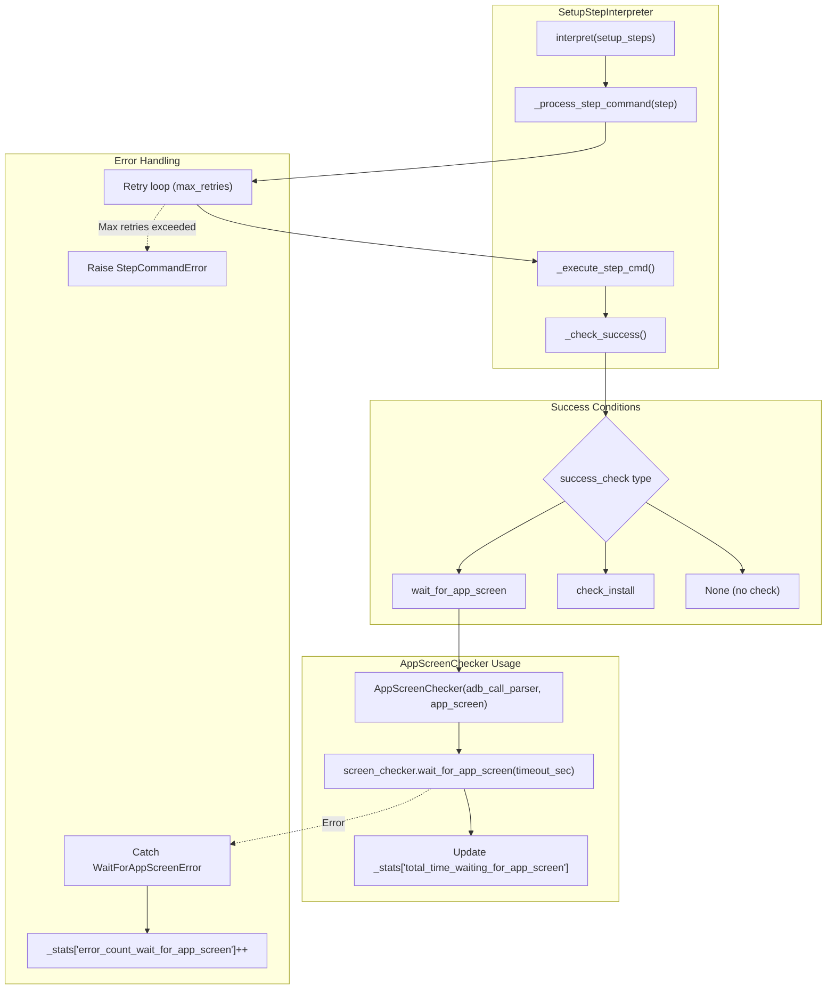
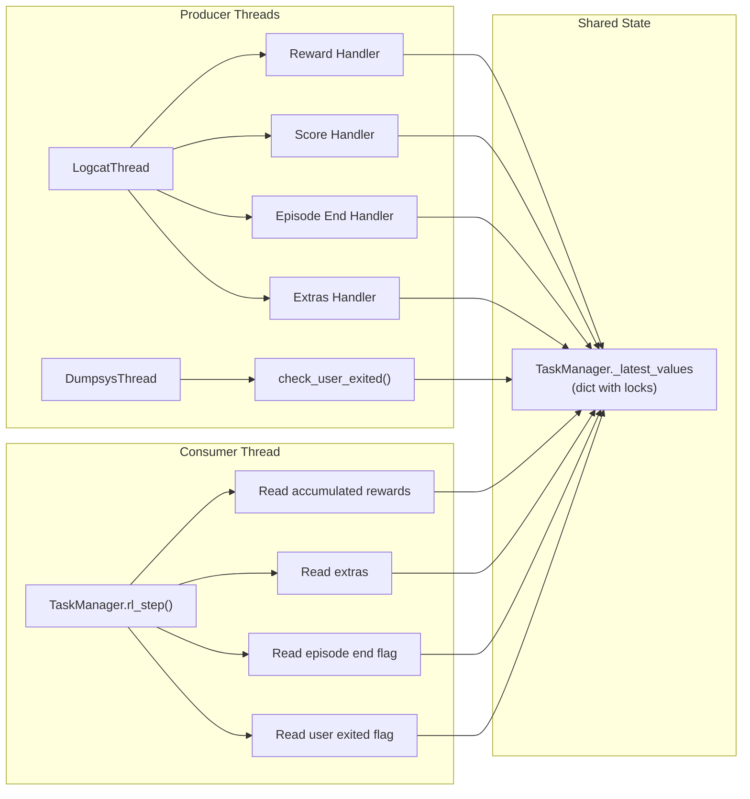

<!-- source: DeepWiki mcp.deepwiki.com · repo google-deepmind/android_env · page 4.4 Monitoring System · fetched 2026-10-26 -->

# Monitoring System

Relevant source files

The following files were used as context for generating this wiki page:

- [android_env/components/app_screen_checker.py](android_env/components/app_screen_checker.py)
- [android_env/components/dumpsys_thread.py](android_env/components/dumpsys_thread.py)
- [android_env/components/errors.py](android_env/components/errors.py)
- [android_env/components/errors_test.py](android_env/components/errors_test.py)
- [android_env/components/logcat_thread.py](android_env/components/logcat_thread.py)
- [android_env/components/logcat_thread_test.py](android_env/components/logcat_thread_test.py)
- [android_env/components/setup_step_interpreter.py](android_env/components/setup_step_interpreter.py)

## Purpose and Scope

The Monitoring System provides continuous observation of Android device state and application logs to support task management in AndroidEnv. This system operates through background threads that extract rewards, detect episode termination conditions, and verify that the user remains on the expected application screen.

This document covers:
- **LogcatThread**: Log-based event extraction and regex matching
- **DumpsysThread**: Periodic state polling for screen validation
- **AppScreenChecker**: Activity and view hierarchy verification

For information about how monitoring data is consumed, see [Task Manager](#4.2). For details on how tasks define what to monitor, see [Task Definition](#4.1).

## System Architecture

The monitoring system consists of three primary components that run concurrently with the main RL loop:

**Sources:** [android_env/components/logcat_thread.py:35-132](), [android_env/components/dumpsys_thread.py:26-126](), [android_env/components/app_screen_checker.py:176-270]()

## LogcatThread: Log-Based Monitoring

### Overview

The `LogcatThread` class continuously processes Android logcat output in a daemon thread, using regex pattern matching to extract task-relevant information such as rewards, scores, and episode termination signals.

**Sources:** [android_env/components/logcat_thread.py:35-132]()

### EventListener Pattern

The `EventListener` dataclass associates a compiled regex pattern with a handler function:

| Component | Type | Purpose |
|-----------|------|---------|
| `regexp` | `re.Pattern[str]` | Compiled regex to match against log messages |
| `handler_fn` | `Callable[[Pattern, Match], None]` | Function invoked when pattern matches |

**Sources:** [android_env/components/logcat_thread.py:27-33]()

### Log Line Parsing

The `_process_logs()` method parses each logcat line using a structured regex:

The logcat line regex extracts:
- `timestamp`: Float (seconds since epoch)
- `pid`: Process ID
- `tid`: Thread ID  
- `priority`: Single character (D, I, W, E, etc.)
- `tag`: Log tag
- `message`: Actual log content (this is what event patterns match against)

**Sources:** [android_env/components/logcat_thread.py:87-132]()

### Thread Safety

The `_line_ready` threading event ensures that TaskManager only reads accumulated values after all listeners have been notified for a given log line:

1. When a matching log line is found: `_line_ready.clear()` [android_env/components/logcat_thread.py:120]()
2. All listeners are notified [android_env/components/logcat_thread.py:125-129]()
3. Reading is allowed: `_line_ready.set()` [android_env/components/logcat_thread.py:131]()

**Sources:** [android_env/components/logcat_thread.py:50-51](), [android_env/components/logcat_thread.py:72-74](), [android_env/components/logcat_thread.py:120-131]()

### Lifecycle Management

| Method | Purpose |
|--------|---------|
| `pause()` | Stops consuming log output via `log_stream.pause_stream()` |
| `resume()` | Resumes consuming log output via `log_stream.resume_stream()` |
| `kill()` | Sets `_should_stop` event, stops stream, joins thread with 3s timeout |

**Sources:** [android_env/components/logcat_thread.py:76-85]()

## DumpsysThread: State-Based Monitoring

### Overview

The `DumpsysThread` class periodically checks whether the user has exited the expected application screen by using `AppScreenChecker`. This expensive operation runs asynchronously to avoid blocking the main RL step loop.

**Sources:** [android_env/components/dumpsys_thread.py:26-126]()

### Frequency-Based Execution

The `check_user_exited()` method uses a counter to throttle expensive checks:

1. Increment `_main_loop_counter` on each call [android_env/components/dumpsys_thread.py:74]()
2. If `counter < check_frequency`, return `False` immediately [android_env/components/dumpsys_thread.py:75-78]()
3. Reset counter to 0 [android_env/components/dumpsys_thread.py:78]()
4. Submit async check if no check is in flight [android_env/components/dumpsys_thread.py:81-84]()

**Sources:** [android_env/components/dumpsys_thread.py:60-93]()

### Outcome Interpretation

The `_check_impl()` method interprets `AppScreenChecker.Outcome` values:

| Outcome | Action | Return Value |
|---------|--------|--------------|
| `FAILED_ACTIVITY_EXTRACTION` | Increment failure counter; if exceeds max, reset and return True | True if max exceeded, else continue |
| `SUCCESS` | User is on expected screen | False |
| `EMPTY_EXPECTED_ACTIVITY` | No activity specified to check | False |
| `UNEXPECTED_ACTIVITY` | User exited the app | True |
| `UNEXPECTED_VIEW_HIERARCHY` | User navigated away from expected screen | True |

**Sources:** [android_env/components/dumpsys_thread.py:94-125]()

## AppScreenChecker: Screen Validation

### Overview

The `AppScreenChecker` class verifies that the Android device is displaying the expected activity and view hierarchy by parsing dumpsys output.

**Sources:** [android_env/components/app_screen_checker.py:176-240]()

### Dumpsys Tree Parsing

The `build_tree_from_dumpsys_output()` function constructs a tree from indentation-based dumpsys output:

The tree structure enables hierarchical traversal via `find_child(predicate, max_levels)` which recursively searches for nodes matching a predicate function.

**Sources:** [android_env/components/app_screen_checker.py:31-83](), [android_env/components/app_screen_checker.py:85-126]()

### View Hierarchy Matching

The `matches_path()` function validates that the dumpsys tree contains a path matching all expected regex patterns:

1. Parse dumpsys output into tree structure [android_env/components/app_screen_checker.py:145]()
2. Find "View Hierarchy" node within `max_levels` from root [android_env/components/app_screen_checker.py:148-155]()
3. For each regex in `expected_view_hierarchy_path`, find matching child [android_env/components/app_screen_checker.py:158-172]()
4. Return `True` if all regexes matched sequentially, `False` otherwise [android_env/components/app_screen_checker.py:173]()

**Sources:** [android_env/components/app_screen_checker.py:129-174]()

### Wait for App Screen

The `wait_for_app_screen(timeout_sec)` method polls until the expected screen appears:

**Sources:** [android_env/components/app_screen_checker.py:241-270]()

## Integration with Setup Step Interpreter

The `SetupStepInterpreter` uses `AppScreenChecker` to validate success conditions after executing setup steps:

**Sources:** [android_env/components/setup_step_interpreter.py:52-183]()

## Thread Safety and Data Flow

The monitoring threads communicate with TaskManager through a thread-safe `_latest_values` dictionary:

The `LogcatThread._line_ready` event provides additional synchronization to ensure that all event listeners have completed processing before TaskManager reads values.

**Sources:** [android_env/components/logcat_thread.py:72-74](), [android_env/components/logcat_thread.py:120-131]()

## Error Handling

The monitoring system defines specific error types for different failure modes:

| Error Class | Error Code | Usage |
|-------------|------------|-------|
| `WaitForAppScreenError` | 8 | Raised when `wait_for_app_screen()` timeout expires |
| `CheckInstallError` | 9 | Raised when package installation verification fails |
| `StepCommandError` | 7 | Base class for setup step failures |

These errors are tracked in `SetupStepInterpreter._stats`:
- `error_count_wait_for_app_screen`: Number of failed screen waits
- `total_time_waiting_for_app_screen`: Cumulative wait time in seconds

**Sources:** [android_env/components/errors.py:63-78](), [android_env/components/setup_step_interpreter.py:41-47](), [android_env/components/setup_step_interpreter.py:97-101]()

---

