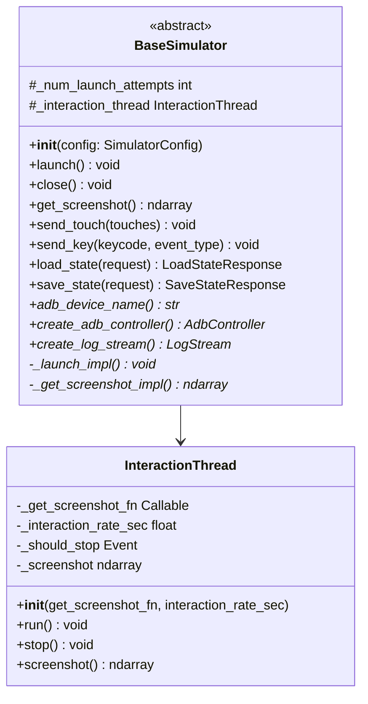
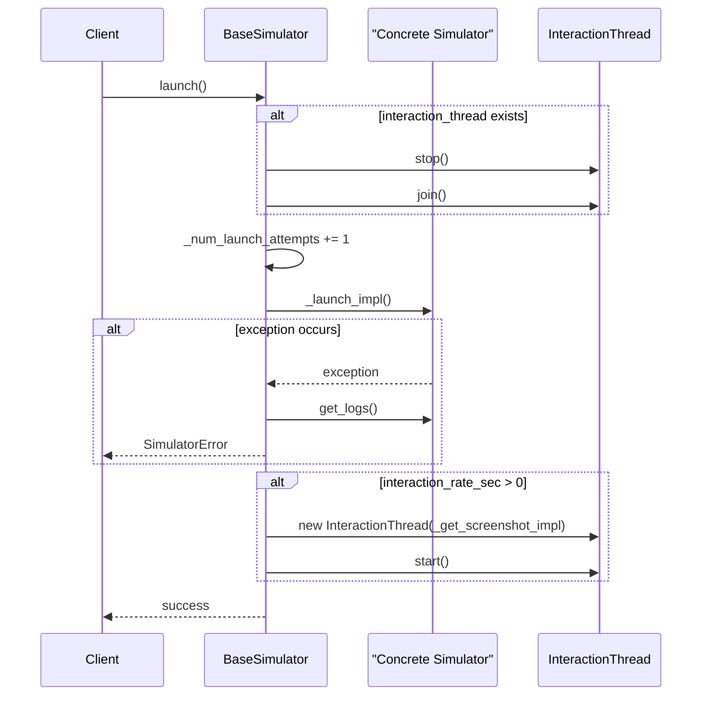
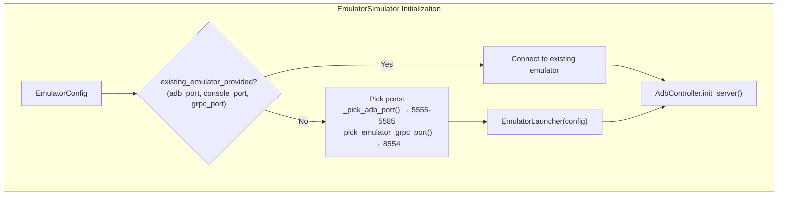
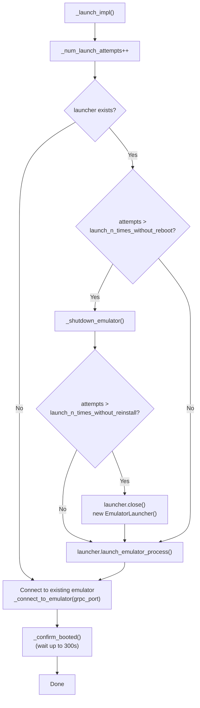
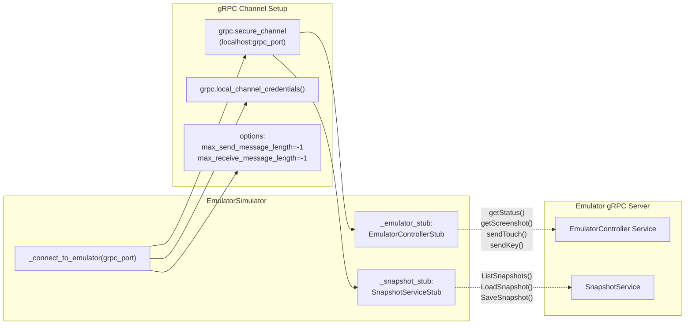
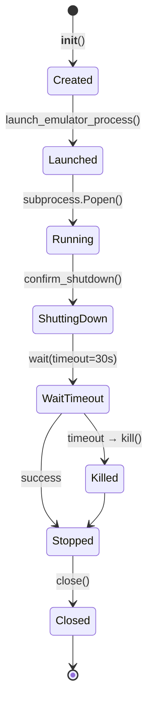
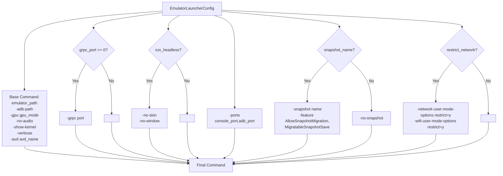
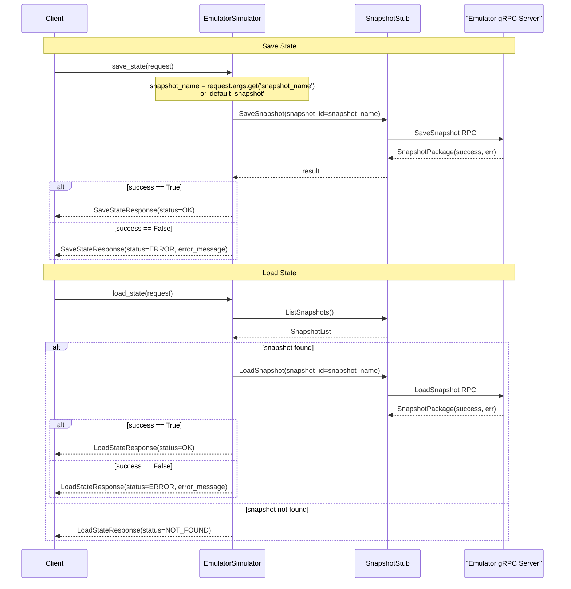
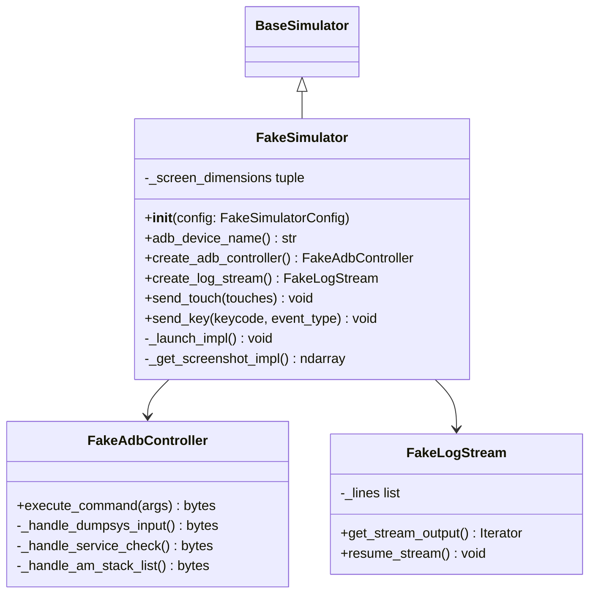
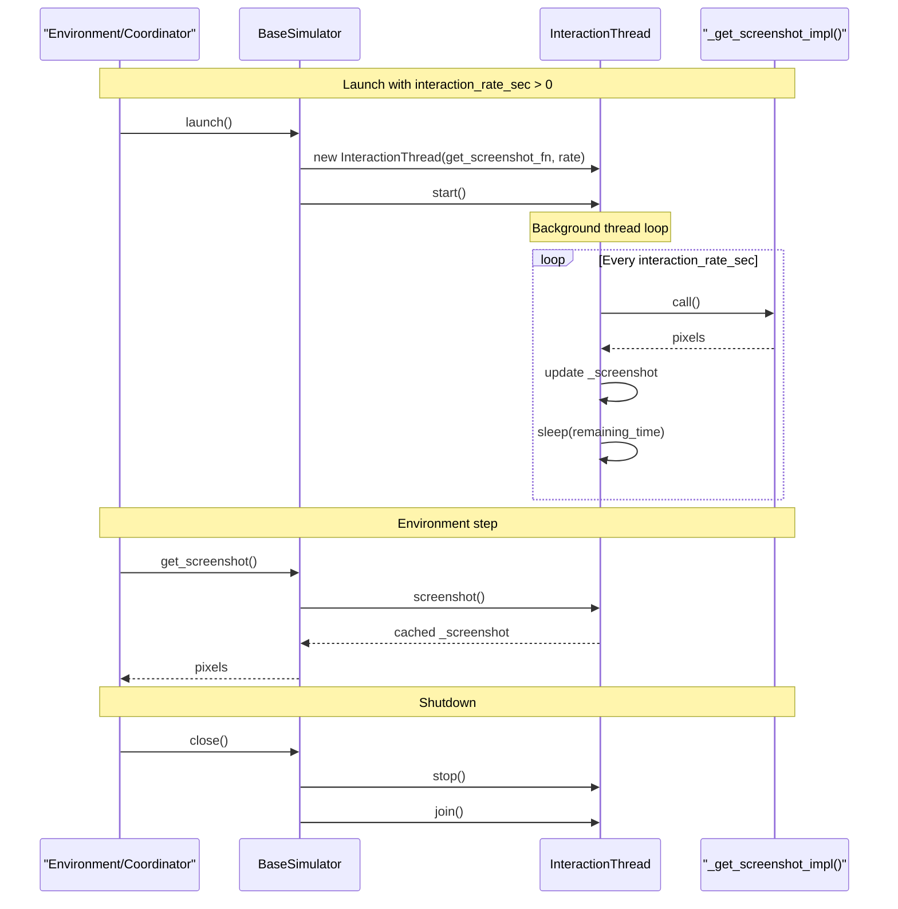

<!-- source: DeepWiki mcp.deepwiki.com · repo google-deepmind/android_env · page 5 Simulator System · fetched 2026-10-26 -->

# Simulator System

<details>
<summary>Relevant source files</summary>

The following files were used as context for generating this wiki page:

- [android_env/components/setup_step_interpreter_test.py](android_env/components/setup_step_interpreter_test.py)
- [android_env/components/simulators/__init__.py](android_env/components/simulators/__init__.py)
- [android_env/components/simulators/base_simulator.py](android_env/components/simulators/base_simulator.py)
- [android_env/components/simulators/base_simulator_test.py](android_env/components/simulators/base_simulator_test.py)
- [android_env/components/simulators/emulator/__init__.py](android_env/components/simulators/emulator/__init__.py)
- [android_env/components/simulators/emulator/emulator_launcher.py](android_env/components/simulators/emulator/emulator_launcher.py)
- [android_env/components/simulators/emulator/emulator_launcher_test.py](android_env/components/simulators/emulator/emulator_launcher_test.py)
- [android_env/components/simulators/emulator/emulator_simulator.py](android_env/components/simulators/emulator/emulator_simulator.py)
- [android_env/components/simulators/emulator/emulator_simulator_test.py](android_env/components/simulators/emulator/emulator_simulator_test.py)
- [android_env/components/simulators/fake/__init__.py](android_env/components/simulators/fake/__init__.py)
- [android_env/components/simulators/fake/fake_simulator_test.py](android_env/components/simulators/fake/fake_simulator_test.py)
- [examples/run_acme_agent.py](examples/run_acme_agent.py)
- [examples/run_human_agent.py](examples/run_human_agent.py)
- [examples/run_random_agent.py](examples/run_random_agent.py)

</details>


## Purpose and Scope

The Simulator System provides an abstraction layer over Android devices and emulators, enabling AndroidEnv to communicate with either real Android emulators or test doubles. This system handles emulator lifecycle management (launch, shutdown, reboot), screenshot capture, input injection (touch and keyboard events), and state checkpointing via snapshots.

This page covers the abstract `BaseSimulator` interface, the production `EmulatorSimulator` implementation with its companion `EmulatorLauncher`, state save/load functionality, and the `FakeSimulator` for testing. For details on how the simulator communicates with Android devices via ADB commands, see [Communication Layer](#6). For information on how the Coordinator orchestrates simulator operations, see [Coordinator](#3.3).

## Architecture Overview

```mermaid
graph TB
    subgraph "Client Layer"
        Coordinator["Coordinator"]
    end
    
    subgraph "Simulator Abstraction"
        BaseSimulator["BaseSimulator<br/>(abstract base class)"]
        InteractionThread["InteractionThread<br/>(async screenshot capture)"]
    end
    
    subgraph "Production Implementation"
        EmulatorSimulator["EmulatorSimulator"]
        EmulatorLauncher["EmulatorLauncher<br/>(process manager)"]
        GrpcStubs["gRPC Stubs:<br/>EmulatorControllerStub<br/>SnapshotServiceStub"]
    end
    
    subgraph "Test Implementation"
        FakeSimulator["FakeSimulator"]
        FakeAdbController["FakeAdbController"]
    end
    
    subgraph "Android Emulator Process"
        EmulatorProcess["emulator<br/>(subprocess)"]
        GrpcServer["gRPC Server<br/>(port 8554)"]
        AdbDaemon["ADB Daemon"]
    end
    
    Coordinator -->|"launch()<br/>get_screenshot()<br/>send_touch()<br/>send_key()"| BaseSimulator
    
    BaseSimulator <|.."implements"| EmulatorSimulator
    BaseSimulator <|.."implements"| FakeSimulator
    BaseSimulator --> InteractionThread
    
    EmulatorSimulator --> EmulatorLauncher
    EmulatorSimulator --> GrpcStubs
    
    EmulatorLauncher -->|"subprocess.Popen()"| EmulatorProcess
    GrpcStubs -->|"getScreenshot()<br/>sendTouch()<br/>sendKey()"| GrpcServer
    
    FakeSimulator --> FakeAdbController
    
    EmulatorProcess --> GrpcServer
    EmulatorProcess --> AdbDaemon
```

**Sources:** [android_env/components/simulators/base_simulator.py:32-175](), [android_env/components/simulators/emulator/emulator_simulator.py:97-487](), [android_env/components/simulators/emulator/emulator_launcher.py:27-170]()

The simulator layer consists of:
- **BaseSimulator**: Abstract interface defining the contract for all simulators
- **EmulatorSimulator**: Production implementation controlling Android Virtual Devices via gRPC
- **EmulatorLauncher**: Subprocess manager for the emulator process
- **FakeSimulator**: Test double providing deterministic responses
- **InteractionThread**: Optional background thread for asynchronous screenshot capture

## BaseSimulator Interface

### Abstract Class Contract

The `BaseSimulator` class defines the interface that all simulator implementations must satisfy:



**Sources:** [android_env/components/simulators/base_simulator.py:32-175]()

### Key Methods

| Method | Purpose | Abstract |
|--------|---------|----------|
| `launch()` | Starts the simulator and initializes the interaction thread | No (template method) |
| `_launch_impl()` | Platform-specific launch logic | Yes |
| `get_screenshot()` | Returns current screen pixels (may use async thread) | No |
| `_get_screenshot_impl()` | Platform-specific screenshot capture | Yes |
| `send_touch(touches)` | Injects touch events with x, y, is_down, identifier | Yes |
| `send_key(keycode, event_type)` | Injects keyboard events | Yes |
| `adb_device_name()` | Returns device identifier for ADB | Yes |
| `create_adb_controller()` | Creates ADB controller for this device | Yes |
| `create_log_stream()` | Creates logcat stream for this device | Yes |
| `load_state(request)` | Loads a saved state/snapshot | No (raises NotImplementedError) |
| `save_state(request)` | Saves current state/snapshot | No (raises NotImplementedError) |

**Sources:** [android_env/components/simulators/base_simulator.py:56-168]()

### Launch Lifecycle

The `launch()` method follows a template pattern:



**Sources:** [android_env/components/simulators/base_simulator.py:68-93]()

The `_num_launch_attempts` counter tracks how many times the simulator has been launched, which `EmulatorSimulator` uses to determine whether to reboot or reinstall the emulator.

## EmulatorSimulator

### Initialization and Configuration

The `EmulatorSimulator` class controls Android Virtual Devices via gRPC:



**Sources:** [android_env/components/simulators/emulator/emulator_simulator.py:100-165]()

Port selection logic:
- **ADB Port**: Tries range 5555-5585 (recommended by Android), falls back to random unused port via `portpicker`
- **gRPC Port**: Tries 8554 (recommended), falls back to random unused port
- **Console Port**: Always picks random unused port

### Launch Behavior and Recovery

The `_launch_impl()` method implements sophisticated restart logic based on `_num_launch_attempts`:

| Launch Attempt | Behavior | Configuration |
|----------------|----------|---------------|
| 1 to `launch_n_times_without_reboot` | Normal boot | Default: 5 |
| `launch_n_times_without_reboot` + 1 to `launch_n_times_without_reinstall` | Shutdown and reboot (process restart) | Default: 10 |
| > `launch_n_times_without_reinstall` | Full reinstall (delete emulator files, recreate) | Default: 10 |



**Sources:** [android_env/components/simulators/emulator/emulator_simulator.py:202-250]()

### gRPC Communication

The `EmulatorSimulator` establishes a secure gRPC channel to the emulator process:



**Sources:** [android_env/components/simulators/emulator/emulator_simulator.py:331-360]()

The `_reconnect_on_grpc_error` decorator (lines 166-179) automatically re-establishes the gRPC connection if an `RpcError` occurs during method execution.

### Screenshot Capture

Screenshots are retrieved via gRPC in RGBA8888 format and converted to RGB:

```python
# Conceptual flow from emulator_simulator.py:446-458
def _get_screenshot_impl(self) -> np.ndarray:
    image_proto = self._emulator_stub.getScreenshot(self._image_format)
    h, w = image_proto.format.height, image_proto.format.width
    image = np.frombuffer(image_proto.image, dtype='uint8', count=h * w * 4)
    image.shape = (h, w, 4)
    return image[:, :, :3]  # Drop alpha channel
```

**Sources:** [android_env/components/simulators/emulator/emulator_simulator.py:445-458]()

### Touch and Keyboard Input

Touch events support multi-finger gestures:

```python
# Touch event structure (from emulator_simulator.py:394-415)
# touches: list[tuple[int, int, bool, int]]
#   0: x coordinate
#   1: y coordinate  
#   2: is_down (finger touching screen)
#   3: identifier (finger ID for multi-touch)

def send_touch(touches):
    touch_events = [
        emulator_controller_pb2.Touch(
            x=t[0], y=t[1], pressure=int(t[2]), identifier=t[3])
        for t in touches
    ]
    self._emulator_stub.sendTouch(
        emulator_controller_pb2.TouchEvent(touches=touch_events))
```

**Sources:** [android_env/components/simulators/emulator/emulator_simulator.py:394-415]()

Keyboard events use XKB format keycodes:

```python
# Key event types: 'keydown', 'keyup', 'keypress'
def send_key(keycode, event_type):
    self._emulator_stub.sendKey(
        emulator_controller_pb2.KeyboardEvent(
            codeType=KeyboardEvent.KeyCodeType.XKB,
            eventType=KeyboardEvent.KeyEventType.Value(event_type),
            keyCode=int(keycode)))
```

**Sources:** [android_env/components/simulators/emulator/emulator_simulator.py:417-443]()

## EmulatorLauncher

### Process Lifecycle Management

The `EmulatorLauncher` class manages the emulator subprocess:



**Sources:** [android_env/components/simulators/emulator/emulator_launcher.py:57-169]()

### Command Construction

The emulator command is built from configuration parameters:



**Sources:** [android_env/components/simulators/emulator/emulator_launcher.py:88-133]()

### Environment Variables

The launcher configures critical environment variables for the emulator process:

| Variable | Value | Purpose |
|----------|-------|---------|
| `ANDROID_HOME` | `""` | Cleared to avoid conflicts |
| `ANDROID_SDK_ROOT` | `config.android_sdk_root` | SDK location |
| `ANDROID_AVD_HOME` | `config.android_avd_home` | AVD data directory |
| `ANDROID_EMULATOR_KVM_DEVICE` | `config.kvm_device` | KVM device path (default: `/dev/kvm`) |
| `ANDROID_ADB_SERVER_PORT` | `adb_server_port` | ADB server port |
| `LD_LIBRARY_PATH` | `lib64/x11:lib64/qt/lib:...` | Emulator libraries |
| `QT_XKB_CONFIG_ROOT` | `emulator_path/../qt_config/` | Qt keyboard config |
| `ANDROID_EMU_ENABLE_CRASH_REPORTING` | `"1"` | Enable crash reports |
| `SHOW_PERF_STATS` | `"1"` or `"0"` | Performance statistics |

**Sources:** [android_env/components/simulators/emulator/emulator_launcher.py:62-86]()

### Temporary Directory and Logging

The launcher creates a temporary directory for emulator output:

```python
# From emulator_launcher.py:44-52
os.makedirs(config.tmp_dir, exist_ok=True)
self._local_tmp_dir_handle = tempfile.TemporaryDirectory(
    dir=config.tmp_dir, prefix='simulator_instance_'
)
self._local_tmp_dir = self._local_tmp_dir_handle.name
self._logfile_path = os.path.join(self._local_tmp_dir, 'emulator_output')
```

The emulator's stdout and stderr are redirected to `emulator_output` in this directory, which can be retrieved via `EmulatorSimulator.get_logs()`.

**Sources:** [android_env/components/simulators/emulator/emulator_launcher.py:44-56](), [android_env/components/simulators/emulator/emulator_simulator.py:181-188]()

## State Management

### Snapshot Operations

The `EmulatorSimulator` supports saving and loading emulator states via the gRPC `SnapshotService`:



**Sources:** [android_env/components/simulators/emulator/emulator_simulator.py:251-329]()

### Snapshot Request/Response Protocol

The snapshot operations use protobuf messages from `state_pb2`:

| Method | Request Fields | Response Fields |
|--------|----------------|-----------------|
| `save_state()` | `args['snapshot_name']` (optional) | `status` (OK, ERROR), `error_message` |
| `load_state()` | `args['snapshot_name']` (optional) | `status` (OK, ERROR, NOT_FOUND), `error_message` |

The default snapshot name is `'default_snapshot'` if not specified.

**Sources:** [android_env/components/simulators/emulator/emulator_simulator.py:251-329]()

## FakeSimulator

### Purpose and Implementation

The `FakeSimulator` provides a test double for unit and integration testing without requiring a real Android emulator:



**Sources:** Test file references from [android_env/components/simulators/fake/fake_simulator_test.py:25-115]()

### Deterministic Responses

The `FakeAdbController` provides canned responses for common ADB commands:

| Command | Response |
|---------|----------|
| `shell dumpsys input` | `"  SurfaceOrientation: 0"` |
| `shell service check <name>` | `"Service <name>: found"` |
| `shell am stack list` | `"taskId=0 fake_activity visible=true topActivity=ComponentInfo{fake_activity}"` |

The `FakeLogStream` yields predetermined log lines that include reward events, extras, and episode end markers:

```
1553110400.424  5583  5658 D Tag: reward: 0.5
1553110400.424  5583  5658 D Tag: reward: 1.0
1553110400.424  5583  5658 D Tag: extra: my_extra [1.0]
1553110400.424  5583  5658 D Tag: episode end
```

**Sources:** [android_env/components/simulators/fake/fake_simulator_test.py:52-91]()

### Screenshot Generation

The `FakeSimulator` generates synthetic screenshots with the configured dimensions:

```python
# Conceptual implementation
def _get_screenshot_impl(self) -> np.ndarray:
    height, width = self._screen_dimensions
    return np.zeros((height, width, 3), dtype=np.uint8)
```

The returned array has shape `[height, width, 3]` with RGB channels, matching the real emulator's output format.

**Sources:** [android_env/components/simulators/fake/fake_simulator_test.py:42-50]()

## Asynchronous Screenshot Capture

### InteractionThread

The `InteractionThread` enables asynchronous screenshot capture to decouple screenshot retrieval from the environment step rate:



**Sources:** [android_env/components/simulators/base_simulator.py:177-209]()

### Synchronous vs Asynchronous Mode

The screenshot retrieval mode is determined by `config.interaction_rate_sec`:

| Configuration | Behavior | Use Case |
|---------------|----------|----------|
| `interaction_rate_sec <= 0` | Synchronous: `get_screenshot()` calls `_get_screenshot_impl()` directly | Default mode, screenshots on-demand |
| `interaction_rate_sec > 0` | Asynchronous: `InteractionThread` continuously captures screenshots in background | High-frequency screenshot updates independent of step rate |

```python
# From base_simulator.py:151-159
def get_screenshot(self) -> np.ndarray:
    if self._config.interaction_rate_sec > 0:
        return self._interaction_thread.screenshot()  # Async cached
    else:
        return self._get_screenshot_impl()  # Sync direct call
```

**Sources:** [android_env/components/simulators/base_simulator.py:151-159](), [android_env/components/simulators/base_simulator.py:177-209]()

The `InteractionThread.run()` loop maintains a target frame rate by measuring elapsed time and sleeping for the remainder of the interval.

## Simulator Device Naming

Each simulator implementation provides a unique device name for ADB communication:

| Simulator | Device Name Pattern | Example |
|-----------|---------------------|---------|
| `EmulatorSimulator` | `emulator-{adb_port - 1}` | `emulator-5554` (if adb_port=5555) |
| `FakeSimulator` | `fake_simulator` | `fake_simulator` |

**Sources:** [android_env/components/simulators/emulator/emulator_simulator.py:189-190](), [android_env/components/simulators/fake/fake_simulator_test.py:27-31]()

The device name is used by `AdbController` to target commands to the correct device via the `-s` flag.

---

