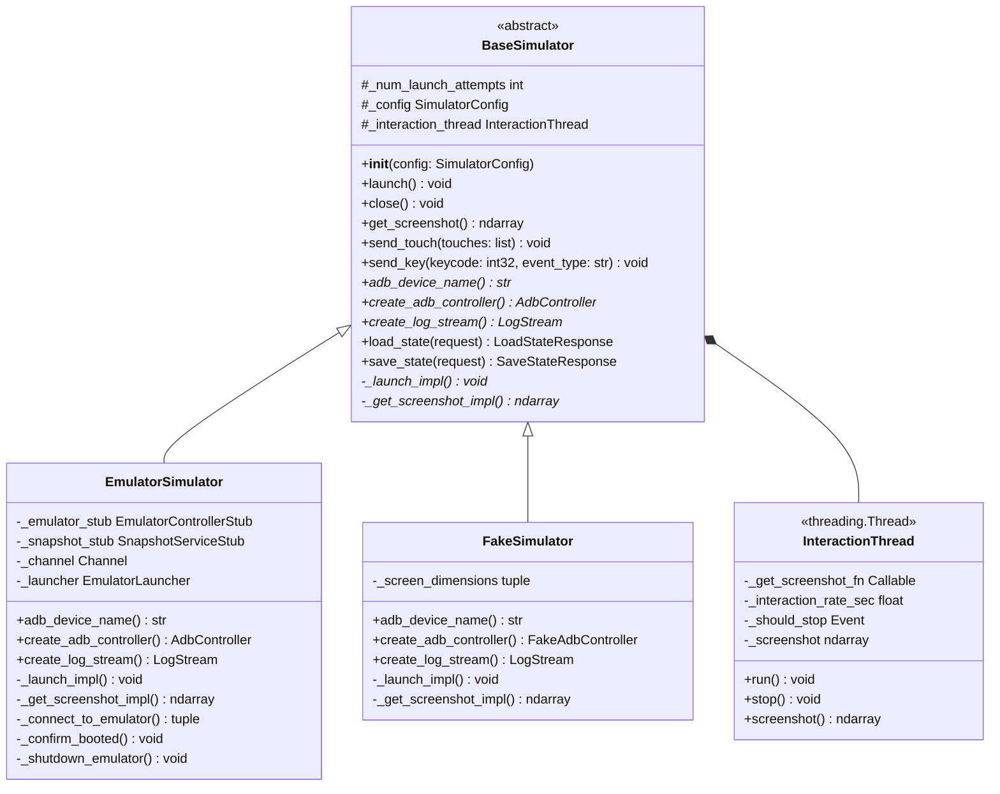
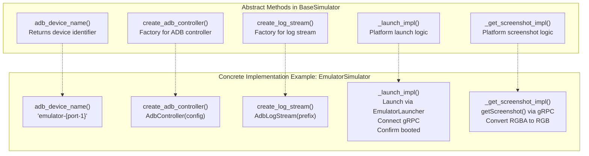
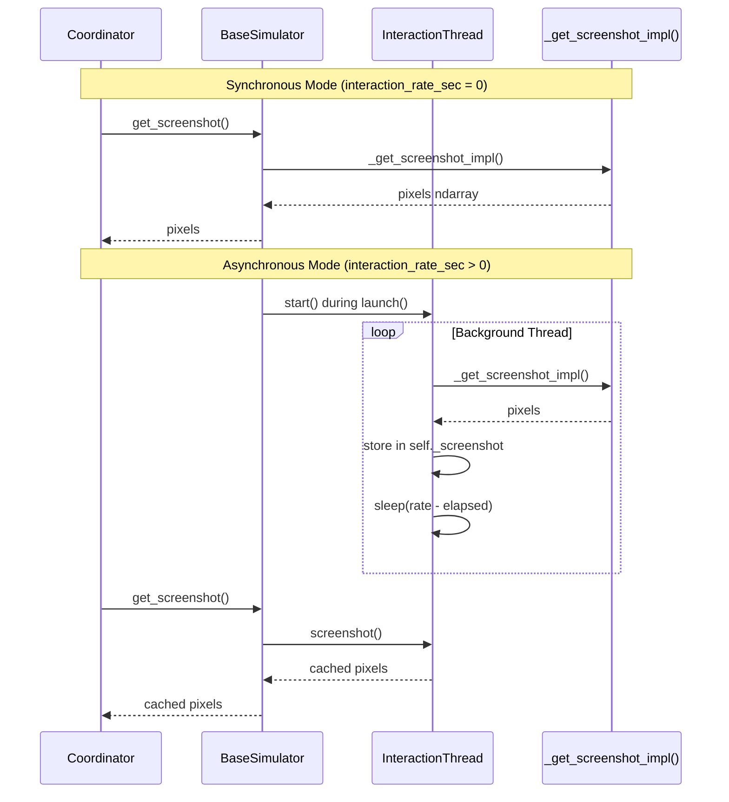
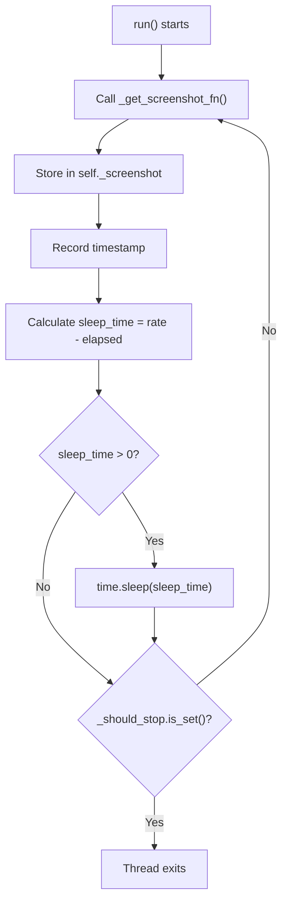
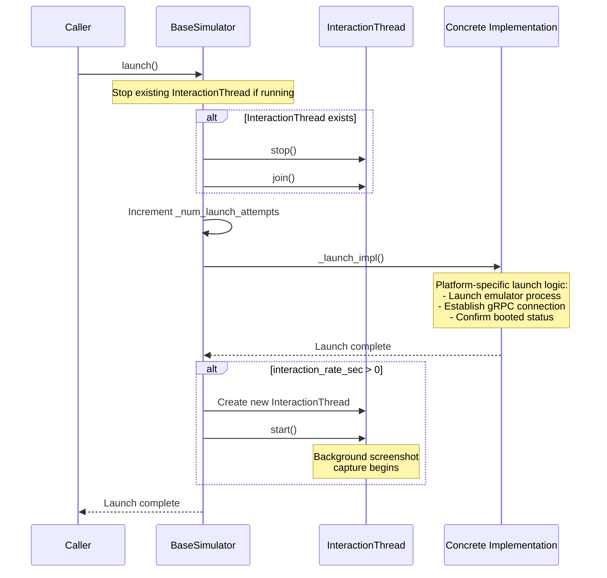
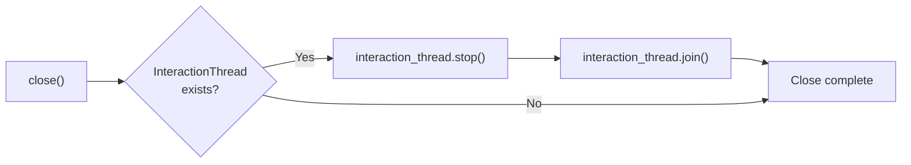
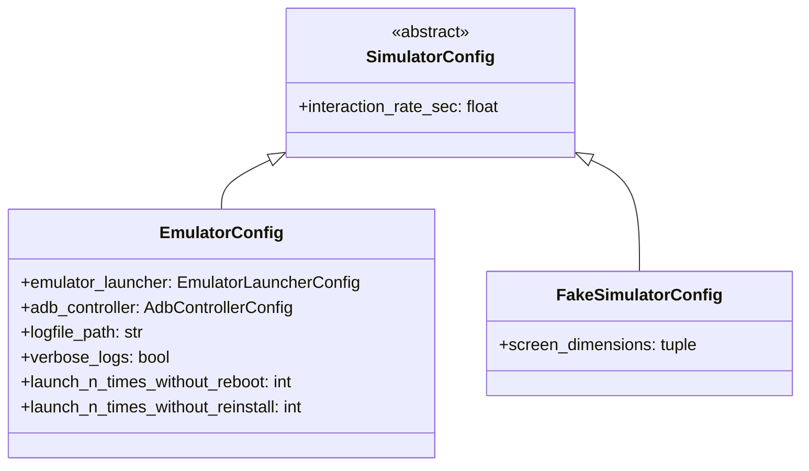
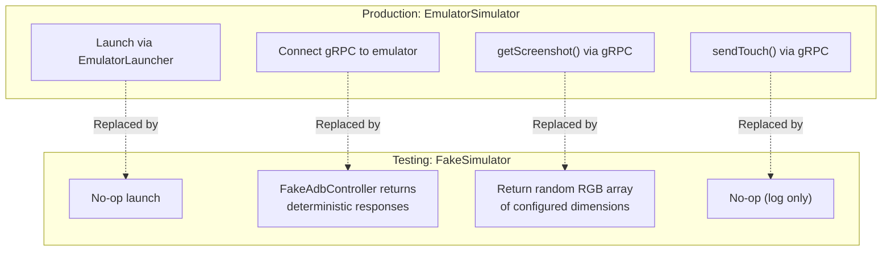

<!-- source: DeepWiki mcp.deepwiki.com · repo google-deepmind/android_env · page 5.1 Simulator Interface · fetched 2026-10-26 -->

# Simulator Interface

<details>
<summary>Relevant source files</summary>

The following files were used as context for generating this wiki page:

- [android_env/components/setup_step_interpreter_test.py](android_env/components/setup_step_interpreter_test.py)
- [android_env/components/simulators/__init__.py](android_env/components/simulators/__init__.py)
- [android_env/components/simulators/base_simulator.py](android_env/components/simulators/base_simulator.py)
- [android_env/components/simulators/base_simulator_test.py](android_env/components/simulators/base_simulator_test.py)
- [android_env/components/simulators/emulator/__init__.py](android_env/components/simulators/emulator/__init__.py)
- [android_env/components/simulators/emulator/emulator_simulator.py](android_env/components/simulators/emulator/emulator_simulator.py)
- [android_env/components/simulators/emulator/emulator_simulator_test.py](android_env/components/simulators/emulator/emulator_simulator_test.py)
- [android_env/components/simulators/fake/__init__.py](android_env/components/simulators/fake/__init__.py)
- [android_env/components/simulators/fake/fake_simulator_test.py](android_env/components/simulators/fake/fake_simulator_test.py)

</details>


## Purpose and Scope

This document describes the `BaseSimulator` abstract class, which defines the interface contract for communicating with Android simulators. The simulator layer provides an abstraction over different Android device types (emulators, virtual machines, physical devices) and manages screenshot capture, input sending, and device lifecycle.

For concrete simulator implementations, see:
- **Emulator Simulator**: [5.2](#5.2) for the production `EmulatorSimulator` class using gRPC
- **Fake Simulator**: [5.5](#5.5) for the test `FakeSimulator` class
- **Emulator Launcher**: [5.3](#5.3) for emulator process management
- **State Management**: [5.4](#5.4) for snapshot save/load functionality

---

## Class Hierarchy

The simulator system follows an abstract base class pattern where `BaseSimulator` defines the interface contract and concrete implementations provide platform-specific behavior.



**Sources:** [android_env/components/simulators/base_simulator.py:32-175](), [android_env/components/simulators/emulator/emulator_simulator.py:97-487]()

---

## Abstract Interface Contract

`BaseSimulator` defines several abstract methods that all simulator implementations must provide:

### Required Abstract Methods

| Method | Return Type | Purpose |
|--------|-------------|---------|
| `adb_device_name()` | `str` | Returns the device identifier for ADB connections (e.g., "emulator-5555") |
| `create_adb_controller()` | `AdbController` | Factory method to create an ADB controller configured for this simulator |
| `create_log_stream()` | `LogStream` | Factory method to create a log stream for reading logcat output |
| `_launch_impl()` | `None` | Platform-specific implementation of simulator launch logic |
| `_get_screenshot_impl()` | `np.ndarray` | Platform-specific screenshot capture returning [height, width, 3] RGB array |

### Abstract Method Details



**Sources:** [android_env/components/simulators/base_simulator.py:56-168](), [android_env/components/simulators/emulator/emulator_simulator.py:189-201](), [android_env/components/simulators/emulator/emulator_simulator.py:446-457]()

---

## Screenshot Capture System

The simulator supports two screenshot capture modes: synchronous and asynchronous. The mode is controlled by the `interaction_rate_sec` configuration parameter.

### Synchronous vs Asynchronous Modes



### Mode Selection Logic

The `get_screenshot()` method in `BaseSimulator` dispatches between synchronous and asynchronous modes:

```python
def get_screenshot(self) -> np.ndarray:
    if self._config.interaction_rate_sec > 0:
        assert self._interaction_thread is not None
        return self._interaction_thread.screenshot()  # Async mode
    else:
        return self._get_screenshot_impl()  # Sync mode
```

**Sources:** [android_env/components/simulators/base_simulator.py:151-159](), [android_env/components/simulators/base_simulator.py:177-209]()

### InteractionThread Implementation

When `interaction_rate_sec > 0`, the `InteractionThread` continuously captures screenshots in the background:

| Component | Description |
|-----------|-------------|
| **Thread Class** | `InteractionThread(threading.Thread)` |
| **Location** | [android_env/components/simulators/base_simulator.py:177-209]() |
| **Initialization** | Created during `launch()` if `interaction_rate_sec > 0` |
| **Purpose** | Decouple screenshot capture from environment step rate |

#### Key Attributes

- `_get_screenshot_fn`: Callback to platform-specific `_get_screenshot_impl()`
- `_interaction_rate_sec`: Target rate for screenshot capture (seconds)
- `_should_stop`: `threading.Event` for graceful shutdown
- `_screenshot`: Latest captured screenshot (cached)

#### Run Loop



**Sources:** [android_env/components/simulators/base_simulator.py:177-209]()

---

## Input Methods

`BaseSimulator` defines abstract methods for sending touch and keyboard input to the simulator.

### Touch Events

```python
@abc.abstractmethod
def send_touch(self, touches: list[tuple[int, int, bool, int]]) -> None:
    """Sends a touch event to be executed on the simulator.
    
    Args:
      touches: A list of touch events. Each element in the list corresponds to a
          single touch event. Each touch event tuple should have:
          0 x: The horizontal coordinate of this event.
          1 y: The vertical coordinate of this event.
          2 is_down: Whether the finger is touching or not the screen.
          3 identifier: Identifies a particular finger in a multitouch event.
    """
```

#### Touch Event Structure

| Index | Field | Type | Description |
|-------|-------|------|-------------|
| 0 | x | `int` | Horizontal screen coordinate |
| 1 | y | `int` | Vertical screen coordinate |
| 2 | is_down | `bool` | `True` if finger down, `False` if lifted |
| 3 | identifier | `int` | Finger ID for multitouch (0-based) |

**Example usage:** `[(123, 456, True, 0), (135, 246, True, 1)]` represents a two-finger touch.

**Sources:** [android_env/components/simulators/base_simulator.py:99-109]()

### Keyboard Events

```python
@abc.abstractmethod
def send_key(self, keycode: np.int32, event_type: str) -> None:
    """Sends a keyboard event.
    
    Args:
      keycode: Represents a specific keyboard key. This is platform and
        simulator-specific.
      event_type: Type of key event to be sent.
    """
```

#### Event Types

The `event_type` parameter supports platform-specific values. For `EmulatorSimulator`, valid types from `KeyboardEvent.KeyEventType` include:
- `"keydown"`: Key press initiated
- `"keyup"`: Key press released  
- `"keypress"`: Complete press and release

**Sources:** [android_env/components/simulators/base_simulator.py:111-119](), [android_env/components/simulators/emulator/emulator_simulator.py:418-443]()

---

## Lifecycle Management

The simulator lifecycle includes initialization, launch, optional relaunch, and shutdown phases.

### Launch Sequence



### Launch Attempt Tracking

The `_num_launch_attempts` counter tracks how many times `launch()` has been called. Implementations can use this to implement retry strategies:

```python
self._num_launch_attempts: int = 0  # Initialized in __init__

def launch(self) -> None:
    # Stop existing threads
    if self._interaction_thread is not None:
        self._interaction_thread.stop()
        self._interaction_thread.join()
    
    self._num_launch_attempts += 1
    try:
        self._launch_impl()  # Delegate to concrete implementation
    except Exception as error:
        for line in self.get_logs().splitlines():
            logging.error(line)
        raise errors.SimulatorError(...) from error
    
    # Start async screenshot thread if configured
    if self._config.interaction_rate_sec > 0:
        self._interaction_thread = InteractionThread(...)
        self._interaction_thread.start()
```

**Sources:** [android_env/components/simulators/base_simulator.py:68-93]()

### Close Sequence

The `close()` method performs graceful shutdown:



**Sources:** [android_env/components/simulators/base_simulator.py:169-175]()

---

## State Management (Optional)

`BaseSimulator` provides optional state save/load functionality via snapshots. By default, these methods raise `NotImplementedError`, but concrete implementations (e.g., `EmulatorSimulator`) can override them.

### Interface Signatures

```python
def load_state(
    self, request: state_pb2.LoadStateRequest
) -> state_pb2.LoadStateResponse:
    """Loads a state.
    
    Args:
      request: A `LoadStateRequest` containing any parameters necessary to
        specify how/what state to load.
    
    Returns:
      A `LoadStateResponse` containing the status, error message (if
      applicable), and any other relevant information.
    """
    raise NotImplementedError('This simulator does not support load_state()')

def save_state(
    self, request: state_pb2.SaveStateRequest
) -> state_pb2.SaveStateResponse:
    """Saves a state.
    
    Args:
      request: A `SaveStateRequest` containing any parameters necessary to
        specify how/what state to save.
    
    Returns:
      A `SaveStateResponse` containing the status, error message (if
      applicable), and any other relevant information.
    """
    raise NotImplementedError('This simulator does not support save_state()')
```

### Response Status Values

| Status | Meaning |
|--------|---------|
| `OK` | Operation completed successfully |
| `NOT_FOUND` | Requested snapshot does not exist (load only) |
| `ERROR` | Operation failed; see `error_message` field |

For implementation details, see [State Management](#5.4).

**Sources:** [android_env/components/simulators/base_simulator.py:121-149]()

---

## Helper Methods

### ADB Device Name

```python
@abc.abstractmethod
def adb_device_name(self) -> str:
    """Returns the device name that the adb client will connect to."""
```

**Example implementation in `EmulatorSimulator`:**
```python
def adb_device_name(self) -> str:
    return 'emulator-%s' % (self._config.emulator_launcher.adb_port - 1)
```

This returns strings like `"emulator-5555"` which ADB uses to identify the device.

**Sources:** [android_env/components/simulators/base_simulator.py:56-59](), [android_env/components/simulators/emulator/emulator_simulator.py:189-190]()

### ADB Controller Factory

```python
@abc.abstractmethod
def create_adb_controller(self) -> adb_controller.AdbController:
    """Returns an ADB controller which can communicate with this simulator."""
```

Creates an `AdbController` instance configured with the correct device name and server port. The simulator maintains its own internal ADB controller for bookkeeping.

**Sources:** [android_env/components/simulators/base_simulator.py:60-62]()

### Log Stream Factory

```python
@abc.abstractmethod
def create_log_stream(self) -> log_stream.LogStream:
    """Creates a stream of logs from the simulator."""
```

Returns a `LogStream` implementation (typically `AdbLogStream`) that streams logcat output from the device. Used by `TaskManager` for reward extraction and monitoring.

**Sources:** [android_env/components/simulators/base_simulator.py:64-66]()

### Get Logs (Optional)

```python
def get_logs(self) -> str:
    """Returns logs recorded by the simulator (if provided)."""
    return 'No simulator logs provided.'
```

Default implementation returns a placeholder. Concrete implementations can override to provide emulator process logs. `EmulatorSimulator` reads from a log file if available.

**Sources:** [android_env/components/simulators/base_simulator.py:52-54]()

---

## Configuration

Simulators are configured via subclasses of `SimulatorConfig`:



### Key Configuration Parameters

| Parameter | Type | Default | Purpose |
|-----------|------|---------|---------|
| `interaction_rate_sec` | `float` | `0.0` | Screenshot capture rate; 0 = synchronous mode |
| `launch_n_times_without_reboot` | `int` | `1` | Number of launches before forcing reboot (EmulatorSimulator) |
| `launch_n_times_without_reinstall` | `int` | `3` | Number of launches before reinstalling emulator files (EmulatorSimulator) |

**Sources:** [android_env/components/simulators/base_simulator.py:35-46](), [android_env/components/simulators/emulator/emulator_simulator.py:100-139]()

---

## Error Handling

### Launch Errors

When `_launch_impl()` raises an exception, `launch()` logs the simulator logs and wraps the error in `SimulatorError`:

```python
def launch(self) -> None:
    self._num_launch_attempts += 1
    try:
        self._launch_impl()
    except Exception as error:
        for line in self.get_logs().splitlines():
            logging.error(line)
        raise errors.SimulatorError(
            'Exception caught in simulator. Please see the simulator logs '
            'above for more details.'
        ) from error
```

This ensures that emulator logs are visible when debugging launch failures.

**Sources:** [android_env/components/simulators/base_simulator.py:76-85]()

### Screenshot Errors

In asynchronous mode, if `_get_screenshot_impl()` raises an exception in the `InteractionThread`, that exception will propagate when `screenshot()` is called. This allows errors in the background thread to surface to the caller.

**Sources:** [android_env/components/simulators/base_simulator_test.py:71-96]()

---

## Testing

The fake simulator provides a deterministic implementation for testing:



**Key test utilities:**
- `FakeSimulator`: Returns random screenshots, no-op inputs
- `FakeAdbController`: Returns deterministic ADB responses
- Test coverage: [android_env/components/simulators/fake/fake_simulator_test.py:1-115]()

**Sources:** [android_env/components/simulators/base_simulator_test.py:1-182](), [android_env/components/simulators/fake/fake_simulator_test.py:1-115]()

---

