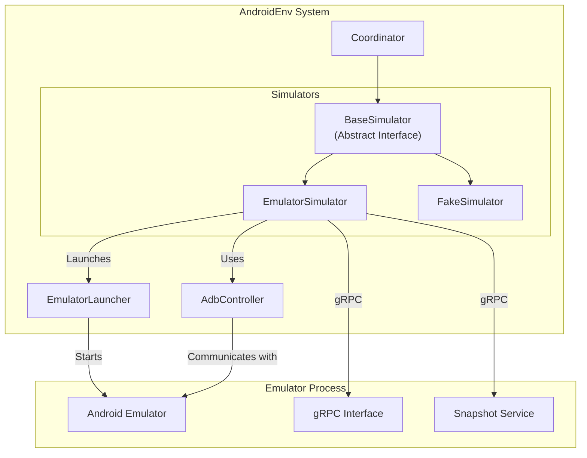
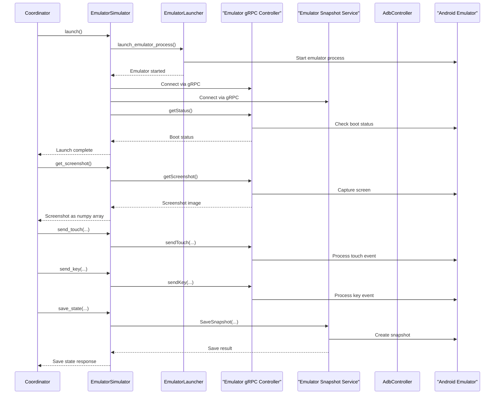
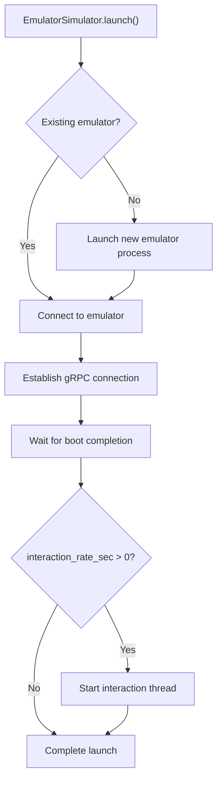
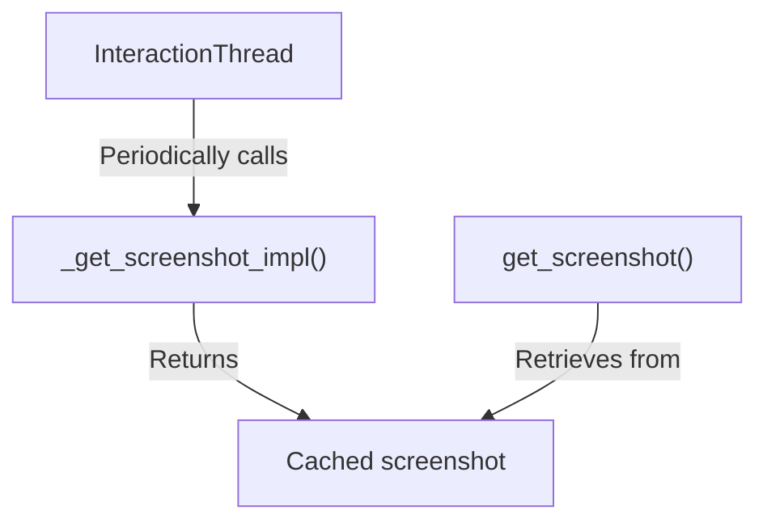

<!-- source: DeepWiki mcp.deepwiki.com · repo google-deepmind/android_env · page 5.2 Emulator Simulator · fetched 2026-10-26 -->

# Emulator Simulator

<details>
<summary>Relevant source files</summary>

The following files were used as context for generating this wiki page:

- [android_env/components/simulators/base_simulator.py](android_env/components/simulators/base_simulator.py)
- [android_env/components/simulators/emulator/emulator_simulator.py](android_env/components/simulators/emulator/emulator_simulator.py)
- [android_env/components/simulators/emulator/emulator_simulator_test.py](android_env/components/simulators/emulator/emulator_simulator_test.py)

</details>


The EmulatorSimulator is a core component in the AndroidEnv framework that manages and interacts with an Android Emulator. It provides a standardized interface for controlling the emulator, sending input events, capturing screenshots, and managing emulator states. This page documents the implementation of the EmulatorSimulator class, its functionality, configuration options, and common usage patterns.

For information about the EmulatorLauncher (which handles the actual process of starting the Android Emulator), see [Emulator Launcher](#4.2). For details about the FakeSimulator (used for testing), see [Fake Simulator](#4.3).

## Overview

The EmulatorSimulator implements the BaseSimulator interface and serves as a bridge between the reinforcement learning agent and the actual Android Emulator. It manages:

- Emulator lifecycle (launching, rebooting, and shutdown)
- Communication with the emulator via gRPC and ADB
- Input handling (touch events and key events)
- Screenshot capture
- State management (saving and loading snapshots)



Sources: [android_env/components/simulators/emulator/emulator_simulator.py:97-98](), [android_env/components/simulators/base_simulator.py:32-36]()

## Architecture

The EmulatorSimulator functions as a mediator between the higher-level components of AndroidEnv (such as the Coordinator) and the actual Android Emulator. It communicates with the emulator through multiple channels:

1. **gRPC Channel**: Used for sending touch/key events, capturing screenshots, and managing snapshots
2. **ADB Controller**: Used for device configuration and command execution



Sources: [android_env/components/simulators/emulator/emulator_simulator.py:97-486]()

## Configuration

The EmulatorSimulator is configured through the `EmulatorConfig` class, which contains various settings for controlling the emulator's behavior.

### Key Configuration Options

| Parameter | Description |
|-----------|-------------|
| `emulator_launcher` | Configuration for the EmulatorLauncher (paths, ports, etc.) |
| `adb_controller` | Configuration for the ADB controller (ADB path, ports, etc.) |
| `logfile_path` | Path to the emulator's log file |
| `launch_n_times_without_reboot` | Number of launch attempts before rebooting |
| `launch_n_times_without_reinstall` | Number of launch attempts before reinstalling |
| `verbose_logs` | Whether to enable verbose logging |
| `interaction_rate_sec` | Rate at which to interact with the emulator |

Sources: [android_env/components/simulators/emulator/emulator_simulator.py:100-164]()

## Core Functionality

### Initialization and Launch

The EmulatorSimulator can either connect to an existing emulator or launch a new one:

- If connecting to an existing emulator, it uses the provided ports (ADB, console, gRPC)
- Otherwise, it picks appropriate ports and launches a new emulator process

The launch process involves:
1. Starting the emulator process (if needed)
2. Establishing a gRPC connection
3. Waiting for the emulator to boot completely
4. Starting an interaction thread for asynchronous screenshots (if configured)



Sources: [android_env/components/simulators/emulator/emulator_simulator.py:68-93](), [android_env/components/simulators/emulator/emulator_simulator.py:203-249]()

### Input Handling

#### Touch Events

The EmulatorSimulator can send touch events to the emulator via the gRPC interface. Each touch event includes:
- X and Y coordinates
- Whether the finger is touching the screen (pressure)
- An identifier for multi-touch events

```python
# Example of sending touch events
simulator.send_touch([
    (x1, y1, is_down1, identifier1),
    (x2, y2, is_down2, identifier2)
])
```

Sources: [android_env/components/simulators/emulator/emulator_simulator.py:394-415]()

#### Key Events

The EmulatorSimulator can also send key events:
- Keycodes are in XKB format
- Event types include keydown, keyup, and keypress

```python
# Example of sending key events
simulator.send_key(keycode, "keydown")
simulator.send_key(keycode, "keyup")
simulator.send_key(keycode, "keypress")
```

Sources: [android_env/components/simulators/emulator/emulator_simulator.py:418-443]()

### Screenshot Capture

The EmulatorSimulator can capture screenshots from the emulator in two modes:

1. **Synchronous mode**: Captures screenshots on demand
2. **Asynchronous mode**: Continuously captures screenshots in a background thread at a specified rate

Screenshots are returned as numpy arrays with shape `[height, width, 3]` in RGB format.

Sources: [android_env/components/simulators/emulator/emulator_simulator.py:151-168](), [android_env/components/simulators/emulator/emulator_simulator.py:445-457]()

### State Management (Snapshots)

The EmulatorSimulator supports saving and loading emulator states using the emulator's snapshot functionality:

#### Saving States

```python
# Example of saving a state
response = simulator.save_state(
    state_pb2.SaveStateRequest(args={"snapshot_name": "my_snapshot"})
)
```

#### Loading States

```python
# Example of loading a state
response = simulator.load_state(
    state_pb2.LoadStateRequest(args={"snapshot_name": "my_snapshot"})
)
```

If no snapshot name is provided, a default name (`default_snapshot`) is used.

Sources: [android_env/components/simulators/emulator/emulator_simulator.py:251-329]()

## Error Handling and Recovery

The EmulatorSimulator includes robust error handling mechanisms:

### gRPC Error Reconnection

The EmulatorSimulator automatically reconnects to the emulator if gRPC connection errors occur. This is implemented using a decorator function that wraps critical methods:

```python
@_reconnect_on_grpc_error
def method_name(self, ...):
    # Method implementation
```

Sources: [android_env/components/simulators/emulator/emulator_simulator.py:166-179]()

### Boot Error Handling

The EmulatorSimulator monitors the boot process and raises appropriate exceptions if the emulator fails to boot:

- `EmulatorBootError`: Raised when the emulator fails to boot
- `EmulatorCrashError`: Raised when the emulator crashes

Sources: [android_env/components/simulators/emulator/emulator_simulator.py:89-95](), [android_env/components/simulators/emulator/emulator_simulator.py:362-392]()

### Reboot and Reinstall Strategy

The EmulatorSimulator employs a staged approach to handle persistent issues:

1. **Normal boot**: First few launch attempts
2. **Reboot**: After `launch_n_times_without_reboot` attempts
3. **Reinstall**: After `launch_n_times_without_reinstall` attempts

This strategy helps recover from common issues that may occur during emulator operation.

Sources: [android_env/components/simulators/emulator/emulator_simulator.py:203-237]()

## Resource Management

The EmulatorSimulator properly manages resources through its lifecycle:

### Initialization

During initialization, the EmulatorSimulator sets up:
- ADB controller
- Communication ports
- EmulatorLauncher (if needed)

### Cleanup

The `close()` method ensures proper cleanup:
1. Stops the interaction thread (if running)
2. Shuts down the emulator (if running)
3. Closes the gRPC channel
4. Releases other resources

Sources: [android_env/components/simulators/emulator/emulator_simulator.py:100-164](), [android_env/components/simulators/emulator/emulator_simulator.py:475-486]()

## Implementation Details

### Port Selection

The EmulatorSimulator intelligently selects ports for ADB and gRPC communication:
- ADB ports are selected from the recommended range 5555-5585 when possible
- gRPC port defaults to 8554 (the recommended port) when available

Sources: [android_env/components/simulators/emulator/emulator_simulator.py:57-86]()

### Interaction Thread

The EmulatorSimulator can use a background thread to continuously capture screenshots at a specified rate, which helps optimize performance by avoiding unnecessary screenshot requests:



Sources: [android_env/components/simulators/base_simulator.py:177-208]()

## Usage Examples

### Basic Usage

```python
# Create configuration
config = config_classes.EmulatorConfig(
    emulator_launcher=config_classes.EmulatorLauncherConfig(
        emulator_path="/path/to/emulator",
        android_sdk_root="/path/to/sdk",
        avd_name="my_avd"
    ),
    adb_controller=config_classes.AdbControllerConfig(
        adb_path="/path/to/adb"
    )
)

# Create and launch simulator
simulator = EmulatorSimulator(config)
simulator.launch()

# Interact with the simulator
screenshot = simulator.get_screenshot()
simulator.send_touch([(100, 200, True, 0)])
simulator.send_key(keycode, "keypress")

# Save/load state
simulator.save_state(state_pb2.SaveStateRequest(args={"snapshot_name": "my_snapshot"}))
simulator.load_state(state_pb2.LoadStateRequest(args={"snapshot_name": "my_snapshot"}))

# Cleanup
simulator.close()
```

### Connecting to an Existing Emulator

```python
# Configuration for connecting to an existing emulator
config = config_classes.EmulatorConfig(
    emulator_launcher=config_classes.EmulatorLauncherConfig(
        adb_port=5555,
        emulator_console_port=5554,
        grpc_port=8554
    ),
    adb_controller=config_classes.AdbControllerConfig(
        adb_path="/path/to/adb"
    )
)

# Create and connect to the simulator
simulator = EmulatorSimulator(config)
```

Sources: [android_env/components/simulators/emulator/emulator_simulator.py:97-486]()

---

