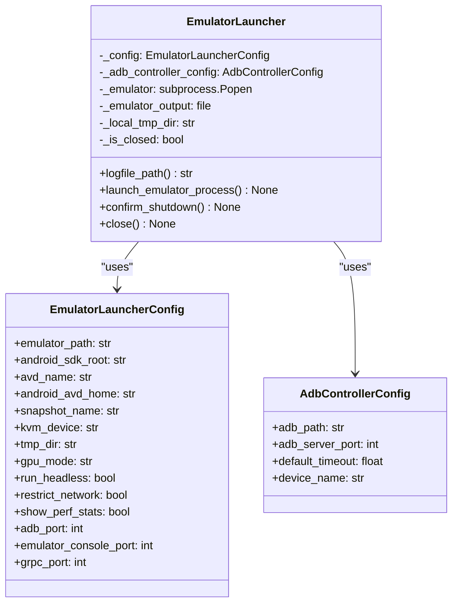
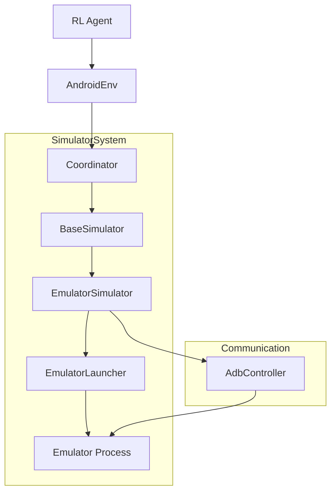
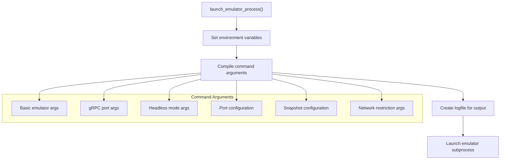

<!-- source: DeepWiki mcp.deepwiki.com · repo google-deepmind/android_env · page 5.3 Emulator Launcher · fetched 2026-10-26 -->

# Emulator Launcher

<details>
<summary>Relevant source files</summary>

The following files were used as context for generating this wiki page:

- [android_env/components/simulators/emulator/emulator_launcher.py](android_env/components/simulators/emulator/emulator_launcher.py)
- [android_env/components/simulators/emulator/emulator_launcher_test.py](android_env/components/simulators/emulator/emulator_launcher_test.py)
- [examples/run_acme_agent.py](examples/run_acme_agent.py)
- [examples/run_human_agent.py](examples/run_human_agent.py)
- [examples/run_random_agent.py](examples/run_random_agent.py)

</details>


The `EmulatorLauncher` component is responsible for preparing and launching Android emulator processes within the AndroidEnv framework. It handles environment variable setup, command-line argument construction, and manages the complete lifecycle of the emulator subprocess.

For information about the broader simulator system, see [Simulator System](#4). For details about the higher-level `EmulatorSimulator` that uses this launcher, see [Emulator Simulator](#4.1).

## Component Architecture

The `EmulatorLauncher` class is designed to handle all aspects of emulator process management, from initialization to shutdown. It works with configuration objects to customize the emulator launch parameters.



Sources: [android_env/components/simulators/emulator/emulator_launcher.py:27-52]()

## System Integration

The `EmulatorLauncher` fits within the broader AndroidEnv architecture as follows:



Sources: [android_env/components/simulators/emulator/emulator_launcher.py:27-39]()

## Configuration

The `EmulatorLauncher` is configured through two configuration classes:

### EmulatorLauncherConfig

| Parameter | Description | Default |
|-----------|-------------|---------|
| `emulator_path` | Path to the Android emulator executable | Required |
| `android_sdk_root` | Path to the Android SDK installation | Required |
| `avd_name` | Name of the Android Virtual Device to use | Required |
| `android_avd_home` | Path to the AVD directory | `~/.android/avd` |
| `snapshot_name` | Name of snapshot to load/save | `""` (no snapshot) |
| `kvm_device` | Path to KVM device | `/dev/kvm` |
| `tmp_dir` | Directory for temporary files | `/tmp` |
| `gpu_mode` | GPU mode for the emulator | `swangle_indirect` |
| `run_headless` | Whether to run in headless mode | `False` |
| `restrict_network` | Whether to restrict network access | `False` |
| `show_perf_stats` | Whether to show performance stats | `False` |
| `adb_port` | ADB port for the emulator | Required |
| `emulator_console_port` | Emulator console port | Required |
| `grpc_port` | gRPC port for the emulator | `-1` (disabled) |

### AdbControllerConfig 

The launcher also requires ADB controller configuration to set up communication with the emulator:

| Parameter | Description |
|-----------|-------------|
| `adb_path` | Path to the ADB executable |
| `adb_server_port` | Port for the ADB server |
| `default_timeout` | Default timeout for ADB commands |
| `device_name` | Device identifier for ADB |

Sources: [android_env/components/simulators/emulator/emulator_launcher_test.py:32-75]()

## Emulator Launch Process

The `launch_emulator_process()` method orchestrates the launch of the emulator with the following steps:



Sources: [android_env/components/simulators/emulator/emulator_launcher.py:57-143]()

### Environment Variables

The launcher sets up several environment variables required by the emulator:

```
ANDROID_HOME
ANDROID_SDK_ROOT
ANDROID_AVD_HOME
ANDROID_EMULATOR_KVM_DEVICE
ANDROID_ADB_SERVER_PORT
LD_LIBRARY_PATH
QT_XKB_CONFIG_ROOT
ANDROID_EMU_ENABLE_CRASH_REPORTING
SHOW_PERF_STATS
```

Sources: [android_env/components/simulators/emulator/emulator_launcher.py:68-83]()

### Command-line Arguments

The command-line arguments for the emulator are constructed based on configuration settings:

1. **Basic arguments**: Path to emulator, ADB path, GPU mode, AVD name
2. **Optional gRPC port**: Only included if `grpc_port` is not -1
3. **Headless mode**: `-no-skin -no-window` flags when `run_headless` is true
4. **Port configuration**: ADB port and console port
5. **Snapshot configuration**: Snapshot name and features, or `-no-snapshot` if disabled
6. **Network restrictions**: Network restriction arguments when `restrict_network` is true

Sources: [android_env/components/simulators/emulator/emulator_launcher.py:89-133]()

## Lifecycle Management

The `EmulatorLauncher` manages the complete lifecycle of the emulator process:

### 1. Initialization

During initialization, the launcher:
- Stores configuration parameters
- Creates a temporary directory for emulator output 
- Sets up a logfile path for capturing output

Sources: [android_env/components/simulators/emulator/emulator_launcher.py:30-52]()

### 2. Process Launch

The `launch_emulator_process()` method:
- Sets up environment variables
- Builds command-line arguments
- Opens the output log file
- Launches the emulator as a subprocess

Sources: [android_env/components/simulators/emulator/emulator_launcher.py:57-143]()

### 3. Process Shutdown

The `confirm_shutdown()` method ensures proper termination:
- Checks if the emulator process has finished
- Waits for process termination with a 30-second timeout
- Forces termination if the process doesn't exit within the timeout
- Closes the output log file

Sources: [android_env/components/simulators/emulator/emulator_launcher.py:145-159]()

### 4. Resource Cleanup

The `close()` method and destructor handle final cleanup:
- Removes temporary directories
- Ensures the emulator process is shut down
- Prevents multiple cleanup attempts with an `_is_closed` flag

Sources: [android_env/components/simulators/emulator/emulator_launcher.py:161-169]()

## Usage Examples

The `EmulatorLauncher` is typically configured through the AndroidEnv configuration system. Here's how it appears in example scripts:

```python
config = config_classes.AndroidEnvConfig(
    task=config_classes.FilesystemTaskConfig(path=FLAGS.task_path),
    simulator=config_classes.EmulatorConfig(
        emulator_launcher=config_classes.EmulatorLauncherConfig(
            emulator_path=FLAGS.emulator_path,
            android_sdk_root=FLAGS.android_sdk_root,
            android_avd_home=FLAGS.android_avd_home,
            avd_name=FLAGS.avd_name,
            run_headless=FLAGS.run_headless,
        ),
        adb_controller=config_classes.AdbControllerConfig(
            adb_path=FLAGS.adb_path
        ),
    ),
)
```

This configuration is then passed to the AndroidEnv loader, which creates the necessary components including the `EmulatorLauncher`.

Sources: [examples/run_random_agent.py:48-62](), [examples/run_human_agent.py:133-147]()

## Feature Configuration Examples

The `EmulatorLauncher` supports several features that can be enabled through configuration:

### Snapshots

```python
emulator_launcher=config_classes.EmulatorLauncherConfig(
    # ... other settings ...
    snapshot_name='my_snapshot',
)
```

When a snapshot name is provided, the emulator is launched with `-snapshot my_snapshot -feature AllowSnapshotMigration,MigratableSnapshotSave` arguments.

Sources: [android_env/components/simulators/emulator/emulator_launcher_test.py:194-232]()

### Network Restrictions

```python
emulator_launcher=config_classes.EmulatorLauncherConfig(
    # ... other settings ...
    restrict_network=True,
)
```

When `restrict_network` is enabled, the emulator is launched with network restriction arguments to limit network access.

Sources: [android_env/components/simulators/emulator/emulator_launcher_test.py:241-290]()

### gRPC Support

```python
emulator_launcher=config_classes.EmulatorLauncherConfig(
    # ... other settings ...
    grpc_port=8554,
)
```

When `grpc_port` is set to a value other than -1, the emulator is launched with `-grpc port_number` to enable gRPC communication.

Sources: [android_env/components/simulators/emulator/emulator_launcher_test.py:134-176]()

---

