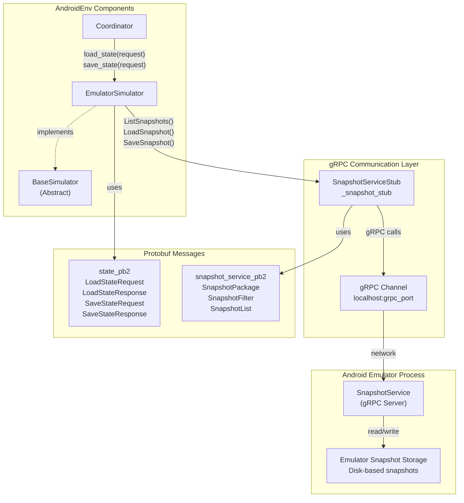
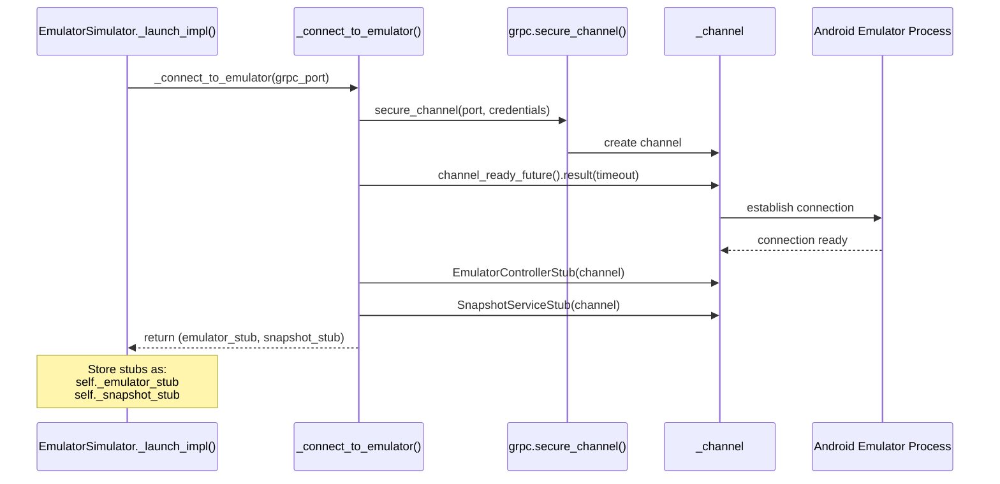
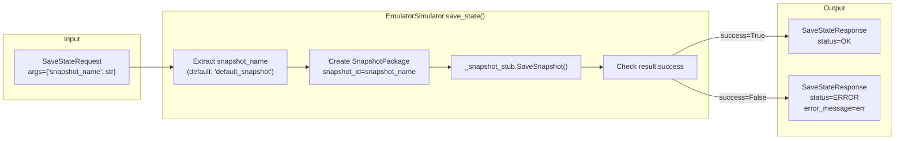
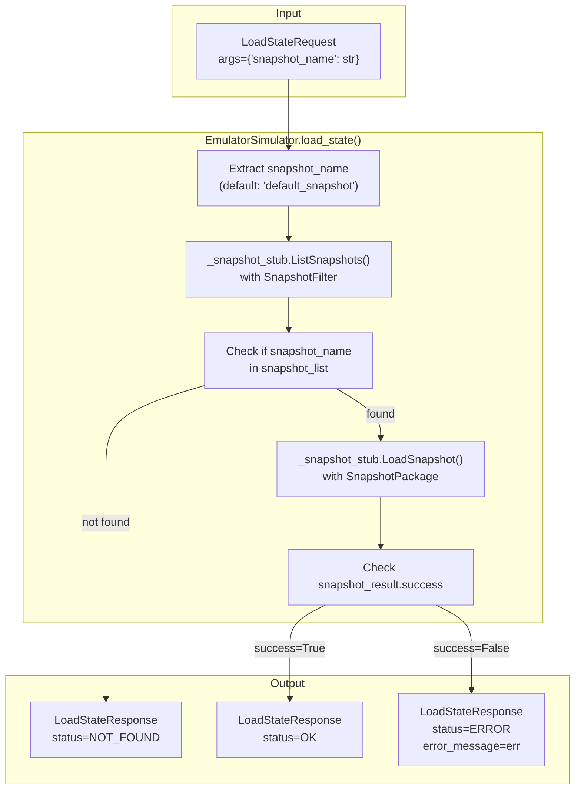
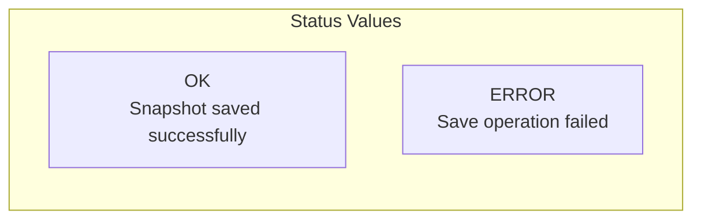
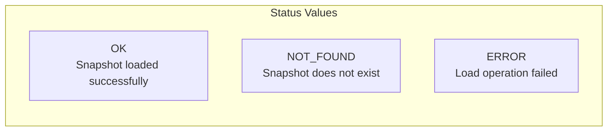
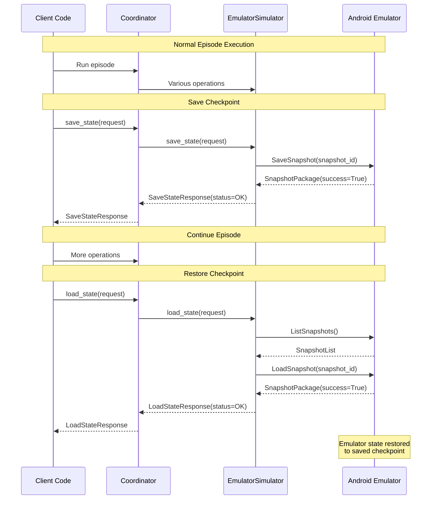

<!-- source: DeepWiki mcp.deepwiki.com · repo google-deepmind/android_env · page 5.4 State Management · fetched 2026-10-26 -->

# State Management

<details>
<summary>Relevant source files</summary>

The following files were used as context for generating this wiki page:

- [android_env/components/simulators/base_simulator.py](android_env/components/simulators/base_simulator.py)
- [android_env/components/simulators/emulator/emulator_simulator.py](android_env/components/simulators/emulator/emulator_simulator.py)
- [android_env/components/simulators/emulator/emulator_simulator_test.py](android_env/components/simulators/emulator/emulator_simulator_test.py)

</details>


## Purpose and Scope

This document explains the state management system in AndroidEnv, which provides snapshot save/load functionality for checkpointing Android emulator states. This capability enables saving the complete state of an emulator (including memory, device state, and application state) and later restoring it, which is useful for tasks like curriculum learning, debugging, and reproducible experiments.

State management is specific to the simulator layer and is currently only implemented for `EmulatorSimulator`. For general simulator architecture and lifecycle, see [Simulator Interface](#5.1). For emulator-specific operations beyond state management, see [Emulator Simulator](#5.2).

**Sources:** [android_env/components/simulators/emulator/emulator_simulator.py:251-329](), [android_env/components/simulators/base_simulator.py:121-149]()

## Architecture Overview

State management operates through the Android Emulator's gRPC SnapshotService, which provides native snapshotting capabilities. The system uses a client-server architecture where `EmulatorSimulator` acts as a gRPC client communicating with the emulator's SnapshotService.



**Figure 1: State Management Architecture**

**Sources:** [android_env/components/simulators/emulator/emulator_simulator.py:30-39](), [android_env/components/simulators/emulator/emulator_simulator.py:331-360]()

### Key Components

| Component | Type | Responsibility |
|-----------|------|----------------|
| `BaseSimulator` | Abstract Class | Defines `load_state()` and `save_state()` interface |
| `EmulatorSimulator` | Concrete Class | Implements state management using gRPC SnapshotService |
| `SnapshotServiceStub` | gRPC Stub | Client-side proxy for SnapshotService operations |
| `state_pb2` | Protobuf Module | Defines request/response messages for state operations |
| `snapshot_service_pb2` | Protobuf Module | Defines emulator-specific snapshot messages |

**Sources:** [android_env/components/simulators/base_simulator.py:121-149](), [android_env/components/simulators/emulator/emulator_simulator.py:100-124]()

## gRPC Connection Setup

The snapshot stub is initialized during emulator connection through the `_connect_to_emulator` method. This happens during the simulator launch process.



**Figure 2: gRPC Connection Initialization Sequence**

The connection uses secure local channels with unlimited message sizes:

```
options = [
    ('grpc.max_send_message_length', -1),
    ('grpc.max_receive_message_length', -1)
]
creds = grpc.local_channel_credentials()
```

**Sources:** [android_env/components/simulators/emulator/emulator_simulator.py:331-360](), [android_env/components/simulators/emulator/emulator_simulator.py:237-241]()

## Snapshot Operations

### Save State

The `save_state` method persists the current emulator state to a named snapshot. The snapshot includes the entire device state: RAM, storage, CPU registers, and all running applications.



**Figure 3: Save State Operation Flow**

**Method Signature:**
```python
def save_state(
    self, request: state_pb2.SaveStateRequest
) -> state_pb2.SaveStateResponse
```

**Key Implementation Details:**

1. **Snapshot Name Resolution**: If `request.args.snapshot_name` is not provided, uses `_DEFAULT_SNAPSHOT_NAME` ('default_snapshot')
2. **gRPC Call**: Invokes `self._snapshot_stub.SaveSnapshot()` with a `SnapshotPackage` containing the snapshot ID
3. **Response Handling**: Returns a `SaveStateResponse` with status `OK` on success or `ERROR` with an error message on failure

**Sources:** [android_env/components/simulators/emulator/emulator_simulator.py:299-329]()

### Load State

The `load_state` method restores a previously saved snapshot. It first verifies the snapshot exists before attempting to load it.



**Figure 4: Load State Operation Flow**

**Method Signature:**
```python
def load_state(
    self, request: state_pb2.LoadStateRequest
) -> state_pb2.LoadStateResponse
```

**Key Implementation Details:**

1. **Snapshot Existence Check**: Calls `ListSnapshots()` with a filter for all snapshots and checks if the requested snapshot exists
2. **Conditional Loading**: Only attempts to load if the snapshot is found in the list
3. **Status Responses**:
   - `OK`: Snapshot loaded successfully
   - `NOT_FOUND`: No snapshot with the given name exists
   - `ERROR`: Snapshot exists but failed to load (with error message)

**Sources:** [android_env/components/simulators/emulator/emulator_simulator.py:251-297]()

## Protobuf Message Structures

### State Management Protobufs

The state management system uses two sets of protobufs: high-level state operations and low-level snapshot operations.

| Message | Purpose | Key Fields |
|---------|---------|------------|
| `state_pb2.SaveStateRequest` | Request to save state | `args: dict` (contains 'snapshot_name') |
| `state_pb2.SaveStateResponse` | Response from save | `status: enum`, `error_message: str` |
| `state_pb2.LoadStateRequest` | Request to load state | `args: dict` (contains 'snapshot_name') |
| `state_pb2.LoadStateResponse` | Response from load | `status: enum`, `error_message: str` |

### Snapshot Service Protobufs

| Message | Purpose | Key Fields |
|---------|---------|------------|
| `snapshot_service_pb2.SnapshotPackage` | Identifies a snapshot | `snapshot_id: str`, `success: bool`, `err: bytes` |
| `snapshot_service_pb2.SnapshotFilter` | Filters snapshot list | `statusFilter: enum` (All/Valid/Invalid) |
| `snapshot_service_pb2.SnapshotList` | List of snapshots | `snapshots: repeated SnapshotPackage` |

**Sources:** [android_env/proto/state_pb2](), [android_env/proto/snapshot_service_pb2]()

## Response Status Codes

### SaveStateResponse Status



### LoadStateResponse Status



**Sources:** [android_env/components/simulators/emulator/emulator_simulator.py:285-297](), [android_env/components/simulators/emulator/emulator_simulator.py:322-329]()

## Error Handling and Edge Cases

### Snapshot Not Found

When loading a non-existent snapshot:

```python
# Implementation checks snapshot list first
snapshot_list = self._snapshot_stub.ListSnapshots(
    snapshot_service_pb2.SnapshotFilter(
        statusFilter=snapshot_service_pb2.SnapshotFilter.LoadStatus.All
    )
)
if any(snapshot.snapshot_id == snapshot_name for snapshot in snapshot_list.snapshots):
    # Proceed with load
else:
    return state_pb2.LoadStateResponse(
        status=state_pb2.LoadStateResponse.Status.NOT_FOUND
    )
```

**Sources:** [android_env/components/simulators/emulator/emulator_simulator.py:272-297]()

### Load/Save Failures

When the snapshot operation fails at the emulator level:

```python
snapshot_result = self._snapshot_stub.SaveSnapshot(
    snapshot_service_pb2.SnapshotPackage(snapshot_id=snapshot_name)
)
if snapshot_result.success:
    return state_pb2.SaveStateResponse(
        status=state_pb2.SaveStateResponse.Status.OK
    )
else:
    return state_pb2.SaveStateResponse(
        status=state_pb2.SaveStateResponse.Status.ERROR,
        error_message=snapshot_result.err.decode('utf-8')
    )
```

**Sources:** [android_env/components/simulators/emulator/emulator_simulator.py:318-329]()

### Unsupported Simulators

The base `BaseSimulator` class raises `NotImplementedError` for simulators that don't support state management:

```python
def load_state(
    self, request: state_pb2.LoadStateRequest
) -> state_pb2.LoadStateResponse:
    raise NotImplementedError('This simulator does not support load_state()')

def save_state(
    self, request: state_pb2.SaveStateRequest
) -> state_pb2.SaveStateResponse:
    raise NotImplementedError('This simulator does not support save_state()')
```

**Sources:** [android_env/components/simulators/base_simulator.py:121-149]()

## Usage Pattern

The typical workflow for using state management:



**Figure 5: Complete State Management Usage Pattern**

**Sources:** [android_env/components/simulators/emulator/emulator_simulator.py:251-329]()

## Testing and Validation

### Test Coverage

The test suite validates state management functionality through mocking:

**Test Scenarios:**

1. **Successful Save**: Verifies that saving a snapshot returns `OK` status
2. **Failed Save**: Tests error handling when `SnapshotPackage.success` is `False`
3. **Successful Load**: Tests loading an existing snapshot
4. **Snapshot Not Found**: Verifies `NOT_FOUND` status for non-existent snapshots
5. **Failed Load**: Tests error handling when load operation fails

```python
# Example test structure from test file
def test_save_state(self):
    simulator.launch()
    with mock.patch.object(simulator, '_snapshot_stub', create_autospec=True) as mock_snapshot_stub:
        mock_snapshot_stub.SaveSnapshot.return_value = (
            snapshot_service_pb2.SnapshotPackage(success=True)
        )
        save_response = simulator.save_state(
            request=state_pb2.SaveStateRequest(
                args={'snapshot_name': 'snapshot_name_foo'}
            )
        )
        self.assertEqual(
            save_response.status, state_pb2.SaveStateResponse.Status.OK
        )
```

**Sources:** [android_env/components/simulators/emulator/emulator_simulator_test.py:377-417]()

### Snapshot Name Handling

The default snapshot name is used when no name is provided:

```python
_DEFAULT_SNAPSHOT_NAME: str = 'default_snapshot'

snapshot_name = request.args.get('snapshot_name', _DEFAULT_SNAPSHOT_NAME)
```

This allows calls without explicit snapshot names to work consistently.

**Sources:** [android_env/components/simulators/emulator/emulator_simulator.py:42](), [android_env/components/simulators/emulator/emulator_simulator.py:271](), [android_env/components/simulators/emulator/emulator_simulator.py:317]()

## Limitations and Considerations

### Performance

- **Snapshot Size**: Complete device state can be several gigabytes
- **Save Duration**: Saving takes 5-30 seconds depending on device memory size
- **Load Duration**: Loading typically takes 10-60 seconds
- **Disk Space**: Each snapshot consumes significant disk space

### Consistency

- Snapshots are device-level and include all running processes
- Application state must be consistent at save time (e.g., no in-flight network requests)
- Some timing-sensitive applications may behave differently after restore

### Availability

- Only available for `EmulatorSimulator`, not `FakeSimulator` or physical devices
- Requires emulator to support gRPC SnapshotService (modern Android Emulator versions)
- Snapshot storage location is managed by the emulator

**Sources:** [android_env/components/simulators/emulator/emulator_simulator.py:251-329](), [android_env/components/simulators/base_simulator.py:121-149]()

---

