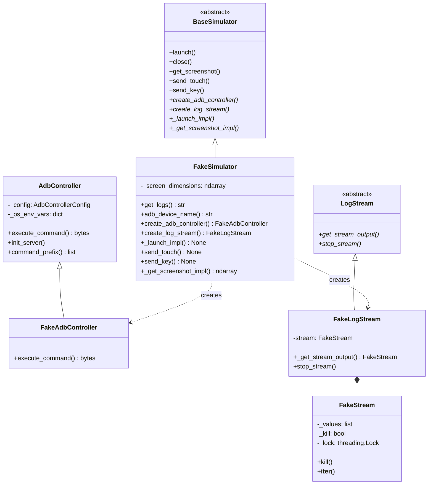
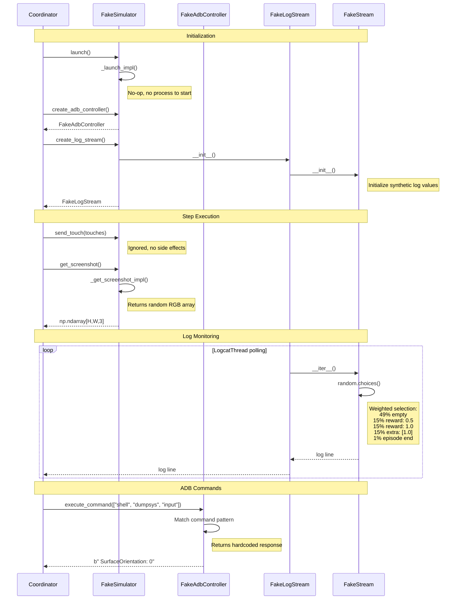
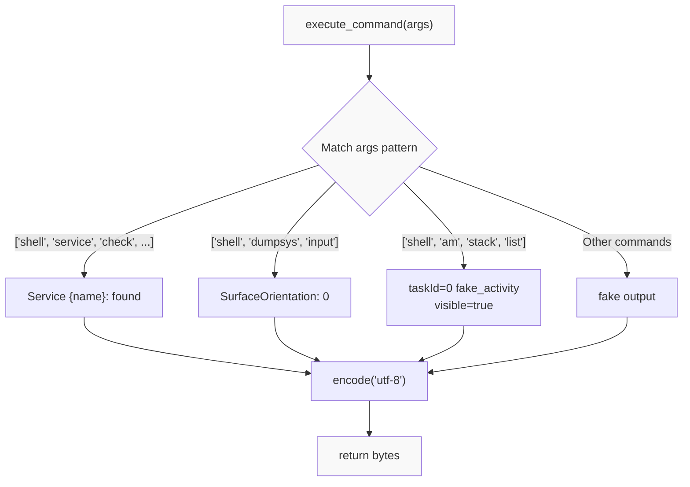
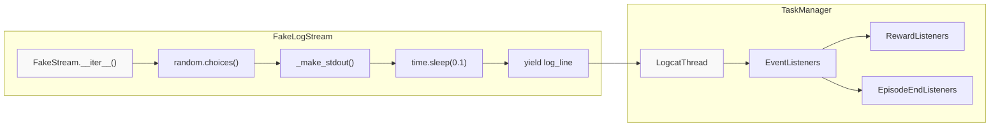

<!-- source: DeepWiki mcp.deepwiki.com · repo google-deepmind/android_env · page 5.5 Fake Simulator · fetched 2026-10-26 -->

# Fake Simulator

<details>
<summary>Relevant source files</summary>

The following files were used as context for generating this wiki page:

- [android_env/components/adb_controller.py](android_env/components/adb_controller.py)
- [android_env/components/adb_controller_test.py](android_env/components/adb_controller_test.py)
- [android_env/components/setup_step_interpreter_test.py](android_env/components/setup_step_interpreter_test.py)
- [android_env/components/simulators/__init__.py](android_env/components/simulators/__init__.py)
- [android_env/components/simulators/base_simulator_test.py](android_env/components/simulators/base_simulator_test.py)
- [android_env/components/simulators/emulator/__init__.py](android_env/components/simulators/emulator/__init__.py)
- [android_env/components/simulators/fake/__init__.py](android_env/components/simulators/fake/__init__.py)
- [android_env/components/simulators/fake/fake_simulator.py](android_env/components/simulators/fake/fake_simulator.py)
- [android_env/components/simulators/fake/fake_simulator_test.py](android_env/components/simulators/fake/fake_simulator_test.py)

</details>


## Purpose and Scope

This document describes the **FakeSimulator** and related testing infrastructure that provides deterministic mock implementations of the Android simulator components. The FakeSimulator allows running AndroidEnv in test environments without requiring a real Android emulator, enabling fast unit and integration testing.

For information about the real emulator simulator, see [Emulator Simulator](#5.2). For the base simulator interface that both implementations extend, see [Simulator Interface](#5.1).

## Overview

The FakeSimulator provides a lightweight testing alternative to the EmulatorSimulator by implementing the `BaseSimulator` interface with mock behavior. It returns fake screenshots, processes touch/key events without side effects, and generates synthetic log streams containing rewards and episode markers. This allows developers to test AndroidEnv's core logic, wrappers, and task management without the overhead of launching actual Android emulator processes.

**Key Components:**
- `FakeSimulator` - Main simulator implementation that returns random screenshots
- `FakeAdbController` - Provides hardcoded responses to ADB commands
- `FakeLogStream` / `FakeStream` - Generates synthetic logcat output with rewards and events
- `FakeSimulatorConfig` - Configuration for screen dimensions and other properties

Sources: [android_env/components/simulators/fake/fake_simulator.py:1-139]()

## Architecture

### Class Hierarchy

The FakeSimulator implements the same interfaces as EmulatorSimulator but with mock implementations:



Sources: [android_env/components/simulators/fake/fake_simulator.py:106-139](), [android_env/components/adb_controller.py:27-166]()

### Component Interaction

The FakeSimulator integrates with the rest of AndroidEnv exactly like the EmulatorSimulator, but returns deterministic mock data:



Sources: [android_env/components/simulators/fake/fake_simulator.py:30-139]()

## FakeSimulator Class

The `FakeSimulator` class is defined at [android_env/components/simulators/fake/fake_simulator.py:106-139]() and implements the `BaseSimulator` interface with minimal overhead.

### Constructor

```python
def __init__(self, config: config_classes.FakeSimulatorConfig):
```

Takes a `FakeSimulatorConfig` that primarily specifies `screen_dimensions` (default `[320, 480]`). Stores dimensions as a numpy array for use in screenshot generation.

Sources: [android_env/components/simulators/fake/fake_simulator.py:109-113]()

### Key Methods

| Method | Return Type | Purpose |
|--------|-------------|---------|
| `adb_device_name()` | `str` | Returns `"fake_simulator"` as the device identifier |
| `create_adb_controller()` | `FakeAdbController` | Creates a FakeAdbController with empty config |
| `create_log_stream()` | `FakeLogStream` | Creates a FakeLogStream that generates synthetic logs |
| `_launch_impl()` | `None` | No-op implementation (no process to launch) |
| `send_touch(touches)` | `None` | No-op implementation (ignores touch events) |
| `send_key(keycode, event_type)` | `None` | No-op implementation (ignores key events) |
| `_get_screenshot_impl()` | `np.ndarray` | Returns random RGB uint8 array with configured dimensions |
| `get_logs()` | `str` | Returns `"FakeSimulator: fake logs"` |

### Screenshot Generation

The `_get_screenshot_impl()` method at [android_env/components/simulators/fake/fake_simulator.py:136-138]() generates random pixel data:

```python
return np.random.randint(
    low=0, high=255, size=(*self._screen_dimensions, 3), dtype=np.uint8)
```

This creates a new random screenshot on each call, simulating a changing screen state without any actual rendering.

Sources: [android_env/components/simulators/fake/fake_simulator.py:115-139]()

## FakeAdbController Class

The `FakeAdbController` at [android_env/components/simulators/fake/fake_simulator.py:77-104]() extends `AdbController` and overrides `execute_command()` to return hardcoded responses based on command patterns.

### Command Response Mapping



### Implementation Details

The `execute_command()` method at [android_env/components/simulators/fake/fake_simulator.py:80-103]() pattern-matches ADB commands:

**Service Checks** ([fake_simulator.py:91-92]()):
```python
if args[:3] == ['shell', 'service', 'check']:
    return f'Service {args[-1]}: found'.encode('utf-8')
```
Returns a positive response for any service check, allowing service readiness checks to pass.

**Dumpsys Input** ([fake_simulator.py:95-96]()):
```python
if args == ['shell', 'dumpsys', 'input']:
    return b' SurfaceOrientation: 0'
```
Always reports orientation as 0 (portrait).

**Activity Stack** ([fake_simulator.py:99-101]()):
```python
if args[:4] == ['shell', 'am', 'stack', 'list']:
    return (b'taskId=0 fake_activity visible=true '
            b'topActivity=ComponentInfo{fake_activity}')
```
Reports a fake activity as the current foreground activity, which allows `AppScreenChecker` validation to pass when tasks expect `"fake_activity"`.

**Default** ([fake_simulator.py:103]()):
All other commands return `b'fake output'`.

Sources: [android_env/components/simulators/fake/fake_simulator.py:77-104]()

## FakeLogStream and FakeStream

The log streaming infrastructure generates synthetic logcat output containing rewards, extras, and episode end signals.

### FakeStream

`FakeStream` at [android_env/components/simulators/fake/fake_simulator.py:30-61]() is an iterator that yields log lines with weighted random selection:

**Log Value Distribution:**

| Log Line | Weight | Probability |
|----------|--------|-------------|
| Empty string `''` | 0.49 | 49% |
| `"reward: 0.5"` | 0.15 | 15% |
| `"reward: 1.0"` | 0.15 | 15% |
| `"extra: my_extra [1.0]"` | 0.15 | 15% |
| `"episode end"` | 0.01 | 1% |

**Log Format** ([fake_simulator.py:44-46]()):
```python
def _make_stdout(self, data):
    return f'         1553110400.424  5583  5658 D Tag: {data}'
```

Generates valid logcat format with fixed timestamp, PIDs, and debug tag.

**Iteration** ([fake_simulator.py:51-60]()):
The `__iter__()` method uses a lock to thread-safely select the next log line, sleeps 0.1 seconds, then yields it. This continues until `kill()` is called.

Sources: [android_env/components/simulators/fake/fake_simulator.py:30-61]()

### FakeLogStream

`FakeLogStream` at [android_env/components/simulators/fake/fake_simulator.py:63-75]() wraps `FakeStream` in the `LogStream` interface:

```python
class FakeLogStream(log_stream.LogStream):
    def __init__(self):
        super().__init__(verbose=False)
        self.stream = FakeStream()
    
    def _get_stream_output(self):
        return self.stream
    
    def stop_stream(self):
        self.stream.kill()
```

This allows the TaskManager's LogcatThread to consume fake logs using the same interface as real logcat streams.

Sources: [android_env/components/simulators/fake/fake_simulator.py:63-75]()

### Log Stream Flow



Sources: [android_env/components/simulators/fake/fake_simulator.py:30-75]()

## Configuration

The `FakeSimulatorConfig` is a simple dataclass that extends `BaseSimulatorConfig`:

**Key Configuration Parameter:**
- `screen_dimensions`: Tuple specifying `(height, width)` of generated screenshots (default: `[320, 480]`)

Example usage:
```python
config = config_classes.FakeSimulatorConfig(screen_dimensions=(640, 480))
simulator = FakeSimulator(config)
```

All other simulator configuration options from `BaseSimulatorConfig` (like `interaction_rate_sec`) are inherited but may not have visible effects since FakeSimulator has no actual device interaction.

Sources: [android_env/components/simulators/fake/fake_simulator.py:109-113](), [android_env/components/simulators/fake/fake_simulator_test.py:28-50]()

## Testing Usage

### Unit Testing

The FakeSimulator is used extensively in tests to avoid emulator overhead:

**Example from base_simulator_test.py** ([base_simulator_test.py:32-38]()):
```python
def test_launch(self):
    simulator = fake_simulator.FakeSimulator(
        config_classes.FakeSimulatorConfig(screen_dimensions=(640, 480))
    )
    simulator.launch()
```

**Screenshot validation** ([fake_simulator_test.py:42-50]()):
```python
simulator = fake_simulator.FakeSimulator(
    config_classes.FakeSimulatorConfig(screen_dimensions=(320, 480))
)
simulator.launch()
screenshot = simulator.get_screenshot()
np.testing.assert_equal(screenshot.shape, [320, 480, 3])
np.testing.assert_equal(screenshot.dtype, np.uint8)
```

### Integration Testing

FakeSimulator can replace EmulatorSimulator in full AndroidEnv integration tests, allowing rapid testing of:
- Task management logic
- Reward extraction from logs
- Episode termination conditions
- Wrapper transformations
- Coordinator orchestration

The synthetic log stream ensures predictable rewards and events for deterministic testing.

Sources: [android_env/components/simulators/fake/fake_simulator_test.py:1-114](), [android_env/components/simulators/base_simulator_test.py:30-178]()

## Behavioral Differences from EmulatorSimulator

While FakeSimulator implements the same interface as EmulatorSimulator, there are key behavioral differences:

| Aspect | EmulatorSimulator | FakeSimulator |
|--------|-------------------|---------------|
| Screenshot | Actual emulator screen via gRPC | Random RGB pixels |
| Touch/Key Events | Sent to emulator, affects app state | Ignored, no side effects |
| Log Stream | Real logcat from running apps | Synthetic logs with fixed patterns |
| ADB Commands | Executed on real device/emulator | Hardcoded responses |
| Launch Time | Seconds to start emulator process | Instant (no-op) |
| Resource Usage | High (emulator process, graphics) | Minimal (pure Python) |
| State Persistence | Apps maintain state between steps | Stateless (new random screenshot each time) |
| Determinism | Non-deterministic (real Android) | Partially deterministic (fixed log patterns) |

These differences make FakeSimulator suitable for:
- ✅ Testing AndroidEnv infrastructure and wrappers
- ✅ Validating task definition parsing and reward extraction
- ✅ CI/CD pipelines requiring fast tests
- ❌ Testing actual Android app behavior
- ❌ Developing or debugging Android agents
- ❌ Evaluating agent performance on real tasks

Sources: [android_env/components/simulators/fake/fake_simulator.py:106-139](), [android_env/components/simulators/base_simulator_test.py:1-181]()

---

