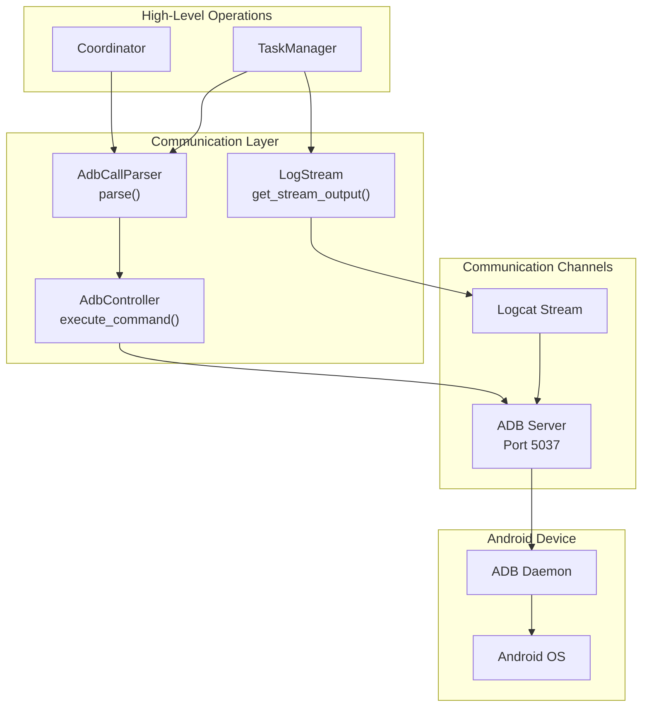
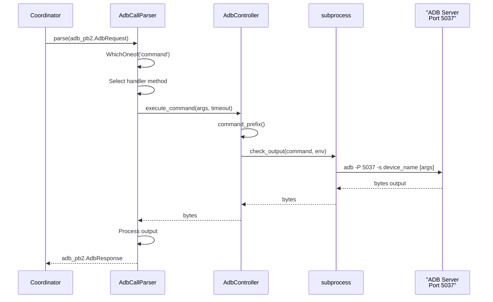
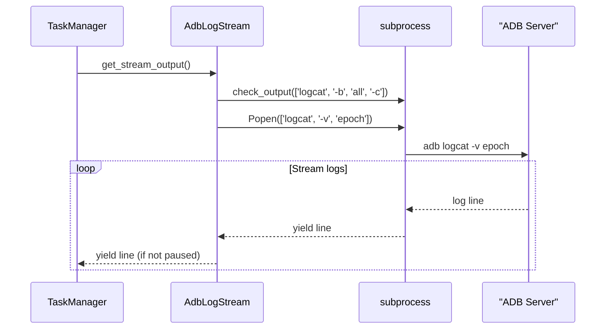
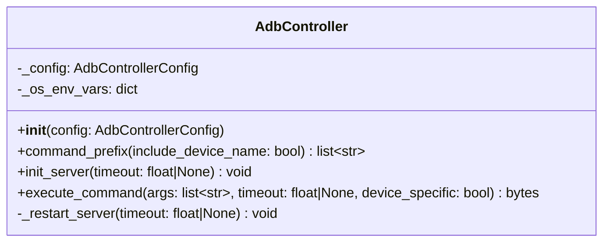
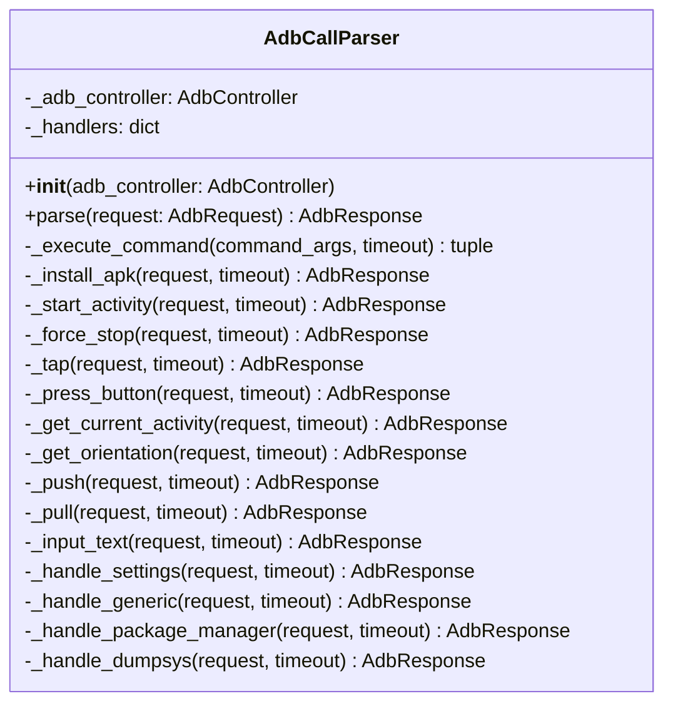
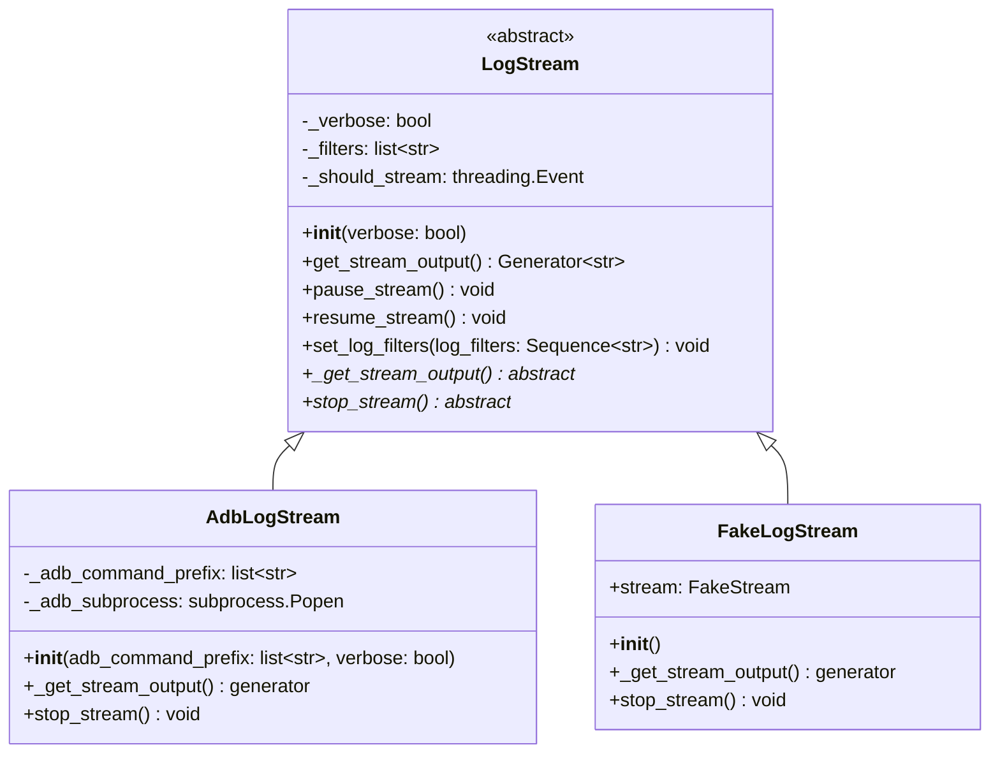

<!-- source: DeepWiki mcp.deepwiki.com · repo google-deepmind/android_env · page 6 Communication Layer · fetched 2026-10-26 -->

# Communication Layer

<details>
<summary>Relevant source files</summary>

The following files were used as context for generating this wiki page:

- [android_env/components/adb_call_parser.py](android_env/components/adb_call_parser.py)
- [android_env/components/adb_call_parser_test.py](android_env/components/adb_call_parser_test.py)
- [android_env/components/adb_controller.py](android_env/components/adb_controller.py)
- [android_env/components/adb_controller_test.py](android_env/components/adb_controller_test.py)
- [android_env/components/adb_log_stream.py](android_env/components/adb_log_stream.py)
- [android_env/components/adb_log_stream_test.py](android_env/components/adb_log_stream_test.py)
- [android_env/components/log_stream.py](android_env/components/log_stream.py)
- [android_env/components/simulators/fake/fake_simulator.py](android_env/components/simulators/fake/fake_simulator.py)
- [android_env/proto/adb.proto](android_env/proto/adb.proto)

</details>


The Communication Layer provides the interface between AndroidEnv's high-level components (Coordinator, TaskManager) and the Android device/emulator. This layer translates semantic operations into ADB commands and streams device logs back to the system.

This page documents the three main components:
- [ADB Controller](#6.1) - Executes ADB commands via subprocess
- [ADB Call Parser](#6.2) - Translates AdbRequest protobufs into ADB commands
- [Log Streams](#6.3) - Streams logcat output for event monitoring

For related information, see:
- [Simulator System](#5) - Uses the Communication Layer for device control
- [Task Management](#4) - Consumes log streams for reward extraction

## Architecture Overview

The Communication Layer consists of three primary components that translate high-level requests into ADB commands and stream device state back to AndroidEnv:

**Communication Stack Diagram**



Sources: 
- [android_env/components/adb_controller.py:27-166]()
- [android_env/components/adb_call_parser.py:40-863]()
- [android_env/components/log_stream.py:24-65]()

## Component Interaction Flow

**Command Execution Sequence**



**Log Streaming Sequence**



Sources:
- [android_env/components/adb_controller.py:105-166]()
- [android_env/components/adb_call_parser.py:93-112]()
- [android_env/components/adb_log_stream.py:34-50]()
- [android_env/components/log_stream.py:32-39]()

## AdbController

The `AdbController` class ([android_env/components/adb_controller.py:27-166]()) executes ADB commands via `subprocess.check_output()` and manages the ADB server connection.

**Class Structure**



### Key Methods

| Method | Purpose | Implementation |
|--------|---------|----------------|
| `__init__()` | Initialize controller, unset problematic env vars | [android_env/components/adb_controller.py:30-51]() |
| `command_prefix()` | Build ADB command prefix with port and device name | [android_env/components/adb_controller.py:53-69]() |
| `init_server()` | Start ADB daemon on configured port | [android_env/components/adb_controller.py:71-83]() |
| `execute_command()` | Execute ADB command with retry logic | [android_env/components/adb_controller.py:105-166]() |
| `_restart_server()` | Kill and restart ADB server | [android_env/components/adb_controller.py:85-103]() |

### Retry Logic

The `execute_command()` method implements automatic retry with server restart:

1. Try command (max 2 retries)
2. On failure for device-specific commands: call `_restart_server()`
3. Retry command
4. If all retries fail: raise `AdbControllerError`

Sources:
- [android_env/components/adb_controller.py:27-166]()
- [android_env/components/adb_controller_test.py:110-165]()

## AdbCallParser

The `AdbCallParser` class ([android_env/components/adb_call_parser.py:40-863]()) translates `adb_pb2.AdbRequest` protobuf messages into ADB shell commands.

**Class Structure and Handler Registry**



### Handler Registry

The constructor ([android_env/components/adb_call_parser.py:43-63]()) builds a mapping of command types to handler methods:

| Command Type | Handler Method | ADB Command Example |
|--------------|----------------|---------------------|
| `install_apk` | `_install_apk()` | `adb install -r -t -g <path>` |
| `start_activity` | `_start_activity()` | `adb shell am start -S -W -n <activity>` |
| `force_stop` | `_force_stop()` | `adb shell am force-stop <package>` |
| `tap` | `_tap()` | `adb shell input tap <x> <y>` |
| `press_button` | `_press_button()` | `adb shell input keyevent <keycode>` |
| `get_current_activity` | `_get_current_activity()` | `adb shell am stack list` |
| `get_orientation` | `_get_orientation()` | `adb shell dumpsys input` |
| `push` | `_push()` | `adb push <local> <remote>` |
| `pull` | `_pull()` | `adb pull <remote> <local>` |
| `input_text` | `_input_text()` | `adb shell input text <text>` |
| `settings` | `_handle_settings()` | `adb shell settings <verb> <namespace> <key>` |
| `generic` | `_handle_generic()` | `adb <args...>` |
| `package_manager` | `_handle_package_manager()` | `adb shell pm <verb> <args>` |
| `dumpsys` | `_handle_dumpsys()` | `adb shell dumpsys <service>` |

### Command Processing Flow

The `parse()` method ([android_env/components/adb_call_parser.py:93-111]()) processes requests:

1. Extract command type using `request.WhichOneof('command')`
2. Validate timeout is non-negative
3. Dispatch to handler via `self._handlers[command_type](request, timeout)`
4. Return `adb_pb2.AdbResponse` with status and output

Sources:
- [android_env/components/adb_call_parser.py:40-863]()
- [android_env/components/adb_call_parser_test.py:30-807]()

## ADB Protocol Buffers

The `adb.proto` file ([android_env/proto/adb.proto:15-433]()) defines the request/response contract for ADB communication.

### AdbRequest Structure

**Primary Message Types**

| Message | Field Number | Description |
|---------|--------------|-------------|
| `InstallApk` | 1 | Install APK from filesystem or blob |
| `StartActivity` | 2 | Launch Android activity with optional extras |
| `ForceStop` | 3 | Stop application by package name |
| `Tap` | 6 | Touch screen at (x, y) coordinates |
| `PressButton` | 7 | Send hardware button press (HOME/BACK/ENTER) |
| `StartScreenPinning` | 10 | Pin activity to screen (kiosk mode) |
| `UninstallPackage` | 16 | Uninstall application |
| `GetCurrentActivity` | 17 | Query foreground activity |
| `Push` | 18 | Upload file to device |
| `Pull` | 19 | Download file from device |
| `InputText` | 20 | Insert text via keyboard |
| `SettingsRequest` | 21 | Modify device settings (system/secure/global) |
| `GenericRequest` | 22 | Execute arbitrary ADB command |
| `PackageManagerRequest` | 23 | Package manager operations (list/clear/grant) |
| `GetOrientationRequest` | 24 | Query device orientation |
| `SendBroadcast` | 25 | Send broadcast intent |
| `DumpsysRequest` | 26 | Execute dumpsys command |

### AdbResponse Status Codes

```proto
enum Status {
  UNDEFINED = 0;           // Unset status
  OK = 1;                  // Success
  UNKNOWN_COMMAND = 2;     // Command type not recognized
  FAILED_PRECONDITION = 3; // Invalid request parameters
  INTERNAL_ERROR = 4;      // Unexpected error during execution
  ADB_ERROR = 5;           // ADB command failed
  TIMEOUT = 6;             // Command exceeded timeout
}
```

### Example Message Definitions

**InstallApk** ([android_env/proto/adb.proto:21-38]()):
```proto
message InstallApk {
  message Filesystem { string path = 1; }
  message Blob { bytes contents = 1; }
  oneof location {
    Filesystem filesystem = 2;
    Blob blob = 6;
  }
}
```

**SettingsRequest** ([android_env/proto/adb.proto:133-188]()):
```proto
message SettingsRequest {
  enum Namespace { UNKNOWN = 0; SYSTEM = 1; SECURE = 2; GLOBAL = 3; }
  message Get { string key = 1; }
  message Put { string key = 1; string value = 2; }
  message Delete { string key = 1; }
  message Reset { string package_name = 1; Mode mode = 2; }
  message List {}
  
  Namespace name_space = 1;
  oneof verb { Get get = 2; Put put = 3; Delete delete_key = 4; Reset reset = 5; List list = 6; }
}
```

Sources:
- [android_env/proto/adb.proto:15-433]()
- [android_env/components/adb_call_parser.py:65-91]()

## Log Streaming

The log streaming system provides real-time access to Android logcat output for monitoring device state and extracting task events.

**Class Hierarchy**



### LogStream Base Class

The abstract `LogStream` class ([android_env/components/log_stream.py:24-65]()) defines the interface for log streaming:

| Method | Purpose |
|--------|---------|
| `get_stream_output()` | Yields log lines, respecting pause state |
| `pause_stream()` | Stop yielding lines (clear `_should_stream` event) |
| `resume_stream()` | Resume yielding lines (set `_should_stream` event) |
| `set_log_filters()` | Configure logcat filters (e.g., `['ActivityTaskManager:I']`) |
| `_get_stream_output()` | Abstract method to obtain log stream |
| `stop_stream()` | Abstract method to terminate log stream |

### AdbLogStream Implementation

The `AdbLogStream` class ([android_env/components/adb_log_stream.py:27-58]()) implements log streaming via ADB logcat:

**Initialization Sequence:**
1. Clear all log buffers: `adb logcat -b all -c`
2. Spawn logcat process: `adb logcat -v epoch <filters>`
3. Set stdout pipe for line-by-line reading

**Stream Management:**
- `_get_stream_output()` ([android_env/components/adb_log_stream.py:34-50]()): Creates subprocess and returns stdout
- `stop_stream()` ([android_env/components/adb_log_stream.py:52-57]()): Kills logcat subprocess

### Filter Format

Filters use Android logcat syntax ([android_env/components/log_stream.py:62-64]()):
```python
filters = ['ActivityTaskManager:I', 'AndroidRuntime:E']
# Becomes: ['ActivityTaskManager:I', 'AndroidRuntime:E', '*:S']
# Where *:S silences all other tags
```

### Usage Pattern

```python
# TaskManager creates log stream from simulator
log_stream = simulator.create_log_stream()
log_stream.set_log_filters(['MyApp:V'])
log_stream.resume_stream()

# Consume stream in monitoring thread
for line in log_stream.get_stream_output():
    # Process log line for rewards/events
    process_log_line(line)
```

Sources:
- [android_env/components/log_stream.py:24-65]()
- [android_env/components/adb_log_stream.py:27-58]()
- [android_env/components/simulators/fake/fake_simulator.py:63-75]()
- [android_env/components/adb_log_stream_test.py:35-53]()

## Communication Patterns

### Command Execution Pattern

The typical flow for executing commands follows this pattern:

1. Create an `AdbRequest` object with the appropriate command field set
2. Send the request to `AdbCallParser.parse()`
3. `AdbCallParser` validates the request and selects the appropriate handler method
4. The handler method executes one or more ADB commands via `AdbController`
5. `AdbController` translates these to command-line arguments for the ADB executable
6. Results are processed and encapsulated in an `AdbResponse` object
7. The `AdbResponse` is returned to the caller

Example implementation pattern from `AdbCallParser`:

```python
def _some_command(self, request: adb_pb2.AdbRequest, timeout: float | None = None) -> adb_pb2.AdbResponse:
    # 1. Extract specific request data
    command_data = request.some_command
    
    # 2. Validate preconditions
    response = adb_pb2.AdbResponse()
    if not command_data.required_field:
        response.status = adb_pb2.AdbResponse.Status.FAILED_PRECONDITION
        response.error_message = 'Required field is missing'
        return response
    
    # 3. Execute ADB command
    response, command_output = self._execute_command(
        ['shell', 'some', 'adb', 'command', command_data.some_param], 
        timeout=timeout)
    
    # 4. Process output if needed
    if response.status == adb_pb2.AdbResponse.Status.OK:
        response.some_command.output = command_output
    
    return response
```

### Error Handling Patterns

The communication system employs several error handling strategies:

1. **Request validation**: Checking preconditions before executing commands
2. **Command retries**: Automatically restarting the ADB server on failure
3. **Status codes**: Returning clear error status in responses
4. **Timeout management**: Setting appropriate timeouts for each operation

The `AdbController` includes a retry mechanism for handling transient failures:

```python
def execute_command(self, args: list[str], timeout: float | None = None, device_specific: bool = True) -> bytes:
    # Try command up to n_retries times
    n_retries = 2
    n_tries = 1
    latest_error = None
    while n_tries <= n_retries:
        try:
            # Execute command...
            return cmd_output
        except (subprocess.CalledProcessError, subprocess.TimeoutExpired) as e:
            # Log error...
            n_tries += 1
            latest_error = e
            if device_specific and n_tries <= n_retries:
                self._restart_server(timeout=timeout)
    
    # If all retries failed, raise exception
    raise errors.AdbControllerError(...)
```

Sources:
- [android_env/components/adb_controller.py:94-151](android_env/components/adb_controller.py:94-151)
- [android_env/components/adb_call_parser.py:65-91](android_env/components/adb_call_parser.py:65-91)

---

